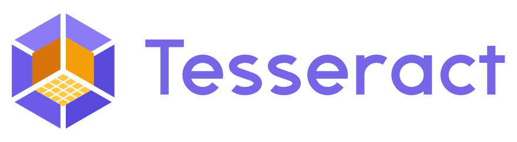
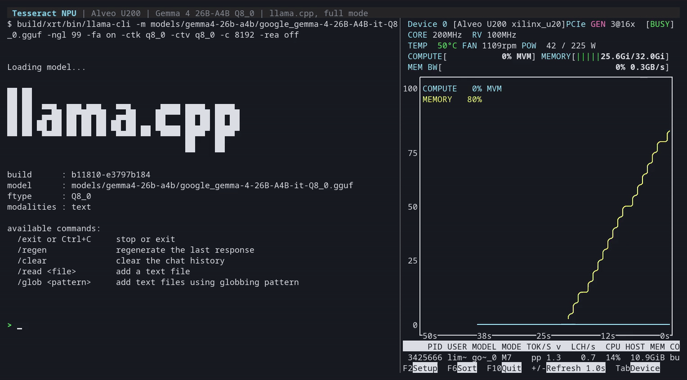
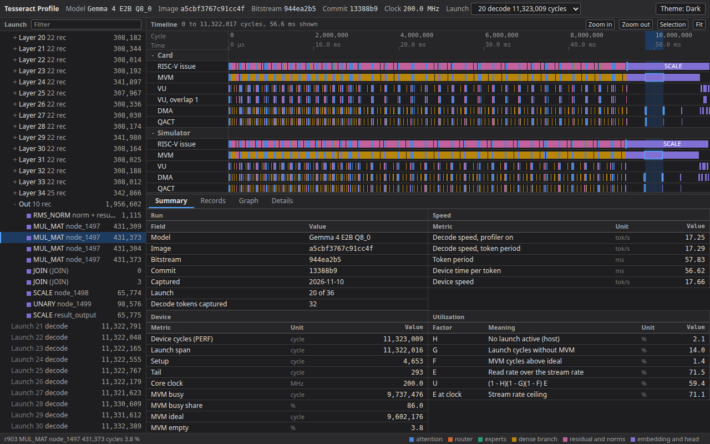
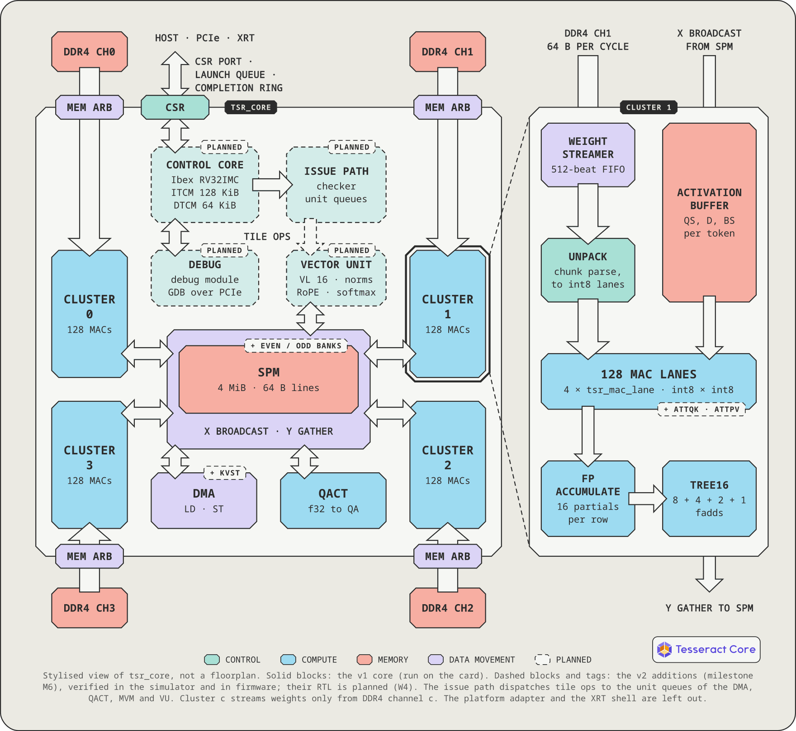
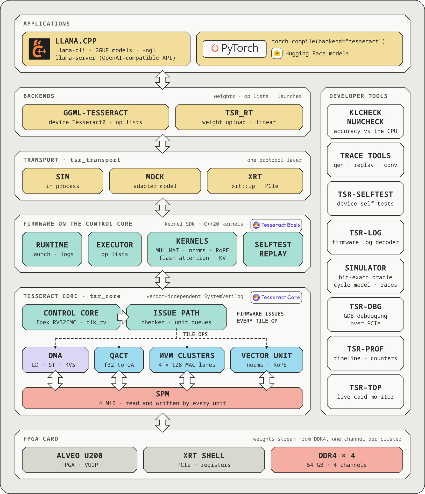
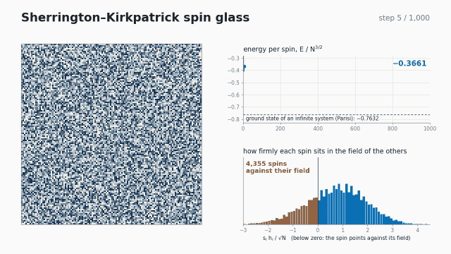

<p align="center">
  
</p>

<p align="center">
  <a href="LICENSE"></a>
  <a href="rtl/CHANGELOG.md"></a>
  <a href="CHANGELOG.md"></a>
  <a href="docs/platform-u200.md"></a>
</p>

# Tesseract

A full-stack, open-source NPU for LLM inference.

-  hardware: NPU core in SystemVerilog with an on-chip RISC-V control core.
-  firmware: C++20 runtime, kernel library and kernel SDK.
- Software: llama.cpp and PyTorch backends, the Tesseract Pivot graph scheduler, bit-exact simulator, verification tools.

Runs GGUF models as shipped through llama.cpp with `-ngl`. Implemented on an AMD Alveo U200 FPGA. The U200 card holds 32 GiB of DDR4, four channels of 8 GiB. The design supports up to 16 GiB per channel.

## Try it without a card

The whole stack runs on the simulator, so trying it needs no FPGA. On Linux (x86-64) with git, CMake, a C++
compiler, Python 3 and curl:

```sh
git clone --recurse-submodules https://github.com/jwkim04/tesseract-npu.git tesseract && cd tesseract
./quickstart.sh          # builds, checks, downloads Qwen2.5 0.5B Q8_0 (0.7 GB), runs it and profiles one token
./quickstart.sh chat     # chat with the model on the simulated NPU
```

The first command builds the firmware and the host stack, boots the firmware on the simulated core, and runs the
model through llama.cpp with every layer on the device. It then writes `build/dev/quickstart/report.html`, the
profile of one decode token: a timeline per unit, the records by layer and the device counters. The simulator
computes the same bits as the hardware, and it is the reference that the RTL, the firmware and the host stack are
checked against. Its cycle counts come from a cycle model of the core. `build/dev/bin/tsr-top` in a second
terminal shows the simulated device while the chat runs.

## Demo

[](docs/demo/demo.mp4)

Gemma 4 26B-A4B Q8_0 in the llama.cpp chat (left) on one Alveo U200 in full mode, with thinking off, and
`tsr-top` watching the card (right). The run uses multi-token prediction: the model's MTP head drafts one
token per step. The command line is at the top of the left pane when the video starts, and its multi-token
prediction flags are explained in [getting-started](docs/getting-started.md). The video starts after the model
has loaded and runs in real time. The shell sets `TSR_DEVICE=xrt`, `TSR_XCLBIN` and `LLAMA_ATTN_ROT_DISABLE=1`.
[MP4](docs/demo/demo.mp4)

[](docs/demo/profile.png)

The profile report of one decode token (Gemma 4 E2B Q8_0): a timeline per unit for the card and the
simulator, the records by layer, and the device counters ([profiling](docs/prof-dbg.md)).

## Latest releases

**Tesseract Basis 1.5.0** (2026-11-17), the firmware SDK and the host side

- Support for the QACT scale pipeline of Tesseract Core 1.2.0, which the core reports as `CAPS` bit `QACT_PIPE`. Every
  kind keeps its numerics revision, so no output changes, and Basis 1.5.0 also runs on Core 1.1.0 and 1.0.0.
- The simulator has the cycle model of the pipeline. `TSR_SIM_CARD=k4qpipe` with `TSR_SIM_GDN=1` configures it like the
  release image, and `TSR_SIM_QACT_PIPE` sets the bit alone.
- Tesseract Pivot reads the bit and charges QACT at the cost of the pipeline when it orders a graph.
- `tsr-selftest` and the llama.cpp device list name the bit, and trace replay ignores it when it matches a trace to a
  device.

**Tesseract Core 1.2.1** (2026-11-18), the RTL and the Alveo U200 image

- A patch release for the wiring of the image. It computes the same results as Core 1.2.0 at the same speed: on the seven
  models of the table below the prefill and decode rates are 0.999 to 1.001 times those on Core 1.2.0, and the chat text
  is identical.
- The kernel has 402,384 LUT, from 406,288, and 510,465 FF, from 518,825.
- The design uses 15,679 SLLs, the connections between the three dies of the FPGA, from 16,482.
- What changed are structures at the crossings between the dies and on nets with a wide fanout. The read response of the
  DMA on two memory channels is one register stage without a skid entry. The command link of the vector unit is a delay
  line without a ready path. The first broadcast stage of the MVM unit has two copies. The trace writer's write mux sits
  behind the DMA's pipeline stages.
- `CAPS` is unchanged, so Basis 1.5.0 runs on the image as it is. The image needs Basis 1.2.0 or later, as Core 1.2.0 does.

All changes are in [CHANGELOG.md](CHANGELOG.md) (Basis) and [rtl/CHANGELOG.md](rtl/CHANGELOG.md) (Core).

## Performance

Decode and prefill rates on one Alveo U200 card, batch 1, in full mode, measured with the Tesseract Core 1.2.0
image. The Core 1.2.1 image runs at 0.999 to 1.001 times these rates. Prefill is 512 tokens at `-ub 512`
and decode is 64 tokens, both from `llama-bench`. The last column is the decode rate per watt of card
board power.

| Model | Quantization | Prefill tok/s | Decode tok/s | tok/s/W |
| --- | --- | ---: | ---: | ---: |
| Qwen3.8 27B | Q8_0 | 5.62 | 2.32 | 0.038 |
| Qwen3.5 9B | Q8_0 | 18.65 | 7.25 | 0.118 |
| Gemma 4 31B | Q4_K_M | 9.50 | 3.44 | 0.055 |
| Gemma 4 26B-A4B | Q8_0 | 40.41 | 14.83 | 0.250 |
| Gemma 4 12B | Q8_0 | 15.75 | 5.32 | 0.085 |
| Gemma 4 E4B | Q8_0 | 40.00 | 12.86 | 0.210 |
| Gemma 4 E2B | Q8_0 | 77.64 | 24.42 | 0.404 |

With multi-token prediction the draft head proposes tokens and the device verifies them in one launch. The output is identical to plain greedy decoding.

| Model | Quantization | Plain tok/s | MTP tok/s | Speedup |
| --- | --- | ---: | ---: | ---: |
| Qwen3.8 27B | Q4_K_M | 3.22 | 4.53 | 1.41x |
| Qwen3.8 2B | Q4_K_M | 31.67 | 34.32 | 1.08x |
| Gemma 4 26B-A4B | Q8_0 | 14.74 | 18.20 | 1.23x |

The MTP conditions and the per-K cycles are in [docs/performance.md](docs/performance.md).

Conditions, device memory, cycles per token and the method are in [docs/performance.md](docs/performance.md).

## Operators and features

The device runs these ggml ops. The op list kinds behind them are in [docs/versioning.md](docs/versioning.md).

- Matrix multiply: `MUL_MAT` with Q8_0 and Q4_K weights and an optional fused add, and `MUL_MAT_ID` for the expert matrices of mixture-of-experts layers. Other weight types are converted to Q8_0 when the model loads.
- Attention: `FLASH_ATTN_EXT` with grouped-query heads, head sizes 64 to 512 and masks, over a Q8_0 KV cache that lives in device memory (`SET_ROWS`).
- Normalization and position: `RMS_NORM` with a fused weight multiply, and `ROPE` in normal, NEOX and interleaved multi-section modes.
- Activations and element-wise ops: `ADD`, `MUL`, `SCALE`, `UNARY` (tanh, GELU, SiLU, sigmoid, exp, softplus), `GLU` (SwiGLU, GeGLU), `GET_ROWS` and `CPY`.
- Routing: softmax, top-k selection and weight normalization of a mixture-of-experts router.
- Recurrent layers: `SSM_CONV` and `GATED_DELTA_NET` for Gated DeltaNet.

Any other op runs on the CPU through the ggml scheduler, and PyTorch runs the ops that match no pattern eagerly. A model that llama.cpp runs therefore
runs here, with the supported part on the device. Qwen2.5, Gemma 4, Qwen3 MoE and Qwen3.5 are examples.
[docs/README.md](docs/README.md) lists the limits.

- One launch per decode token. In full mode the whole token, KV cache and attention included, is one launch of the firmware's `graph` kernel. In matmul mode only the matrix products run on the device ([execution modes](docs/design/README.md)).
- Multi-token prediction. The model's draft head proposes tokens and the device verifies a window of them in one launch, with rollback of the recurrent state. `tsr-mtp` drives and measures it.
- Graph scheduling. Tesseract Pivot orders the nodes of a graph before they are lowered, so that independent matrix products run on the MVM unit while the control core and the element-wise pipeline work on other records ([design](docs/design/07-graph-scheduler.md)).
- Kernel SDK. Basis kernels are freestanding C++20 for the control core and build for the host as well.
- Bit-exact simulator. `sw/sim` is the oracle for the RTL, the firmware and the host stack. The transports are `sim`, `mock` and `xrt` (the card).
- PyTorch backend. `torch.compile(model, backend="tesseract")` runs regions of a model's aten graph on the device, one op list each, in full mode, or only the weight matmuls in matmul mode.
- Tools. `tsr-selftest` checks a device, `klcheck` and `numcheck` compare a whole model and every weight matmul with the CPU, `tsr-prof` and the profile report show where a token spends its cycles, `tsr-top` monitors a running card, and `tsr-dbg` debugs the control core with GDB.

## Architecture

<p align="center"></p>

One MVM cluster per DDR4 channel streams weights into 128 MAC lanes. In decode it reads two weight
streams at once, so the DDR4 channel and not the core clock bounds the weight rate.
A 4 MiB scratchpad holds activations and results. The RISC-V control core runs the firmware and
issues every tile op to the DMA, QACT, MVM and vector units. It has its own clock domain. Every
crossing goes through a synchronizer, a gray-coded counter or FIFO, or a handshake
([control core design, section 11](docs/design/04-control-core.md#11-clock-domains-and-cdc)).

## Software stack

<p align="center"></p>

llama.cpp hands its graph to the ggml-tesseract backend. The backend orders the nodes of the graph
with Tesseract Pivot, the graph scheduler, then lowers it to an op list and launches it through
`tsr_transport`. Pivot lets independent matrix products run on the MVM unit while the control core
and the glue pipeline are busy; it changes no output ([design](docs/design/07-graph-scheduler.md)).
The Basis firmware on the control core walks the op list and issues tile ops. The transport kinds are `sim` (the C simulator, the bit-exact oracle), `mock`
(the adapter's register model around the simulator) and `xrt` (the card).

<p align="center"></p>

Logos in the figures belong to their owners ([sources and licenses](docs/fig/logos/SOURCES.md)).

## Custom kernels

Basis is the kernel SDK. Kernels are freestanding C++20 that run on the control core and build for
the host too.

```cpp
#include "tsr/kernel.hpp"
#include "tsr/rt.hpp"

using namespace tsr;

// y = a + b over n floats. Args: a0 a, a1 b, a2 y (DRAM handles), a3 n (a multiple of 16).
TSR_KERNEL(vadd, 4, 0, 0);
extern "C" int32_t vadd(const tsr_args * args) {
    const uint32_t n = args->a[3], lines = n / 16;            // 16 floats per 64-byte SPM line
    const spm A{0}, B{lines};                                 // two buffers in the scratchpad
    const ticket la = issue(LD(A, from_handle(args->a[0]), lines));            // DMA
    const ticket lb = issue(LD(B, from_handle(args->a[1]), lines));            // DMA
    const ticket ad = issue(VOP({.func = VOP_FUNC_ADD, .d = A.line, .a = A.line,
                                 .b = B.line, .m = n, .rows = 1}), after(la, lb));  // vector unit
    issue(ST(A, from_handle(args->a[2]), lines), after(ad));                    // DMA
    return 0;                                                 // the runtime joins every op
}
```

The [firmware SDK guide](sw/ctrl/README.md) covers the kernel API and the host side that loads an
image and launches a kernel by name.

A kernel can grow far beyond that. [`examples/ising`](examples/ising) is an Ising
machine. It searches for the ground state of a Sherrington-Kirkpatrick spin glass, where every pair
of spins is coupled by +1 or -1 at random, with simulated bifurcation. One step is one dense
matrix-vector product over all the couplings, which the MVM clusters stream from card DDR, plus a
few vector-unit ops. Up to eight replicas run side by side in the same ops. It is a project of
its own that uses the SDK, not part of it; its [README](examples/ising/README.md) shows how to run it.

[](docs/demo/spin-glass.mp4)

A run with 16,384 spins on the simulator. Left: one pixel per spin, as the spins freeze. Top right:
the energy per spin, with the ground-state value of an infinite system (Parisi) as a line. Bottom
right: how firmly each spin sits in the field of all the others.
[MP4](docs/demo/spin-glass.mp4)

## Quick start

`./quickstart.sh` ([Try it without a card](#try-it-without-a-card)) does a shorter form of the steps below (the
compiler alone, the targets it needs) and downloads the model. By hand:

```sh
git clone --recurse-submodules https://github.com/jwkim04/tesseract-npu.git tesseract && cd tesseract
third_party/apply-patches.sh                 # hooks ggml-tesseract into the pinned llama.cpp
sw/ctrl/tools/install-toolchain.sh           # RISC-V toolchain for the firmware, user space, no sudo
cmake -S . -B build/dev -DCMAKE_BUILD_TYPE=Release
cmake --build build/dev -j4
build/dev/bin/tsr-selftest --device sim      # boots the firmware on the simulator and checks it
# put a GGUF in models/ (quickstart.sh downloads qwen2.5-0.5b-instruct-q8_0.gguf), then run it on the simulator:
LLAMA_ATTN_ROT_DISABLE=1 build/dev/bin/llama-completion -m models/qwen2.5-0.5b-instruct-q8_0.gguf \
    -ngl 99 -fa on -ctk q8_0 -ctv q8_0 -no-cnv -p "The capital of France is" -n 16
```

To run a PyTorch model, configure with `-DTSR_WITH_TORCH=ON` and build the extension. The Python
environment (torch, transformers, safetensors) is in [PyTorch backend](docs/torch-backend.md) §2.1.

```sh
cmake -S . -B build/dev -DCMAKE_BUILD_TYPE=Release -DTSR_WITH_TORCH=ON
cmake --build build/dev -j8 --target tesseract_torch_ext
export PYTHONPATH=$PWD/sw/torch:$PWD/build/dev/python
build/tools/torchvenv/bin/python run.py          # run.py is the snippet below
```

```python
import torch, tesseract_torch as tt              # importing registers the backend "tesseract"
from transformers import AutoModelForCausalLM, AutoTokenizer

path = "models/hf/Qwen2.5-0.5B-Instruct"         # safetensors files from the Hugging Face Hub
tok = AutoTokenizer.from_pretrained(path)
model = AutoModelForCausalLM.from_pretrained(path, dtype=torch.float32).eval()

# Full mode: the decoder forward runs on the device as one region, in one launch.
# tt.compile(model, mode="matmul") keeps only the weight matmuls on the device;
# tt.compile(model, attention="cpu") keeps attention in float32.
model = torch.compile(model, backend="tesseract")
ids = tok("The capital of France is", return_tensors="pt").input_ids
with torch.no_grad():
    logits = model(ids, use_cache=False).logits   # on the simulator unless TSR_DEVICE says otherwise
print(tok.decode(logits[0, -1].argmax()))        # " Paris"
```

For the card, configure with `-DTSR_WITH_XRT=ON` and set `TSR_DEVICE=xrt` and
`TSR_XCLBIN=<tsr_u200_k4.xclbin>`. [Getting started](docs/getting-started.md) has the requirements,
the tests, PyTorch and the card.

## Documentation

- [Documentation index](docs/README.md)
- [Getting started](docs/getting-started.md): build, run, verify, repository layout
- [Specification](docs/spec.md) and [design documents](docs/design/README.md)
- [Basis kernel SDK](sw/ctrl/README.md)
- [Versions](docs/versioning.md): Core capability and release, Basis version and ABI, kind revisions
- Changelogs: [Core](rtl/CHANGELOG.md), [Basis](CHANGELOG.md)

## License

Apache-2.0, see [LICENSE](LICENSE). A few files carry other licenses; [NOTICE](NOTICE) and
[REUSE.toml](REUSE.toml) list them.
