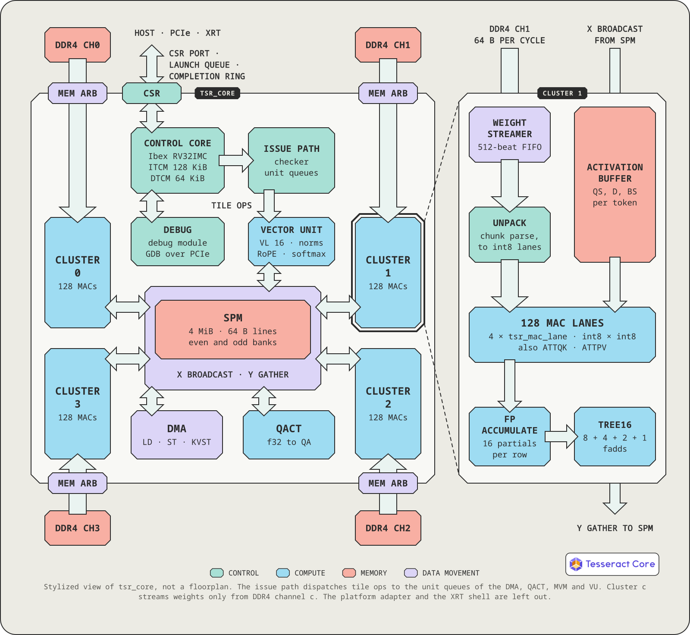

<p align="center">
  
</p>

# Tesseract

**An open-source NPU core for LLM inference.**

Tesseract runs the ggml graphs of [llama.cpp](https://github.com/ggml-org/llama.cpp) as an ordinary
backend (`-ngl`) and loads shipped GGUF files without converting the model. It is built around DRAM
bandwidth, not raw compute: one matrix-vector cluster per memory channel streams the weights at one
64-byte beat per cycle. The simulator, the RTL and the card agree bit for bit. Tesseract is
implemented on an AMD Alveo U200 FPGA today; the core is vendor-independent SystemVerilog.

<p align="center"><picture><source media="(prefers-color-scheme: dark)" srcset="docs/fig/hero-dark.svg"></picture></p>

Dashed blocks are the v2 additions: verified in the simulator and in firmware; RTL planned (W4).

## Highlights

**Hardware**

- **Built around memory bandwidth.** One MVM cluster per DDR4 channel streams weights at one
  64-byte beat per cycle; four channels read 72 GB/s on the card.
- **Q8_0 and Q4_K in hardware.** Every other GGUF weight type is converted to Q8_0 at load. Models
  up to the card's 64 GB.
- **Bit-exact by construction.** The order and rounding of every floating-point operation are
  fixed, so the simulator, the RTL and the card agree bit for bit; Qwen2.5-0.5B logits are
  bit-identical to the simulator on the card.
- **Portable core.** A new target rewrites only the tech wrappers, the platform adapter and the
  transport.
- **An on-chip RISC-V control core (in development).** An Ibex core runs firmware kernels and
  issues every tile op asynchronously to per-unit queues; the host only loads firmware and
  launches kernels.
- **Vector unit and attention on the device (in development).** Norms, RoPE, activations and
  reductions on a vector unit; flash attention over a q8_0 KV cache on the MVM clusters.

**Software**

- **A ggml backend for llama.cpp.** `-ngl` offload of unmodified GGUF models; no model conversion.
- **PyTorch.** `torch.compile(model, backend="tesseract")` runs the weight matmuls on the device
  (verified on the v1 stack; the v2 re-run is pending).
- **A bit-exact simulator** with a RISC-V interpreter, cycle model, race detector and
  record/replay traces. The whole stack runs on it without a card (`TSR_DEVICE=sim`).
- **A firmware SDK.** Kernels in freestanding C++20 with a header library; the host build of the
  same kernels issues the same tile-op stream as the RISC-V build.
- **Deterministic verification.** `klcheck` (model-level KL against the CPU), `numcheck` (every
  weight matmul checked bit for bit), `tsr-selftest`, trace generation and replay.
- **GDB over PCIe (in development).** RISC-V source-level debugging through a debug module, plus
  tile-level stops and a dispatch history.

## Performance

Decode is memory-bound: on the 12B and 32B models the weight stream is busy in 97 to 98 % of the
device's cycles.

| Model | Weights | Decode (tok/s)¹ |
| --- | --- | --- |
| Qwen2.5-0.5B-Instruct | Q8_0 | 54.7 |
| Gemma 4 12B | Q8_0 | 4.50 |
| Gemma 4 12B | Q4_K_M | 6.91 |
| Qwen2.5-32B-Instruct | Q4_K_M | 2.93 |

¹ Decode throughput, batch 1, measured on an Alveo U200 with the v1 core (tag `v1-m4`, 276 MHz
kernel clock; attention and norms on the CPU). The v2 core (control core, vector unit, attention on
the device) runs on the simulator; its card numbers follow the v2 bitstream.

More numbers, conditions and the measurement history: [`docs/performance.md`](docs/performance.md).

## Architecture

<p align="center"><picture><source media="(prefers-color-scheme: dark)" srcset="docs/fig/system-dark.svg"></picture></p>

One **MVM cluster** per DDR4 channel streams that channel's share of every weight matrix at one
64-byte beat per cycle (19.2 GB/s at the 300 MHz design clock) into 128 MAC lanes. Decoding a dense
model reads every weight once per token, so the design aims to keep that stream unbroken rather
than to add MACs. A 4 MiB scratchpad (SPM) holds activations and results. In v2, an embedded
RISC-V control core runs firmware kernels and issues tile ops through a checked issue path to
in-order unit queues; a vector unit handles norms, RoPE, activations and reductions; attention runs
on the MVM clusters over a q8_0 KV cache; and the host only loads the firmware image and launches
kernels (in development). Specification: [`docs/spec.md`](docs/spec.md); v2 design set:
[`docs/v2/README.md`](docs/v2/README.md).

## Software stack

<p align="center"><picture><source media="(prefers-color-scheme: dark)" srcset="docs/fig/stack-dark.svg"></picture></p>

- **Applications.** `llama-cli`, `llama-server` and `llama-completion` offload with `-ngl`; PyTorch
  uses `torch.compile(backend="tesseract")`.
- **ggml-tesseract backend.** Registers the device `Tesseract0`, converts and repacks weights at
  load, builds op lists (cached) and launches them.
- **Transport.** One protocol layer over four device kinds: `sim` (the default, in-process),
  `mock`, `xrt` (the card; the v1 transport ran on the card, the v2 kind awaits the v2 bitstream)
  and `vkernel` (the Verilated kernel, planned).
- **Firmware kernels.** Freestanding C++20 on the control core: weight matmuls, and norms, RoPE,
  activations, KV updates and flash attention verified on the simulator.
- **Simulator.** Bit-exact, with a RISC-V interpreter, a cycle model and a race detector.
- **Checks.** `tsr-selftest`, `klcheck`, `numcheck`, trace generation and replay, `tsr-log`.
- **Debugging and profiling (in development).** GDB over PCIe, tile-level debug, `tsr-prof`.

## Supported models

| Model | Weights | Runs today |
| --- | --- | --- |
| Qwen2.5-0.5B-Instruct | Q8_0 | card (v1); simulator (v2 path) |
| Gemma 4 12B | Q8_0, Q4_K_M | card (v1) |
| Qwen2.5-32B-Instruct | Q4_K_M | card (v1); simulator (v2 path, KL checked) |
| Qwen2.5-0.5B-Instruct (Hugging Face) | float32, through PyTorch | card (v1 stack); simulator (v1 stack, v2 re-run pending) |
| Qwen3-30B-A3B (mixture of experts) | Q4_K | planned (M8) |

The hardware formats are Q8_0 and Q4_K; every other 2D weight type is converted to Q8_0 at load.
Weights live in the card's 64 GB of DRAM. Limits: no model above 64 GB, no training, no multi-card.
Other dense GGUF models are not part of the verified set.

## Quick start

```sh
git clone --recurse-submodules https://github.com/jwkim04/tesseract-npu.git tesseract && cd tesseract
third_party/apply-patches.sh                 # hooks ggml-tesseract into the pinned llama.cpp
sw/ctrl/tools/install-toolchain.sh           # RISC-V toolchain for the firmware, user space, no sudo
cmake -S . -B build/dev -DCMAKE_BUILD_TYPE=Release
cmake --build build/dev -j4
build/dev/bin/tsr-selftest --device sim      # boots the firmware on the simulator and checks it
# put a GGUF in models/, then run it on the simulator:
LLAMA_ATTN_ROT_DISABLE=1 build/dev/bin/llama-completion -m models/qwen2.5-0.5b-instruct-q8_0.gguf \
    -ngl 99 -nkvo -fa on -ctk q8_0 -ctv q8_0 -no-cnv -p "The capital of France is" -n 16
```

Requirements, the test suite, PyTorch, the card and every check:
[`docs/getting-started.md`](docs/getting-started.md).

## Documentation

- [`docs/getting-started.md`](docs/getting-started.md): build, run on the simulator, PyTorch and
  the card, verify, environment variables, repository layout, and the index of every document.
- [`docs/performance.md`](docs/performance.md): every measurement with its provenance, the
  estimates for v2, the measurement history.
- [`docs/spec.md`](docs/spec.md): the master specification: architecture, layouts, numerics, ISA,
  interfaces, verification strategy, milestones, open items.
- [`docs/v2/README.md`](docs/v2/README.md): the core v2 design set (M6 to M9): execution model,
  vector unit, attention and KV cache, control core, debug, software and verification.
- [`sw/ggml-tesseract/README.md`](sw/ggml-tesseract/README.md): the llama.cpp backend.
- [`sw/ctrl/README.md`](sw/ctrl/README.md): the firmware SDK.
- [`sw/sim/README.md`](sw/sim/README.md): the simulator and the references.
- [`sw/transport/README.md`](sw/transport/README.md): the transport.

## Roadmap

**Done (v1, tag `v1-m4`).** M0 DDR bandwidth, M1 ggml backend and simulator, M2 RTL core, M3 MVM
clusters on four channels, M4 Qwen2.5-32B Q4_K_M at 2.93 tok/s. M0, M3 and M4 ran on the Alveo
U200.

**In development (v2).**

- M6: the RISC-V control core, the vector unit, the attention and KV hardware modes and debug over
  PCIe. The firmware, simulator and host stack run on the simulator; RTL and the card follow.
- M7: a kernel library and graph execution: norms, RoPE, activations and flash attention on the
  device, one launch per decoded token for Qwen2.5 and Gemma 4.
- M8: device-side mixture of experts (Qwen3-30B-A3B) and PyTorch on the kernels.
- M9 (optional): a resident decode loop.

**Ideas, not scheduled.** HBM Alveo cards, Zynq or Kria boards, an open-PDK ASIC prototype.

## License

No license has been chosen yet; it is an open item in [`docs/spec.md`](docs/spec.md) §20 (Open
items). Until a `LICENSE` file is added, the repository carries no open-source license.
