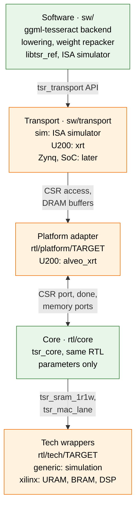
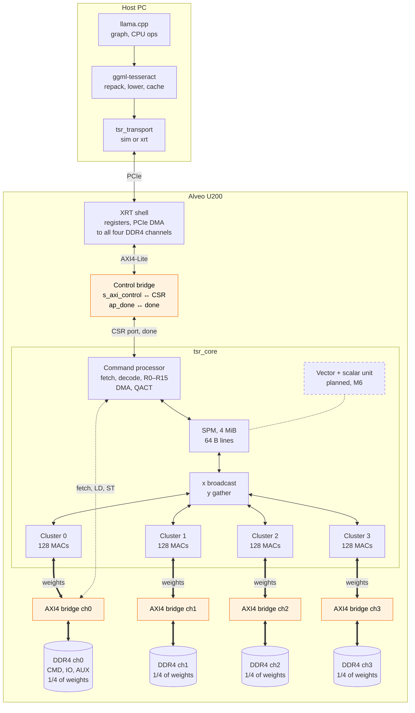
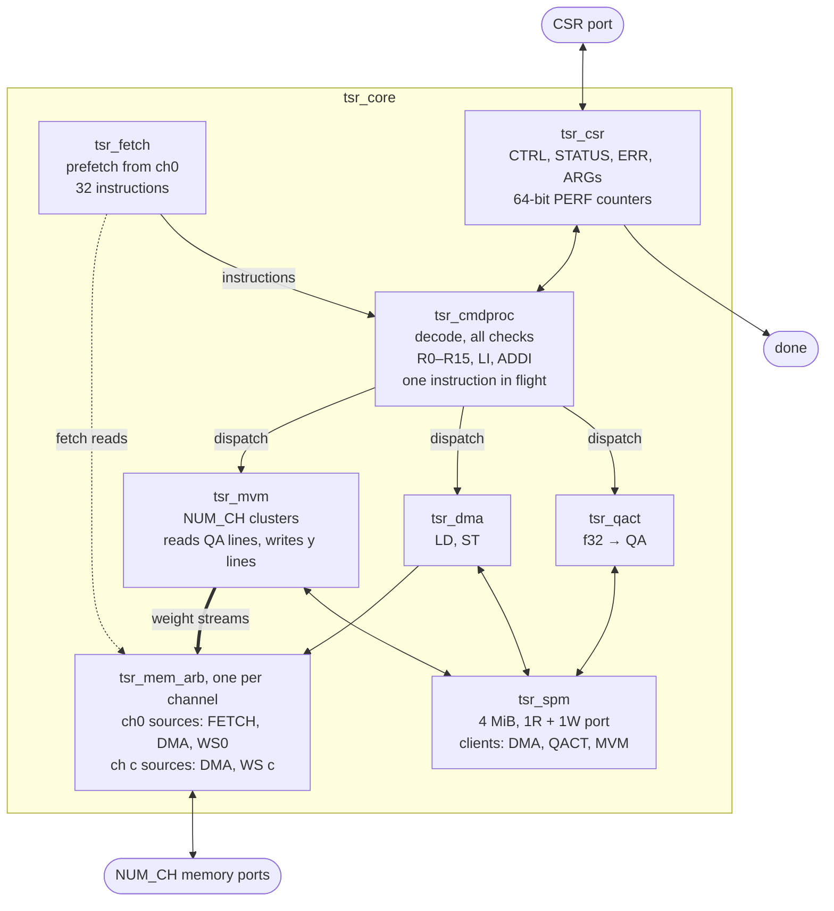
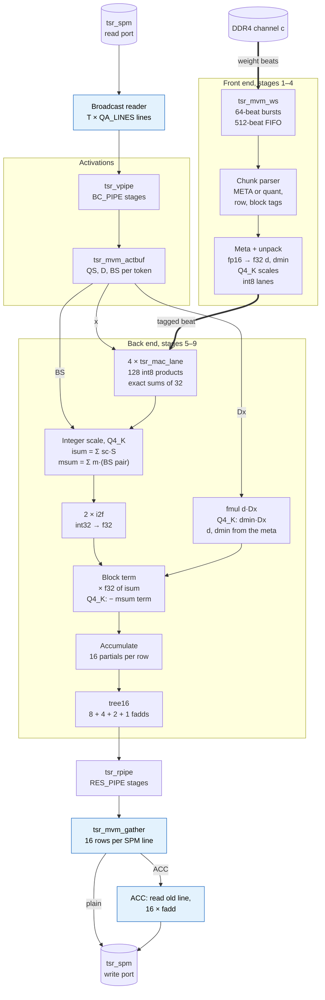
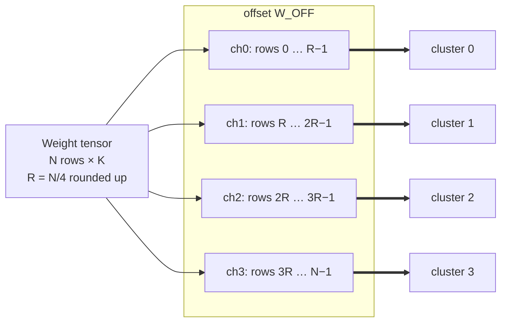
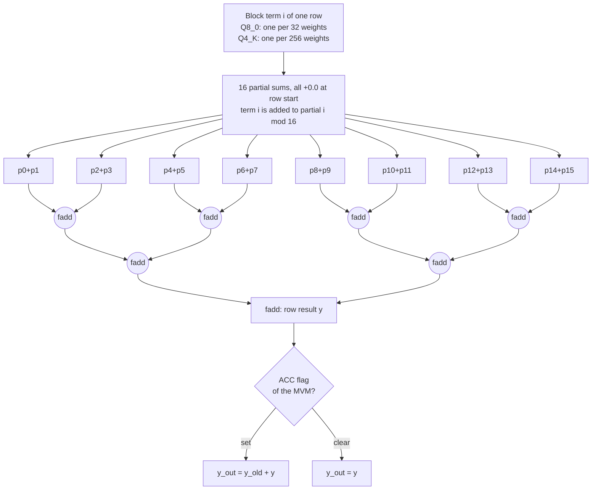
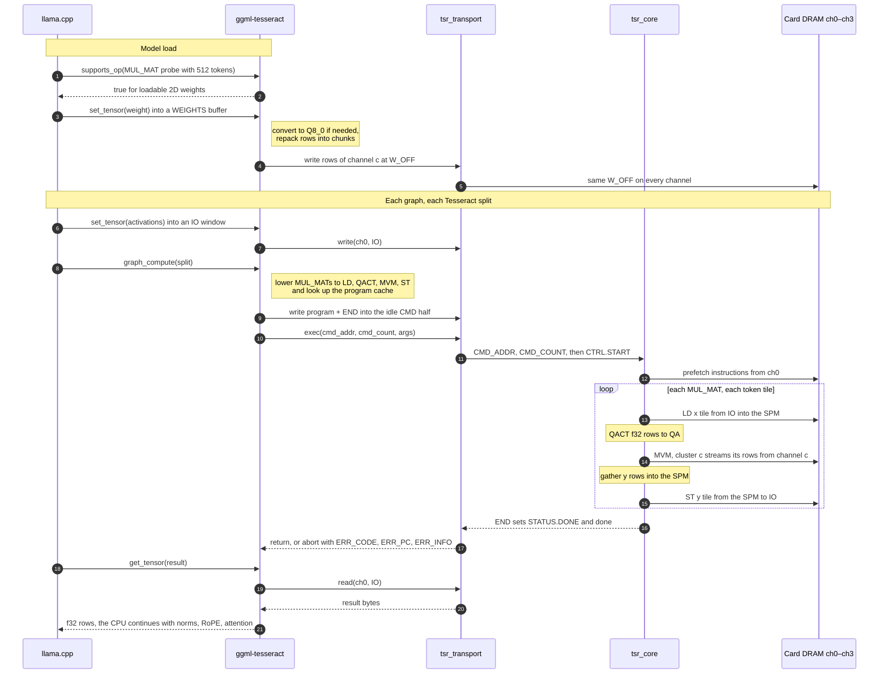
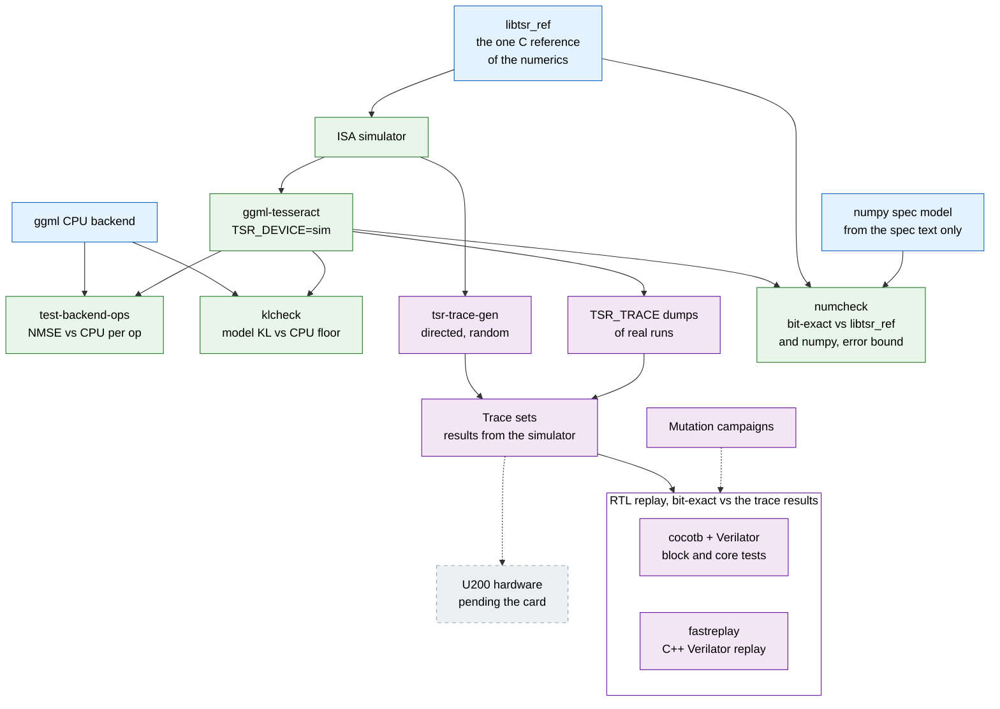

<p align="center">
  <picture>
    <source media="(prefers-color-scheme: dark)" srcset="docs/logo/tesseract-lockup-dark.svg">
    <source media="(prefers-color-scheme: light)" srcset="docs/logo/tesseract-lockup.svg">
    
  </picture>
</p>

# Tesseract

Tesseract is an open-source FPGA overlay core that runs the ggml graphs of
[llama.cpp](https://github.com/ggml-org/llama.cpp) through its own 256-bit instruction set. It
plugs into llama.cpp as an ordinary ggml backend (`ggml-tesseract`, offloaded with `-ngl`). It
loads shipped GGUF files without converting the model file. The simulator, the RTL and the
hardware are meant to agree bit for bit. The first target is the AMD/Xilinx **Alveo U200**. The
core RTL is vendor-independent SystemVerilog, so other boards need new board-specific layers, not
a new design.

> **Status (2026-10-23):** no hardware run yet, because the card is not installed. M1 (ISA
> simulator + ggml backend) and M2 (RTL core without the matrix unit) have passed. In M3, the
> MVM (matrix-vector) unit is integrated and every regression trace replays bit-exactly on the
> RTL. The U200 platform, timing and XRT host transport (M3 part C) are being written now.
> Everything below is verified in simulation unless it says otherwise.

## Contents

- [Overview](#overview)
  - [Goals and non-goals](#goals-and-non-goals)
  - [Design principles](#design-principles)
  - [At a glance](#at-a-glance)
- [Status and milestones](#status-and-milestones)
- [Architecture](#architecture)
  - [Four layers](#four-layers)
  - [System on the Alveo U200](#system-on-the-alveo-u200)
  - [Core boundary](#core-boundary)
  - [Inside tsr_core](#inside-tsr_core)
  - [MVM unit](#mvm-unit)
  - [Memory model](#memory-model)
  - [Data formats](#data-formats)
  - [Numerics](#numerics)
  - [ISA](#isa)
  - [Execution model, CSRs and errors](#execution-model-csrs-and-errors)
- [Software stack](#software-stack)
  - [From a llama.cpp graph to device work](#from-a-llamacpp-graph-to-device-work)
  - [Offload policy (v1)](#offload-policy-v1)
  - [Weight placement and conversion](#weight-placement-and-conversion)
  - [Lowering and program cache](#lowering-and-program-cache)
  - [Transport layer](#transport-layer)
  - [Environment variables](#environment-variables)
- [Verification](#verification)
  - [Oracle chain](#oracle-chain)
  - [Trace sets and RTL replay](#trace-sets-and-rtl-replay)
  - [Op-level and model-level results](#op-level-and-model-level-results)
  - [Simulated performance](#simulated-performance)
- [Getting started](#getting-started)
- [Hardware notes (Alveo U200)](#hardware-notes-alveo-u200)
- [Repository layout](#repository-layout)
- [Roadmap and future ports](#roadmap-and-future-ports)
- [Documentation](#documentation)
- [License](#license)
- [Contributing](#contributing)

## Overview

llama.cpp splits a model's graph across backends. Tesseract registers one device, `Tesseract0`,
as a GPU-type ggml device. When llama.cpp offloads layers to it, the backend does three things:

1. It repacks the weights into a device layout and spreads them over the card's DRAM channels.
2. It lowers each supported graph node into a short program of 32-byte instructions.
3. It runs that program on the device through a transport layer: the XRT driver on the card, or
   an in-process ISA simulator.

On the device, one **MVM cluster** per DDR4 channel streams that channel's share of the weights
at one 64-byte beat per cycle. Decoding a dense model reads every weight once per token, so the
design is built around keeping that weight stream unbroken, not around raw compute.

### Goals and non-goals

**v1 goal:** run a 32B Q4_K_M GGUF on an Alveo U200 with llama.cpp, end to end, without converting
the model file. Correctness comes first. The performance target is at least 1 token/s decode on
32B Q4_K_M using 4 channels.

v1 goals in detail:

- **GGUF as shipped.** Load the GGUF files as they are distributed.
- **Two weight formats in hardware.** Q8_0 (8-bit) and Q4_K (4-bit). Every other weight type is
  converted to Q8_0 at load time. This includes the Q6_K tensors that Q4_K_M files contain.
- **Portable core.** The core RTL is vendor-independent SystemVerilog. Only the tech wrappers and
  the platform adapter are written per target.
- **One contract.** The ISA and the memory layout are the only contract between hardware and
  software.
- **Room to grow.** Integer registers and register + immediate addressing are in the encoding
  from day one. MoE and host-independent decode can therefore be added without changing it.

Not in v1:

- **Formats.** No hardware path for 5- or 6-bit formats (Q5_K, Q6_K) or I-quants; these are
  converted to Q8_0 instead. Q4_0 and MXFP4 are deferred.
- **Model size.** Models larger than 64 GB, such as gpt-oss-120b and GLM-4.5-Air.
- **Scope.** Training, multiple cards and multi-session serving.

Long term (M5–M9):

- **MoE.** Host-assisted first, then with routing done on the device.
- **Host independence.** In the final stage the decode loop runs on the device itself.

### Design principles

- **Bandwidth-bound by design.** A cluster consumes 1 beat per cycle: 300 MHz × 64 B = 19.2 GB/s.
  That is the peak of a DDR4-2400 channel. The goal is an unbroken beat supply, not more MACs.
- **Weight traffic stays local.** Cluster *c* reads weights only from channel *c*, so the weight
  streams never leave their SLR (the super logic regions, or dies, of the FPGA). What crosses SLRs
  is small by comparison: the activation broadcast (a few KB per MVM), the result gather, control,
  and the activation-sized LD/ST traffic between the one central DMA engine and the per-channel
  memory arbiters.
- **Bit-exact determinism.** The order and rounding of every floating-point operation are fixed
  by the spec, so the ISA simulator, the RTL and the hardware must agree bit for bit. There is
  one C reference implementation of the numerics (`sw/sim`), shared by the backend, the simulator
  and the cocotb tests.
- **The simulator is the oracle.** An RTL change is accepted only if the relevant traces replay
  bit-exactly.
- **Strict sequential semantics.** Each instruction sees every effect of the previous one.
  Execution may overlap only when the result is provably the same.
- **Portability through layering.** Vendor primitives appear only under `rtl/tech/`. The core
  exposes only a CSR port, one memory port per channel and `done`, with no vendor AXI inside.
- **The spec is the single source of truth.** Changes to the ISA, the layout or the numerics go
  into the same commit as the matching edit of `docs/spec.md`.
- **Reserved fields must be zero.** Otherwise the instruction stops with `ILLEGAL_OP`.

### At a glance

| | Alveo U200, v1 |
| --- | --- |
| DRAM channels = MVM clusters (`NUM_CH`) | 4 |
| Core clock target (`F_CORE`) | 300 MHz |
| Weight stream per cluster | 1 beat (64 B) per cycle = 19.2 GB/s, 76.8 GB/s for 4 channels |
| MAC lanes per cluster (`LANES`) | 128 int8 × int8 |
| Weight formats in hardware | Q8_0, Q4_K (everything else → Q8_0 at load) |
| On-chip scratchpad (`SPM_BYTES`) | 4 MiB, 64-byte lines |
| Instruction | fixed 256 bits (32 B), 16 int32 registers |
| Largest reduction dimension (`K_MAX`) | 32768 |
| Tokens per MVM (`T_MAX`) | 1 in the v1 parameter table, architectural maximum 8 (a synthesized 8 is being evaluated) |
| DRAM per channel (`CH_BYTES`) | 16 GiB (standard U200: 4 × 16 GB) |

## Status and milestones

Each milestone has a pass criterion that must be met before the next one starts. The exception is
M0: it needs the card, XRT and the platform installed, so it is deferred until then, and M1–M3
proceed without it. M4 is the v1 goal, M5 adds MoE, and M7–M9 are the host-independence stages
A–C.

| Milestone | Work | Pass criterion | Status |
| --- | --- | --- | --- |
| **M0** Shell bring-up | DMA test kernel: per-channel and 4-channel concurrent bandwidth | Measured bandwidth recorded as the baseline for performance prediction | Waiting for the card; the bandwidth kernel and host tool are being written in M3 part C |
| **M1** ISA simulator + backend | `TSR_DEVICE=sim`, MUL_MAT offload only, no hardware | `test-backend-ops`; 32B KL check in the simulator | **Passed** 2026-10-22 (32B klcheck ratio 1.36, top-1 98.83 %) |
| **M2** RTL core skeleton | Command processor (R0–R15, LI, ADDI), DMA, LD/ST, QACT | Verilator trace replay bit-exact | **Passed** 2026-10-23 (`traces/m2`, 172 traces) |
| **M3** MVM clusters, Q8_0 | One cluster per channel, starting with 1 channel, then 4 | Qwen2.5-0.5B Q8_0 running on hardware | **In progress.** RTL parts A and B done (the Q4_K path is designed and verified too); part C (Xilinx wrappers, timing, U200 adapter, XRT transport) being written |
| **M4** Q4_K unpack, 4 channels | v1 goal; other types converted to Q8_0 at load | 32B Q4_K_M on hardware at ≥ 1 tok/s | Planned |
| **M5** MoE, host-assisted | Router converted to Q8_0, back-to-back MVM overlap, symmetric expert placement | Qwen3-30B-A3B on hardware | Planned |
| **M6** Vector unit, more ops | RMSNorm, position-based RoPE, SwiGLU, residual, softmax | No host round trips inside a layer | Planned |
| **M7** Attention and KV on device, T > 1 | Stage A: DQROW, prefill tiling, speculative decoding | One split per token; measured prefill gain | Planned |
| **M8** Register extensions, device MoE | Stage B: RLD, MULI, LOOP, TOPK, programs per KV-length bucket | The host writes only 2 arguments per token | Planned |
| **M9** On-device decode loop | Stage C: WAITM, JUMP, output-token ring buffer, `sw/runner` | The host only polls the ring buffer | Planned |

## Architecture

### Four layers

The system has four layers. A new target rewrites only the bottom two (the tech wrappers and the
platform adapter) plus a transport. The software and the core only change their parameters.

| Layer | Components | Depends on the target |
| --- | --- | --- |
| Software | `ggml-tesseract` backend, weight repacker, graph lowering, ISA simulator, transport layer | Transport only (XRT, Zynq AXI, SoC driver) |
| Core | Command processor with R0–R15, MVM clusters × C, vector unit, f32 scalar unit, SPM, DMA | Parameters only |
| Tech wrappers | `tsr_sram_*`, `tsr_mac_lane`, clock and reset, CDC synchronizers | Written per target |
| Platform adapter | Control-register bridge; memory port → AXI4 or similar | Written per target |



Green boxes are the same on every target. Orange boxes are written per target:

| Target-specific piece | Alveo U200 (v1) | Zynq / Kria (idea) | SoC (idea) |
| --- | --- | --- | --- |
| Transport | `xrt` (M3 part C) | Zynq AXI | SoC driver |
| Platform adapter | `rtl/platform/alveo_xrt`: AXI4-Lite → CSR port, one AXI4 bridge per DDR4 channel (M3 part C) | to be written | to be written |
| Tech wrappers | `rtl/tech/xilinx`: URAM, BRAM, DSP48E2 (M3 part C) | to be written | SRAM macros (for example on an open PDK) |
| Core parameters | `NUM_CH` 4, `BEAT_BITS` 512 | `NUM_CH` 1–2, `BEAT_BITS` about 128 | to be decided |

`rtl/tech/generic` holds behavioural versions of the wrappers for simulation and lint on any
target.

Porting notes from the spec:

- HBM cards (U280, U55C) would use a large `NUM_CH` with `BEAT_BITS` 256.
- Zynq-class parts would use `NUM_CH` 1–2 with `BEAT_BITS` around 128.
- The cluster structure and the ISA stay the same in every case.
- `NUM_CH` is at most 16, because `LD`/`ST` name the channel in a 4-bit field. An HBM part with
  32 pseudo-channels groups them into at most 16 channels.
- The current RTL elaborates only with `BEAT_BITS` = 512 and `LANES` = 128 (one beat is one SPM
  line), so other widths are a porting task for later.

### System on the Alveo U200

<!-- The front matter pins dagre: Mermaid 12 lays flowcharts out with ELK by default, which
     reorders the clusters and DDR4 channels of this diagram. -->


Thick lines are the per-channel memory paths that carry the weight streams. The dotted line is
instruction fetch (always from ch0) and LD/ST (v1 lowering uses ch0). Inside the core, cluster 0's
weight stream and the command processor's fetch, LD and ST share ch0's one memory port through
`tsr_mem_arb` (see [Inside tsr_core](#inside-tsr_core)). Orange boxes are the platform adapter
(`rtl/platform/alveo_xrt`). Host DMA from the XRT shell reaches all four channels and is not
drawn as an edge.

- **Host.** llama.cpp with the `ggml-tesseract` backend lowers graphs to command buffers and
  repacks weights. Over PCIe, the transport moves command buffers, weights and activations into
  card DRAM and starts the core.
- **Platform adapter (Alveo XRT).**
  - The control bridge turns the XRT `ap_ctrl_hs` register and the kernel arguments (`cmd_addr`,
    `cmd_count`) into core CSR writes: `ap_start` drives `CTRL.START`, and `done` drives
    `ap_done`.
  - The other core CSRs are exposed after the arguments, so the host can read the perf counters
    and the error registers.
  - There is one AXI4 memory bridge per channel.
- **Weight traffic.** Cluster *c* receives weights only from channel *c*, at up to 19.2 GB/s per
  channel. The floorplan puts each cluster in the SLR of its own DDR4 controller.
- **What crosses SLRs.** The weight streams never do. The activation broadcast (a few KB per
  MVM) and the result gather pass through pipeline stages whose depth is a parameter
  (`MVM_BC_PIPE`, `MVM_RES_PIPE`, ≥ 2 across SLRs on the U200). Control crosses too, and so does
  LD/ST data: one central DMA engine serves every channel's `tsr_mem_arb`, and each arbiter sits
  next to its own DDR4 controller. That path is latency-insensitive valid/ready, and register
  slices on it are an M4 timing item.
- **Not yet confirmed.** The exact channel-to-SLR mapping will be checked with `platforminfo` at
  bring-up.

The spec's version of this figure, with Korean labels: [`docs/fig/u200-system.jpg`](docs/fig/u200-system.jpg).

### Core boundary

`tsr_core` does not use AXI. It exposes exactly three things on one clock `clk` with a
synchronous, active-low `rst_n`. The CSR port and the memory ports are valid/ready; `done` is a
level.

| Interface | Signals |
| --- | --- |
| CSR port | `csr_valid/ready/we`, a 12-bit byte address `csr_addr`, 32-bit `csr_wdata/rdata`. The adapter maps it to `s_axi_control`. |
| `done` | Level output, equal to `STATUS.DONE`. The adapter maps it to `ap_done` or an interrupt. |
| Memory port × `NUM_CH` | Five valid/ready streams per channel: read request `{addr_beat, len, id}`, read response `{data[511:0], id, last}`, write request `{addr_beat, len, id}`, write data `{data[511:0], last}`, write response `{id}`. |

Memory port rules (asserted by the testbench memory model `tb/common/mem_model.py`):

- **Bursts.** Addresses are in 64-byte beats. A burst is 1–64 beats long and never crosses a
  4 KiB boundary.
- **Outstanding reads.** At most `RD_OUTSTANDING` (16) reads are in flight per channel, summed
  over all sources.
- **Ordering.** Read data is in order within one id. Different ids may interleave at beat
  granularity. The id is `{source, local}`, where the source is FETCH, DMA or WS (weight stream).
- **Writes.** Writes are full-beat only (no byte strobes). The write request and write data
  channels are independent, as in AXI.
- **No deadlock.** Each source reserves response space before it requests.
- **Quiescence.** `DONE` implies that no transaction is in flight.
- **Registered outputs.** Every memory-port output is driven from a flop in `tsr_mem_arb`.

### Inside tsr_core



| Block | What it does | Measured (RTL simulation, U200 v1, ideal memory) |
| --- | --- | --- |
| `tsr_cmdproc` | Decodes, runs every range check before dispatch (`ILLEGAL_OP` → `BAD_FMT` → `K_RANGE` → `T_RANGE` → `SPM_RANGE` → `DRAM_RANGE`), holds R0–R15, dispatches to one unit at a time. Units never report errors. | NOP / LI / ADDI 4.25 cycles each |
| `tsr_fetch` | Prefetches instructions from ch0. Two instructions per beat. An out-of-range beat is never read; it faults only if that pc executes. | – |
| `tsr_dma` | One engine for LD/ST on all channels. LD data arrives in order (one id), so no reorder buffer is needed. | 1.01 cycles/beat, about 38 cycles overhead |
| `tsr_qact` | QACT pipeline: reader → BRAM line buffer → amax tree → 2 × `tsr_fp_div` → 16 × `tsr_fp_mul` quantizer → writer of the QS, D and BS lines | A256: 1.11 cycles per source line. A32: 8.03 (bound by the divider) |
| `tsr_mvm` | Matrix unit, see [MVM unit](#mvm-unit) | 1.000 cycles per weight beat, steady state |
| `tsr_spm` | Line SRAM, banks of 16,384 lines (4 banks on the U200; 128 URAM288 in total), fixed-latency reads, byte-enabled writes, fixed-priority client arbitration | – |
| `tsr_mem_arb` | Per channel: round robin per burst between sources, one shared outstanding counter, responses routed by id, every stream through a register slice | – |
| `tsr_csr` | CSRs and 64-bit PERF counters. Reading the LO half snapshots the HI half. | 4 cycles per CSR access |

**Dispatch protocol.** `tsr_cmdproc` hands one command struct to a unit with `cmd_valid` /
`cmd_ready` and waits for a registered `done` pulse. The unit raises `done` only when all of the
instruction's effects are visible: every SPM write accepted, every DRAM write response received
(ST), and every weight beat received (MVM). Only then is the next instruction offered. This is how
the RTL implements the spec's strict sequential semantics. `ABORT` and `SOFT_RESET` act only
between instructions.

### MVM unit

`MVM` computes `y = W · x` for T tokens. W is an N × K matrix in Q8_0 or Q4_K, and x is a
quantized activation (QA) vector already in the SPM. The N rows are split into contiguous ranges,
one per channel: R = ⌈N / NUM_CH⌉, and channel *c* owns rows [c·R, min((c+1)·R, N)). Each
cluster therefore reads exactly `rows_c × ROW_BEATS` beats, one contiguous range of its own
channel, with no over-fetch.

The MVM unit runs in four steps:

1. `tsr_mvm` sends one setup command to every cluster.
2. It broadcasts the T × `QA_LINES` QA lines from the SPM, one line per cycle, into each cluster's
   activation buffer. Meanwhile each cluster already requests its weights, so the DRAM latency
   hides behind the broadcast.
3. Weight beats enter the back end only once the activation buffer is complete.
4. Row results return through the gather, which assembles 16 results per SPM line and writes
   them with byte enables. With `ACC` it first reads the old line and adds.



The diagram shows one cluster. Blue nodes belong to `tsr_mvm` and are shared by all clusters;
everything else exists once per channel. The two `tsr_spm` nodes are the read and write ports of
the same scratchpad.

| Spec stage | RTL | Details |
| --- | --- | --- |
| 1 Stream requester | `tsr_mvm_ws` | Address-order bursts of up to 64 beats. A burst is issued only when FIFO space is reserved, so the read response is always accepted. The 512-beat FIFO (8 BRAM36) sustains 1 beat/cycle up to about 440 cycles (1.47 µs) of DRAM round trip. |
| 2 Chunk parser | `tsr_mvm_front` | Tags each beat with META/quant, row, block and row end. A META beat costs one stream cycle and produces no output. |
| 3 Meta register | `tsr_mvm_front` | Holds the meta beat. The Q4_K 6-bit scales are unpacked as in ggml `get_scale_min_k4`. |
| 4 Weight unpack | `tsr_mvm_front` | Q4_K: 128 nibbles per beat. Q8_0: 64 bytes per beat (two 32-weight blocks). |
| 5 Activation read | `tsr_mvm_actbuf` | All tokens are read with one address, so each weight beat is shared by T tokens. 24 BRAM36 per cluster at T_MAX 1. |
| 6 MAC lanes | 4 × `tsr_mac_lane` | 128 signed 8-bit products in 4 groups of 32, giving exact 21-bit group sums. Operands may be −128. |
| 7 Integer scale | `tsr_mvm_back` | Q4_K: isum = Σ sc_j·S_j and msum = Σ m_j·(BS pair), both 26 bits, exact. |
| 8 fp term | `tsr_mvm_i2f`, `tsr_fp_mul`, `tsr_fp_add` | Separately rounded operations, no FMA (see [Numerics](#numerics)). |
| 9 Accumulator | `tsr_mvm_back` | 16 partials per (row, token) in two accumulate lanes. A streaming tree16 finishes one row while the next accumulates. A new row can start every 8 cycles. |
| 10 Output | `tsr_rpipe` → `tsr_mvm_gather` | Token *t*, row *n* goes to line `dst + t·stride + n/16`, lane `n mod 16`. Only the owner of row N−1 zeroes the tail of the last line. |

**Throughput.** In RTL simulation with an ideal memory, the steady state is 1.0000 cycles per
weight beat for every tested shape at T = 1 and T = 8 (one T = 8 shape, Q4_K K 1024, measured
0.9994). Rows of at least 9 beats never stall the back end, for any T and any latency setting.
The fixed overhead per MVM is
69 + T·`QA_LINES` cycles (Q8_0) or 72 + T·`QA_LINES` (Q4_K) at T = 1. An MVM is therefore weight
bound: for example, Qwen2.5-32B `ffn_down` (Q4_K, N 5120, K 27648) is 1280 rows × 243 beats =
311,040 cycles per channel, or 1.04 ms at 300 MHz. The broadcast is 0.16 % of that.

**Implementation parameters** (they change timing, never results; the tests vary them):

| Parameter | Default | Range or note |
| --- | --- | --- |
| `SPM_RD_LAT` | 2 | 1–4; U200 timing wants 4 |
| `MVM_WS_FIFO` | 512 | power of 2, ≥ 64 |
| `MVM_BC_PIPE`, `MVM_RES_PIPE` | 1 | ≥ 2 for clusters in another SLR |
| `MVM_ACT_RD_LAT` | 2 | ≥ 1 |
| `MVM_MAC_LAT` | 3 | ≥ 1 |
| `MVM_MUL_LAT` | 4 | ≥ 1 |
| `MVM_ADD_LAT` | 5 | 1–8 (a partial is reused at most every 8 cycles) |
| `MVM_WS_RD_LAT` | 2 | 1–4 |

The planned U200 bitstream configuration (`SPM_RD_LAT` 4, `MVM_BC_PIPE` 2, `MVM_RES_PIPE` 2) is
already replayed bit-exactly in simulation.

### Memory model

The core sees two address spaces: per-channel **DRAM**, addressed as `(channel, beat)`, and the
**SPM**, addressed in 64-byte lines. The host sees only DRAM. Every channel uses the same map; in
v1 the low regions of ch1–ch3 stay empty.

| Region | Range within a channel | Use |
| --- | --- | --- |
| CMD | 0 – 64 MiB (ch0) | Command buffers, double-buffered (two 32 MiB halves); from M9, the resident program |
| IO | 64 – 320 MiB (ch0) | Host ↔ core I/O. v1 uses a 240 MiB compute-buffer window area and a 16 MiB staging area at the top. Later: token ids, positions, masks, KV indices, output-token ring. |
| AUX | 320 – 512 MiB (ch0) | Small raw tensors (norm weights, later RoPE tables) |
| WEIGHT | 512 MiB – end (all channels) | Repacked weights and expert tensors, symmetric allocation |
| KV | to be decided (M7) | Device KV cache |

**Symmetric allocation.** A weight tensor sits at the same offset `W_OFF` in every channel.
Channel *c* stores its rows back to back from there: row *r* starts at
`W_OFF + (r − c·R) × ROW_BEATS(fmt, K)`. One MVM instruction can therefore name a tensor with a
single offset, and each cluster works on its own range independently.

For MoE, expert *e* sits at `W_OFF + e × EXP_STRIDE` with `EXP_STRIDE = R × ROW_BEATS`. One
expert MVM still uses all four channels, and a device-computed expert id needs only one multiply
to become an address.



**Capacity.** 32B Q4_K_M (about 20 GB) needs about 5 GB per channel. A 32B Q8_0 (about 35 GB)
needs about 9 GB per channel.

**SPM rules.**

- Addresses are linear, in 64-byte lines, and every operand starts on a line boundary.
- There are no type tags: the instruction decides how bytes are interpreted.
- Writes are whole lines; the bytes after the last valid element are written as 0.
- Different operands never share a line.

### Data formats

**Device weight chunks.** At upload, weights are rearranged into chunks of one meta beat followed
by quant beats. The bit meaning is ggml's; only byte positions change, so for full chunks the
bandwidth overhead against GGUF is 0 %. A partial last chunk is padded to whole beats (Q8_0,
K = 896: 960 B against 952 B in GGUF).

| Format | Chunk | Meta beat (64 B) | Quant beats | Chunk size | vs GGUF |
| --- | --- | --- | --- | --- | --- |
| Q8_0 | 32 blocks × 32 = 1024 weights | 32 × fp16 `d` | 16 (block *b* in beat ⌊b/2⌋) | 1088 B = 17 beats | 0 % |
| Q4_K | 4 superblocks × 256 = 1024 weights | 4 × 16 B: `d`, `dmin`, `scales[12]` | 8 (superblock *s* in beats 2s, 2s+1) | 576 B = 9 beats | 0 % |

A partial last chunk is shorter. Rows start on beat boundaries:
`ROW_BEATS = full·(1 + ⌈S·QB/64⌉) + [rem > 0]·(1 + ⌈rem·QB/64⌉)`. Here S is the number of blocks
per chunk, QB the quant bytes per block (32 for Q8_0, 128 for Q4_K), nb = K / block size,
full = ⌊nb/S⌋ and rem = nb mod S.

| Example | ROW_BEATS | Bytes |
| --- | --- | --- |
| Q8_0, K = 896 (Qwen2.5-0.5B) | 15 | 960, GGUF 952 (partial chunk) |
| Q8_0, K = 5120 | 85 | 5440, same as GGUF |
| Q4_K, K = 27648 (Qwen2.5-32B `ffn_down`) | 243 | 15552, same as GGUF |

**Load-time conversion.** Any other 2D weight type goes through ggml `to_float` and
`quantize_row_q8_0_ref`. This covers Q6_K, Q5_K, Q5_0, Q4_0, F16, BF16, F32 and the I-quants.

- **Which tensors.** In Q4_K_M files, `attn_v`, half of `ffn_down` and `output` are Q6_K and take
  this path.
- **Cost.** For Qwen2.5-32B this adds about 1.3 GB (about 6 %) of device memory and bytes read
  per token.
- **Accuracy.** Measured against fp64 (numcheck B3), Q6_K→Q8_0 has a *smaller* error than the CPU
  backend: the 32B median ratio is 0.62×. The device quantizes activations with one scale per 32
  values, while the CPU uses Q8_K, with one scale per 256.

**Quantized activations (QA).** The weight format decides the activation format: Q8_0 → A32,
Q4_K → A256.

| Kind | Used with | ggml equivalent | Block | Scale | Block sums | SPM layout per token (line-aligned regions) |
| --- | --- | --- | --- | --- | --- | --- |
| A32 | Q8_0 | `block_q8_0` | 32 | 1 f32 per block | none | `QS` int8 × K, then `D` f32 × K/32 |
| A256 | Q4_K | `block_q8_K` | 256 | 1 f32 per block | int16 per 16 values | `QS` int8 × K, then `D` f32 × K/256, then `BS` int16 × K/16 |

`QA_LINES` is the total number of lines of these regions. T tokens are laid out with that stride. At
K = 32768 an A256 vector is 584 lines (37,376 B) and an A32 vector is 576 lines.

- **A32 rule.** Bit for bit the same as `quantize_row_q8_0_ref`: d = amax/127, id = 1/d,
  q = roundf(x·id) with ties away from zero, and D is d rounded through fp16.
- **A256 rule.** Bit for bit the same as `quantize_row_q8_K_ref`: iscale = −127/max, then
  round-half-even, and `BS` holds the 16-value sums.

### Numerics

Integer math is exact up to the end of each block, and fp32 is used only a few times per block.
The simulator and the RTL must be bit-identical, so the spec fixes the order and rounding of
every floating-point operation.

**The design is not bit-exact with the ggml CPU backend**, which accumulates in a different
order. Agreement with the CPU is checked statistically instead: NMSE per op and KL divergence per
model.

**Block terms.** Each block gives one term, evaluated in exactly this parenthesized order. Every
product and sum is rounded separately (no FMA).

- Q8_0: `t = (d·Dx) · f32(isum)`
- Q4_K: `t = (d·Dx) · f32(isum) − (dmin·Dx) · f32(msum)`, with `isum = Σ sc_j·S_j` and
  `msum = Σ m_j·(BS[2j] + BS[2j+1])`

**Row accumulation.**



The tree is `y = (((p0+p1)+(p2+p3))+((p4+p5)+(p6+p7)))+(((p8+p9)+(p10+p11))+((p12+p13)+(p14+p15)))`.

"16 partials" is an architectural constant. Two terms that land in the same partial are at least
8 cycles apart, so a pipelined fp adder with a latency of up to 8 cycles can accept one term per
cycle. The order is observable: in numcheck, a mutant model that sums sequentially is wrong on
67–87 % of the elements of real tensors. That is why the order is verified bit-exactly.

**Integer widths.** int32 always suffices, so integer order is free:

- Q8_0 isum: 21 bits.
- Q4_K group sums S_j: 17 bits.
- Q4_K isum and msum: 26 bits.

The MVM must accept any SPM bytes as a QA image, which is why msum is 26 bits wide.

**Common fp rules.**

- IEEE binary32 with round-to-nearest-even.
- fp16 → f32 is exact, including subnormals.
- **DAZ and FTZ, keeping the sign.** Subnormal inputs are read as zero. The result is rounded
  with RNE over the full exponent range, then flushed to signed 0 if it is subnormal.
- int → f32 conversion rounds with RNE, because isum can exceed 24 bits.
- A NaN result is always the canonical `0x7FC00000`. Inf propagates per IEEE.
- The C code is built with `-ffp-contract=off -fno-fast-math`.

### ISA

Instructions are a fixed 256 bits (eight 32-bit words w0–w7, little-endian). Every address field
is `R[reg] + immediate` with 32-bit wrap-around. v1 lowering uses R0 (always 0), so addresses
behave as absolute. SPM addresses are in lines, DRAM addresses in beats and lengths in elements.

```
w0:  [7:0] opcode  [11:8] sub  [15:12] flags  [19:16] ra  [23:20] rb  [27:24] rc  [31:28] rd
address fields: A1 = R[ra] + w, A2 = R[rb] + w, A3 = R[rc] + w (each opcode names its word w)
LD, ST:  A1 = SPM line (w1), A2 = DRAM beat (w2); w3 n_lines
QACT:    A1 = QA dst (w1), A2 = f32 src (w2); w3 K, w4 T, w5 src_stride
MVM:     A1 = dst (w1), A2 = x (w2), A3 = W_OFF (w3); w4 N, w5 K[15:0] T[19:16], w6 dst_stride
```

The remaining words are immediates. Reserved fields and unused register fields must be 0, so LD,
ST and QACT need rc = 0. The later instructions (DQROW, RLD, WAITM, JUMP, VOP, RED, ROPE, TOPK,
SOP) name their own address fields; see the ISA table in [`docs/spec.md`](docs/spec.md).

| Opcode | Name | Operation | Milestone | Simulator + RTL today |
| --- | --- | --- | --- | --- |
| 0x00 | `NOP` | nothing | M2 | yes |
| 0x01 | `END` | signal completion, stop | M2 | yes |
| 0x02 | `LI` | R[rd] = imm | M2 | yes |
| 0x03 | `ADDI` | R[rd] = R[ra] + imm | M2 | yes |
| 0x04 | `MULI` | R[rd] = low 32 bits of R[ra] × imm | M8 | – |
| 0x05 | `RLD` | SPM word → R[rd], optionally × imm | M8 | – |
| 0x06 | `LOOP` | repeat the next w1 instructions R[ra] + w2 times | M8 | – |
| 0x07 | `WAITM` | poll a ch0 DRAM word (EQ / NE / GE, mask, timeout) | M9 | – |
| 0x08 | `JUMP` | continue at another ch0 instruction address | M9 | – |
| 0x10 | `LD` | DRAM(ch) → SPM, n lines | M2 | yes |
| 0x11 | `ST` | SPM → DRAM(ch), n lines | M2 | yes |
| 0x12 | `DQROW` | dequantize one row of a weight tensor to f32 (embeddings) | M7 | – |
| 0x18 | `QACT` | T f32 vectors → T QA vectors (sub 0 A32, 1 A256) | M2 | yes |
| 0x20 | `MVM` | W × QA, fmt in sub (0 Q8_0, 1 Q4_K), flags bit0 ACC, w5 = K[15:0] and T[19:16], w6 dst_stride | M3 | yes |
| 0x30 | `VOP` | elementwise: ADD, SUB, MUL, MAX, MULS, ADDS, SILU, SWIGLU, EXP, COPY | M6 | – |
| 0x31 | `RED` | SUM / SUMSQ / MAX → f32 scalar register | M6 | – |
| 0x32 | `ROPE` | NORM / NEOX rotation of one token | M6 | – |
| 0x33 | `TOPK` | k ≤ 16 (index, value) pairs | M8 | – |
| 0x40 | `SOP` | f32 scalar op (MOVI, ADD, MUL, ADDI, MULI, SQRT, RECIP, LDS, STS) | M6 | – |
| 0x7F | `FENCE` | boundary for overlapped execution (a NOP without overlap) | M2 | yes |

An unimplemented opcode, an undefined function or a nonzero reserved field stops with
`ILLEGAL_OP`. MVM format codes 2–15 are reserved; the only candidates are 4-bit formats (Q4_0,
MXFP4). A MoE expert MVM needs no extra opcode: its A3 is `R[x] + W_OFF`, where register x holds
expert × `EXP_STRIDE` (computed on the device by `RLD` with its `MUL EXP_STRIDE` option).

### Execution model, CSRs and errors

The host runs a program like this:

1. It writes a command buffer of 32-byte instructions into the CMD region of ch0. The next
   token's buffer can be prepared in the other half of CMD (double buffering).
2. It writes `CMD_ADDR` and `CMD_COUNT`, then sets `CTRL.START`. At start, R1–R7 = 0 and R8–R15 =
   `ARG0`–`ARG7`.
3. The core prefetches and executes the instructions strictly in order. Instruction *pc* is
   fetched from beat `CMD_ADDR + ⌊pc/2⌋`.
4. `END` sets `STATUS.DONE` and raises `done`, after every memory transaction has completed.
5. On an error the core stops and records `ERR_PC`, `ERR_CODE` and `ERR_INFO`; STATUS becomes
   DONE | ERR. A faulting instruction changes no state. Running all `CMD_COUNT` instructions
   without an `END` is an `ILLEGAL_OP` at pc = `CMD_COUNT`.

| Offset | CSR | Access | Content |
| --- | --- | --- | --- |
| 0x000 | ID | R | `0x54535231` ("TSR1") |
| 0x004 | VERSION | R | ISA major [15:8], minor [7:0] |
| 0x008 | CFG0 | R | NUM_CH [7:0], LANES [19:8], T_MAX [23:20] |
| 0x00C | CFG1 | R | SPM size in lines |
| 0x010 | CFG2 | R | VL [7:0], NSREG [15:8], K_MAX/256 [31:16] |
| 0x014 | CAPS | R | feature bits (VU, RLD/MULI/LOOP, TOPK, WAITM/JUMP), so one software build can drive bitstreams with different features |
| 0x020 | CTRL | W | bit0 START, bit1 SOFT_RESET, bit2 ABORT |
| 0x024 | STATUS | R / W1C | bit0 BUSY, bit1 DONE, bit2 ERR, bit3 WAITING |
| 0x028 / 0x02C | CMD_ADDR_LO / HI | RW | command buffer start (ch0 beat address) |
| 0x030 | CMD_COUNT | RW | number of instructions |
| 0x040 / 0x044 / 0x048 | ERR_PC / ERR_CODE / ERR_INFO | R | position, code and extra information of an error |
| 0x050 | PC | R | current instruction (debug) |
| 0x060 – 0x07C | ARG0 – ARG7 | RW | copied into R8–R15 at START |
| 0x100 + 8i | PERF i (LO, HI at +4) | R | 64-bit counters: cycles, retired instructions, MVM cycles, VU cycles, WAITM wait, per-channel beats read, per-channel DRAM wait |

The software reads its configuration from these CSRs at start-up. Error codes:

| Code | Name | Condition |
| --- | --- | --- |
| 1 | `ILLEGAL_OP` | undefined or unimplemented opcode or function, a nonzero reserved field, or an LD/ST channel ≥ `NUM_CH` |
| 2 | `BAD_FMT` | unsupported weight format |
| 3 | `QA_MISMATCH` | reserved, never raised in v1 |
| 4 | `SPM_RANGE` | SPM access out of range |
| 5 | `DRAM_RANGE` | DRAM address beyond the channel's limit of min(`CH_BYTES`/64, 2^`ADDR_BEAT_W`) beats, including an instruction fetch beyond it |
| 6 | `K_RANGE` | K > K_MAX or not a multiple of the block size |
| 7 | `T_RANGE` | T = 0 or T > T_MAX |
| 8 | `ABORTED` | stopped by `CTRL.ABORT` |
| 9 | `LOOP_NEST` | LOOP nested deeper than `LOOP_DEPTH` (M8) |
| 10 | `WAIT_TIMEOUT` | WAITM condition not met in time (M9) |

## Software stack

### From a llama.cpp graph to device work



### Offload policy (v1)

v1 offloads only `MUL_MAT`; every other op stays on the CPU until the vector unit arrives (M6).
`supports_op` accepts a `MUL_MAT` when all of these hold:

- src1 and dst are F32.
- src0 is 2D (`ne2 = ne3 = 1`) and all three tensors are contiguous.
- src0 has a loadable type.
- The shape fits: K ≤ K_MAX, K a multiple of the format's block size, and one token's x + QA + y
  fits in the SPM.
- src0 is a weight in a Tesseract buffer. Activations, and graph inputs such as the Hadamard
  rotation of a quantized KV cache, stay on the CPU.
- src1 is 64-byte aligned.

`supports_op` has **no token-count limit**. llama.cpp decides weight placement with a fixed
512-token probe, and a token-count limit would leave large-vocabulary output heads on the CPU. The
no-op ops (`NONE`, `VIEW`, `RESHAPE`, `PERMUTE`, `TRANSPOSE`) are reported as supported, as every
GPU backend does.

In practice, with the pinned llama.cpp:

- The output head is offloaded for any `-ngl ≥ 1`. `token_embd` always stays on the CPU.
- Norms and biases (`MUL`, `ADD`), attention and the KV cache run on the CPU.
- **`-nkvo` is required in v1.** Without it, llama.cpp puts the KV cache into a Tesseract buffer
  and the scheduler aborts on `SET_ROWS`.
- Qwen2.5-0.5B gives 290 splits per graph, 145 of them on `Tesseract0`: 6 per layer plus the head.
  `ffn_gate` and `ffn_up` share one split.

### Weight placement and conversion

The buffer type is a virtual address space that is never dereferenced. Each buffer's storage is
decided at its first data access:

| Buffer | Storage |
| --- | --- |
| `WEIGHTS` usage | **PLACED**, per tensor. A 2D weight of a loadable type is converted (unless Q8_0 or Q4_K), repacked row by row with `tsr_repack_row` and written with symmetric allocation into the WEIGHT heap. Other tensors (1D norms, odd shapes) stay raw in AUX. |
| Compute buffers | **LINEAR**: the whole buffer is one window in the ch0 IO region, if a window is free |
| Otherwise, or leaf-only buffers (LoRA adapters, a KV cache without `-nkvo`) | **HOSTED** in host memory |

- **Staged path.** A MUL_MAT runs on its own, staged through the IO stage area in token tiles,
  when its src1 or dst is HOSTED, or when its dst rows are not line-aligned (N·4 not a multiple
  of 64 with T > 1). Only one tile has to fit in IO, whatever the token count.
- **Lazy conversion.** A src0 that is not a placed weight is converted lazily into the heap at
  `graph_compute`. The result is cached and keyed on the buffer's write generation.
- **Readback.** `get_tensor` of a weight un-repacks it. This is exact for Q8_0/Q4_K; converted
  types are re-encoded with a warning, for debugging.

### Lowering and program cache

Each `MUL_MAT` is tiled over tokens. The SPM holds `[x tile | QA tile | y tile]`, with
x = 4K/64 lines per token, QA = `QA_LINES(kind, K)` and y = ⌈4N/64⌉. The tile size is
t = min(T, T_MAX, SPM lines / lines per token). Each tile emits four instructions:

```
LD   ch0  spm_x  <- x_beat + t0*x_lines
QACT kind spm_qa <- spm_x   K tt src_stride=x_lines
MVM  fmt  spm_y  <- spm_qa  W_OFF N K tt dst_stride=y_lines
ST   ch0  y_beat + t0*y_lines <- spm_y
```

- **Segments.** The MUL_MATs of a split form one segment, which runs as one command buffer
  ending in `END`.
- **Program cache.** Programs are cached by (fmt, N, K, T, W_OFF, x and y addresses) of each
  MUL_MAT, with LRU eviction at 64 MiB / 4096 entries. Programs over 4 MiB are not cached.
- **Double buffering.** A program is written into the CMD half that was not used last. A cached
  program that is still resident in its half runs in place without being rewritten.

### Transport layer

`tsr_transport` (`sw/transport/tsr_transport.h`) is the only target-specific part of the
software. Its API:

- `open(kind)`, `close`
- `config`, read from the ID, VERSION, CFG and CAPS CSRs
- `write(ch, off)` and `read(ch, off)` for DRAM
- `exec(cmd_addr, cmd_count, args[8])`, which blocks until DONE or ERR
- `csr_read`

`TSR_DEVICE` selects the implementation:

- **`sim`** (default) runs the ISA simulator in-process. The simulator implements the current
  instruction set bit-exactly, runs MVMs on several threads with identical results, and has an
  informational cycle model.
- **`xrt`** drives the card through XRT. It is part of M3 part C, in progress.

### Environment variables

| Variable | Effect |
| --- | --- |
| `TSR_DEVICE` | Transport: `sim` (default), `xrt` (M3 part C); `none` registers no device |
| `TSR_DEBUG` | `1`: placement, lowering and exec log; `2`: also buffer events and a disassembly of every executed program |
| `TSR_FORCE_HOST=1` | Test knob: every non-WEIGHTS buffer in host memory, so every MUL_MAT takes the staged path |
| `TSR_STAGE_KIB` | Test knob: IO stage size in KiB |
| `TSR_TRACE=dir` | Dump every exec as a trace directory `dir/<6-digit sequence>/` (never overwrites) |
| `TSR_SIM_DRAM_DIR` | Back the simulator's DRAM with sparse temporary files in this directory (needed for 32B models) |
| `TSR_SIM_TMAX` | Simulated T_MAX, 1–8 (default 1) |
| `TSR_SIM_CH_GIB` | Simulated GiB per channel, 1–16 (default 16) |
| `TSR_SIM_THREADS` | Simulator threads, 1–64 (default min(CPUs, 8)) |
| `TSR_SIM_LOG` | Per-instruction log to `stderr` or a file |

A malformed `TSR_SIM_*`, `TSR_TRACE` or `TSR_STAGE_KIB` value makes the device open fail; it is
never silently ignored. `TSR_DEBUG` and `TSR_FORCE_HOST` are read as integers, so a non-numeric
value counts as 0. For llama.cpp's own scheduler log, use `GGML_SCHED_DEBUG=1` or `2` with `-v`.

## Verification

### Oracle chain

The ggml CPU backend validates the ISA simulator, and the simulator validates the RTL (and later
the hardware) bit for bit. The simulator was built before the RTL, and the backend has used it as
a stand-in device from the start.



Blue: references. Green: the software path and its checks, run on the simulator. Purple: traces
and RTL verification. Grey: pending hardware.

| Stage | Oracle | Pass condition | Tool |
| --- | --- | --- | --- |
| Op level (sim) | ggml CPU backend | NMSE within tolerance | `test-backend-ops` |
| Whole model (sim) | CPU backend, and the CPU against itself with a 1-ulp input change (the floor) | mean KL ≤ 3 × floor KL, top-1 agreement ≥ 80 % | `klcheck` |
| Whole-model numerics (sim) | `libtsr_ref`, an independent numpy spec model, fp64 exact values | every output element of every weight MUL_MAT bit-exact with both models, zero violations of a proven fp32 error bound | `numcheck` |
| RTL block | shared C reference functions | bit-exact | cocotb + Verilator |
| RTL core | ISA simulator | trace replay bit-exact | cocotb + Verilator, fastreplay |
| Hardware | ISA simulator | trace replay bit-exact, same token sequence | XRT host runner (pending) |

- **Mutation testing.** Every test must be shown to fail on at least one deliberate mutant.
  - The M3 core campaign: 31 mutants, 28 killed. The 3 survivors were marked equivalent in
    advance.
  - The M2 core mutants were all killed except 2 equivalent ones.
  - In numcheck, a sequential-sum mutant fails B1 and B1b. It passes B2, which is why the
    summation order is checked bit-exactly.
- **Software unit tests.** `ctest` covers the reference library against ggml: exhaustive fp16 ↔
  f32 and int32 → f32, QACT against `quantize_row_q8_{0,K}_ref`, dequantization, dot products and
  layouts. It also covers the simulator, the transport, the backend allocator and lowering, and an
  end-to-end backend test that is bit-exact against `tsr_ref` and within NMSE ≤ 5e-4 of the CPU.

### Trace sets and RTL replay

A trace is a directory with `meta.json` (configuration), `cmd.bin` (instructions),
`init/ch<c>_<offset>.bin` (DRAM before) and `expect/...` (DRAM after). A replay must match STATUS,
the error registers and every expected region bit for bit. The set of written regions must equal
the expected set, and reads must stay inside the initialized regions. Because the backend can
dump the traces of a real llama.cpp run, real model shapes become RTL regression tests.

| Set | Traces | In git | Content |
| --- | --- | --- | --- |
| `traces/m2` | 172 | yes | M2 instructions only, 6 configurations, including error endings |
| `traces/gen` | 32 | yes (also `--target tsr-traces`) | LD, QACT, MVM, ST programs |
| `traces/m3` | 284 | `traces/m3/regen.sh` | MVM edge cases (partial chunks, K_MAX, N = 0, N < C, shared y lines, ACC special values, arbitrary QA images) and 23 MVM error kinds, 7 configurations (U200 v1, T_MAX 8, 1, 3 and 16 channels, two error sets) |
| `traces/model` | 290 | `traces/model/regen.sh` (needs the models) | every split of a 1-token run of Qwen2.5-0.5B Q8_0 and of a Q4_K_M requantization |
| `traces/tmp/tbo`, `tbo_tmax8` | 1402 each | no | `test-backend-ops` dumps |

RTL replay results (`tb/fastreplay`, every trace in all four memory regimes):

| Traces | Runs | Failed | Simulated cycles |
| --- | --- | --- | --- |
| m3 + gen + m2 (488) | 1,952 | 0 | 12.7 M |
| model (290) | 1,160 | 0 | 32.6 M |
| tbo (1402, T_MAX 1) | 5,608 | 0 | 552.6 M |
| tbo_tmax8 (1402, T_MAX 8) | 5,608 | 0 | 216.6 M |

The four memory regimes:

- `rand`: random latency and backpressure.
- `fast`: latency 0–2.
- `slow`: read latency 20–160, write latency 10–120, heavy backpressure.
- `ordered`: no interleaving across ids.

The cocotb core suite runs further configurations in lockstep with the simulator:

- **U200 v1:** 256 traces × 4 regimes (1,708 MVMs), plus 150 random programs.
- **Other configurations:** T_MAX 8, and 1, 3 and 16 channels.
- **Implementation variants:** pipes 0 and 3, weight FIFO 64 and 1024, all MVM latencies 1, a
  slow corner (ACT_RD 4, MAC 8, MUL 8, ADD 8, WS_RD 4, WS FIFO 128, `SPM_RD_LAT` 3), and
  `SPM_RD_LAT` 1 and 4.
- **Directed tests:** ABORT, SOFT_RESET and hardware reset in the middle of MVMs.

`tb/run_all.sh` (lint plus every suite) reports 170 passed, 5 opt-in tests skipped and 0 failed.

### Op-level and model-level results

**test-backend-ops** (sim transport):

- 1403 `MUL_MAT` cases are supported: 28 src0 types, K from 32 to 8192, N from 1 to 17408, up to
  4096 tokens.
- Every case passes except one: `type_a=f32,type_b=f32,m=1,n=1,k=2048`. It has a single output,
  so its NMSE is one squared relative error. With 8-bit weights and activations it exceeds 5e-4 in
  about 15 % of random runs. The exact dot product of the same 8-bit operands fails on the same
  runs, so this is a property of the 8-bit path, not a defect.
- `ctest` therefore leaves out that one shape and checks it bit-exactly against the reference
  model instead.
- The 1419 traces of a `TSR_TRACE` dump of the full run replay bit-exactly.

**numcheck** (one prompt per model, every weight MUL_MAT checked element by element; all PASS):

| Model | B1 mismatches vs `libtsr_ref` | B1b vs numpy model | B2 bound violations | KL ratio vs floor |
| --- | --- | --- | --- | --- |
| Qwen2.5-0.5B Q8_0 | 0 / 14,594,048 | 0 | 0 | 1.38 |
| Qwen2.5-0.5B Q4_K_M (requantized) | 0 / 14,594,048 | 0 | 0 | 1.46 |
| Qwen2.5-32B Q4_K_M | 0 / 76,881,920 | 0 | 0 | 2.12 |

**klcheck** (device in the simulator vs CPU; limit: mean KL ≤ 3 × floor, top-1 ≥ 80 %):

| Model | Positions | Mean KL device / floor | Ratio | Top-1 vs CPU |
| --- | --- | --- | --- | --- |
| Qwen2.5-0.5B Q8_0 | 512 (8 prompts × 64 tokens) | 1.095e-3 / 1.136e-3 | 0.964 | 98.05 % |
| Qwen2.5-32B Q4_K_M | 4 prompts × 64 tokens | – | 1.36 | 98.83 % |

### Simulated performance

These numbers come from RTL simulation, not from hardware. Conditions: U200 v1 parameters, ideal
memory (always ready, latency 0–1, on every channel at once), cycles converted at the 300 MHz
target. The M3 gate shapes (Qwen2.5-0.5B Q8_0, one token, 4 channels):

| MVM | Weight beats per channel | Cycles | Cycles per beat | At 300 MHz |
| --- | --- | --- | --- | --- |
| K 896 × N 896 (q, o) | 3,360 | 3,445 | 1.025 | 11.5 µs |
| K 896 × N 4864 (gate, up) | 18,240 | 18,325 | 1.005 | 61.1 µs |
| K 4864 × N 896 (down) | 18,144 | 18,297 | 1.008 | 61.0 µs |
| K 896 × N 151936 (output head) | 569,760 | 569,845 | 1.0001 | 1.90 ms |

The whole 1-token trace set of Qwen2.5-0.5B Q8_0 (145 traces) takes 2.27 M cycles, including LD
and QACT, under the `fast` memory regime (latency 0–2). That is 7.6 ms at 300 MHz for the
offloaded MUL_MATs alone; the CPU-side ops and the host round trips are not included. Real DRAM
bandwidth will be measured in M0.

## Getting started

Everything below runs without an FPGA: the backend uses the ISA simulator as its device.

### Requirements

- Linux (developed on Ubuntu 24.04), CMake ≥ 3.20 (≥ 3.28 for a clean `ctest`; Ubuntu 24.04
  ships 3.28), a C11/C++17 compiler. With CMake 3.20–3.27, llama.cpp's own model tests
  (`test-llama-context`, `test-llama-context-model`, `test-thread-safety`) do not get
  `TSR_DEVICE=none`, so they offload the KV cache to Tesseract and can abort on `SET_ROWS`.
- Python 3 with numpy (used by `ctest`'s numcheck self test, numcheck and the QACT cocotb tests).
- For the RTL tests: Verilator 5, cocotb and pytest. The dev host runs Verilator 5.046, cocotb
  2.0.1 and pytest 9.0.2.
- Optional: Vivado 2024.2 for out-of-context timing runs, and XRT 2.18.179 for the card.

### Build and test the software

llama.cpp is a git submodule pinned to commit `e3797b18` (see [`docs/llama-pin.md`](docs/llama-pin.md)).
The backend hooks into it through the patches in `third_party/patches/`. The patch script is
idempotent and also takes `--status` and `--reverse`.

```sh
git submodule update --init
third_party/apply-patches.sh          # ggml-tesseract hooks into the pinned llama.cpp
cmake -S . -B build/dev -DCMAKE_BUILD_TYPE=Release
cmake --build build/dev -j4
ctest --test-dir build/dev
# unfiltered: about 1 run in 7 reports 1402/1403 (the f32 m=1,n=1,k=2048 case, see Op-level results)
TSR_DEVICE=sim build/dev/bin/test-backend-ops -o MUL_MAT -b Tesseract0
```

A narrower build and the backend tests:

```sh
cmake --build build/dev -j4 --target test-backend-ops test-ggml-tesseract test-tsr-backend-units llama-completion
build/dev/bin/test-tsr-backend-units                  # allocator + lowering
build/dev/bin/test-ggml-tesseract                     # bit-exact vs tsr_ref + NMSE vs CPU
TSR_SIM_TMAX=8 build/dev/bin/test-ggml-tesseract      # token tiling with T > 1
ctest --test-dir build/dev -R '^ref_' --output-on-failure
```

### Run a model on the simulator

Model files are not part of the repository; put GGUF files in `models/` (ignored by git).
Remember `-nkvo`. `-no-cnv` turns off the chat mode that llama-completion starts by itself for
models with a chat template:

```sh
build/dev/bin/llama-completion -m models/qwen2.5-0.5b-instruct-q8_0.gguf -ngl 99 -nkvo -no-cnv -p "..." -n 16
build/dev/bin/klcheck all -m models/qwen2.5-0.5b-instruct-q8_0.gguf -o build/klcheck-05b -n 64
```

The simulator is slow: on the 16-core dev host, 0.5B decode takes about 84 ms per token. A 32B
model needs file-backed simulator DRAM (`TSR_SIM_DRAM_DIR=<dir>` with about 20 GiB free); see
[`docs/klcheck.md`](docs/klcheck.md) and [`docs/numcheck.md`](docs/numcheck.md).

### RTL lint, tests and trace replay

```sh
rtl/lint.sh                                           # Verilator -Wall, must stay clean
build/dev/bin/tsr-trace-replay -q traces/m2 traces/gen  # replay on the ISA simulator
traces/m3/regen.sh                                    # regenerate traces/m3 (not stored in git)
tb/run_all.sh                                         # lint + every cocotb suite (long: about 1.5 h cold)
tb/run_all.sh -k dma                                  # a subset
tb/fastreplay/run.py traces/m3 traces/gen --regimes all   # fast C++ Verilator replay
```

## Hardware notes (Alveo U200)

- **Card.** The Alveo U200 has a VU9P FPGA with three SLRs, four DDR4 channels (16 GB each on the
  standard card) and PCIe. The standard shell is `xilinx_u200_gen3x16_xdma_base_2`.
- **Used cards with smaller DIMMs.** The stock shell's four DDR4 controllers are fixed to one
  16 GB 2Rx8 RDIMM part and do not read SPD. The project's development card was sold as a 32 GB
  variant; the stock shell was flashed and `xbutil validate` passed, which rules out a DDR4
  calibration failure. What remains to check at M0 is the real per-channel capacity and
  upper-address aliasing, which validate's small-buffer memory test cannot catch. With 8 GB per
  channel, `CH_BYTES` drops to 8 GiB and the largest models are about 32B Q4_K_M and 30B-A3B.
- **Status.** The card is not installed in the dev host, so no Tesseract bitstream has run on
  hardware yet.
- **XRT on new kernels.** XRT 2024.2 (2.18.179) builds its PCIe drivers (`xocl`, `xclmgmt`) with
  DKMS for the Ubuntu 24.04 GA kernel 6.8. They fail to build on the HWE kernels: 413 errors on
  7.0.
  - [`sw/xrt-driver`](sw/xrt-driver/README.md) carries 19 patches (one kernel API change each)
    and a `build.sh` that needs no root.
  - The patched tree builds on 6.8 (object code identical to the unpatched tree), 6.11, 6.14,
    6.17 and 7.0.
  - The drivers have not been loaded on a card yet. Installing them needs sudo; the steps are in
    that README.
- **Bitstream path (M3 part C, in progress).** This covers the Xilinx tech wrappers
  (`rtl/tech/xilinx`), the XRT platform adapter (`rtl/platform/alveo_xrt`), the build scripts in
  `hw/u200`, the `xrt` transport and the M0 bandwidth kernel. Their documents are listed under
  [Documentation](#documentation).
- **Timing so far.** These are out-of-context Vivado 2024.2 runs on `xcu200-fsgd2104-2-e` at
  3.333 ns, without a floorplan.
  - The M2 core (no MVM unit) with the SPM in URAM and `SPM_RD_LAT` 4 meets 300 MHz with
    WNS +0.120 ns.
  - At block level, `tsr_fp_add` (latency 5) has WNS +1.10 ns and `tsr_fp_mul` (latency 4)
    +1.16 ns.
  - Timing of the whole core with four clusters is part C.
- **Resource estimates** (the whole core has not been synthesized yet):
  - 128 DSP48E2 per cluster for the MAC lanes at T = 1, so 512 of the VU9P's 6840 for four
    clusters.
  - 24 BRAM36 for the activation buffer and 8 BRAM36 for the weight FIFO per cluster.
  - 128 URAM288 for the 4 MiB SPM.

## Repository layout

```
tesseract/
├── docs/                    spec (Korean) and English RTL / backend / verification documents
├── sw/
│   ├── sim/                 libtsr_ref (bit-exact numerics), ISA simulator, trace I/O, tests
│   ├── ggml-tesseract/      ggml backend: placement, repacking, lowering, program cache, tests
│   ├── transport/           tsr_transport: sim (in-process); xrt (M3 part C)
│   ├── tools/               tsr-trace-gen, tsr-trace-replay, klcheck, tsr-numcheck + numcheck.py
│   ├── xrt-driver/          patches to build the XRT 2.18.179 PCIe drivers on kernels 6.8–7.0
│   └── runner/              M9 on-device decode runner (planned; not in the repository yet)
├── rtl/
│   ├── core/                22 vendor-independent SystemVerilog files (tsr_core and its units)
│   ├── tech/generic/        behavioural tsr_sram_1r1w and tsr_mac_lane (simulation, lint)
│   ├── tech/xilinx/         URAM / BRAM / DSP48E2 wrappers (M3 part C, in progress)
│   ├── platform/alveo_xrt/  XRT control bridge and AXI4 memory adapter (M3 part C, in progress)
│   └── filelist.f, lint.sh
├── tb/                      cocotb + Verilator tests per block and for the core, fastreplay, run_all.sh
├── traces/                  regression traces (m2 and gen in git; m3 and model regenerated)
├── hw/u200/                 U200 kernel build scripts (M3 part C, in progress)
└── third_party/             llama.cpp submodule (pinned), patches/, apply-patches.sh
```

## Roadmap and future ports

**Planned (from the spec):**

- **M4: dense v1 on hardware.** Q4_K on four channels and 32B Q4_K_M at ≥ 1 tok/s. The Q4_K
  datapath is already in the RTL and verified in simulation.
- **M5 and M8: MoE.** MoE suits a card with modest bandwidth and large capacity.
  - Qwen3-30B-A3B reads about 2 GB per token (file about 18.6 GB), against about 20 GB for a
    dense 32B. On the same card it could be close to 10× faster.
  - `MUL_MAT_ID` starts host-assisted (M5). Routing moves to the device with `TOPK`, `RLD` and
    `LOOP` (M8).
- **M6: vector and scalar unit.**
  - VL = 16 f32 lanes and s0–s15 scalar registers.
  - Elementwise ops, reductions with a fixed 128-partial tree, and position-based RoPE.
  - Bit-exact transcendental approximations, defined once in `sw/sim/tsr_ref_math.c`.
  - Softmax is composed from these ops.
- **M7–M9: host independence.**
  - Stage A: the whole graph on the device, with one split per token.
  - Stage B: position-independent programs. The host writes only the token id and the position.
  - Stage C: a resident decode loop with `WAITM`, `JUMP` and an output-token ring buffer.
- **Prefill.** The spec now aims at a synthesized `T_MAX` of 8, a decision pulled forward from
  M7; its resources, timing and DSP packing are settled in M3 part C. In the simulator, T > 1
  gives the same output bytes as T = 1.
- **Formats.** Q4_0 and MXFP4 (needed for gpt-oss-20b) are the only format candidates.
- **Debugging and profiling (planned).** Design in [`docs/prof-dbg.md`](docs/prof-dbg.md).
  - Software first, after M3 part C: a record per device run (PERF deltas and host times)
    mapped to ggml nodes and layers, post-mortem and hang dumps, and a shadow mode that runs the
    ISA simulator next to the card and keeps the first diverging run as a replayable trace.
  - M4: a debug block at core CSR 0x800–0x9FC with halt, resume, single step, breakpoints and
    register / SPM access. The core halts only between instructions, so a halted core equals
    the simulator after the same number of retired instructions.
  - JTAG: not on the U200. The user kernel sits in the DFX shell's reconfigurable region, and the
    shell's user debug network has no JTAG fallback (XVC over PCIe only), so debugging goes
    through the PCIe CSR window; ILAs exist only in debug builds and are reached by XVC over
    PCIe. Zynq / Kria may add a BSCANE2 bridge; an ASIC or a board without a host bus
    reaches the same registers through a JTAG TAP and DTM.

**Ideas, not scheduled:**

- **HBM Alveo cards (U280, U55C).** More channels and a narrower beat. The ISA stays the same.
- **Zynq / Kria boards.** One or two channels and a narrower memory port. A transport over the
  Zynq AXI interface. The current RTL requires `BEAT_BITS` = 512, so this needs RTL work.
- **An open-PDK ASIC prototype.** It would reuse the core RTL, with SRAM macros as tech wrappers
  and a SoC driver as the transport.

## Documentation

| Document | Content |
| --- | --- |
| [`docs/spec.md`](docs/spec.md) | **The contract**: architecture and ISA spec v0.2 with the v0.2.1 clarifications, in **Korean**. ISA, memory layout, numerics, backend integration, MoE, roadmap, verification strategy, milestones, open items. |
| [`docs/rtl-m2.md`](docs/rtl-m2.md) | RTL contract and results of the M2 core: conventions, dispatch protocol, memory-port rules, SPM, units, verification, timing |
| [`docs/rtl-m3.md`](docs/rtl-m3.md) | MVM unit architecture, interfaces, back-end numerics, throughput, verification and integration results |
| [`docs/llama-pin.md`](docs/llama-pin.md) | llama.cpp pin, the verified backend API, how llama.cpp places weights and splits graphs, `test-backend-ops` results |
| [`docs/numcheck.md`](docs/numcheck.md) | One-prompt numeric verification (B1, B1b, B2, B3) and results |
| [`docs/klcheck.md`](docs/klcheck.md) | Model-level KL check: method and results |
| [`docs/prof-dbg.md`](docs/prof-dbg.md) | Profiler and debugger design (plan, not implemented): debug block registers and halt rules, tools, record formats, metrics, JTAG and ILA per target, verification |
| [`sw/ggml-tesseract/README.md`](sw/ggml-tesseract/README.md) | Backend internals |
| [`sw/xrt-driver/README.md`](sw/xrt-driver/README.md) | XRT 2.18.179 driver patches for kernels 6.8–7.0 |
| `docs/platform-u200.md`, `docs/xrt-host.md`, `docs/m0-bw.md` | U200 platform adapter, XRT host transport, M0 bandwidth kernel (M3 part C, in progress; added with part C) |
| [`docs/fig/`](docs/fig) | System and milestone figures from the spec (Korean labels) |

The source-of-truth order is `docs/spec.md`, then the ISA simulator (`sw/sim`), then the RTL
documents.

## License

No license has been chosen yet; it is an open item in `docs/spec.md`. Until a `LICENSE` file is
added, the repository carries no open-source license.

## Contributing

The project follows the working rules of `docs/spec.md`:

1. **The spec first.** `docs/spec.md` is the single source of truth. A change to the ISA, the
   memory layout or the numerics goes into the same commit as the spec edit. If code and spec
   disagree, fix the spec first.
2. **Bit-exact replay.** The ISA simulator is the oracle. An RTL change merges only when the
   relevant traces replay bit-exactly.
3. **One reference.** Repacking, QA quantization, dot products and approximate functions exist
   once, in `sw/sim`, shared by the backend, the simulator and the cocotb tests.
4. **The pinned llama.cpp.** Use only the pinned commit. Changes to llama.cpp go into
   `third_party/patches/`; record verified API facts in `docs/llama-pin.md`.
5. **Reserved fields are zero.** Simulator and hardware stop with `ILLEGAL_OP` otherwise.
6. **RTL rules.** SystemVerilog, `rtl/lint.sh` clean (targeted waivers only), a cocotb test per
   module, and vendor primitives only under `rtl/tech/`.
7. **Measurement conditions.** Every performance number states how it was measured: model,
   prompt length, generated tokens and build.
