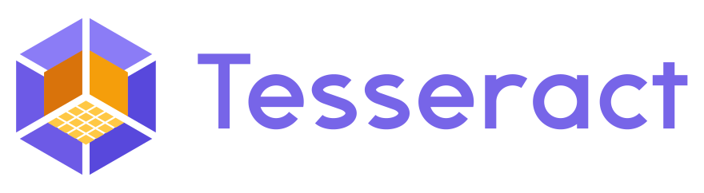
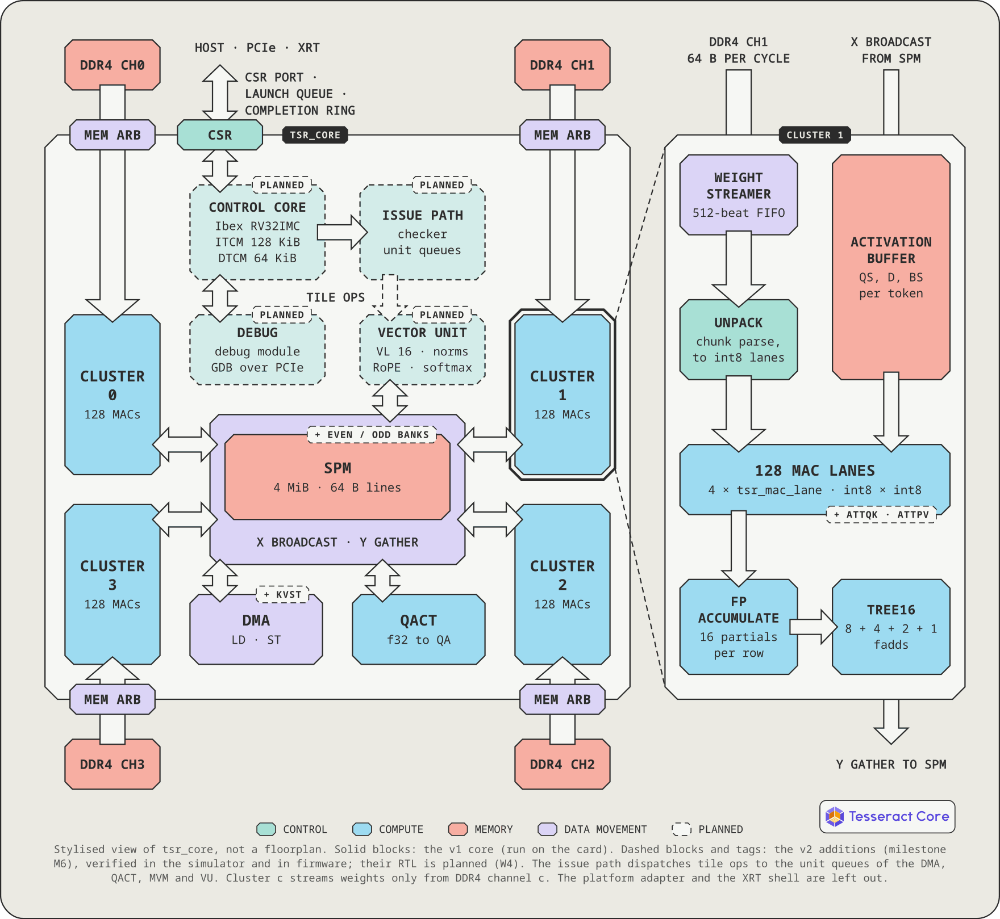

<p align="center">
  
</p>

# Tesseract

**A full-stack, open-source NPU for LLM inference.**

- Hardware: NPU core in SystemVerilog with an on-chip RISC-V control core.
- Firmware: C++20 runtime, kernel library and kernel SDK.
- Software: llama.cpp and PyTorch backends, bit-exact simulator, verification tools.

Runs shipped GGUF models with `-ngl`. Implemented on an AMD Alveo U200 FPGA.

## Performance

| Model | Weights | Decode (tok/s) |
| --- | --- | --- |
| Qwen2.5-0.5B-Instruct | Q8_0 | 54.7 |
| Gemma 4 12B | Q8_0 | 4.50 |
| Gemma 4 12B | Q4_K_M | 6.91 |
| Qwen2.5-32B-Instruct | Q4_K_M | 2.93 |

Batch 1 on an Alveo U200 with the v1 core. The v2 core runs on the simulator. Details:
[docs/performance.md](docs/performance.md).

## Architecture

<p align="center"></p>

One MVM cluster per DDR4 channel streams weights at one 64-byte beat per cycle into 128 MAC lanes.
A 4 MiB scratchpad holds activations and results. Dashed blocks are the v2 additions, which run
on the simulator.

## Software stack

<p align="center"></p>

<p align="center"></p>

Logos belong to their owners ([sources and licences](docs/fig/logos/SOURCES.md)).

## Custom kernels

Basis is the kernel SDK: kernels are freestanding C++20 that run on the RISC-V control core and build for the host too.

```cpp
#include "tsr/kernel.hpp"
#include "tsr/rt.hpp"

using namespace tsr;

// y = a + b over n floats. Args: a0 a, a1 b, a2 y (DRAM handles), a3 n (a multiple of 16).
TSR_KERNEL(vadd, 4, 0, 0);
extern "C" int32_t vadd(const tsr_args * args) {
    const uint32_t n = args->a[3], lines = n / 16;            // 16 floats per 64-byte SPM line
    const spm A{0}, B{lines};                                 // two buffers in the scratchpad
    const ticket la = issue(LD(A, from_handle(args->a[0]), lines));            // DMA
    const ticket lb = issue(LD(B, from_handle(args->a[1]), lines));            // DMA
    const ticket ad = issue(VOP({.func = VOP_FUNC_ADD, .d = A.line, .a = A.line,
                                 .b = B.line, .m = n, .rows = 1}), after(la, lb));  // vector unit
    issue(ST(A, from_handle(args->a[2]), lines), after(ad));                    // DMA
    return 0;                                                 // the runtime joins every op
}
```

The host loads the image and launches the kernel by name:

```cpp
#include "tsr_transport.h"

tsr_image * img;
tsr_image_open("vadd.elf", &img);                    // firmware image with the kernel
tsr_transport * t = tsr_transport_open("sim");       // "xrt" for the card
tsr_transport_boot(t, img);                          // load, verify, start the control core

tsr_transport_write(t, 0, A * 64, a, bytes);         // inputs into device DRAM (channel 0)
tsr_transport_write(t, 0, B * 64, b, bytes);

tsr_launch l = {.type = TSR_DESC_TYPE_LAUNCH, .flags = 0,
                .kernel = (uint16_t) tsr_image_kernel(img, "vadd"),
                .arg = {A, B, Y, n}};                // handles = 64-byte beat indices
tsr_record r;
tsr_transport_call(t, &l, TSR_TIMEOUT_DEFAULT, &r);  // launch and wait for the answer
tsr_transport_read(t, 0, Y * 64, y, bytes);
```

See the [firmware SDK guide](sw/ctrl/README.md).

## Quick start

```sh
git clone --recurse-submodules https://github.com/jwkim04/tesseract-npu.git tesseract && cd tesseract
third_party/apply-patches.sh                 # hooks ggml-tesseract into the pinned llama.cpp
sw/ctrl/tools/install-toolchain.sh           # RISC-V toolchain for the firmware, user space, no sudo
cmake -S . -B build/dev -DCMAKE_BUILD_TYPE=Release
cmake --build build/dev -j4
build/dev/bin/tsr-selftest --device sim      # boots the firmware on the simulator and checks it
# put a GGUF in models/, then run it on the simulator:
LLAMA_ATTN_ROT_DISABLE=1 build/dev/bin/llama-completion -m models/qwen2.5-0.5b-instruct-q8_0.gguf \
    -ngl 99 -nkvo -fa on -ctk q8_0 -ctv q8_0 -no-cnv -p "The capital of France is" -n 16
```

See [Getting started](docs/getting-started.md) for requirements, tests, PyTorch and the card.

## Documentation

- [Getting started](docs/getting-started.md): build, run, verify, repository layout
- [Performance](docs/performance.md): measurements and conditions
- [Specification](docs/spec.md)
- [v2 design documents](docs/v2/README.md)
- [Basis kernel SDK](sw/ctrl/README.md)

## License

Apache-2.0, see [LICENSE](LICENSE). A few files carry other licenses; [NOTICE](NOTICE) and
[REUSE.toml](REUSE.toml) list them.
