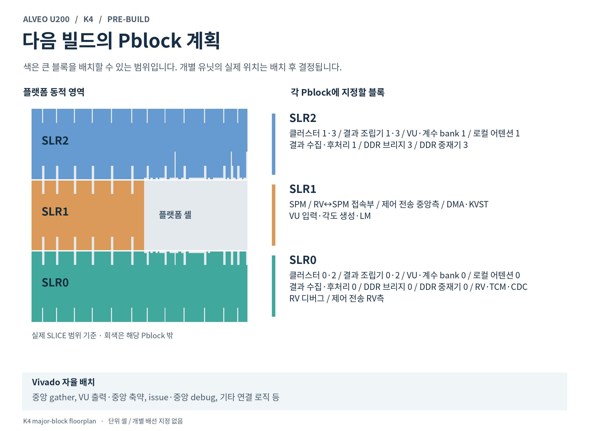
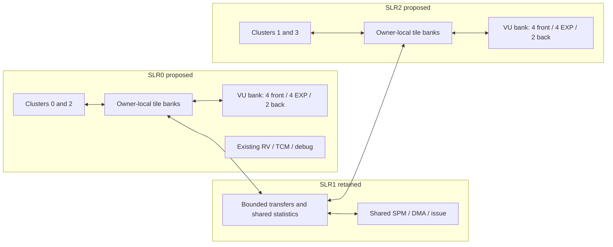

# Local intermediate execution plan

Candidate implementation, November 5, 2026. Section 0 records what is implemented
and verified. Sections 1–8 preserve the broader design plan; requirements not
listed in section 0 remain future work. The normative implemented contracts are
`docs/design/03-attention-kv.md` §5.5a, `02-vector-unit.md` §7.11 and
`06-software-verification.md` §7.2. The implementation preserved the RV-SLR0/VU-SLR2 attempt until the user
requested its replacement on November 6; its source inputs remain unchanged.

The priority is attention score/probability locality, then completed MVM output
tiles with local vector consumers, then transfer only at sharing and storage
boundaries. Define the common ownership, completion and transport rules first.
Do not build local memories before deciding which central paths they replace.

## 0. Implemented candidate and qualification

The candidate is `/home/limagin-dev/tesseract-local-intermediates-20261105`,
branch `codex/local-intermediates`. It starts from the complete dirty source
snapshot of the running checkout, not just its last commit. The implementation was functionally qualified before native launch. On
November 6 at 00:07 KST the user-authorized native attempt
`k4_20261106_000734_t4_local_masked_core250_rv166` started from this checkout.
It includes masked KVST and all local features. See `docs/handoff.md` for live
status and the placement-comparison notifier. No card operation was launched.

| Priority | Implemented behavior | Coverage and remaining path |
|---|---|---|
| 1: attention locality | Three score/P banks per owner; QK writes locally, existing VU lanes run ASMAX beside the banks, PV reads P locally. | Capability-gated FAST records that pass full-record preflight. GENERAL, oversized and selected short prefill records retain legacy. Global max, PV partials, LSUM, merge and normalization remain shared. |
| 2: MVM epilogues | Optional MUL_MAT_SCALE and MUL_MAT_SOFTCAP kinds; ordered bounded queues feed the existing VU before exporting the final MVM result. | No new arithmetic engines. Full-N legacy weight ownership retained. No arbitrary cross-record residency or new N-window dispatch. |
| 3: physical transport | Each pair's registered gather payload is two 281-bit flits rather than one 562-bit packet; compile-time wide alternative is absent in the candidate. Whole source collectors follow their owner SLR. | Both pairs aggregate one line/cycle; one pair peaks at half a line/cycle. QA and generic VU trunks remain for dense and compatibility work. Actual crossed nets/SLL use require native reports. |
| DDR stores | Validated masked-KVST candidate merged with RV-local; write masks reach the XRT AXI bridge. | KVST no longer reads old DDR metadata just to preserve unmodified words. This is not a general masked-store ISA extension for every DMA client. |
| Frameworks | ggml selects guarded local SCALE/softcap; Torch has a narrow FP32 inference SCALE region. Both negotiate the booted image and hardware caps. | Old images, unsupported patterns and dtype/cast boundaries keep the original execution. No new Torch device attention or TANH approximation. |
| MoE preparation | Shared checked owner-window helper carries original N, expert address/stride and token origins. Existing DDR boundary retained. | Executing dense commands use expert zero and identity token order. Expert packing, explicit token IDs, MUL_MAT_ID, token grouping and combine are the next feature, not implemented here. |

The candidate K4 wrapper enables `LOCAL_INTERMEDIATES`, `LOCAL_SCALE` and
`LOCAL_SOFTCAP`, with `MVM_GATHER_FLITS=2`. K1 and module defaults retain the old
configuration. The previous RV-SLR0/VU-SLR2 build had none of these new local features or
masked KVST. It was stopped by the user when the candidate build was launched.
Its reports must not be attributed to this work.

The map is an allowed-region plan, not placed cells. Clusters 0/2, local banks,
VU bank 0 and the complete source collector use SLR0; their 1/3 counterparts
use SLR2. RV remains in SLR0. SPM, DMA and the SPM-facing VU frontend remain in
SLR1. The central collector/receiver and individual stages are free to place.
Only whole functional blocks are constrained. Receiver placement can affect
which bus crosses an SLR, so the RTL width is not a measured SLL saving.

### Functional and performance evidence

Actual RV firmware was booted on the RTL core and its final DDR bytes compared
with the C oracle. The comparison uses T4, four DDR channels and VU 8/8/4.
These are bounded graphs, not whole-model or card measurements.

| RTL graph | Legacy cycles | Candidate cycles | Change |
|---|---:|---:|---:|
| FAST attention, two GQA subsets | 10,337 | 10,542 | +1.98% |
| MVM then SCALE | 6,428 | 5,726 | −10.92% |
| MVM then SCALE/TANH/SCALE | 32,616 | 31,862 | −2.31% |
| Short causal prefill, caps off, gather width only | 30,569 | 30,653 | +0.28% |

FAST and softcap also pass QABORT during actual local lane execution, wait for
ABORTED/QIDLE, empty memory transactions and released lane ownership, then
re-execute to matching DDR. Wrapped group origins, G16/four subsets, GENERAL
fallback and observed intermediate TANH are covered. Endpoint tests include
all owner rotations, nonsaturated/saturated TANH, signed zero, masks, full
queues, delayed consumers and partial-packet reset.

The complete software build passes. Non-slow CTest: 288 passed, 8 skipped,
1 disabled, no failures. Existing M6 instruction digests and 60 trace replays
remain exact. Old production firmware with 14 kinds works with the new ggml
and Torch host; feature-off and actual torch.compile fallback cases pass.
New kinds start at revision 1; all old kind fingerprints remain unchanged.
SCALE fingerprint is `5d333b36789f5115`; softcap is `9d454e96f9729b03`.

Thirty attention launches match all 558 DDR regions in the software A/B.
Modeled cycles change by +0.657% in aggregate, worst +6.641% after conservative
short-prefill selection. This model retains old unit latency assumptions; it
does not model local VU reservation, softcap phases or gather flit backpressure.
It cannot establish the end-to-end performance budget. The user-approved
single-digit loss remains a qualification target, not a general guarantee.

Legacy RTL regression covers T4 attention/MVM, three-channel attention and
VU 8/8/4 at pipe depths 0/2/3 (39 VU cases). Combined masked-KVST, response
sharing, memory arbitration, AXI masks and gather regression: 18 pytest cases
passed. Standalone VU checker: 2 passed. Generic and Xilinx packaged K4
Verilator lint and generated-file checks pass. Astra's independent functional
review found no remaining concrete blocker in the reviewed scope.

Receipts are under `build/analysis/local_intermediates/`: `software_verification.json`,
`attention_software_final_ab.json`, `rtl_att_graph_abort.log`,
`rtl_dense_graph.log`, `rtl_softcap_graph_abort.log`,
`rtl_prefill_narrow_only.log`, `rtl_masked_gather_regression.log`,
`rtl_legacy_vu_regression.log`, `rtl_vu_checker_regression.log` and `review.md`.
The earlier failed/stopped exploratory logs are retained; these final receipts
supersede them. The full RTL/technology commit gate has not been run here;
no commit or push was performed.

### Whole-model decode checks, November 6

Real GGUF models ran through llama.cpp M7 and candidate firmware
`f7bb1fc039d7ee0c` on the C simulator with T4 and all local capabilities enabled.
Qwen2.5-0.5B Q8_0 and Q4_K_M requant each ran four prompts with 32 generated
tokens. Their KL/three-seed-floor ratios were 1.105141 and 1.376901; CPU top-1
matched 124/128 positions for each. Gemma 4 12B Q4_K_M ran one prompt with eight
generated tokens and prompt-tail 2: nine logit rows, KL/floor 0.355755, CPU top-1
9/9. All passed the existing numerical criterion and token/embedding identity
check. Local-capability-off matched-token replays were bit-identical at every
row (128, 128 and 9). Both sides keep candidate gather and masked KVST.

Queue samples confirmed local QK/PV execution. Gemma completed nine local MVM
softcap instructions from eight graph records; prefill output tiling explains
the extra raw instruction. Not all attention records use local storage. No
erroneous completions, TOPK or DQROW instructions were observed. Each model
used one device launch per graph call, including one per single-token decode.
Host graph preparation, final logits and next-token selection remain; this is
not autonomous multi-token generation.

The primary Qwen runs used the default simulator RV/core ratio. Additional
eight-position queue samples and the Gemma run used 166.666667/250. These are
functional model checks, not native lane-count or cycle qualification. Short
samples do not establish long-context, SWA-wrap, language quality or MoE support.
Astra's independent numerical review passed the sampled scope. The consolidated
report and raw receipts are under
`build/analysis/model_decode_local_20261106/`. The native build continued without
changes to its frozen inputs.

### Remaining qualification

Local RAM/control consumes area. The nominal score/P allocation is 3.28125 MiB
in addition to the retained 4 MiB central SPM. A simple 512-bit mapping suggests
192 URAM, but actual synthesis inference, cascade timing and net logic cost
have not been measured. The current one-cycle RAM service must be checked in
native timing; a latency change requires matching control and new tests.

Normal implementation reports must establish outer/central resource use,
congestion, actual crossings, legal route and >=250 MHz timing. No claim of
full-K4 routability or whole-model throughput follows from functional tests.
Future numeric relaxation also needs an explicit reference/version and model
accuracy check. This candidate did not change arithmetic order or output bits.

## 1. Scope and comparison configuration

Keep four clusters, four 512-bit weight channels, T_MAX=4, and aggregate VU
8 front / 8 EXP / 4 back lanes. MVM and VU retain separate arithmetic engines.
Keep FP32 intermediates and the existing accumulation and rounding order.
Locality does not require lower precision or a model-specific approximation.
The C simulator remains the oracle. Any later numerical change needs its own
contract and versioning decision.

The proposal has two outer memory/compute groups, with four logical owners:

This moves one existing VU bank from the active build's SLR2 to SLR0. It adds
local readers, writers, scheduling and bounded storage; their area is not free.
Keep the central 4 MiB SPM initially. Do not replicate the full SPM, alter its
fixed read latency, or expose arbitrary remote SPM loads through local banks.
The diagram shows intended functional groups, not an approved placement map.

The current dense MVM already accumulates each full-K dot product locally and
partitions output rows across DDR owners. The missing part is keeping completed
values near their next consumer. See `docs/platform-u200.md` §8.6.20–§8.6.21.

Before the next verification/build, integrate the separately validated masked
KVST candidate as required in [handoff.md](handoff.md). Record its inclusion in
the manifest. Compare locality variants with the same KVST setting; otherwise
resource and traffic changes cannot be attributed to locality. This plan does
not launch a build. Later physical qualification uses major-block Pblocks,
shown before launch, normal implementation reports and core timing >=250 MHz.

## 2. Common contract before the first implementation

Use a bounded internal tile descriptor. Keep published DDR handles unchanged.
Define fields and state transitions in EX/AT/CC before allocating encodings.

| Contract | Required meaning |
|---|---|
| Identity | Launch/operation epoch, tile/chunk, head subset, logical owner, original global coordinates, layout and valid extent. Physical pairs do not redefine channel order. |
| Allocation | Bank/slot, allocated bytes, valid byte mask, port budget, output credits and optional DDR destination. A local slot is neither a DDR handle nor a global SPM alias. |
| Lifetime | Reserved → producing → ready → consuming/exporting → released. Account for every reader and transfer. Increment the generation before slot reuse. |
| Visibility | Ready follows the last committed local write. Operation completion follows every required output write and DDR response. Tile completion and whole-operation completion are different. |
| Progress | Reserve output and response space before accepting work. Provide independently drainable consumer/export queues; a blocked QK must not sit ahead of the PV needed to free its slot. |
| Failure | Abort closes the generation to new work and rejects stale local results. Keep drain bookkeeping, credits and owned storage for accepted bus transactions until their responses complete. There is no rollback or automatic replay of the graph or its KV updates. |

Preflight the whole selected record or fused region before issuing writes.
Reserve its **maximum simultaneous live set**, not the sum of every chunk.
Check each query tile, including GENERAL masks and FA_NEW. Current firmware
preplans only the first tile, so it does not provide a safe whole-record retry
point. Valid records outside the local coverage use the existing path selected
before issue. Malformed records retain the existing error behavior.

Soft abort cannot cancel an accepted DDR write or make its response disappear.
Advance local epochs without reusing storage still owned by an old transaction.
A hardware reset must follow the existing platform reset/drain contract; it
must not be treated as transactional rollback. Preserve one terminal completion
with the existing error meaning after the required drain.

Make a path inventory before RTL: producer, consumer, payload/control width,
burst and sustained rate, buffering, maximum in-flight work, physical boundary,
remaining clients, and replacement. Model finite queues and RAM ports at the
core clock. Do not assume a 500 MHz TDM clock or infinite buffering.

## 3. Priority 1: local attention scores and probabilities

### Data flow

Today, ATTQK scores travel through paired gather into central SPM. VU reads
scores and writes P there. MVM reads P centrally and sends it to the owning
cluster. Keep these intermediates in the owner-local bank instead:

1. ATTQK writes score lines to its owner's reserved epoch. KV group `u` still
   belongs to `u mod 4`. Preserve all GQA subsets and their global row indices.
2. FAST masks retain their existing semantics. GENERAL imports the same
   scaled-domain FP32 mask, once per query/group to its owner, and runs the
   existing AMASK arithmetic locally. Compute maxima after masking.
3. Exchange per-row maxima and return the common maximum before EXP. Empty
   owners contribute the defined neutral value. Independent local softmax is
   incorrect. Preserve MAXT comparison and exceptional-value behavior.
4. Each local VU bank runs ASMAX in place. Replay P into the cluster's existing
   activation-buffer ingress in its original order. Reserve ingress capacity
   and preserve the fixed-latency PV read and P-received contracts.
5. Keep four PV partials/LSUM and central AMERGE/ANORM initially, then store the
   same final output to DDR. Preserve `((c0+c1)+(c2+c3))`; adding physical pairs
   0/2 and 1/3 first changes the FP32 reduction tree.

Preserve the original NCG, chunk order, 64-cell PV segment arithmetic, wrapped
SWA runs and FA_NEW newest-last order. Shrinking chunks to fit memory can change
the online merge result. Use legacy execution when the local plan does not fit
until an equivalent bounded spill path is qualified.

Reuse the eight EXP lanes, not eight new ones. A bank needs a local sequencer
because its owners have different row/group coordinates. General VU work still
uses both banks and its original lane/reduction mapping. Drain fixed-latency
pipelines before switching modes and reserve result space before injection.
Do not introduce new serialization between independent MVM and VU execution.

### Storage and service budget

Use full query-tile `R = Tq * n_head`, including all GQA subsets; a single pass's
row count is insufficient. Per owner, one S/P epoch needs
`R * owner_group_count * 64` bytes. Begin with three independently accessible
physical S/P epochs, four MK slots, two central PV partial slots and two GENERAL
mask epochs. Three address ranges inside one 1R1W RAM are not three banks.

| Concurrent phase | Local service required |
|---|---|
| QK produces chunk k | Score writes and max updates into its reserved epoch. |
| AMASK/ASMAX processes an earlier chunk | Read and write its own epoch; independent mask read when needed. |
| PV consumes a ready chunk | P reads from a different epoch into the existing activation buffer. |

The MVM issue queue still serializes QK and PV operations. Prove the actual
overlap of output drains, VU work and P preload rather than assuming three
simultaneous MVM engines. Keep existing one-chunk-behind scheduling and release
epochs on their last acknowledged read/write completion, not on command issue.

For D=128, G=4, n_head_kv=8, Tq=1 and 128 groups, R=32. Each score/P epoch is
64 KiB per owner; three epochs total 768 KiB across four owners. Avoided central
SPM score/P accesses are 1 MiB per chunk: score write, ASMAX read/write and PV
read. Unique score/P payload on the gather/broadcast paths is 512 KiB. GENERAL
adds its AMASK savings. These are analytical byte counts, not routed wire or
token-rate measurements.

A host probe calling the shared `fa_plan` accepted 1,615 T4 geometries and found
a peak of 280 KiB per owner per S/P epoch: D64, n_head_kv=4, G=35, R=140, NCG=128.
Probe limits were C=4, T_MAX=4, K_MAX=32768, PCAP=9344 and a 60,144-line ring;
it enumerated D in {64,128,256,512}, E/64 in 1..511 and G in 1..64.
The shared chunk planner also produced two full 128-group GENERAL chunks for
that geometry at n_kv=4096. This verifies static geometry and a chunk witness,
not DDR handles, MSUM/FA_NEW data, firmware execution or backend eligibility.
Three epochs require 840 KiB per owner, 3.28125 MiB total, additional to the
retained central SPM. A candidate 512-bit mapping uses 16 URAM per epoch
(eight 64-bit slices, two 4,096-deep blocks per slice), 192 total, 96 per outer
SLR. This arithmetic mapping excludes masks, queues, metadata and any port
replication; it is not a synthesized resource upper bound. GENERAL masks need
up to 16 KiB per owner for two epochs. Maintain a planner regression for this
bound and verify actual depth/width rounding and memory ports in implementation.
The platform's recorded outer dynamic regions each contain 320 URAM; resource
capacity alone does not establish legal placement or enough CLB/routing space.

Keep 512-bit local memory service as the initial performance model. Consider
256/128-bit service only after burst/preload analysis. The example needs 8,192
ideal elapsed EXP issue cycles across two four-lane banks versus 8,704 K-read
beats per owner. Setup, masking, skew and other VU work consume that headroom.
An uneven or very short chunk can leave one bank idle while the other is busy;
retaining eight total lanes does not guarantee the old service rate on every
shape. Measure those cases before choosing coverage or narrower transports.

### Software and physical exit criteria

Keep the existing FLASH_ATTN OPL record and final DDR layout. Change internal
firmware scheduling and shared planning, guarded by hardware support. llama.cpp
needs no new public attention flag. PyTorch currently offloads matmuls only;
this change does not add PyTorch device attention.

This step removes score/P central accesses, but shared buses need separate
treatment. Scores share the 561-bit paired-gather job path with dense results
and PV partials. P shares the QA broadcast path with required dense/QK inputs.
Generic VU traffic still uses central lane packets. A local bypass alone does
not remove these physical trunks. Identify the central score/mask/mux logic
actually pruned. Treat wide-path retention as a functional milestone, not as
proof of routing relief; complete the shared-path replacement in §5.

## 4. Priority 2: completed MVM tiles with local epilogues

Keep full-K dot products and the original weight packing. Stream bounded output
row windows into local buffers, run a pointwise VU consumer, and export once.
Start with MVM → FP32 SCALE. Then admit the existing device sequence
SCALE(inv_softcap) → TANH → SCALE(softcap), used by the Gemma output head, with
every primitive and rounding boundary preserved. MVM+bias/residual and
RMS_NORM×weight fusion already exist; use them as controls, not new features.

Preserve the baseline T tile where possible. Prefer bounded N windows over
reducing T, which can reread weights more often during prefill. For an initial
size, 1,024 completed FP32 rows × T4 is 16 KiB per owner; double buffering costs
32 KiB per owner before operands and metadata. This is a sizing candidate, not
a fixed ISA limit. Budget it separately from attention until lifetime proofs
permit safe bank reuse. Large outputs need not fit in full.

An N window must retain original `R = ceil(N/4)`. Owner c's window starts at
global row `c*R + local_row0` and channel address
`W_OFF + local_row0*row_beats`, with its original valid tail. Merely issuing a
smaller N against the same W_OFF silently selects different rows. Add explicit
row-window/stream-completion semantics or retain the legacy command. A tile
buffer cannot be reused while an old MVM command still promises its entire
SPM destination is valid. Keep final DDR destinations and token strides;
per-owner DDR output placement would be a separate layout change.

Align interior exports to complete 64-byte lines. For shared tail lines use
explicit byte ownership/masked writes or a boundary merge before enabling
them. The isolated KVST masked-write implementation does not automatically add
masked stores to every other DMA client. Reserve export credits so local output
backpressure cannot deadlock weight reads or the next tile.

Add an optional bounded epilogue kind, leaving MUL_MAT arguments and semantics
intact. Fuse only a supported single-consumer chain whose intermediate is not
observed, aliased, an output or consumed in another graph split. Preserve
existing addend order and whole-graph hazard checks. Keep one list/launch where
the existing M7 graph uses one. Choose the old sequence before launch when
feature, shape, dtype, operand placement or capacity checks fail.

RMS/global reductions, RoPE pair boundaries, quantization blocks and two-producer
GLU require additional contracts and are excluded from the first epilogue.
Keep current `sw/rt` N/K partition fallback. N-only partitions preserve each
dot product; existing K-part ACC_DST performs sequential rounded FP32 sums.
Do not replace that result with an unsplit reduction under this optimization.

## 5. Priority 3: explicit sharing, imports and exports

Complete the common contract from §2 with bounded transfers. Keep local values
inside a FLASH_ATTN record or bounded fused epilogue first. Avoid a general
globally addressed distributed SPM or full NoC in this implementation.

| Boundary | Action |
|---|---|
| Supported pointwise consumer with the same owner/layout | Pass the local descriptor; no central write/read. |
| Row maximum or other required global statistic | Exchange the defined statistic, preserving reduction order where relevant. |
| Next row-partitioned dense layer | Redistribute/broadcast the required activation. Its consumers need the full input vector. |
| Final output, CPU reader, graph/list cut, unsupported consumer or unproved alias | Materialize at the existing DDR destination, wait for writes, then use the normal dependency. |
| Capacity overflow | Select legacy before issue, or use a preplanned bounded spill preserving layout and arithmetic order. |

Keep local lifetimes separate from DDR RAW/WAR/WAW edges. Track allocation,
epoch, last writer, all readers and pending exports. Preserve DDR dependencies
on every imported/exported range. Initially materialize uncertain aliases or
multiple-reader cases. Do not place local IDs into existing DDR channel/beat
handles. Host synchronization and readback must still observe completed writes.

Reduce shared link width only after a complete remaining-client rate budget:

| Existing path | Remaining clients after priorities 1–2 | Required physical decision |
|---|---|---|
| Paired gather: 561 job bits plus owner/handshake | Dense exports, PV partials, legacy jobs | Use bounded result/export packets; remove obsolete score forwarding/max logic when all compatibility cases are covered. Choose width using small-K bursts as well as large-K averages. |
| QA/P broadcast: 527 payload bits plus valids | Dense/QK QA, legacy PV | Remove local-P forwarding; retain or narrow QA distribution only if input setup/DDR utilization stays within the measured budget. |
| Central VU lane packets | Generic VU, unsupported local operands | Use local injection for supported work and a bounded import/export service for general work. Account for real operand rates, reductions and scalar modes. |
| Attention statistics and partial outputs | Global max, four O_c/LSUM, final normalization | Keep necessary exchanges; do not replace the arithmetic tree with physical-pair addition. |

Separate response/credit progress from blocked request queues and provide fair
service to remaining clients. Reuse the current clock domains. Do not add a
second full-width fallback network alongside the new one. For bring-up, an
old-wide comparison configuration is useful; it is not the final routing
optimization. Preserve old tile-op behavior through the qualified bounded
transport in the target image. If its service rate is inadequate, widen that
path or reduce optimized coverage with an explicit performance report.
CPU fallback is not always legal for device-owned KV and cannot replace this
compatibility work.

Dense average bandwidth alone is insufficient. For example, the recorded
D128/G4/Tq1 attention case can produce approximately 7.53 GB/s of gather payload
at 250 MHz, above a 128-bit link's 4 GB/s before overhead. Report each direction
and SLR boundary separately. Declared width, transferred bytes, registered
crossings and routed SLL use are different measurements.

## 6. Framework compatibility and implementation map

| Layer | Planned change | Preserved behavior / limit |
|---|---|---|
| C simulator and shared planners | Model local commands, finite slots, owner windows and completion; retain old oracle vectors. | Same accepted old records and arithmetic; explicit reference for each new kind. |
| Firmware | Local attention schedule, full-record preflight, tile epochs; new bounded MVM epilogue handler. | Existing launch/OPL records, final output layout and error contract. |
| llama.cpp M7 backend | Reuse fusion/lowering checks for the optional epilogue; preserve DDR hazard edges and capability guards. | Existing application API, GGUF/weight packing, KV layout and one-list decode path. No direct vendored edit is planned. |
| PyTorch baseline | Keep current per-matmul `tsr_rt` path and CPU consumers. | Existing `torch.compile`/linear entry points, CPU output tensors, N/K splitting and unsupported-op behavior. No implied device attention. |
| PyTorch bounded extension | Add an inference-only FX `linear → pointwise` region, runtime/extension binding and one stage-in/final readback. | Guard shape, dtype, alias, mutation and image support; unsupported regions use the current per-node path before launch. |

For PyTorch, start with FP32 regions whose pointwise semantics match exactly.
Test addmm alpha/beta, beta=0, broadcasts and NaN/Inf behavior. Preserve FP16 and
BF16 intermediate cast points before admitting those regions. A CPU TANH/GELU
must not silently become a device approximation. Broader region coverage or a
changed numerical contract is separate work, even if the hardware op exists.
Current HF/card evidence does not qualify the new K4 or these new regions.

| Work area | Main files to change during implementation |
|---|---|
| Contracts and generated definitions | `docs/design/01-execution-model.md`, `02-vector-unit.md`, `03-attention-kv.md`, `04-control-core.md`, `06-software-verification.md`; `sw/tables/tsr_tables.py` and its generator. |
| Local datapath and transport | `rtl/core/tsr_mvm{,_cluster,_att,_pv,_gather}.sv`, `tsr_core_dp.sv`, `tsr_vu{,_gen,_inj,_lanes}.sv`; new local bank/endpoint modules. Later wrapper changes go through `gen_tops.py`. |
| Planner, simulator and firmware | `sw/sim`, `sw/ctrl/include/tsr/{plan,plan_attn,opl}.hpp`, `sw/ctrl/kernels/{k_fattn,k_mulmat,k_elem}.cpp`. |
| llama.cpp integration | `sw/ggml-tesseract/{tsr-build,tsr-opl,tsr-lower,ggml-tesseract}.cpp`; preserve weight-layout helpers unless a separately reviewed format change is needed. |
| PyTorch integration | `sw/rt/{tsr_rt.cpp,tsr_rt.h}`, `sw/torch/csrc/tsr_torch.cpp`, `sw/torch/tesseract_torch/{backend,runtime}.py`. |

Guard optional behavior with hardware support and the booted image's kind
table. Do not allocate numeric CAPS/opcodes in this plan. Follow
[versioning.md](versioning.md): new optional features use CAPS; existing hardware
contract changes require the appropriate capability decision. A new kind starts
at revision 1. Changes to old output bits need a numerics revision; changes to
old record meanings or a narrower planner acceptance need ABI review. Identical
outputs with different scratch/scheduling do not by themselves change numerics.

MoE routing, GDN state, MTP and full PyTorch device graphs are later consumers
of this ownership/export model. Do not bake dense-only assumptions into tile
identity, but do not add those engines or promise their performance here.

## 7. Work packages and acceptance

| Order | Deliverable | Exit evidence |
|---|---|---|
| Preparation | Descriptor/state machine, complete path inventory, planner capacity and finite-queue/port model. | Exact optimized coverage; no unresolved ownership, completion or circular credit dependency; gross resource estimate. |
| 1a | Local-attention simulator/firmware, then RTL endpoints and existing lane reuse. | Intermediate and final oracle matches; masks, GQA, abort and backpressure pass; local traffic and service measured. |
| 1b | Remove obsolete attention forwarding/control and qualify compatibility transport. | Named logic/path changes; shared trunks still required are explicitly listed. No routing-success claim from traffic alone. |
| 2a | Full-K owner windows, double-buffered local output and optional SCALE epilogue; llama lowering. | Original weight layout, correct tails, one final export, baseline T maintained where supported. |
| 2b | Bounded device epilogue chain and guarded PyTorch FX/runtime region. | Fused/unfused device comparisons; framework dtype/cast semantics and prelaunch fallback tested. |
| 3 | Finish shared transfer service and materialization policy; narrow only qualified paths. | No duplicate wide fallback network; whole-workload/fallback throughput and actual structural savings recorded. |
| Physical qualification | Compare each useful variant and the combined design against the same baseline. | Whole-K4 legal route, setup/hold/CDC and >=250 MHz core; central/outer utilization and congestion assessed. |

Functional cases include D64/128/256/512; T1/T4; G=1/2/3/4/5/16 and high-G
capacity limits; empty/uneven owners; short groups; FAST/GENERAL/all-masked;
SWA wrap/shared groups; FA_NEW; Q8_0/Q4_K; large heads; shared tail lines;
capacity fallback; delayed responses; full queues; epoch reuse and abort/reset.
Compare score, maximum, P, PV partials, LSUM and merge state as well as final
outputs. Include aliases, graph outputs, tied weights, list cuts, missing kinds
and forced small-memory cases on both host paths.

Reuse `sw/ctrl/tests/test_fw_kvfa_plan.cpp`, `kvfa.cmake`,
`sw/ggml-tesseract/tests/test-tsr-attn.cpp`, `test-tsr-opl-launch.cpp`,
`sw/rt/tests/test_tsr_rt.cpp`, `sw/torch/tests/{test_ext,test_backend,test_robustness,test_hf}.py`
and the existing `tb/at`, `tb/mvm`, `tb/vu`, `tb/core`, `tb/platform` benches.
Run the AGENTS.md commit gates before any eventual commit. A documentation-only
plan does not require starting those regressions or occupying a Vivado slot.

Record decode and prefill cycles across short/long attention, GENERAL, large
heads, small-K dense, mixed VU work and fallback shapes. Report DDR weight
utilization, queue/port stalls, local occupancy, central accesses, transfer bytes
and launch count. Preserve arithmetic capacity; measure end-to-end speed rather
than infer it from lane count. Accept only measured tradeoffs, with regressions
listed per workload. There is no measured speedup or guaranteed route success
for this proposal yet.

Physical reports must include gross added RAM/control and net removed logic,
central/outer CLB, BRAM/URAM/DSP, both SLR boundaries, congestion, route legality
and final timing. Use normal implementation reports; no placement ECO or helper
ownership audit. An OOC endpoint result cannot establish full-K4 closure.

## 8. Evidence

Repository contracts: `docs/design/03-attention-kv.md` §§6.2–6.6, 7.1–7.5 and 12;
`docs/design/06-software-verification.md` §§6.9, 7.2, 7.4–7.5, 9.3–9.4 and SW-42;
`docs/torch-backend.md` §§3–8; `docs/platform-u200.md` §§8.6.20–8.6.21 and 14.

Planning notes and independent review are under
`build/analysis/intermediate_locality_plan_20261105/`. Earlier capacity and
software probes are under `build/analysis/spm_locality_20261105/` and
`build/analysis/spm_stack_20261105/`. These ignored analysis files are evidence,
not implementation inputs or portable deliverables. Keep this plan and the
design contracts sufficient to resume work without them.
