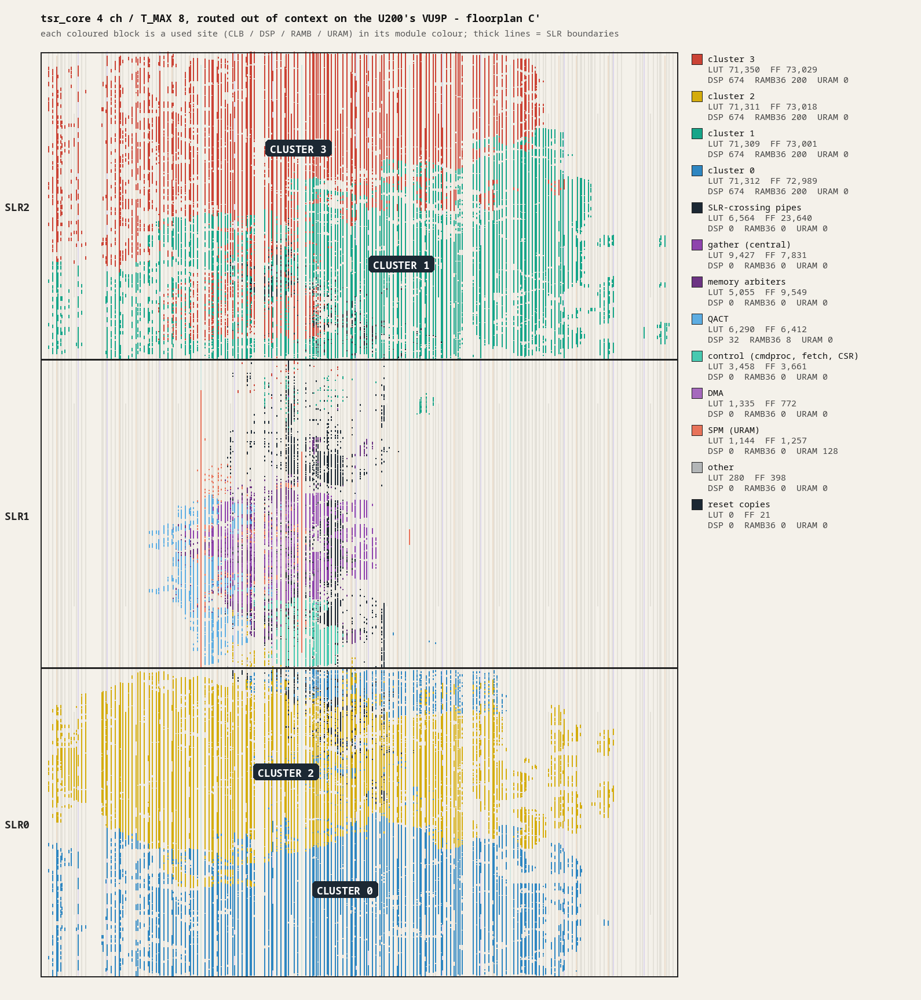

# Performance and measurements

This document records what Tesseract has been measured to do and what the design expects it to do,
with the provenance of every number: decode throughput on the Alveo U200, where the decode time
goes, memory bandwidth, model load time, accuracy against the CPU, timing and resources, RTL
simulation cycle counts, the results on the simulator and the estimates. It ends with the
measurement history and the commands that reproduce the numbers.

> **Scope.** Measurement record, not a design. The first card measurements with the control core
> are in "The first card image with the control core" below (2026-11-06); the full-feature image's
> are in "The full-feature image after the ATTPV fix" and, for the image before the fix, "The full-feature image on the card, second link" (both 2026-11-08).
> Multi-token prediction on the same image is in "Multi-token prediction on the card" (2026-11-09). The MoE and Gated DeltaNet models on the same image are in "MoE and Gated DeltaNet on the card" (2026-11-09), and Qwen3-30B-A3B in "Qwen3-30B-A3B on the card". All other card
> measurements were taken before the control core was added, with the host issuing the ops; the
> Vivado and RTL simulation results are of the design that ran on the card. The other numbers are simulator measurements or estimates, and none
> of them is a card measurement. Every number carries one of the provenance labels below. The
> normative targets and estimates of the control core are in [`docs/design`](design/README.md):
> [EX](design/01-execution-model.md) §4.11,
> [CC](design/04-control-core.md) §14, [AT](design/03-attention-kv.md) §9 and
> [SW](design/06-software-verification.md) §7.8, §10.4.

## How to read these numbers

Provenance labels:

| Label | Meaning |
| --- | --- |
| `measured on the card (k4, 276.3 MHz)` | Alveo U200, bitstream `tsr_u200_k4` at its achieved kernel clock. Other bitstreams are named: `k1`, `tsr_bw_k4`, or the milestone (M0, M3, M4) |
| `measured on the card (k4m200, 200 / 100 MHz)` | Alveo U200, the first image with the control core: `tsr_u200_k4` as linked on 2026-11-06 with the core at 200 MHz and `clk_rv` at 100 MHz |
| `measured on the card (k4full, 200 / 100 MHz)` | Alveo U200, the full-feature image (`tsr_u200_k4` of branch `k4full`: `T_MAX` 4, VU, attention, trace writer) linked on 2026-11-07 / 08 with the core at 200 MHz and `clk_rv` at 100 MHz. The sections name the link (second: before the ATTPV fix; fourth: after it) |
| `measured on the simulator (<commit>)` | Software time of this tree on the development host: host work, simulator speed, accuracy results of the tools |
| `simulator cycle model (<commit>)` | Device or RISC-V cycles from the simulator's informational cycle model. Not a card measurement |
| `measured in RTL simulation (ideal memory)` | Verilator simulation of the RTL with an ideal memory |
| `measured in Vivado 2024.2 (out of context)`, `(linked)` | Timing and utilisation of Vivado runs, without or with the shell |
| `estimate (<document> section N)`, `target (...)` | A number of the design that nothing has measured yet |
| `not re-measured (<document>)` | Copied from an earlier document of this repository |

**Decode tok/s** is the generation rate of llama.cpp's `eval time` line: batch 1, greedy
(`--temp 0`), `llama-completion -ngl 99 -nkvo -no-cnv`, a prompt of 6 to 7 tokens, 31 to 127
generated tokens. With `-nkvo` the KV cache stays on the CPU. The context was 4096 for the
Gemma 4 runs and for the `TSR_STATS` runs, and the model default for the Qwen2.5 runs (32768 for
0.5B, 131072 for 32B). Prompt processing is not part of the figure.

**Clocks.** The design target is 300 MHz (`F_CORE`). The 4-channel bitstream `tsr_u200_k4` closed
at 276.3 MHz, so every k4 number below is at 276.3 MHz; `tsr_u200_k1` and the M0 kernel
`tsr_bw_k4` ran at 300 MHz. The image with the control core (`k4m200`, 2026-11-06) runs the core
at 200 MHz and `clk_rv` at 100 MHz (`RV_FREQ` ratio 0.5); its numbers are in their own section and
are not comparable with the 276.3 MHz ones without the clock ratio.

**Host.** All card runs were made on the development host that holds the card: AMD Ryzen 7 9700X
(8 cores, 16 threads), 14 GB RAM, Ubuntu 24.04, kernel 7.0.0-38, XRT 2.18.179 with the 19 driver
patches ([`sw/xrt-driver`](../sw/xrt-driver/README.md)), shell `xilinx_u200_gen3x16_xdma_base_2`,
SC firmware 4.6.21. The U200 has a VU9P with three SLRs and 4 x 16 GB DDR4 (DDR4-2400, 19.2 GB/s
peak per channel). Simulator timings are from the same host.

## Multi-token prediction on the card (`k4full`, SW-83 to SW-86, 2026-11-09)

Measured on the card (k4full, fourth link, 200 / 100 MHz), 2026-11-09, with the bitstream of the sections below (sha256
`6fdf31fdee80778771644fdc7708041c66070fd2ed8f0b1f753c7f66d3745284`, `HAS_GDN` 0: the composed Gated DeltaNet path, CAPS 0x21) and the
`tsr-fw.elf` of branch `mtp` (image id `b8838a99660d1da7`, firmware sources unchanged from `sw-moegdn`; Basis 0.1.0, ABI 1). The host stack is the `build/xrt`
build of `mtp` (Release, `-DTSR_WITH_XRT=ON`). Before every card session the ATTPV trace `traces/at/errors/at_s53_0009` was replayed. Models: the target
`Qwen3.8-27B-Q4_K_M.gguf` (ggml-org, sha256 `d15d4b6de55f662ac40e867702d31afe738d032fa06b829b2b1a21a49d4a48ee`) or `Qwen3.8-27B-Q8_0.gguf`
(sha256 `6bc9e7220d8400574fd62df25f04a961cb5cbb0d766cf0118c21c36c0059c35a`), and the MTP head `mtp-Qwen3.8-27B-Q8_0.gguf` (ggml-org, sha256
`572ebcd0349321a71ccc6886c2611ff9d8c9aa160312ed4c90ae5bf9a055f4c6`: the block, `output.weight`, `token_embd`). Design: SW §7.11.

Method: `tsr-mtp` (`sw/tools/tsr_mtp.cpp`), greedy (`--temp 0`), the M7 settings of klcheck (FA on, q8_0 KV, rotation off, `-c 2048`), the first four built-in
klcheck prompts (7 to 15 tokens), 32 generated tokens each (128 per configuration), one process per session: the plain loop (one token per decode, a target context
without snapshots), then MTP with K = 1, 2 and 3 drafts (the target keeps K_max + 1 = 4 recurrent snapshots). Cycles are the PERF core cycles read around each launch (hook
`ggml_backend_tesseract_counters`; the 200 MHz tok/s is `200 M / cycles per token`); the wall tok/s is the decode loop of the process on the host (load average 4 to 8). Prefill is not in
any figure. The generated tokens are compared with the plain loop's in the same process.

```sh
source /opt/xilinx/xrt/setup.sh; export TSR_XCLBIN=…/k4full/build/link/k4full/tsr_u200_k4.xclbin TSR_IMAGE=build/xrt/fw/tsr-fw.elf
tsr-selftest --device xrt --no-mem --no-kernel --rate-n 10 --traces traces/at/errors/at_s53_0009     # before every session
LLAMA_ATTN_ROT_DISABLE=1 TSR_STATS=1 TSR_DEVICE=xrt tsr-mtp -m Qwen3.8-27B-Q4_K_M.gguf -md mtp-Qwen3.8-27B-Q8_0.gguf --mtp-device xrt \
    --mtp-mode all --mtp-k-list 1,2,3 --mtp-n-prompts 4 -n 32 --mtp-rounds 3 -c 2048 -t 8
```

### Qwen3.8 27B Q4_K_M (3 rounds)

| | plain | MTP K = 1 | MTP K = 2 | MTP K = 3 |
| --- | --- | --- | --- | --- |
| Accepted drafts per step (tokens per step) | 0 (1) | 0.855 (1.855) | 1.364 (2.364) | 1.977 (2.977) |
| Drafts accepted at position 1 / 2 / 3 | | 85.5 % | 76.4 / 62.3 % | 81.8 / 65.1 / 54.8 % |
| Steps accepting 0 / 1 / 2 / 3 | | 10 / 59 | 13 / 9 / 33 | 8 / 8 / 5 / 23 |
| Device cycles per token, total | 113.99 M | **87.99 M** | **90.05 M** | **87.86 M** |
| draft + verify + process | | 3.87 + 83.07 + 1.06 | 6.17 + 83.00 + 0.88 | 7.40 + 79.72 + 0.74 |
| Speed-up in cycles | 1.00 | 1.30 | 1.27 | 1.30 |
| tok/s at 200 MHz from the cycles | 1.755 | 2.273 | 2.221 | 2.276 |
| Wall tok/s, best / median of 3 rounds | 1.745 / 1.745 | 2.224 / 2.205 | 2.161 / 2.158 | 2.212 / 2.208 |
| Launches per token | 1.00 | 1.62 | 1.72 | 1.72 |
| Tokens equal to plain decoding | | 4 of 4 prompts | 4 of 4 | 4 of 4 |

One session (K = 3 only, 1 round) with the output head whole (`TSR_HEAD_SPLIT=0`, SW-84) gave a plain token of 113.98 M cycles (the same) and a K = 3 verification of
247.3 M cycles per step against 231.9 M with the head in row blocks (MVM busy 88.9 M against 73.4 M per step); K = 3 was 93.14 M cycles per token (1.22 ×) instead of 87.86 M (1.30 ×).

### Where a verification step goes (27B Q4_K_M)

| Verification of T tokens (core cycles per step) | T = 1 (plain) | T = 2 (K = 1) | T = 3 (K = 2) | T = 4 (K = 3) |
| --- | --- | --- | --- | --- |
| Total | 113.99 M | 154.09 M | 193.16 M | 231.92 M |
| MVM busy | 73.07 M | 73.17 M | 73.28 M | 73.38 M |
| VU busy | 36.94 M | 73.68 M | 109.09 M | 144.67 M |
| DMA busy | 12.90 M | 25.61 M | 38.14 M | 50.17 M |

The MVM time does not depend on T (the weights stream once for all the tokens: the vocabulary matrix in four row blocks, SW-84). The step grows by 39 M cycles per token: the composed
Gated DeltaNet recurrence is serial in the tokens and VU-bound (37 M per token of the 48 layers, SW §7.10), and the K = 1 records of the chain re-load the state tile
(DMA busy +12.4 M per token). A draft step costs 7.2 M cycles, 5.3 M of them the Q8_0 vocabulary matrix (1.35 GB, once per drafted token), the rest the block (0.45 GB); the catch-up
`process` decode 2.0 to 2.1 M per step. So K = 1, 2 and 3 land at the same 88 M cycles per token: every drafted token adds about 7 M of draft and 39 M of verification and gains 0.5 to 0.85 accepted tokens.
On an image with the fused GDN op the recurrence of a token costs about a quarter (VU busy 9 M instead of 37 M, SW §7.10), so the slope falls to about 18 M per token and the gain rises (the simulator rows below).

### Qwen3.8 27B Q8_0 (2 rounds)

| | plain | MTP K = 1 | MTP K = 2 | MTP K = 3 |
| --- | --- | --- | --- | --- |
| Accepted drafts per step (tokens per step) | 0 (1) | 0.855 (1.855) | 1.426 (2.426) | 1.787 (2.787) |
| Device cycles per token | 148.18 M | **106.83 M** | **103.46 M** | **106.76 M** |
| Speed-up in cycles | 1.00 | 1.39 | 1.43 | 1.39 |
| tok/s at 200 MHz from the cycles | 1.350 | 1.872 | 1.933 | 1.873 |
| Wall tok/s, best / median of 2 rounds | 1.340 / 1.339 | 1.835 / 1.829 | 1.881 / 1.879 | 1.821 / 1.809 |
| Tokens equal to plain decoding | | 4 of 4 | 4 of 4 | 4 of 4 |

The Q8_0 target streams 28.6 GB per token (MVM busy 106.5 M cycles), so a larger share of the step is weight traffic that the verification shares between the tokens.

### All eight klcheck prompts × 64 tokens (27B Q4_K_M target, 1 round)

The larger sample (512 generated tokens, the prompts of klcheck's built-in set, 7 to 25 tokens), same session layout, once with the ggml-org Q8_0 head and once with the Q4_K requantized head (below). Every MTP stream equals plain decoding's (8 of 8 prompts, K = 1, 2, 3, both heads).

| | plain | K = 1 | K = 2 | K = 3 |
| --- | --- | --- | --- | --- |
| Q8_0 head: accepted drafts per step (tokens per step) | 0 (1) | 0.859 (1.859) | 1.471 (2.471) | 1.893 (2.893) |
| Q8_0 head: accepted at draft position 1 / 2 / 3 | | 85.9 % | 82.7 / 65.4 % | 82.6 / 62.5 / 46.8 % |
| Q8_0 head: cycles per token (draft + verify + process) | 113.99 M | **88.29 M** (3.88 + 83.34 + 1.06) = 1.29 × | **85.48 M** (5.83 + 78.81 + 0.84) = 1.33 × | **89.24 M** (7.48 + 81.01 + 0.75) = 1.28 × |
| Q8_0 head: wall tok/s | 1.639 | 2.192 | 2.269 | 2.168 |
| Q4_K head: accepted drafts per step | | 0.853 | 1.483 | 1.845 |
| Q4_K head: cycles per token (draft + verify + process) | 113.99 M | **86.33 M** (2.08 + 83.66 + 0.59) = 1.32 × | **81.93 M** (3.10 + 78.37 + 0.47) = 1.39 × | **86.86 M** (4.06 + 82.37 + 0.43) = 1.31 × |
| Q4_K head: wall tok/s | 1.741 | 2.247 | 2.353 | 2.194 |

The third drafted token is accepted less than half of the time, so K = 2 is the best setting here on both heads.

The third drafted token is accepted less than half of the time. llama.cpp's `--spec-draft-p-min P` stops drafting once the head's top-1 probability is below P, so the verification is shorter when the draft is doubtful
(K = 3, Q8_0 head, same prompts, tokens again equal to plain decoding's on 8 of 8 prompts):

| K = 3 | accepted drafts per step | drafted | cycles per token (draft + verify + process) | against plain |
| --- | --- | --- | --- | --- |
| `--spec-draft-p-min 0` (the default) | 1.893 | 525 | 89.24 M (7.48 + 81.01 + 0.75) | 1.28 × |
| `0.5` | 1.638 | 408 | **83.40 M** (6.97 + 75.65 + 0.79) | **1.37 ×** |
| `0.75` | 1.137 | 301 | 84.79 M (6.78 + 77.07 + 0.94) | 1.34 × |

### The MTP head's quantization (27B Q4_K_M target, 1 round)

The draft step reads the head's vocabulary matrix and its block once per drafted token. `mtp-Qwen3.8-27B-Q4_0.gguf` (ggml-org, 1.7 GB) does not shrink it on this device: Q4_0 is not a device format, so
the backend converts it to Q8_0 at load and streams the same bytes (draft step 7.175 M cycles, as for the Q8_0 file) and the double rounding costs acceptance. A head requantized to Q4_K (`llama-quantize
--allow-requantize --pure --output-tensor-type q4_k --token-embedding-type q8_0` of the Q8_0 file: the block and `output.weight` in Q4_K, 2.3 GB with the embedding table, not a published file) streams 0.56 bytes per weight:
the draft step halves to 3.83 M cycles. Same four prompts × 32 tokens and the same session layout as above; the generated tokens equal plain decoding's in every run.

| Device cycles per token (M) | plain | K = 1 | K = 2 | K = 3 |
| --- | --- | --- | --- | --- |
| Q8_0 head (above): accepted drafts per step | | 0.855 | 1.364 | 1.977 |
| Q8_0 head: cycles per token | 113.99 | 87.99 (1.30 ×) | 90.05 (1.27 ×) | 87.86 (1.30 ×) |
| Q4_0 head (ggml-org, converted to Q8_0 at load): drafts per step | | 0.803 | 1.357 | 1.848 |
| Q4_0 head: cycles per token (draft per step) | 113.99 | 90.60 (1.26 ×) (7.18) | 91.72 (1.24 ×) (7.18) | 92.32 (1.23 ×) (7.18) |
| Q4_K head (requantized): drafts per step | | 0.855 | 1.407 | 1.909 |
| Q4_K head: cycles per token (draft per step) | 113.99 | **85.71 (1.33 ×)** (3.83) | **85.17 (1.34 ×)** (3.83) | **84.12 (1.36 ×)** (3.83) |
| Q4_K head: wall tok/s | 1.716 | 2.211 | 2.197 | 2.247 |

### Qwen3.8 2B Q4_K_M (its GGUF carries the MTP block)

K = 3 on three prompts × 16 tokens: 2.500 tokens per step, 14.26 M cycles per token against 11.44 M plain (0.80 ×; the 2B's tied head, 540 MB as Q8_0, is read per draft token: 2.9 M cycles of each).
MTP does not pay for the 2B; the 27B's head is 7 % of a token, the 2B's 29 %. Bit identity with the simulator: `klcheck` of the card (plain generation of 4 × 24 tokens, and a replay of the same tokens
in verification windows of up to 4 tokens with rollbacks) replayed on `TSR_SIM_CARD=k4full`: 96 of 96 rows bit-identical for both, and the card's verification rows are bit-identical to its plain rows (96 of 96).

### The 27B from truncated models on the simulator (card configuration)

`simulator cycle model (mtp)`, `TSR_SIM_CARD=k4full` (`T_MAX` 4, VU 8 / 8 / 4 lanes, `clk_rv` at half the core clock, 200 MHz image) with the composed Gated DeltaNet path (the card image) and with
`TSR_SIM_GDN=1` (an image with the fused op, `k4f250` at 200 MHz). The whole 27B was not run on the simulator in this session (the host was busy with a K4 link); the rows extrapolate
the first 4 and the first 8 layers of the real GGUF (`sw/tools/gguf_truncate.py`, the method of SW §7.10: a group of 3 Gated DeltaNet and 1 attention layers is the difference, the head
and embeddings the rest; 15 groups added to the 4-layer run), with the real MTP head (`mtp-Qwen3.8-27B-Q8_0.gguf`). A draft step does not depend on the target's depth (7.175 M cycles) and the
catch-up decode costs 1.96 / 2.05 / 2.14 M at 2 / 3 / 4 tokens. The accepted tokens per step are the card's (the table above; the fused op changes the target's bits, so its acceptance will differ a little). The
composed rows reproduce the card: plain 114.2 M against 113.99 M measured, a `T = 4` verification 235.1 M against 231.9 M (+1.4 %), cycles per token 90.4 / 90.4 / 86.9 M against 87.99 / 90.05 / 87.86 M measured (within 3 %).

| Core cycles per step or token (M) | plain | K = 1 | K = 2 | K = 3 |
| --- | --- | --- | --- | --- |
| Composed (card image): verification of K + 1 tokens | 114.2 | 158.5 | 197.2 | 235.1 |
| Composed: per generated token (draft + verify + process, ÷ tokens per step) | 114.2 | 90.4 (1.26 ×) | 90.4 (1.26 ×) | 86.9 (1.31 ×) |
| Fused op (state on its cell): verification of K + 1 tokens | 91.1 | 112.3 | 128.6 | 144.6 |
| Fused: per generated token | 91.1 | 65.5 (**1.39 ×**) | 61.4 (**1.49 ×**) | 56.5 (**1.61 ×**) |
| Fused at 200 MHz, tok/s from the cycles | 2.20 | 3.05 | 3.26 | 3.54 |

A fused verification of 4 tokens is 73 M MVM busy (the weights once), 35 M VU busy and 35 M DMA busy cycles (the units run one after the other in a decode token); the DMA share is the chain's
re-reads of the state (plain decoding: 8.3 M). A GDN kernel that stored its tile after each token would read the state once and save about a third of it (13 M of 145 M cycles, 9 %); it needs two record words
(an ABI change) and was not built.

## MoE and Gated DeltaNet on the card (`k4full`, firmware of `sw-moegdn`, 2026-11-09)

Measured on the card (k4full, fourth link, 200 / 100 MHz), 2026-11-09. The bitstream is the one of the section below: sha256
`6fdf31fdee80778771644fdc7708041c66070fd2ed8f0b1f753c7f66d3745284`, UUID `c7f70219-f070-c4fd-cfdc-1da14a7eb251`. The firmware is the
`tsr-fw.elf` of branch `sw-moegdn` (image id `99698a44030574f4`, 21 kinds, kind table 0x804f, ITCM 84,056 B), and the host stack is
the `build/xrt` build of that branch (Release, `-DTSR_WITH_XRT=ON`). Accuracy and the bit identity with the simulator are in
[`klcheck.md`](klcheck.md); the three klcheck runs (Gemma 4 26B-A4B in M6 and M7, Qwen3.8 2B in M7) pass.

Method. M7 settings: `llama-completion -ngl 99 -fa on -ctk q8_0 -ctv q8_0 -c 4096 --temp 0 -no-cnv -t 8` with
`LLAMA_ATTN_ROT_DISABLE=1`, `TSR_STATS=1`, no `-nkvo`, so attention and the KV cache are on the device and a decode token is one
launch. Decode: `-n 65` and the prompt `The history of the printing press begins` (8 tokens for Gemma, 7 for Qwen). The per-token device
figures are the difference of the PERF counters of the `-n 65` and `-n 1` runs, divided by the 64 passes between them. Prefill: a prose
prompt cut to exactly 512 tokens for each tokenizer, `-n 1`. Three runs of each case, with the ATTPV trace replayed before every run
(the first ATTPV after a configuration writes stale lines in this image) and the counters read with `tsr-dbg --attach -ex perf`.
The host was busy with other jobs (load average 5 to 12, below); the device counters do not depend on it.

| Per decode token | Gemma 4 26B-A4B Q4_K_M | Qwen3.8 2B Q4_K_M |
| --- | --- | --- |
| Decode tok/s, runs 1 / 2 / 3 | 11.98 / 10.45 / 11.99 | 15.66 / 15.57 / 15.33 |
| **Best, median** | **11.99, 11.98 tok/s** (83.42, 83.47 ms) | **15.66, 15.57 tok/s** (63.87, 64.23 ms) |
| `PERF_CYCLES` per token | 16.316 M (81.58 ms) | 12.630 M (63.15 ms) |
| Device share of wall time, runs 1 / 2 / 3 | 97.7 / 85.2 / 97.8 % | 98.9 / 98.3 / 96.8 % |
| Load average (1 min) at start and end, runs 1 / 2 / 3 | 9.6 to 9.1 / 10.1 to 12.7 / 8.1 to 7.6 | 6.2 to 6.0 / 6.0 to 6.4 / 6.2 to 6.0 |
| `MVM_CYCLES` | 13.286 M (81.4 %) | 5.712 M (45.2 %) |
| `MVM_EMPTY` / `MVM_WAIT` | 1.811 M (11.1 %) / 1.217 M (7.5 %) | 5.586 M (44.2 %) / 1.331 M (10.5 %) |
| `VU_CYCLES` / `DMA_CYCLES` / `QACT_CYCLES` | 1.088 M (6.7 %) / 1.306 M (8.0 %) / 0.505 M (3.1 %) | 4.758 M (37.7 %) / 2.978 M (23.6 %) / 0.098 M (0.8 %) |
| Launches per token, op records per launch (average over the run) | 1, 1,323 | 1, 756 |
| Backend host work, outside the backend, launch beyond device time | 0.58, 0.87, 0.39 ms | 0.27, 0.31, 0.15 ms |
| Simulator cycle model (`moe` and `gdn-sw`), at 200 MHz, before SW-80 | 15.14 M, 13.2 tok/s | 10.51 M, 19 tok/s |
| Simulator cycle model after SW-80, card configuration (`TSR_SIM_CARD=k4full`) | 16.24 M (+ 0.4 % below the card) | 12.65 M (+ 0.2 % above the card) |

The decode figure is llama.cpp's `eval time` (64 runs). The one slow Gemma run (run 2) had the host load rising from 10 to 12.7: its device time is
the same as in the other two runs (16.316 M cycles), so the other 14.8 % of its wall time is host time. The unit percentages are shares of the token's cycles and overlap,
so they do not add up to 100. The counters were read from the best run of each model. The cycles of the Gemma decode token were 7.7 % above the
simulator's model, and the MVM busy cycles are the same to 0.1 % (13.29 M against 13.30 M): the difference is `MVM_EMPTY` and `MVM_WAIT`. For Qwen3.8 the
card took 20 % more cycles than the model. The MVM busy cycles agree (5.71 M against 5.70 M); the card's VU busy cycles are 4.76 M against 2.73 M
and its DMA busy cycles 2.98 M against 2.45 M in the simulator's counters. The causes are in "Card against simulator" below; the simulator's model
was corrected on 2026-11-09 (SW-80) and now agrees with these tokens to 0.2 % and 0.4 %.

| 512-token prefill | Gemma 4 26B-A4B Q4_K_M (`-ub 64`) | Gemma 4 26B-A4B Q4_K_M (`-ub 512`, the default, SW-76) | Qwen3.8 2B Q4_K_M (`-ub 512`, the default) |
| --- | --- | --- | --- |
| tok/s, runs 1 / 2 / 3 | 26.24 / 26.20 / 25.70 | 26.43 / 26.58 / 26.56 | 32.95 / 33.05 / 32.99 |
| **Best, median** | **26.24, 26.20 tok/s** (19.51 s for the first run) | **26.58, 26.56 tok/s** (19.37 s for the first run) | **33.05, 32.99 tok/s** (15.54 s for the first run) |
| `PERF_CYCLES` of the run | 3,888.3 M (19.44 s) | 3,809.3 M (19.05 s) | 3,081.3 M (15.41 s) |
| Device share of wall time, runs 1 / 2 / 3 | 99.6 / 99.5 / 97.6 % | 98.3 / 98.9 / 98.8 % | 99.2 / 99.4 / 99.3 % |
| `MVM_EMPTY` / `MVM_WAIT` | 14.8 % / 9.3 % | 17.0 % / 5.4 % | 82.9 % / 1.4 % |
| Launches | 9 | 61 | 14 |
| Load average (1 min) at start and end, runs 1 / 2 / 3 | 5.1 to 7.3 / 7.3 to 7.8 / 7.8 to 9.3 | 41.9 to 39.1 / 39.1 to 43.9 / 44.2 to 43.0 | 6.0 to 6.0 / 6.4 to 6.2 / 6.0 to 5.8 |

Gemma 4 prefill at the default `-ub 512` (SW-76). Before SW-76 the host backend stopped before the first launch at `-ub 256` and above:
`tesseract: MoE routing at 'ffn_moe_probs-28' cannot run on the device: MOE_ROUTE: with 512 tokens (several tiles) its outputs overlap the logits of a
later tile` (three runs at 512, one at 256). The record reads the router logits tile by tile and stores each tile's outputs before the next load; ggml-alloc
had put the weights of layer 28 at the start of the logits, and the build refused that layout. It was a host check and not a card fault: the card ran the next
job without a reset. `-ub 128` and `-ub 64` ran (26.48 tok/s in one probe at 128). Since SW-76 a route of more than 64 tokens writes its outputs to a device
scratch and two CPY records move them (SW §7.9), and the default runs: 26.56 tok/s median, the same as at `-ub 64` (26.2). The speed does not depend on the ubatch because the experts
run one MVM of T = 1 per (token, slot) (see below). The device took 2.0 % fewer cycles than at `-ub 64`.
The 61 launches are the 60 lists of the 512-token graph (`TSR_STATS`: lists cut early 59) and the one of the last token; at `-ub 64` a graph is one list.
The host load of these runs was 39 to 44, from other jobs on the machine (the other columns ran at 5 to 9); the device share of wall time is 98.3 to 98.9 %.
`-ub 2048` with `-b 2048` (a 2,048-token prompt, one run) also runs on the device without a refusal: 104.2 s, 19.65 tok/s. Flash attention of more than 680 tokens stays on the CPU
(SW-43), so the 2,048-token graph runs in 31 backend splits (92 launches in the whole run); the MoE records are still the device's (60 MOE_ROUTE, 120 MUL_MAT_ID).
Qwen3-30B-A3B (the section below; before SW-76 its layer test refused at 70 tokens and the model at `-ub 128`, in layer 0) runs the same way at `-ub 512`,
three runs of the 512-token prefill (M7, its tokenizer's 512 tokens): 26.72 / 26.60 / 25.69 tok/s (best 26.72, median 26.60; `-ub 64`: 26.30 and 26.04, 3,850.6 M cycles),
3,798.4 M cycles (18.99 s, 7.4 M per prompt token), device share 99.1 / 98.7 / 95.3 %, `MVM_EMPTY` / `MVM_WAIT` 16.6 % / 7.3 %, 97 launches, host load 17 to 44. `-ub 2048 -b 2048` with a
1,911-token prompt runs too: 90.0 s, 21.23 tok/s (flash attention on the CPU, 146 launches). Logs: `build/card/moegdn/speed/q3ub512`, `build/moeub/runs-q3`.
The Gemma prefill runs one MVM of T = 1 per (token, slot) (SW-66): 7.4 M device cycles per prompt token (7.6 M at `-ub 64`), against 16.3 M for a decode token.
Qwen3.8 prefills at 2.1 times its decode rate (6.0 M cycles per prompt token), and its MVM unit has nothing queued in 83 % of the prefill cycles. The
Gated DeltaNet recurrence alone is about 1.3 G of the 3.1 G cycles, at its isolated record cost of 8.6 K cycles per head and token (SW §7.10).

### Card against simulator: where the extra cycles came from (2026-11-09)

The same op streams, op by op. The card's trace writer (DB §8.3; K4 full-feature image, `TSR_OPL_PROF=1`, a ring started with `tsr-dbg` before
the run, [prof-dbg.md](prof-dbg.md) §3) gave the time of every op of three tokens of each model, and `TSR_SIM_LOG=w,...` gave the simulator's, in the card
configuration (`T_MAX` 4, `CAPS` 0x21, `clk_rv` at half the core clock; before the fix with the VU of the U200 image, 16 / 16 / 8 lanes). The 9,032 (Qwen3.8) and
7,903 (Gemma) ops of a decode launch are the same on both sides, op for op (the simulator's log has one more control entry). Decode launch of Qwen3.8 2B, cycles each record kind adds to the launch
(`sw/tools/trw_vs_sim.py kinds`; the record numbers are those of the 24 layers):

| Record kind | Records | Simulator before | Simulator after | Card |
| --- | --- | --- | --- | --- |
| GATED_DELTA_NET | 18 | 2,955,436 | 4,591,564 | 4,565,886 |
| MUL_MAT | 187 | 5,849,202 | 5,918,147 | 5,918,598 |
| SSM_CONV | 18 | 138,456 | 207,666 | 205,722 |
| RMS_NORM | 115 | 107,118 | 150,468 | 151,641 |
| GLU, ROPE, MUL, UNARY, SCALE, ADD, SOFTPLUS, FLASH_ATTN, SET_ROWS_KV | 211 | 445,663 | 461,850 | 461,341 |
| CPY, GET_ROWS, JOIN (DMA only) | 199 | 1,331,429 | 1,322,983 | 1,324,216 |
| **Decode launch** | 748 | **10,827,304** | **12,652,678** | **12,627,404** |

Before the fix the card was 16.6 % above the simulator and 89 % of the gap (1.61 M of 1.80 M cycles) was the 18 GATED_DELTA_NET records; the three DMA kinds
and MUL_MAT agreed to 1 %. The warm-up and prompt launches (18.9 M and 46.9 M cycles on the card) were 21 % and 30 % below the card in the model; all four launches now agree to 0.3 %. For Gemma 4 26B-A4B the decode launch was 15.35 M against the card's 16.31 M (5.9 % low) and is 16.24 M now (0.4 % low).

**Causes.**

1. **The VU of the card has 8 front, 8 EXP and 4 back lanes behind two register stages (`CFG3` 0x02480088), the simulator modelled 16 / 16 / 8.**
   An 8-lane front takes 2 cycles per 16-element line and the half-rate functions 4. Every VU op of a decode token took twice what the model said when it
   streams: the 128 x 128 f32 state of Gated DeltaNet is 1,024 lines and a pass over it takes 2,112 cycles on the card, 1,044 in the model.
2. **The model's latencies were wrong at both lane counts.** An op that waits for the one before it costs 59 cycles (95 for SILU and the other half-rate
   functions) plus 2 per register stage, measured on the RTL unit at 16 lanes as well (the model had 20 and 64). The reduction of 128 rows of 128 elements,
   twice per head step, takes 3,264 cycles on the card (2,748 at 16 lanes), not the 2,093 of the model: the partial ring holds two such rows at a time (VU §7.5).
3. **The card's VU is not slowed by anything the RTL unit does not do.** The 4,518 VU ops of the Qwen3.8 decode token take 4.737 M cycles when replayed
   on the RTL unit alone (Verilator, `tb/vu/test_vu_timing.py vu_stream`) and `VU_CYCLES` reads 4.758 M on the card; the gaps between the completions of consecutive
   VU ops equal the RTL's gaps to the cycle through the Gated DeltaNet head step. `VU_SPM_WAIT` (0.55 M per token) and `VU_HAZARD` (0.27 M) count cycles that lie
   inside these figures: they are the unit waiting for its own predecessor and for SPM grants while the DMA moves the next head's state, and they cost 0.5 % of the VU's time.
   There is no stall to remove in the sense of the question, but there are three places where the RTL could be faster ([VU §7.13](design/02-vector-unit.md)).
4. **QACT: the A32 quantiser takes 16 cycles per 32-block** (divider bound, `tsr_qact.sv`; K = 2,816: 1,452 cycles on the card and 1,448 in the RTL bench), and the
   simulator charged one cycle per source line (226). A256 is 17 cycles per 256-block plus 72 (259 against 227). Every Q8_0 matrix product and every KV store of Gemma waits for it:
   0.41 M of the 0.95 M cycles of the Gemma gap. This is what `MVM_WAIT` was made of.
5. **DDR latencies the model did not have**: a store of 128 to 256 lines takes its lines plus about 110 cycles on the card (the model 64), and an MVM starts its
   weight stream about 80 cycles later than the model's fill. About 0.18 M cycles of the Gemma gap (0.1 M after the small corrections of SW-80),
   and what remains of `MVM_EMPTY`.

Gemma 4 26B-A4B decode launch, cycles each kind adds (card 16,305,653):

| Record kind | Simulator before | Simulator after | Card |
| --- | --- | --- | --- |
| MUL_MAT (236), MUL_MAT_ID (60) | 13,534,830 | 13,786,788 | 13,805,669 |
| RMS_NORM, ADD, MUL, GLU, SCALE, ROPE, UNARY, MOE_ROUTE, GET_ROWS, JOIN (937) | 1,648,644 | 2,100,183 | 2,130,506 |
| FLASH_ATTN (30) | 143,850 | 273,750 | 278,979 |
| SET_ROWS_KV (60) | 24,995 | 74,935 | 90,499 |
| **Total** | **15,352,319** | **16,235,656** | **16,305,653** |

Per-token PERF counters of the card against the corrected simulator (card configuration): `VU_CYCLES` 4.758 M against 4.785 M (Qwen3.8) and 1.088 M against 1.085 M
(Gemma); `QACT_CYCLES` 98,070 against 98,244 and 505,087 against 505,654; `MVM_CYCLES` 5.712 M against 5.714 M and 13.286 M against 13.271 M. The DMA busy cycles stay low in the
simulator (2.43 M against 2.98 M, 1.17 M against 1.31 M): the card's DMA moves lines at half rate while the VU runs (the Gated DeltaNet state tiles of 1,024 lines take 2,048 cycles
there, 1,088 in the model), the next head's load is hidden behind the head, and the DMA kinds (CPY, GET_ROWS) agree on the critical path. The KV store (the V plane's masked
writes, 0.5 K cycles on the card and 0.1 K in the model) and MOE_ROUTE (3.5 % low) are the larger parts of the 0.4 % left in Gemma.

Table of single ops and records (cycles; card from the trace writer, RTL from the unit bench, [VU §7.13](design/02-vector-unit.md); the VU rows are the gap from the done of
the op before):

| Op or record | Simulator before | Simulator after | RTL bench | Card |
| --- | --- | --- | --- | --- |
| VOP MUL, 128 x 8 line tile (S times k, Gated DeltaNet) | 1,044 | 2,112 | 2,112 | 2,112 |
| VOP MULC, tile (S times alpha) | 1,044 | 2,111 | 2,111 | 2,115 |
| VOP MULCADD, tile with c vector | 1,052 | 2,120 | 2,120 | 2,120 |
| RED SUM, 128 rows of 128 | 2,093 | 3,264 | 3,264 | 3,265 |
| VOP SUB / MULC, one row of 128 | 28 | 80 / 79 | 80 / 79 | 80 / 79 |
| SOP EXP (after an LDS) | 30 | 58 | 58 (60 in the stream) | 68 |
| Gated DeltaNet head step, 13 VU ops | 8,514 | 15,405 | 15,288 | 15,306 |
| RED RMS to an s register, 2,048 elements | 203 | 400 | 401 | 400 |
| ROPE, head_dim 256, n_dims 64, 8 heads, T 1 | 296 | 547 | 547 | 559 (run time) |
| AMERGE (INIT) R 16, D 256 / ANORM R 16, D 256 | 838 / 324 | 2,657 / 674 | 2,657 / 674 | |
| QACT A32, K 2,816 / A256, K 2,816 | 226 / 227 | 1,452 / 259 | 1,448 / 255 | 1,452 / 259 |
| GATED_DELTA_NET record, 2B (16 heads, 1 token) | 164,191 | 255,087 | 261,282 (isolated, with the launch) | 253,660 |
| SSM_CONV record, 2B | 7,692 | 11,537 | | 11,429 |
| RMS_NORM record, Qwen3.8 2B (E 2,048) | 931 | 1,308 | | 1,319 |

The simulator's default configuration is unchanged: the U200 image's 16 / 16 / 8 lanes. A comparison with the card sets `TSR_SIM_CARD=k4full`.
With the default configuration and the corrected model, the Qwen3.8 2B decode token takes 10.96 M cycles (VU 3.16 M, MVM 5.73 M, DMA 2.43 M busy) and Gemma 4 26B-A4B 15.69 M.

## Qwen3-30B-A3B on the card (`k4full`, SW-77, 2026-11-09)

Measured on the card (k4full, fourth link, 200 / 100 MHz), 2026-11-09, with the bitstream, firmware (`tsr-fw.elf` of `sw-moegdn`, 21 kinds, kind
table 0x804f; SW-77 changes no firmware) and method of the section above. The model is `Qwen3-30B-A3B-Q4_K_M.gguf`
(18.56 GB, [`klcheck.md`](klcheck.md) has the provenance and the KL result: ratio 0.813, top-1 96.68 %, 512 of 512 rows bit-identical to the
simulator). Decode: `-n 65`, prompt `The history of the printing press begins` (7 tokens); prefill: a prose prompt of exactly 512 tokens, `-n 1`, **`-ub 64`**
(these runs predate SW-76, when the host backend refused the route of more than one tile at `-ub 128` and above, SW-64; the default `-ub 512` runs since, see the Gemma 4 prefill paragraphs above: 26.72 best, 26.60 median tok/s). Three runs of each, the ATTPV trace
replayed before every run. **The host was busy with other agents' jobs the whole time (load average 23 to 58)**, so the wall figures are
lower bounds of what the card does; the device cycles do not depend on the host.

| Per decode token | Qwen3-30B-A3B Q4_K_M |
| --- | --- |
| Decode tok/s, runs 1 / 2 / 3 | 9.41 / 13.06 / 15.82 |
| **Best, median** | **15.82, 13.06 tok/s** (63.20, 76.59 ms) |
| `PERF_CYCLES` per token | 11.338 M (56.69 ms at 200 MHz; 17.6 tok/s from device time alone) |
| Device share of wall time, runs 1 / 2 / 3 | 53.3 / 74.0 / 89.7 % |
| Load average (1 min) at start and end, runs 1 / 2 / 3 | 45.0 to 58.3 / 37.5 to 35.6 / 40.0 to 38.4 |
| `MVM_CYCLES` | 8.469 M (74.7 %) |
| `MVM_EMPTY` / `MVM_WAIT` | 2.018 M (17.8 %) / 0.847 M (7.5 %) |
| `VU_CYCLES` / `DMA_CYCLES` / `QACT_CYCLES` | 0.749 M (6.6 %) / 1.245 M (11.0 %) / 0.374 M (3.3 %) |
| `ATT_QK_CYCLES` / `ATT_PV_CYCLES` | 0.035 M (0.3 %) / 0.063 M (0.6 %) |
| Launches per token, op records per launch | 1, 1,397 |
| Backend host work, outside the backend, launch beyond device time (best run) | 0.06, 6.25, 0.20 ms |
| At 276.3 MHz (device time only, an estimate) | 41.0 ms, 24.4 tok/s |

The decode figure is llama.cpp's `eval time` (64 runs); the cycles are the difference of the PERF counters of the `-n 65` and `-n 1` runs over the 64
passes between them (the same 11.338 M in all three pairs). Run 1 ran while the load average rose from 45 to 58 and run 2 at 36 to 37: their device time is
the same, so the rest of their wall time is host time (outside the backend: 6 ms in the best run, 46 ms in the first). The unit percentages
overlap. A decode token reads 8 of 128 experts in each of 48 layers: the MVM unit is busy in 75 % of the cycles, and 25 % are queue
gaps (`MVM_EMPTY`, `MVM_WAIT`), the same shape as Gemma 4's (81 % busy) with less weight per token (3.3 B of the 30.5 B parameters are active, by the model card).

| 512-token prefill | Qwen3-30B-A3B Q4_K_M (`-ub 64`) |
| --- | --- |
| tok/s, runs 1 / 2 / 3 | 26.30 / 26.04 / 24.87 |
| **Best, median** | **26.30, 26.04 tok/s** (19.47 s for the first run) |
| `PERF_CYCLES` of the run | 3,850.6 M (19.25 s; 7.52 M per prompt token) |
| Device share of wall time, runs 1 / 2 / 3 | 98.9 / 97.9 / 93.5 % |
| `MVM_EMPTY` / `MVM_WAIT` | 15.5 % / 9.4 % |
| Launches | 9 (eight ubatches and the one decode) |
| Load average (1 min) at start and end, runs 1 / 2 / 3 | 44.2 to 37.5 / 23.0 to 40.0 / 39.3 to 34.2 |

Prefill runs one MVM of T = 1 per (token, slot) (SW-66): 7.5 M cycles per prompt token against 11.3 M for a decode token (Gemma 4: 7.6 M
against 16.3 M). Grouping tokens by expert is not built.
At the default `-ub 512` (SW-76) the same prefill takes 3,798.4 M cycles (7.4 M per prompt token) and runs at 26.72 tok/s best and 26.60 median; the card's 513 rows are bit-identical to the simulator's
(the Gemma 4 prefill paragraphs above have the three runs).

## The full-feature image after the ATTPV fix (`k4full`, fourth link, 2026-11-08)

Measured on the card (k4full, fourth link, 200 / 100 MHz), 2026-11-08. The image is `build/link/k4full/tsr_u200_k4.xclbin`, sha256
`6fdf31fdee80778771644fdc7708041c66070fd2ed8f0b1f753c7f66d3745284`, UUID `c7f70219-f070-c4fd-cfdc-1da14a7eb251`, source `d33f816`.
The configuration, the host tools, the settings and the method are those of the section below (second link): `-n 65` and `-n 1`
(the per-token figures are the difference divided by 64), a 158-token paragraph for prefill, the PERF counters read with `tsr-dbg
--attach -ex perf` after each run. Three runs per case for 0.5B and two for 32B. The host was not quiet (load average 1.6 to 6.3 at
the start of the runs); the device counters do not depend on it. In the "M7" rows attention and the KV cache are on the device (no
`-nkvo`); that run is bit-identical to the simulator ([`klcheck.md`](klcheck.md), [`platform-u200.md`](platform-u200.md) §8.8
"Card bring-up of the fourth link").

### Throughput

| Model, phase | Prefill, 158 tokens | Prefill, 7 tokens | Decode, best run | Decode, all runs | Launches per decode token |
| --- | --- | --- | --- | --- | ---: |
| 0.5B Q8_0, `TSR_KINDS=m6` | 407.1 tok/s (388.1 ms; 404.8 to 407.1) | 5.13 to 5.27 ms per token | **47.83 tok/s** (20.91 ms) | 47.5 to 47.8 tok/s (20.91 to 21.05 ms) | 145 |
| 0.5B Q8_0, vector-unit kinds (`-nkvo`) | 383.7 tok/s (411.8 ms; 382.2 to 383.7) | 4.02 to 4.07 ms per token | **68.45 tok/s** (14.61 ms) | 67.8 to 68.5 tok/s (14.61 to 14.76 ms) | 25 |
| 0.5B Q8_0, M7 | 337.6 tok/s (468.0 ms; 337.0 to 337.6) | 4.55 to 4.58 ms per token | **75.88 tok/s** (13.18 ms) | 75.5 to 75.9 tok/s (13.18 to 13.24 ms) | 1 |
| 32B Q4_K_M, `TSR_KINDS=m6` | 9.5 tok/s (16.59 s; 2 runs) | 126.3 to 126.7 ms per token | **2.25 tok/s** (443.75 ms) | 2.25 tok/s (443.75 and 444.92 ms) | 385 |
| 32B Q4_K_M, vector-unit kinds (`-nkvo`) | 9.5 tok/s (16.62 s; 2 runs) | 125.1 to 125.2 ms per token | **2.32 tok/s** (430.25 ms) | 2.32 tok/s (430.25 and 430.34 ms) | 65 |
| 32B Q4_K_M, M7 | 9.3 tok/s (17.07 s; 2 runs) | 129.0 ms per token | **2.35 tok/s** (424.93 ms) | 2.35 tok/s (424.93 and 425.19 ms) | 1 |

The 158-token prefill is one graph pass: it takes the same number of launches as one decode token (145 / 25 / 1 for 0.5B, 385 / 65 / 1
for 32B). Decode with attention on the device gains 1.59 times over `TSR_KINDS=m6` for 0.5B (20.91 to 13.18 ms) and 1.11 times over the
vector-unit kinds (14.61 to 13.18 ms); for 32B it gains 4.2 % and 1.2 % (443.75, 430.25 and 424.93 ms). Prefill goes the other way at
`T_MAX` 4: 0.5B takes 407 tok/s with `m6`, 384 with the vector-unit kinds and 338 with attention on the device. The run (158 tokens
and one decode token) costs 69.1 M, 80.7 M and 95.8 M device cycles; in the M7 run `MVM_EMPTY` is 15.8 % and `MVM_WAIT` 12.1 % of
the cycles. For 32B the three runs cost 3,220 M, 3,356 M and 3,486 M cycles. In prefill the device takes longer for these ops than
the CPU does.

Per decode token with attention and the KV cache on the device (device counters, 200 MHz):

| Per decode token | Qwen2.5-0.5B Q8_0 | Qwen2.5-32B Q4_K_M |
| --- | --- | --- |
| Wall (llama.cpp `eval time`) | 13.18 ms | 424.93 ms |
| `PERF_CYCLES` | 2.567 M (12.84 ms, 97.4 % of the wall time) | 84.586 M (422.93 ms, 99.5 %) |
| `MVM_CYCLES` | 2.120 M (82.6 %) | 81.265 M (96.1 %) |
| `MVM_EMPTY` / `MVM_WAIT` | 133,049 (5.2 %) / 313,258 (12.2 %) | 19,281 (0.0 %) / 3.300 M (3.9 %) |
| `VU_CYCLES`, `VU_HAZARD` | 99,893 (3.9 %), 10,273 | 1.035 M (1.2 %), 27,112 |
| `ATT_QK_CYCLES` / `ATT_PV_CYCLES` | 9,873 (0.4 %) / 13,790 (0.5 %) | 69,875 (0.1 %) / 107,368 (0.1 %) |
| `DMA_CYCLES`, `QACT_CYCLES` | 6.0 %, 5.7 % | 1.6 %, 1.2 % |
| Launches per token | 1 | 1 |
| Backend host work, outside the backend | 0.12 ms, 0.18 ms | 0.45 ms, 0.46 ms |
| `RV_WFI`, `PUSH_STALL` | 0, 0 | 0, 0 |
| `REC_DROPPED` | 1 | 1 |

With one launch per token the host is out of the way: the wall time is 97.4 % (0.5B) and 99.5 % (32B) device time. What is left for
0.5B is the device's own idle share (`MVM_WAIT` 12.2 %, the MVM unit idle behind a queued entry that cannot start, and `MVM_EMPTY`
5.2 %). The attention ops themselves are small: `ATT_QK_CYCLES` and `ATT_PV_CYCLES` are 0.9 % of a 0.5B token at contexts of 8 to 72 tokens. The `ATT_CYCLES` counter of the issue path reads 0 (the attention ops run in the MVM clusters and have no queue of their own).

### Against the second link's image

| | Second link | Fourth link |
| --- | --- | --- |
| `m6` decode 0.5B, best | 49.5 tok/s (20.19 ms) | 47.83 tok/s (20.91 ms) |
| `m6` cycles per token, 0.5B / 32B | 2.893 M / 84.059 M | 2.893 M / 84.058 M |
| `m6` decode 32B, best | 2.27 tok/s (441.3 ms) | 2.25 tok/s (443.75 ms) |
| `m6` prefill 158 tokens, 0.5B / 32B | 410.8 tok/s / 9.6 tok/s | 407.1 tok/s / 9.5 tok/s |
| Vector-unit kinds, decode 0.5B / 32B | 69.6 tok/s (14.36 ms) / 2.33 tok/s (429.2 ms) | 68.45 tok/s (14.61 ms) / 2.32 tok/s (430.25 ms) |
| Vector-unit kinds, cycles per token, 0.5B / 32B | 2.542 M / 84.073 M | 2.543 M / 84.072 M |
| `VU_CYCLES` per token, 0.5B / 32B | 75,490 / 762,725 | 75,833 / 763,627 |
| Launch round trip beyond the device time (`m6`) | 16.0 µs (0.5B), 15.5 µs (32B) | 16.3 µs, 15.6 µs |

The device cycles per token are equal to four digits, so the XSLR stages cost nothing visible in decode ([`platform-u200.md`](platform-u200.md)
§8.8: +6 cycles on the VU path of an isolated op against no stages, +2 against the second link). The `VU_CYCLES` counter grows by 343
(0.5B) and 902 (32B) cycles per token, 0.45 % and 0.12 % of the VU's busy time and 0.01 % of the token. The wall time is 1.7 to 3.6
% longer for 0.5B and 0.2 to 0.6 % for 32B, with the same busy device time: the difference is the host's share. For the 0.5B `m6`
token the host work outside the backend is 3.72 ms (3.13 ms before) and the backend's own 0.36 ms (0.28 ms); the load on the host
was similar (1.4 to 5 before, 1.6 to 6.3 now) and the five runs of the second link spread over 20.19 to 20.65 ms.

## The full-feature image on the card, second link (`k4full`, 2026-11-08)

Measured on the card (k4full, 200 / 100 MHz), 2026-11-08. The image is `build/link/k4full/tsr_u200_k4.xclbin`, sha256
`20f259253f539ffe700f7b3529193a00da9cadfade74cf52722b647d7ab922e7`, UUID `4a095476-ebbd-cfb5-a49d-2a790b2e9684`; the core runs at
200 MHz and `clk_rv` at 100 MHz (`RV_FREQ` ratio 0.5). Configuration ([`platform-u200.md`](platform-u200.md) §8.8): four
channels, `T_MAX` 4, the vector unit 8 / 8 / 4 lanes, attention with masked KVST, the trace writer and a 512-entry history, `CAPS`
0x21. The host tools are `build/xrt` of the same branch. The settings are those of the `k4m200` section: `llama-completion -ngl 99
-nkvo -fa on -ctk q8_0 -ctv q8_0 -c 4096 --temp 0 -no-cnv -t 8`, `LLAMA_ATTN_ROT_DISABLE=1`, `TSR_STATS=1`, the prompt "The history of
the printing press begins", `-n 65` and `-n 1` (the per-token figures are the difference divided by 64), and a 158-token paragraph
for prefill (`-n 1`). The PERF counters were read after each run with `tsr-dbg --attach -ex perf`. The host was quieter than for
`k4m200` (load 1.4 to 5 at the start of the runs; other jobs still ran).

**Attention on the device does not give right results on this image** (ATTPV, [`platform-u200.md`](platform-u200.md) §8.8 "The
ATTPV fault"), so there is no throughput figure for M7 with attention. The vector-unit kinds on the device do (below).

### Throughput, `TSR_KINDS=m6` (`MUL_MAT` on the device, as `k4m200`)

| Model | Prefill, 158 tokens | Prefill, 7 tokens | Decode, best run | Decode, all runs |
| --- | --- | --- | --- | --- |
| Qwen2.5-0.5B Q8_0 | 410.8 tok/s (384.6 ms; 3 runs, 410.7 to 410.8) | 175 to 197 tok/s (5.07 to 5.73 ms per token; 5 runs) | **49.5 tok/s** (20.19 ms per token) | 48.4 to 49.5 tok/s (5 runs, 20.19 to 20.65 ms) |
| Qwen2.5-32B Q4_K_M | 9.6 tok/s (16.5 s; 2 runs) | 7.9 tok/s (126 ms per token) | **2.27 tok/s** (441.3 ms per token) | 2.26 to 2.27 tok/s (2 runs, 441.3 and 441.8 ms) |

Against `k4m200` decode is the same (0.5B 47.3 tok/s best there, 32B 2.24; the cycles per token are equal to four digits) and
prefill is slower, because `T_MAX` 4 takes four tokens per weight pass where `k4m200` took eight: 0.5B 592.6 to 410.8 tok/s, 32B
17.4 to 9.6 tok/s (158 tokens take 40 passes, 3,220 M cycles = 16.1 s of device time). `MVM_EMPTY` is 2.5 % and `MVM_WAIT` 4.2 % of
the 0.5B prefill, 0.2 % and 0.2 % of the 32B prefill.

Per decode token (device counters, 200 MHz):

| Per decode token | Qwen2.5-0.5B Q8_0 | Qwen2.5-32B Q4_K_M |
| --- | --- | --- |
| Wall (llama.cpp `eval time`) | 20.19 ms | 441.31 ms |
| `PERF_CYCLES` | 2.893 M (14.46 ms, 71.6 % of the wall time) | 84.059 M (420.30 ms, 95.2 %) |
| `MVM_CYCLES` | 2.095 M (72.4 %) | 81.085 M (96.5 %) |
| `MVM_EMPTY` / `MVM_WAIT` | 0.652 M (22.5 %) / 0.145 M (5.0 %) | 1.913 M (2.3 %) / 1.059 M (1.3 %) |
| Launches per token, round trip beyond the device time | 145, 16.0 µs per launch (2.32 ms, 11.5 %) | 385, 15.5 µs per launch (5.95 ms, 1.3 %) |
| Backend host work, outside the backend | 0.28 ms, 3.13 ms | 0.92 ms, 14.14 ms |
| `RV_WFI`, `PUSH_STALL` | 0, 0 | 0, 0 |
| `REC_DROPPED` | 290 (2 per launch) | 770 (2 per launch) |

### Vector-unit kinds on the device (`TSR_KINDS` unset, `-nkvo`: attention and the KV cache on the host)

The kinds RMS_NORM, MUL, ADD, ROPE, GLU, SCALE and the others of the vector unit run on the card; one launch covers the ops
between two attention layers. The logits equal the simulator's bit for bit (0.5B 512 of 512 rows, 32B 32 of 32;
[`klcheck.md`](klcheck.md)).

| Per decode token | Qwen2.5-0.5B Q8_0 | Qwen2.5-32B Q4_K_M |
| --- | --- | --- |
| Decode, best run | **69.6 tok/s** (14.36 ms; 3 runs, 14.36 to 14.54 ms) | **2.33 tok/s** (429.2 ms; 2 runs) |
| Prefill, 7 tokens | 250 tok/s (3.99 ms per token) | 8.0 tok/s (125 ms per token) |
| `PERF_CYCLES` | 2.542 M (12.71 ms, 88.5 % of the wall time) | 84.073 M (420.37 ms, 97.9 %) |
| `MVM_CYCLES` / `MVM_EMPTY` / `MVM_WAIT` | 82.5 % / 5.7 % / 11.8 % | 96.5 % / 0.5 % / 3.1 % |
| `VU_CYCLES`, `VU_HAZARD`, `VU_SPM_WAIT` | 75,490 (3.0 %), 8,208, 533 | 762,725 (0.9 %), 21,607, 1,290 |
| `DMA_CYCLES`, `QACT_CYCLES` | 5.5 %, 5.1 % | 1.5 %, 0.9 % |
| Launches per token, beyond the device time | 25 (was 145), 9.2 µs per launch | 65 (was 385), 31.6 µs per launch |

Against `TSR_KINDS=m6` the 0.5B decode gains 40 % (20.19 to 14.36 ms): 120 fewer launches (the round trips of 2.32 ms drop to
0.23 ms), 0.35 M fewer cycles (the issue-bound gaps of tiny ops, `MVM_EMPTY` 22.5 % to 5.7 %), and the CPU's RMS_NORM, RoPE, SiLU
and adds are gone. 32B gains 2.7 %. The remaining host share is the CPU attention (1.07 ms for 0.5B, 5.9 ms for 32B outside the
backend). M7 with attention on the device would also remove it; it needed the ATTPV fix (next section up).

### Other card figures

- `tsr-selftest`: boot to HELLO 8.4 ms, warm restart 2.5 ms, `PING` 6.53 µs median (6.68 µs p99), 303,658 pipelined launches per
  second.
- Model load (`klcheck`, device phase): 0.5B 0.9 s; 32B 18.1 s (the file was in the page cache).
- Trace writer: 16,247 records in 6.9 s of kernel tests and 647 trace replays, 0 dropped; the records and the PERF counters differ by
  0.2 to 5 % ([`platform-u200.md`](platform-u200.md) §8.8).
- Timing: no fault appeared in M6, the vector-unit kinds, the 647 non-attention replays or the memory tests. The ATTPV fault is not a
  timing fault; it is a Vivado synthesis fault, found by netlist simulation.

## The first card image with the control core (`k4m200`, 2026-11-06)

Measured on the card (k4m200, 200 / 100 MHz), 2026-11-06. The image is
`build/link/k4m200/tsr_u200_k4.xclbin`, sha256
`7a662c678fb7a370059659205fce96741b0bd959690995a67e0001ebdb21e556`, UUID
`5ec6fdb4-acd5-5f50-14d7-f85cf5c74b71`. The core runs at 200 MHz and `clk_rv` at 100 MHz (`RV_FREQ`
32768, F_RV / F_CORE 0.5000). It is the reduced configuration of
[`platform-u200.md`](platform-u200.md) §8.7: four channels, `T_MAX` 8, the control core, no vector unit,
no attention, no trace writer and no dispatch history. `CAPS` reads 0, so the device runs `MUL_MAT`
only (M6) and the CPU runs everything else. The host tools are `build/xrt` of the same branch
(`-DTSR_WITH_XRT=ON`), the firmware image id is `f7bb1fc039d7ee0c`, and the settings are those of M6:
flash attention on, q8_0 KV cache on the host (`-nkvo`), rotation off.

**Method.** `llama-completion -ngl 99 -nkvo -fa on -ctk q8_0 -ctv q8_0 -c 4096 --temp 0 -no-cnv` with
`TSR_KINDS=m6 LLAMA_ATTN_ROT_DISABLE=1 TSR_STATS=1`. Decode is the prompt "The history of the printing
press begins" (7 tokens) with `-n 65` and `-n 1`; the per-token figures are the difference of the two
runs divided by 64. Prefill is one `llama_decode` of a 157-token paragraph with `-n 1`. The PERF counters stay on the card after
a process exits (`SOFT_RESET` at the next open zeroes them), so each run was followed by
`tsr-dbg --attach -ex perf`. The backend's own `TSR_STATS` lines show only 13 of them, and the
transport summary did not print at exit in these tools.

**The host was not quiet.** Other jobs ran on the same 16 threads (a Vivado report run and a training
job; load average 5 to 15). Host-side times vary with that load: five decode runs of 0.5B gave 21.2 to
22.9 ms per token, and an exploratory run with 12 threads (more than the free cores) gave 304 ms per
token. The
figures below are the best run with the range beside it. The device counters do not depend on host
load: five runs agree to 0.02 %.

### Throughput

| Model | Prefill, 157 tokens | Prefill, 7 tokens | Decode, best run | Decode, all runs |
| --- | --- | --- | --- | --- |
| Qwen2.5-0.5B Q8_0 | 592.6 tok/s (264.9 ms; 3 runs, 585.6 to 592.6) | 226 tok/s (4.42 ms per token; 5 runs, 196 to 226) | **47.3 tok/s** (21.16 ms per token) | 43.6 to 47.3 tok/s (5 runs) |
| Qwen2.5-32B Q4_K_M | 17.4 tok/s (9.04 s; 2 runs, 17.3 to 17.4) | 13.5 tok/s (73.9 ms per token) | **2.24 tok/s** (447.2 ms per token) | 2.22 to 2.24 tok/s (2 runs) |

Model load on the card (`klcheck`): 0.5B 0.6 s; 32B 30.8 s, of which the weight upload (`set_tensor`)
took 12.8 s for 19.95 GB with 16 load threads.

Prefill takes up to eight tokens per weight pass (`T_MAX` 8). For 32B a pass takes 0.42 s, and the
157-token prompt cost 8.05 s of device time, about 19 passes.

### Where the time goes

Per decode token, as in the 2026-10-27 table below.

| Per decode token | Qwen2.5-0.5B Q8_0 | Qwen2.5-32B Q4_K_M |
| --- | --- | --- |
| Wall (llama.cpp `eval time`) | 21.16 ms | 447.2 ms |
| Device busy (`PERF_CYCLES` / 200 MHz) | 14.47 ms (68.4 %) | 420.28 ms (94.0 %) |
| Exec start and completion wait (exec wall minus busy) | 2.45 ms (11.6 %), 16.9 µs per launch | 6.53 ms (1.5 %), 17.0 µs per launch |
| Backend host work (lowering, IO) | 0.53 ms (2.5 %) | 2.05 ms (0.5 %) |
| Outside the backend (CPU attention, norms, RoPE; sampling) | 3.71 ms (17.5 %) | 18.34 ms (4.1 %) |
| Host total | 6.69 ms (31.6 %) | 26.92 ms (6.0 %) |
| Device round trips (launches per token) | 145 | 385 |

Device counters over the same tokens (per decode token):

| Per decode token | Qwen2.5-0.5B Q8_0 | Qwen2.5-32B Q4_K_M |
| --- | --- | --- |
| `PERF_CYCLES` | 2.893 M | 84.057 M |
| `MVM_CYCLES` | 2.095 M (72.4 %) | 81.084 M (96.5 %) |
| `MVM_EMPTY` (the MVM unit idle, its queue empty: issue-bound) | 0.652 M (22.5 %), 3.26 ms | 1.911 M (2.3 %), 9.55 ms |
| `MVM_WAIT` (idle, the queue holds an entry that cannot start) | 0.145 M (5.0 %), 0.73 ms | 1.060 M (1.3 %), 5.30 ms |
| Read beats per channel (channels 0, 2, 3) | 2.065 M (71.4 % of the cycles) | 80.97 M (96.3 %) |
| Bytes read (4 channels) | 0.530 GB | 20.744 GB |
| Read rate while the device is busy | 36.6 GB/s | 49.4 GB/s (12.4 per channel) |
| `PERF_CH_WAIT` per channel | 10 to 20 K cycles | 33 to 62 K cycles (0.04 to 0.07 %) |
| `RV_WFI`, `PUSH_STALL` | 0, 0 | 0, 0 |
| `REC_DROPPED` | 290 (2 per launch) | 770 (2 per launch) |

The control-core share, from these counters:

- **RISC-V busy.** `RV_WFI` is 0 in every run, so the control core never sleeps while a launch is
  active. It spins on its queues. Its busy time cannot be separated from polling with this counter.
- **Issue-bound gaps.** `MVM_EMPTY` is 22.5 % of the device time of a 0.5B decode token (the 145
  launches carry one small `MUL_MAT` each, 4,500 core cycles = 22.5 µs of gap per launch) and 2.3 % of a
  32B token. In prefill it is 2.9 % (0.5B) and 0.2 % (32B).
- **Dependency waits.** `MVM_WAIT` is 5.0 % (0.5B decode), 13.4 % (0.5B prefill), 1.3 % and 0.6 % (32B).
- **Launch overhead.** Each launch costs 16.9 to 17.0 µs of wall time beyond the device busy time (the
  host posts the queue words and reads the completion over PCIe; the core pops the descriptor and posts the
  answer). That is 11.6 % of a 0.5B token and 1.5 % of a 32B token. `PUSH_STALL` is 0, so a push never waited
  for a credit.
- **Records.** `REC_DROPPED` counts two per launch. The image has no dispatch history (`HIST_DEPTH` 0)
  and DB drops a completion record that does not fit ([DB](design/05-debug.md)), so this is expected; the RTL
  was not checked for it. `STATUS` showed no error in any run.

The launch round trip of an empty `PING` is 6.57 µs median (7.27 µs p99) and 303,578 pipelined launches
per second, from `tsr-selftest`.

### The cost of `clk_rv` at 100 MHz on M6

The clock is fixed in this image, so the cost is read from the counters and from the simulator model
(`TSR_SIM_RV_RATIO`, informational until the RTL lockstep; `TSR_SIM_VU=0 TSR_SIM_TMAX=8`, 0.5B M6, cycles
per decode token):

| Run | Cycles | MVM | Other (wait and empty) |
| --- | --- | --- | --- |
| Card, ratio 0.5 (measured on the card) | 2.893 M | 2.095 M | 0.798 M (27.6 %) |
| Simulator model, ratio 0.5 | 2.719 M | 2.080 M | 0.639 M |
| Simulator model, ratio 0.603 (the earlier planning value 166.7 / 276.3) | 2.628 M | 2.080 M | 0.548 M |
| Simulator model, ratio 1.0 (`clk_rv` 200 MHz) | 2.453 M | 2.080 M | 0.372 M |
| Simulator model, ratio 2.0 | 2.326 M | 2.080 M | 0.245 M |

The card's MVM cycles match the model to 0.7 %. Its non-MVM cycles are 25 % above the model at the same
ratio. Going from ratio 0.5 to 1.0 removes 42 % of the model's non-MVM cycles. If the card's follow the
model, `clk_rv` at 200 MHz would save about 0.33 M cycles per 0.5B token (1.7 ms of the 14.5 ms device
time, 8 % of the 21.2 ms wall time) and about 1.2 M cycles per 32B token (6 ms, 1.4 % of the wall time).
This is arithmetic on a model, not a measurement. The 32B decode is bound by the core clock instead: the
MVM unit reads one 64-byte beat per cycle per channel, which is 12.8 GB/s per channel at 200 MHz.

### Against the earlier card image (context only)

The 2026-10-27 numbers below were taken at 276.3 MHz with the host issuing the ops (no control core), flash
attention off and an f16 KV cache on the host. This image runs the core at 200 MHz (ratio 0.724) and uses the
M6 settings, so the rows are not a like-for-like comparison.

| | 2026-10-27, k4, 276.3 MHz | 2026-11-06, k4m200, 200 / 100 MHz |
| --- | --- | --- |
| 0.5B decode | 54.7 tok/s (18.29 ms) | 47.3 tok/s (21.16 ms) |
| 32B decode | 2.93 tok/s (341.7 ms) | 2.24 tok/s (447.2 ms) |
| 32B device cycles per token | 82.56 M (298.8 ms) | 84.06 M (420.3 ms) |
| 32B host total per token | 41.8 ms | 26.9 ms |
| 0.5B device cycles per token | 2.28 M (RTL simulation, 8.25 ms) | 2.89 M (measured, 14.47 ms) |

For 32B the cycles agree within 1.8 %. The 1.41 times longer device time is the clock ratio 276.3 / 200 = 1.38
times those 1.8 %. So the slowdown is the core clock, and the control core can account for at most 3.5 % of the cycles
(`MVM_EMPTY` plus `MVM_WAIT`). For 0.5B the cycles went up by 27 %, which is the control core's issue path, and the
time by 1.75 times.

## Decode throughput on the U200

Measured on the card (k4, 276.3 MHz) unless the row says otherwise. The runs offloaded only
`MUL_MAT`: attention, norms, RoPE and the other operations ran on the CPU, and llama.cpp disabled
flash attention for this reason (log line `Flash Attention not supported, set to disabled`).

| Model | Weights | Decode (tok/s) | ms per token | Generated tokens | Log |
| --- | --- | --- | --- | --- | --- |
| Qwen2.5-0.5B-Instruct | Q8_0 | **54.7** | 18.29 | 63 | `build/card/k4/llama.log` |
| Qwen2.5-0.5B-Instruct, `tsr_u200_k1` (1 channel, 300 MHz) | Q8_0 | 24.8 | 40.37 | 63 | `build/card/llama_k1.log` |
| Gemma 4 12B | Q8_0 | **4.50** | 222.03 | 127 | `build/card/m4/gemma-4-12b-it-Q8_0.log` |
| Gemma 4 12B | Q4_K_M | **6.91** | 144.67 | 64 | `build/card/m4/decode_dma_direct.log` |
| Qwen2.5-32B-Instruct | Q4_K_M | **2.93** | 341.72 | 31 | `build/card/m4/llama32b.log` |
| Gemma 4 E4B (single run) | Q8_0 | 9.65 | 103.62 | 127 | `build/card/m4/gemma-4-E4B-it-Q8_0.log` |

- The 64-token runs behind the next section give 4.51 tok/s (221.7 to 221.9 ms) for 12B Q8_0 and
  2.93 to 2.94 tok/s (340.6 to 340.9 ms) for 32B Q4_K_M.
- 12B Q4_K_M with the `staged` host DMA mode instead of the default `direct`: 6.78 tok/s
  (147.48 ms per token). Decode moves only small IO transfers, so the mode barely matters here;
  it matters for model load (see below).
- The Gemma 4 E4B row is one log; treat it as a single run.
- Logs are under `build/card/` and are not committed.

Decode is bound by the DDR weight stream. Every token reads every weight once, and the core
consumes one 64-byte beat per cycle per channel, so the next section's counters (97 to 98 % of the
cycles with a beat) and the M0 read bandwidth set the ceiling.

## Where the time goes

Measured on the card (k4, 276.3 MHz), 2026-10-27, `TSR_STATS=1`. Each figure is the
difference between a `-n 65` and a `-n 1` run of `llama-completion -ngl 99 -nkvo -c 4096`,
divided by the 64 decode tokens.

| Per decode token | Gemma 4 12B Q8_0 | Qwen2.5-32B Q4_K_M |
| --- | --- | --- |
| Wall (llama.cpp `eval time`) | 221.9 ms | 340.6 ms |
| Device busy (`PERF_CYCLES` / clock) | 184.5 ms (83.2 %) | 298.8 ms (87.7 %) |
| Exec start and completion wait (exec wall minus busy) | 10.1 ms (4.6 %), 36 µs per exec | 13.6 ms (4.0 %), 35 µs per exec |
| Backend host work (lowering, IO) | 6.3 ms (2.8 %), 22 µs per graph | 8.5 ms (2.5 %), 22 µs per graph |
| Outside the backend (CPU attention, norms, RoPE; scheduling, sampling) | 20.9 ms (9.4 %) | 19.7 ms (5.8 %) |
| Host total | 37.3 ms (16.8 %) | 41.8 ms (12.3 %) |
| Device round trips (graphs = execs) | 281 | 385 |

Device counters over the same tokens (per token):

| Per decode token | Gemma 4 12B Q8_0 | Qwen2.5-32B Q4_K_M |
| --- | --- | --- |
| `PERF_CYCLES` | 50.98 M | 82.56 M |
| `PERF_MVM_CYCLES` | 49.64 M (97.4 %) | 81.11 M (98.2 %) |
| Read beats per channel (channels 1 to 3) | 49.55 M (97.2 % of the cycles) | 80.97 M (98.1 %) |
| Bytes read (4 channels) | 12.69 GB | 20.74 GB |
| Effective read rate | 68.8 GB/s (17.2 per channel) | 69.4 GB/s (17.4 per channel) |
| `PERF_CH_WAIT` per channel | 37 K cycles (0.07 %) | 57 K cycles (0.07 %) |

- Every channel delivers a beat on 97 to 98 % of the busy cycles and DRAM almost never stalls the
  core. At 276.3 MHz the limit is the kernel's 64 bytes per cycle (17.7 GB/s per channel),
  slightly below the 18.0 GB/s the DRAM gives at 300 MHz (M0, below). Closing 300 MHz would add
  about 4 to 5 %, not the clock ratio.
- Beyond that, decode gets faster only by reading fewer bytes per token (lower-bit formats; native
  Q6_K instead of the Q8_0 conversion, which is about 1.3 GB of the 20.74 GB for 32B Q4_K_M) or by
  using several tokens per weight pass (T > 1).
- The largest part of the host share is the CPU work between the `MUL_MAT`s. The control core
  removes it by running norms, RoPE, activations and attention on the device and by launching once
  per token (designed; see [Estimates and targets](#estimates-and-targets)).
- 0.5B Q8_0 for comparison: 18.29 ms wall per token against about 8.25 ms of device time. That
  device time is derived: 2.28 M PERF cycles per decoded token from RTL simulation (see
  [RTL simulation cycle counts](#rtl-simulation-cycle-counts)) at 276.3 MHz. The remaining
  10 ms is host time.

## Memory bandwidth (M0)

Measured on the card (`tsr_bw_k4.xclbin`, 300 MHz), 2026-10-25. Kernel and tool:
[`docs/m0-bw.md`](m0-bw.md). All 1,633 runs passed their data checks.

| Measurement | Result |
| --- | --- |
| Capacity | 16 GiB per channel, no aliasing (64 GB in total); `CH_BYTES` stays 16 GiB |
| Read, bursts of 64 beats, at least 4 outstanding | 18.01 GB/s per channel (93.8 % of 19.2), 72.05 GB/s on four channels |
| Write, bursts of 64 | 15.92 GB/s per channel (82.9 %), 63.68 GB/s on four |
| Read + write | 35.6 + 35.6 = 71.2 GB/s on four channels |
| Outstanding sweep (read, bursts of 64) | 1: 8.93 GB/s (46.5 %); 2: 17.46 (90.9 %); 4 and more: 18.01 |
| Burst length (read, 32 outstanding) | 1 beat: 4.86 GB/s (25.3 %); 4: 17.07 (88.9 %); 16 and 64: 18.01 |
| First-beat latency | read 67 cycles (223 ns); write about 170 cycles |
| PCIe, `tsr_bw --pcie` (pageable buffer, 256 MiB) | host to card 1.94 to 2.01 GB/s; card to host 10.4 to 11.1 GB/s |

Reference measurements of the shell, measured on the card (`xrt-smi validate`, 8 tests
passed): memory 16.8 GB/s per bank and 67.2 GB/s in total; DMA host to card 7.3 to 7.9 GB/s, card
to host 13.3 to 13.5 GB/s. The weight upload of the backend uses either mode: `staged` (pinned
bounce buffer) reaches 8 to 9 GB/s, `direct` (pageable memory, the default) 2.2 to 3.9 GB/s.

The weight stream has 18.0 GB/s per channel, 93.8 % of the 19.2 GB/s the specification assumes.
Two outstanding bursts already give 91 %.

## Model load time

Measured on the card (k4, 276.3 MHz), 2026-10-30. `llama-completion -n 1` with
`TSR_STATS=1`, which splits `set_tensor` into transport writes, weight stores and the conversion of
non-native rows to Q8_0.

Before the parallel conversion:

| | 12B Q4_K_M, file cached, `direct` | same, `staged` | 32B Q4_K_M, partly cold, `staged` |
| --- | --- | --- | --- |
| llama.cpp load time | 12.2 s | 6.3 s | 34.9 s |
| Transport writes | 3.42 s for 7.5 GB (2.20 GB/s) | 0.88 s (8.61 GB/s) | 2.58 s for 20.8 GB (8.04 GB/s) |
| Q6_K to Q8_0 conversion | 4.6 s for 1.29 GB of Q6_K | 4.6 s | 17.1 s for 4.49 GB of Q6_K |
| Repack, page faults | about 0.3 s | about 0.3 s | about 6 s |
| Outside `set_tensor` (llama.cpp loader, warm-up) | about 0.5 s | about 0.5 s | about 9 s |

With the conversion on worker threads (`TSR_LOAD_THREADS`, default the online CPUs up to 16) and
the calling thread writing finished batches while the workers convert the next:

| `llama-completion -n 1` load time | Before | After |
| --- | --- | --- |
| 12B Q4_K_M (file cached) | 12.2 s | **4.0 s** (`set_tensor` 3.5 s, of which DMA 2.3 s) |
| 12B Q8_0 (partly cold) | 18.7 s | 11.7 s |
| 32B Q4_K_M (partly cold) | 34.9 s | **18.2 s** (`set_tensor` 9.2 s; conversion 30 s of CPU time over 16 threads) |

- The Q6_K to Q8_0 conversion (`to_float` plus `quantize_row_q8_0_ref`) ran at about 0.27 GB/s of
  Q6_K on one thread. Cold sequential disk reads ran at 2.65 GB/s.
- The device bytes are unchanged by the parallel conversion: the 12B Q4_K_M logits before and after
  are 14 of 14 rows bit-identical (`klcheck compare --expect-identical`).
- The first 32B load on the card took 70 s; the table's 34.9 s is a later run.

## Accuracy against the CPU

The criterion of `klcheck` ([`docs/klcheck.md`](klcheck.md)): mean KL(CPU, device) at most 3 times
the floor, and top-1 agreement at least 80 %. The floor is the mean KL between the CPU and the CPU
with a 1-ulp change of every input element. `ratio` is the mean KL over the floor.

**Qwen2.5-0.5B Q8_0, 8 prompts x 64 tokens = 512 positions**

| Run | Settings | Mean KL / floor | Ratio | Top-1 | Provenance |
| --- | --- | --- | --- | --- | --- |
| Simulator | FA off, f16 KV | 1.095e-3 / 1.136e-3 | 0.964 | 98.05 % (502/512) | not re-measured (`docs/klcheck.md`) |
| Card, k1 | FA off, f16 KV | 1.0950e-3 / 1.1357e-3 | 0.964 | 98.05 % | measured on the card (k1) |
| Simulator | M6: FA on, q8_0 KV, rotation off | 2.595e-3 / 2.530e-3 | 1.026 | 97.07 % | measured on the simulator (`83ac601`) |
| Card, k4m200 | M6: FA on, q8_0 KV, rotation off | 2.5947e-3 / 2.5301e-3 | 1.026 | 97.07 % | measured on the card (k4m200, 200 / 100 MHz), `build/card/qwen05b-m6-8x64/report.json` |

On the card, `klcheck compare --expect-identical` between `sim` and `xrt` gives 8 of 8 rows
bit-identical (k1 and k4). The M6 run and its replay on `sim` and on `mock` give 512 of 512 logit
rows bit-identical with the same generated tokens. The ctest `tools_klcheck_qwen05b` (4 prompts x
32 tokens) gives ratio 0.899 against the mean of floor seeds 1 to 3 (0.717 against seed 1) and top-1 96.88 %.

The k4m200 card row is `klcheck all --device xrt --phase m6 -n 64` (8 prompts x 64 tokens). Its ratio is
against floor seed 1, like the others; against the mean of seeds 1 to 3 (2.4101e-3) it is 1.077. The tokens it
generated were replayed on the simulator with `TSR_SIM_VU=0 TSR_SIM_TMAX=8`: 512 of 512 logit rows
bit-identical (`klcheck compare --expect-identical`). The two-prompt baseline of the simulator for this image
(`dev.klc`, 2 prompts x 16 tokens, 32 rows) is reproduced by the card in the generating run and in the replay:
32 of 32 rows bit-identical, and the sha256 over the tokens and logits of both sequences is the same
(`58fa2a9b2fb84fc9ea3a4e2c91da81ee73649cd616a94a54d72252c7a857ab27`). The `.klc` files as a whole differ,
because their headers and `KSEQ` records hold the device name and the timings.

**Qwen2.5-32B Q4_K_M.** The three ratios use different settings or prompt counts and are not
comparable.

| Run | Settings | Positions | Mean KL / floor | Ratio | Top-1 | Provenance |
| --- | --- | --- | --- | --- | --- | --- |
| M1, simulator | FA off, f16 KV | 4 x 64 = 256 | 2.550e-3 / 1.876e-3 | 1.36 | 98.83 % | measured on the simulator, `build/klcheck-32b/report.json` |
| M4, card | FA off, f16 KV | 8 x 64 = 512 | 2.4113e-3 / 1.8487e-3 | 1.304 | 99.02 % | measured on the card (M4) |
| M6, simulator | FA on, q8_0 KV, rotation off, `offload_kqv` false | 8 x 64 = 512 | 2.886e-3 / 2.246e-3 | 1.285 | 98.44 % | measured on the simulator (`83ac601`), `build/klcheck-32b-sim-m6/report.json` |
| M6, card, k4m200 | the same | 2 x 16 = 32 | 1.3362e-3 / 1.7817e-3 (mean of 3 floors) | 0.750 (0.765, 0.684, 0.813 against seeds 1 to 3) | 100 % | measured on the card (k4m200, 200 / 100 MHz), `build/card/qwen32b-m6/report.json` |

The M6 run is `klcheck all -m models/qwen2.5-32b-instruct-q4_k_m-00001-of-00005.gguf -o
build/klcheck-32b-sim-m6 -n 64` with `TSR_SIM_DRAM_DIR` set; its device phase took 4,434 s. All
four runs pass. The k4m200 card run is the smallest set that gives a ratio: `klcheck all --device xrt
--phase m6 --n-prompts 2 -n 16` (the first two built-in prompts, 16 tokens each; device phase 46.5 s, the
whole run 3.5 min). 32 positions are thin for a mean KL; the margin to the limit of 3 is large. The 32
logit rows are also bit-identical to a simulator replay of the same tokens (`TSR_SIM_VU=0 TSR_SIM_TMAX=8`,
`klcheck compare --expect-identical`, 32 of 32; the replay took 386 s of decode).

**numcheck** ([`docs/numcheck.md`](numcheck.md)): one prompt per model; every weight `MUL_MAT`
element is compared with `libtsr_ref` (B1), with an independent numpy model of the specification
(B1b) and against a proven fp32 error bound (B2). Baseline with FA off and f16 KV, measured on the
simulator, not re-measured:

| Model | B1 mismatches | B1b | B2 violations | KL ratio |
| --- | --- | --- | --- | --- |
| Qwen2.5-0.5B Q8_0 | 0 / 14,594,048 | 0 | 0 | 1.38 |
| Qwen2.5-0.5B Q4_K_M (requantized) | 0 / 14,594,048 | 0 | 0 | 1.46 |
| Qwen2.5-32B Q4_K_M | 0 / 76,881,920 | 0 | 0 | 2.12 (one 16-token prompt: coarse; per-position ratios 0.2 to 4.8) |

M6 check, measured on the simulator (`83ac601`): Qwen2.5-0.5B Q8_0, 32 tokens, all 169 weight
`MUL_MAT`s on the device, B1 0 mismatches, B1b 0, B2 0 violations, KL ratio 1.20, top-1 32 of 32.

**Op level.** `test-backend-ops -o MUL_MAT` ([`docs/llama-pin.md`](llama-pin.md)): 1403 cases are
supported (28 source types, K from 32 to 8192, N from 1 to 17408, up to 4096 tokens). Every case
passes except `type_a=f32,type_b=f32,m=1,n=1,k=2048`: it has a single output, so its NMSE is one
squared relative error, which exceeds 5e-4 in about 15 % of the random runs on the 8-bit path (the
exact dot product of the same 8-bit operands fails on the same runs). `ctest` leaves that case out
and checks it bit-exactly. Measured on the card (k4): 1402 of 1402 cases, including the f16
case with 2,105,344 tokens, and `test-ggml-tesseract` 28 of 28. On the simulator, 1403 of 1403
passed in one run (measured on the simulator, working tree after `83ac601`; 69 s with 4 simulator
threads).

**PyTorch backend** ([`docs/torch-backend.md`](torch-backend.md)): Qwen2.5-0.5B-Instruct (float32
safetensors), all 169 linears on the device including the tied `lm_head`; the logits are
bit-identical to eager PyTorch with the reference model in place of each linear, and 16 greedy
tokens equal the CPU's (simulator). An 8-token forward on the Verilated k4t1 kernel gives the
simulator's logits bit for bit (RTL simulation). On the card (`tsr_u200_k4`, 4 channels, `T_MAX` 4, 200 MHz, firmware of the
control core, 2026-11-09): `hf_check.py` bit-identical to the simulator (all 32 KL values, 16 tokens), `--forward-only
--tokens 8 --expect` 8 of 8 rows, test suite 114 passed and 2 skipped. The 8-token forward takes 0.808 M PERF
cycles per token (4.04 ms of device time) against 9.06 M (30.2 ms) on the earlier single-channel image (1 channel, `T_MAX` 1, 300 MHz);
a 32-token forward 0.659 M. At T = 1 a launch costs about 1 ms in the host against 89 µs of device cycles (169 launches per forward).

## Timing, clock and resources

The routed/card numbers below belong to the named historical configurations,
including the four-cluster design before the current control/VU/attention
integration. The November 6 candidate has no routed/card throughput result yet.
Its bounded RTL cycle comparisons, real-model simulator checks and adverse
placement timing result are recorded in [checkpoint-2026-11-06.md](checkpoint-2026-11-06.md).

Measured in Vivado 2024.2 (device `xcu200-fsgd2104-2-e`). The Xilinx technology wrappers
and the U200 bitstream parameters (`SPM_RD_LAT` 4, `MVM_BC_PIPE` 2, `MVM_RES_PIPE` 2,
`MVM_MAC_LAT` 9, `RST_PIPE` 3) are used. Details and the history of the fixes:
[`docs/rtl-m3.md`](rtl-m3.md) §14, [`docs/platform-u200.md`](platform-u200.md) §8 and §14.

**Out of context** (`tsr_core` alone, routed, 3.333 ns, no shell, AXI bridges or DDR4
controllers; measured in Vivado 2024.2, out of context):

| Configuration | Floorplan | WNS / WHS (ns) | CLB LUT | FF | DSP | RAMB36 | URAM |
| --- | --- | --- | --- | --- | --- | --- | --- |
| k1 (1 channel, T_MAX 1) | none | +0.100 / +0.009 | 30,902 | 44,516 | 182 | 40 | 128 |
| k4t1 (4 channels, T_MAX 1) | C' | +0.109 / +0.012 | 67,345 | 113,748 | 632 | 136 | 128 |
| k4 (4 channels, T_MAX 8) | C' | +0.022 / +0.019 | 272,025 | 349,199 | 2,728 | 808 | 128 |

The first k4 run (no floorplan) failed at WNS -0.877 ns (Fmax 237 MHz); with the first fix set and
floorplan C (clusters 0 and 2 in SLR0, 1 and 3 in SLR2) it reached 286 MHz. The final fixes (kept
per-cluster pipes, a gather split per cluster, `MVM_MAC_LAT` 9, `RST_PIPE`) change only latencies,
and every trace still replays bit-exactly.

**Linked** (with the shell, routed, after post-route `phys_opt`; measured in Vivado 2024.2,
linked):

| Bitstream | Kernel clock | WNS (ns) | Notes |
| --- | --- | --- | --- |
| `tsr_u200_k1` | 300 MHz | +0.017 (shell XDMA logic; kernel clock +0.060), WHS +0.009 | 33,502 LUT, 51,212 FF, 40 RAMB36, 128 URAM, 182 DSP, all in SLR1; link 57 min |
| `tsr_bw_k4` (M0) | 300 MHz | +0.017 (shell; kernel clock +0.055) | 11,907 LUT, 20,740 FF, no BRAM, URAM or DSP |
| `tsr_u200_k4` | **276.3 MHz** | -0.285 at 300 MHz (809 failing endpoints, TNS -56.5 ns), so `v++` scaled the clock (`AUTO-FREQ-SCALING-04`) | link 3 h 51 min on the 14 GB host with up to 28 GB of swap; the worst paths are in the gather's job pipes |

**Floorplan C'** (`hw/u200/k4_floorplan.tcl`). Two T_MAX 8 clusters need 1,348 DSP (1,380 with QACT)
and the dynamic region of SLR1 has 1,320, so the clusters cannot all sit next to their DDR4
controller. Clusters 0 and 2 are in SLR0, clusters 1 and 3 in SLR2, and the rest of the core and
the XRT adapter in SLR1. Only register pipes cross SLRs: the activation broadcast, the weight
request and response pipes, the result-gather job and start pipes, the reset copies and the AXI
register slices of channels 0 and 3. The weight-response pipe moves one beat per cycle without
backpressure, so a crossing costs latency, not bandwidth. The DDR banks sit in SLR0 (bank 0), SLR1
(banks 1 and 2) and SLR2 (bank 3). The dynamic region of the three SLRs has 388,160 / 205,440 /
385,440 LUT, 2,280 / 1,320 / 2,280 DSP, 720 / 420 / 720 RAMB36 and 320 / 160 / 320 URAM.

<p align="center"></p>

Routed, out of context, floorplan C'. Full-device views after the `v++` link:
[`tsr_u200_k1` with the XRT shell](fig/floorplan/k1-linked.png) and
[the M0 kernel with the four DDR4 controllers](fig/floorplan/bw-linked.png). All three images are
drawn by [`hw/viz`](../hw/viz/README.md).

**Resources.** The MAC-lane DSP48E2 count per cluster is 128 at T_MAX 1 (one product per DSP) and
512 at T_MAX 8 (two tokens share one DSP), which gives 2,048 MAC DSPs and 2,728 DSPs in all for k4.
RAMB36 per cluster is 24 x T_MAX for the activation buffer plus 8 for the weight FIFO (32 at
T_MAX 1, 200 at T_MAX 8). The 4 MiB SPM takes 128 URAM288.

## RTL simulation cycle counts

Measured in RTL simulation (ideal memory): the U200 configuration at the default
implementation parameters (M3 part C RTL), ideal memory (always ready, latency 0 to 1, on every
channel at once), cycles converted at the 300 MHz target. Not card measurements. The M3 gate
shapes, Qwen2.5-0.5B Q8_0, one token, 4 channels:

| MVM | Weight beats per channel | Cycles | Cycles per beat | At 300 MHz |
| --- | --- | --- | --- | --- |
| K 896 x N 896 (q, o) | 3,360 | 3,448 | 1.026 | 11.5 µs |
| K 896 x N 4864 (gate, up) | 18,240 | 18,328 | 1.005 | 61.1 µs |
| K 4864 x N 896 (down) | 18,144 | 18,298 | 1.008 | 61.0 µs |
| K 896 x N 151936 (output head) | 569,760 | 569,848 | 1.0002 | 1.90 ms |

- At the U200 bitstream parameters the four shapes take 11 to 12 more cycles each. The steady state
  is 1.0000 cycles per weight beat for every tested shape at T = 1 and T = 8. Example: the 32B
  `ffn_down` (Q4_K, N 5120, K 27648) is 1280 rows x 243 beats = 311,040 cycles per channel, 1.04 ms
  at 300 MHz.
- With the part B RTL the four shapes took 3,445, 18,325, 18,297 and 569,845 cycles; the part C
  pipes add 1 to 3 cycles per MVM. The whole 1-token trace set of Qwen2.5-0.5B Q8_0 (145 traces,
  the offloaded `MUL_MAT`s only) took 2.27 M cycles (7.6 ms at 300 MHz) under the `fast` memory
  regime (latency 0 to 2), with the part B RTL.
- Through the whole host stack on the Verilated U200 kernel (`vkernel`, 145 execs per token), one
  decoded token takes 2,281,377 PERF cycles on k4t1 (7.60 ms at 300 MHz) and 8,476,150 on k1
  (28.25 ms). The kernel adds 99 cycles per exec. On k4 (T_MAX 8) a 6-token prompt runs as one
  T = 6 pass of 3.14 M cycles, against 13.67 M at T_MAX 1.
- The fused GDN state update (VU §7.12; engine and lane model in `tb/gdn`, the VU in `tb/vu`), ideal SPM, 8 front lanes: heads of one
  shape run back to back at (rows + 1) x m / 8 cycles (128 x 128: 2,064 cycles, 100 % of the beat time; the +1 is the pseudo row). Eight
  heads of mixed shape (4 x 128 x 128, 2 x 64 x 256, 2 x 128 x 64): 15,555 cycles for 14,480 beats (98 % over the S' output span of
  14,737 cycles). With 16 front lanes the same eight heads take 11,259 cycles. The setup of a head (4 m + rows + 45 cycles) is hidden
  behind the rows of the head before it. For the planned 48-layer, 48-head, 128-by-128 model that is 4.76 M cycles per token: 19.0 ms
  at 250 MHz, 23.8 ms at 200 MHz. Simulation only: the op is in no image that ran on the card.
- The RTL replay of the trace sets returns with the RTL work packages W4 and W5 (see
  [Verify](getting-started.md#verify)).
- Mutation campaigns (every test must fail on at least one deliberate mutant): the M3 core 31
  mutants, 28 killed and 3 equivalent (marked in advance); the M2 core all killed except 2
  equivalent; the U200 adapter 33 mutants, 29 killed, 4 equivalent; the M0 kernel 57 mutants, 54
  killed, 3 equivalent. In numcheck a sequential-sum mutant fails B1 and B1b and passes B2.

## Results on the simulator

Everything here is a simulator result: software time of this tree on the development host, or the
simulator's cycle model. No RTL or bitstream of the control core exists yet. Commands: see
[Reproducing the numbers](#reproducing-the-numbers).

**M6 host stack** (measured on the simulator (`83ac601`), Qwen2.5-0.5B Q8_0, M6 settings):

| Quantity | Value |
| --- | --- |
| Decode time on the simulator | 90 to 95 ms per token |
| Launches per token | 145.00: one per graph split |
| `MUL_MAT` records per launch | 1.17 |
| Op-list cache | 73,385 hits, 855 misses (98.85 %; the commit message of `83ac601` rounds to 98.9 %) |
| Qwen2.5-32B Q4_K_M, file-backed simulator DRAM (1 prompt x 2 tokens) | load 27.9 s, prefill 19.9 s for 7 tokens, decode 7.72 s per token, 385 launches per token |
| Qwen2.5-32B Q4_K_M, full `klcheck all` (8 x 64) | about 8 s per decoded token; device phase 4,434 s |

**Firmware** (simulator cycle model, Ibex "maxperf" pipeline, `clk_rv` 166.7 MHz, core clock
276.3 MHz, fixed schedule; the figures move by a few cycles with every firmware commit, and
`ctest --test-dir build/dev -R '_perf' -V` prints the current ones):

| Quantity | Value | Commit |
| --- | --- | --- |
| Descriptor push to kernel entry | 2.19 µs (605 core cycles) | `92f0b17` |
| Empty launch, push to DONE (device part) | 5.57 µs (1,538 core cycles) | `92f0b17` |
| Same, after the executor optimisation and the Ibex maxperf default | 1.68 µs and 4.22 µs; 8 outstanding launches 4.33 µs each (231 K launches/s). Test `fw_m6_perf` on the production image `tsr-fw.elf` (an empty launch is `selftest` with an unknown id); the test `fw_runtime` on its own test image (`fw_rt.elf`, 19 kernels) reads 1.55 µs and 3.21 µs | `41eb0da`; re-run on the tree of `a775222` |
| Executor, RISC-V cycles per op record | 1,976, then 387 with deep queues (401 with the U200 queue depths; 437 by the method of `92f0b17`) | `92f0b17`, `41eb0da` |
| One 0.5B decode layer (9 records: 7 `MUL_MAT`, 2 joins) | RISC-V 110 µs (W2a firmware, maxperf table; 141 µs on the small table), then 39.5 µs, against 197 µs of MVM work | `92f0b17`, `41eb0da` |
| MVM idle on issue, 0.5B layer | 8.1 %, then 0 % | `92f0b17`, `41eb0da` |

M7 kinds (norms, element-wise operations, GELU16, RoPE, `GET_ROWS`, `SET_ROWS_KV`,
`FLASH_ATTN`), verified at layer level on the simulator (`a775222`); the backend does not emit them
yet. Simulator cycle model, [SW](design/06-software-verification.md) §7.8; re-run on the tree of `a775222`
with `ctest --test-dir build/dev -R 'fw_exec_perf_m7|fw_m7_layer_perf|fw_kvfa_perf' -V`:

- **Short records at the Qwen2.5-0.5B decode shapes** (`fw_exec_perf_m7 --strict`, n = 896, spin-free
  RISC-V cycles of work per record, deep queues): 223 (`CPY`) to 336 (`MUL`), among them `RMS_NORM`
  324 and `ROPE` 325; every kind meets the 350-cycle requirement. Decode records of other shapes
  still exceed it: Gemma 4's per-head `RMS_NORM` (405 to 455), `ROPE` with a frequency-factor table
  or `freq_scale` other than 1 (439 to 475), and every record whose scalar-register values change
  (SW §7.8 lists them; they are a few per layer of models whose layers take milliseconds).
- **One real Qwen2.5-0.5B M7 decode layer** (`fw_m7_layer_perf`, 15 records and a join, three layers
  against one): the control core works 50.7 µs per layer against 270.6 µs of device time. Against a
  near-ideal issuer the RISC-V's speed costs 5.1 % of the launch with the U200 queue depths, 2.1 %
  with deep queues (also with only the DMA queue 31 deep) and 2.5 % at a 250 MHz control core. The
  loss comes from the 8-entry DMA queue and the planning time of `FLASH_ATTN`, not from the short
  records.
- **`FLASH_ATTN`**: a Qwen2.5-32B decode record at 4,096 cells takes 3,378 RISC-V cycles (20.3 µs)
  of planning against 140.0 µs on the units.

**VU width on Qwen2.5-0.5B layer 0 (RTL simulation, 2026-11-04).** The FPGA model ran
15 M7 records with production firmware, real Q8_0 GGUF layer weights, four memory channels,
T_MAX=8 and 256 KV rows. Both runs used the same deterministic 32-cycle memory model and
250/166.67 MHz core/RV clocks. Only the physical FRONT/EXP/BACK widths changed. Times run
from device acceptance of the launch to acceptance of its DONE record.

| Workload | 16/16/8 cycles | 8/8/4 cycles | Extra layer latency | Layer throughput loss |
|---|---:|---:|---:|---:|
| Decode, one token | 117,702 | 118,989 | 1.09% | 1.08% |
| Prefill, eight tokens | 200,814 | 209,319 | 4.24% | 4.06% |

The full and half outputs and K/V planes matched byte for byte. Six decode issue-PC
records per variant used the alternate firmware push path selected by queue credits.
The benchmark paired each with its corresponding call site in the same ELF. Prefill had
no such differences. These measurements cover one layer; full-model board tokens/s is
still pending. Raw timestamps, digests, configuration and reproduction details are in
`build/analysis/k4_vu_model_perf_20261104/rtl_measurement/completion.json`.

**Gated DeltaNet on the simulator** (Qwen3.5 / 3.8, composed from existing VU operations; [SW](design/06-software-verification.md) §7.10,
branch `gdn-sw`; simulator cycle model, fixed schedule, core clock 276.3 MHz in the simulator, 200 MHz on the card image;
`TSR_STATS=1` for the whole tokens, `test_fw_gdn_rv build/dev/fw/tsr-fw.elf bench` for single records):

| Quantity | Value |
| --- | --- |
| GATED_DELTA_NET, one record, 2B (16 heads) / 27B (48 heads), one token | 151.6 K / 425.0 K core cycles (with about 18 K of launch overhead); after SW-80 178.2 K / 504.9 K at 16 lanes, 261.3 K / 754.2 K at the card's 8 / 8 / 4 |
| GATED_DELTA_NET, 27B heads, 4 / 16 tokens | 1.655 M / 6.576 M cycles: 8.6 K per head and token; after SW-80 1.975 M / 7.856 M (10.2 K) at 16 lanes, 2.972 M / 11.846 M (15.4 K) at 8 lanes |
| SSM_CONV, 2B (C 6144) / 27B (C 10240) | 14.6 K / 19.0 K cycles; SOFTPLUS 18.5 K; after SW-80 14.8 K / 19.4 K (16 lanes), 18.2 K / 25.2 K (8 lanes) |
| Qwen3.8 2B Q4_K_M decode token | 10.51 M cycles (52.6 ms at 200 MHz): MVM 5.70 M, VU 2.73 M, DMA 2.45 M busy; one launch of 735 records; 0.97 s of simulator time. After SW-80: 10.96 M (VU 3.16 M, MVM 5.73 M, DMA 2.43 M) with the default lanes, 12.65 M in the card configuration (the card: 12.63 M) |
| Qwen3.8 27B Q4_K_M decode token, from 4 and 8 layers | 108.4 M cycles (542 ms at 200 MHz, 1.85 tokens/s): MVM 73.1 M, VU 22.0 M, DMA 18.4 M; the recurrence 19.7 M (18 %, 98 ms) |
| The fused GDN op (VU §7.12, branch `gdn-vu`) | 23.8 ms per 27B token, estimated: the composed recurrence is about 4.1 times slower; a token would be 468 ms instead of 542 |
| Image size | ITCM 78,576 B, DTCM 49,912 B |

**Gated DeltaNet with the fused GDN op and the state on its cache cell, on the simulator** (branch `gdn-fw`, GATED_DELTA_NET revision 2, [SW](design/06-software-verification.md)
§7.10, SW-78, SW-82). The simulator is in the card configuration (`TSR_SIM_CARD=k4full`, SW-80: VU 8 / 8 / 4 lanes, `clk_rv` at half the core clock), whose composed
three-pass run is the card's own: 12.65 M cycles per 2B decode token against the card's 12.63 M. The card image of 2026-11-09 has no GDN op; the fused path is the same
configuration with `TSR_SIM_GDN=1` (an image with `CAPS` bit 8: `k4f250`, core 250 MHz, `clk_rv` 166.7 MHz, `TSR_SIM_RV_RATIO=0.6667`). The model of the GDN op is fitted to the
RTL unit (2,914 cycles for 128 × 128 at 8 front lanes, RTL 2,913.7). Core cycles per decode token:

| Quantity | Qwen3.8 2B composed | 2B fused | 2B fused + state on its cell | 27B composed (4 and 8 layers) | 27B fused | 27B fused + cell |
| --- | --- | --- | --- | --- | --- | --- |
| Total, 200 MHz image (RISC-V ratio 0.5) | 12.65 M | 9.72 M (−23.2 %) | 8.53 M (−32.6 %) | 123.7 M | 100.6 M (−18.7 %) | 91.1 M (−26.3 %) |
| Total, 250 MHz link (ratio 0.667) | 12.51 M | 9.23 M | 8.04 M | 123.3 M | 97.2 M | 87.7 M |
| VU busy / DMA busy | 4.79 M / 2.43 M | 1.26 M / 2.43 M | 1.26 M / 1.25 M | 37.2 M / 17.8 M | 9.0 M / 17.8 M | 9.0 M / 8.3 M |
| At 200 MHz | 63.3 ms, 15.8 tok/s | 48.6 ms, 20.6 tok/s | 42.6 ms, 23.5 tok/s | 618 ms, 1.62 tok/s | 503 ms, 1.99 tok/s | 456 ms, 2.20 tok/s |
| At 250 MHz | 50.0 ms, 20.0 tok/s | 36.9 ms, 27.1 tok/s | 32.2 ms, 31.1 tok/s | 493 ms, 2.03 tok/s | 389 ms, 2.57 tok/s | 351 ms, 2.85 tok/s |
| GATED_DELTA_NET record, one token (with about 18 K launch overhead) | 264.3 K | 101.4 K (ratio 0.5), 77.9 K (0.667) | | 757.3 K | 275.8 K, 208.7 K | |
| Per head and token, steady state | 15.4 K | 4.69 K (ratio 0.5), 3.52 K (0.667) | | 15.4 K | 4.69 K, 3.52 K | |

The fused step is limited by the RISC-V's issue rate (eleven pushes and 1,827 instructions per head and token), not by the VU (the op takes 2,914 cycles). The state on its cache cell
(the gather and the copy of the pinned graph absorbed when the sequences keep their cells; `TSR_GDN_CELL=0` turns it off; results bit-identical) removes two of the three DRAM
passes over the state and halves the DMA busy cycles. The composed 250 MHz column is the same image's cycles at the other RISC-V ratio (the link has the op). Before SW-80 the
model had 16 / 16 / 8 lanes and gave 10.36 M (composed) and 9.14 M (fused) for the 2B and 106.3 M and 96.8 M for the 27B. The image takes 85,504 B of ITCM. Accuracy:
[klcheck.md](klcheck.md) (2B, 8 × 64: ratio 1.103, top-1 97.27 %).

**Firmware image** (`tsr-elf size build/dev/fw/tsr-fw.elf`, measured on the production image;
ITCM is 131,072 B, DTCM 65,536 B):

| Image | ITCM | DTCM |
| --- | --- | --- |
| W2a (`92f0b17`: `graph`, `selftest`, `replay`) | 25.8 KiB | 46.3 KiB |
| With the M7 kinds (`a775222`) | 71,588 B (54.6 %; budget 81,920 B) | 49,448 B (75.5 %; budget 57,344 B) |
| With the MoE kinds MOE_ROUTE and MUL_MAT_ID (`moe` branch, 18 kinds; the base image is 71,712 B and 49,504 B) | 78,520 B (59.9 %) | 49,680 B (75.8 %) |
| With the Gated DeltaNet kinds (`gdn-sw`) | 78,576 B (59.9 %; budget 81,920 B) | 49,912 B (76.2 %; budget 57,344 B) |
| With both sets of kinds (`sw-moegdn`, 21 kinds; the budget is 98,304 B since SW-75) | 84,056 B (64.1 %; 85.5 % of the budget) | 50,088 B (76.4 %; budget 57,344 B) |
| With the fused path of GATED_DELTA_NET (`gdn-fw`, SW-78) | 85,504 B (65.2 %; 87.0 % of the budget) | 50,616 B (77.2 %; budget 57,344 B) |

**Gemma 4 26B-A4B Q4_K_M, a model with experts** (measured on the simulator, `moe` branch; accuracy in
[klcheck.md](klcheck.md)). Device cycles of one decode token, from the counters of two runs with 4 and 12 tokens
(`TSR_STATS=1`), at the card image's 200 MHz and at 276.3 MHz (device time only, no host overhead, an estimate for the card; the card then took 16.32 M cycles per M7 token and ran at 11.99 tok/s, see "MoE and Gated DeltaNet on the card"):

| Quantity | M6 (matrix products on the device) | M7 (one launch per token) |
| --- | --- | --- |
| Device cycles per decode token | 14,344,436 | 15,143,469 (15,687,458 after SW-80 with the default lanes; 16.24 M in the card configuration, the card: 16.32 M) |
| Beats read per channel and token | 13.08 M (channel 1) | 13.11 M |
| Share of cycles with a beat | 91 % | 87 % |
| Decode at 200 MHz | 13.9 tok/s | 13.2 tok/s |
| Decode at 276.3 MHz | 19.3 tok/s | 18.2 tok/s |
| Launches per decode token | 266, 1.11 records each | 1, 1,320 records (30 MOE_ROUTE and 60 MUL_MAT_ID among them) |

The beats follow from the tensors: experts 8 × 30 × (8,800 + 8,448) = 4.14 M, output head 3.07 M, attention and dense
branch 5.87 M. Only a third of the stream is the experts, so the output head and the dense branch bound the speed: 13.2 tok/s
against 2.35 tok/s of the dense 32B on the same card image. A prefill token costs about the same as a decode token
without the head (8 prompt tokens and 3 decode tokens: 139.7 M cycles in M7), since the experts are read per token
(SW-66). Host time on the simulator with an idle host: about 0.8 s (M6) and 1.0 s (M7) per decoded token, load 37 to 60 s, upload of 17.18 GB in 51 s.

**Verification facts** (measured on the simulator, as recorded in the commit messages):

- The RV32 interpreter passes the 64 riscv-tests (`a54a6e6`); with Spike installed, `rv_isa` 65,
  `rv_arch` 92, `rv_lockstep` 62 and `rv_random` 50 pass (`1ed7460`).
- The trace sets m2, gen, vu, at, ctrl, m3 and model-v1conv regenerate byte-identically and replay
  under the fixed and two random schedules: 3,688 replays, 0 failed (`1ed7460`). The race
  detector adds 1.0x to 1.3x to the run time.
- The flash-attention reference against ggml-cpu `flash_attn_ext`: NMSE at most 1.9e-11 (9.4e-9 on
  one CPU quantization tie), KL at most 8e-12; RoPE angles are bit-identical to ggml-cpu
  (`a54a6e6`).
- GELU16 differs from the pinned ggml fp16 table in 272 of 65,536 entries (7 of them by 2 fp16
  ulp); GELU16 is the correctly rounded value. The `ref_math` tests cover all 2^32 inputs when
  `TSR_REF_MATH_FULL=1` is set (`452e27b`).
- The layer tests `fw_m7_layer_ggml` compare whole decoder layers of Qwen2.5-0.5B and a Gemma 4 12B
  sliding-window layer with ggml-cpu: layer-output NMSE between 3e-14 and 5e-6.

## Estimates and targets

None of these is measured. Each row names its source in `docs/design`; the estimates are checked on
the card in W6 and in synthesis in W4/W5.

| Quantity | Value | Label |
| --- | --- | --- |
| Round trip of an empty launch | 4 to 8 µs, target at most 10 µs | estimate (EX §4.11) |
| Pipelined launch rate | at least 300 K launches/s; target at least 100 K/s | estimate (EX §4.11) |
| Launch overhead saved per decode token in M6 | 7 to 12 ms of the 10.1 / 13.6 ms exec start and completion wait measured on the card (12B / 32B) | estimate (EX §4.11) |
| Firmware load | at most 10 ms per cold load | estimate (EX §3.3, EX-8) |
| PCIe MMIO read latency | assumed 1 to 2 µs per read; not measured (open item) | estimate (EX §4.11) |
| SLR1 LUT use | 125 to 143 K (62 to 72 %) against the 65 % gate (CC-24) | estimate (CC §14.1) |
| Control core, issue path, CSR block | 14.5 to 25 K LUT, 49 RAMB36, 4 to 6 DSP | estimate (CC §14.1, §14.5) |
| Vector unit | about 48 K LUT, 15 RAMB36, 366 DSP (plus or minus 30 %) | estimate (CC §14.1) |
| GDN op in the K4 vector unit | +5.0 K LUT, +40 DSP, +34 URAM; 19.0 ms per token at 250 MHz for the planned 48 x 48 heads of 128 x 128 | out of context, after route (VU §7.12.9); cycles from RTL simulation |
| Debug block | 4.2 to 6.3 K LUT, 7 RAMB36 | estimate (CC §14.1) |
| Attention cluster modes | 19 to 27 K LUT per cluster (SLR0 and SLR2) | estimate (CC §14.1) |
| Attention share of a decode token at 4K context | 0.5B Q8_0 about 9 %, 12B Q4_K_M about 3.5 %, 32B Q4_K_M about 3.0 % (device time) | estimate (AT §9.3) |
| 32B decode layer at 4K context | about 39,900 cycles (144 µs), DDR busy about 89 % | estimate (AT §9.2) |
| Attention of D = 64 models | gather-bound, 61 % efficiency | estimate (AT §9.1) |
| Timing gates | T1 control core out of context at 166.7 MHz; T2 k4 core out of context at 3.333 ns; T3 k4 link at least 276.3 MHz (target 300 MHz); T4 k1 link 300 MHz | target (CC §14.3) |
| DDR utilisation | at least 85 % at M9 for 32B Q4_K_M decode | target ([`docs/spec.md`](spec.md) §14) |

## Measurement history

| Date | Step | Result | Provenance |
| --- | --- | --- | --- |
| 2026-10-22 | M1: ISA simulator and ggml backend | 32B klcheck on the simulator: ratio 1.36, top-1 98.83 % (4 prompts x 64) | measured on the simulator |
| 2026-10-23 | M2: RTL core skeleton | Verilator trace replay bit-exact, 172 traces | not re-measured (README of the time) |
| 2026-10-24 | M3 part C: Xilinx wrappers, U200 adapter, XRT transport, M0 kernel, Verilated kernel | the first full `v++` links on the development host: `tsr_bw_k4` and `tsr_u200_k1` at 300 MHz (k1 in 57 min); `vkernel` and hw_emu runs; PyTorch backend | measured in Vivado 2024.2 (linked); RTL simulation |
| 2026-10-25 | M0 on the card | 72.05 GB/s read on four channels, 18.01 GB/s per channel; 16 GiB per channel | measured on the card (`tsr_bw_k4`) |
| 2026-10-25 | M3 on the card, k1 | logits bit-identical to the simulator (8/8 rows), KL ratio 0.964, 24.8 tok/s | measured on the card (k1, 300 MHz) |
| 2026-10-26 | M3 on the card, k4 (link 3 h 51 min, 276.3 MHz) | same checks, 54.7 tok/s | measured on the card (k4, 276.3 MHz) |
| 2026-10-27 | Host overhead and device counters, 12B and 32B | decode is bound by the 64 B/cycle read path | measured on the card (k4) |
| 2026-10-30 | Model load: conversion on worker threads | 12B Q4_K_M 12.2 s to 4.0 s; 32B 34.9 s to 18.2 s | measured on the card (k4) |
| 2026-10-30 | M4: Qwen2.5-32B Q4_K_M on the card | 2.93 tok/s, KL ratio 1.304, top-1 99.02 % (`de07d92`) | measured on the card (M4) |
| 2026-10-30 | Design set `0dca742` and `85b7713` | six area documents, 167 numbered decisions (175 after W2b), work packages W0 to W6 | design only |
| 2026-10-30 | W0 `452e27b`, `43dcf74` | table source; VU reference math (exhaustive) | measured on the simulator |
| 2026-10-30 | W1a `a54a6e6`, W1b `1ed7460` | simulator, RV32 interpreter with Spike lockstep, VU and AT units, scheduler, race detector, trace format, debug models | measured on the simulator |
| 2026-10-30 | W2a `92f0b17`, executor optimisation `41eb0da` | firmware SDK, `graph`, `selftest`, `replay`; 1,976 to 387 RISC-V cycles per op record | simulator cycle model |
| 2026-10-30 | W3a `83ac601` | transport, M6 backend and tools; M6 on the simulator: 0.5B ratio 1.026 | measured on the simulator (`83ac601`) |
| 2026-10-31 | M6 on the simulator, Qwen2.5-32B Q4_K_M, full klcheck | ratio 1.285, top-1 98.44 % | measured on the simulator (`83ac601`) |
| 2026-10-31 | W2b `a775222`, decisions `802311e`: M7 kernels including flash attention | layer-level tests against the composed references and ggml-cpu; every short kind at the 0.5B decode shapes at or under 350 RISC-V cycles; 5.1 % of a 0.5B decode layer lost to issue with the U200 queues | simulator cycle model; `docs/design/README.md` §10 |
| 2026-11-06 | W6: the first card image with the control core (`k4m200`, core 200 MHz, `clk_rv` 100 MHz), M6 | `tsr-selftest` 205 / 205; 0.5B logits bit-identical to the simulator (512 / 512 rows), KL ratio 1.026, 47.3 tok/s decode; 32B KL ratio 0.750, top-1 100 % (32 positions), 32 / 32 rows bit-identical to the simulator, 2.24 tok/s decode; GDB session on the card | measured on the card (k4m200, 200 / 100 MHz) |
| 2026-11-08 | W6: the full-feature image (`k4full`, core 200 MHz, `clk_rv` 100 MHz): selftest, M6, the vector-unit kinds of M7 | `tsr-selftest` 184 / 185 (ATTPV differs); M6 bit-identical to the simulator (0.5B 512 / 512, 32B 32 / 32); vector-unit kinds on the device bit-identical, 0.5B 69.6 tok/s (25 launches per token), 32B 2.33 tok/s; M6 decode 49.5 / 2.27 tok/s, prefill 410.8 / 9.6 tok/s (`T_MAX` 4); M7 attention on the device wrong (Vivado fault in the ATTPV lane select) | measured on the card (k4full, 200 / 100 MHz) |
| 2026-11-08 | W6: the full-feature image after the ATTPV fix (`k4full`, fourth link) | `tsr-selftest` 184 / 184 after the first run of a load (the first run differs in two lines of id 5); 745 trace replays bit-exact, `at` 98 / 98; M6, vector-unit kinds and M7 with attention on the device bit-identical to the simulator on 0.5B (512 / 512) and 32B (32 / 32); M7 KL ratio 0.953 (0.5B) and 0.735 (32B); M7 decode 75.88 tok/s (0.5B, 13.18 ms, 1 launch per token) and 2.35 tok/s (32B); `m6` decode 47.83 / 2.25 tok/s | measured on the card (k4full, 200 / 100 MHz) |
| 2026-11-09 | W6: the MoE and Gated DeltaNet kinds on the full-feature image (firmware of `sw-moegdn`, bitstream unchanged) | Gemma 4 26B-A4B: M6 ratio 1.294, top-1 92.77 %, M7 ratio 0.742, top-1 94.53 % (512 positions, PASS), 512 / 512 rows bit-identical to the simulator; Qwen3.8 2B M7 ratio 1.061, top-1 98.05 %, 512 / 512 rows bit-identical; 1 x 16 replays 16 / 16 for both; M7 decode 11.99 tok/s (Gemma, 16.32 M cycles per token) and 15.66 tok/s (Qwen3.8, 12.63 M), 512-token prefill 26.2 and 33.0 tok/s; Gemma prefill stops at `-ub` 256 and above (SW-64) | measured on the card (k4full, 200 / 100 MHz) |

Next: the next model targets and the open items of [`docs/handoff.md`](handoff.md); the design plan is
[`docs/design/README.md`](design/README.md) §10.

## Reproducing the numbers

The logs of the card runs are under `build/card/` (not in git). The method of the decode, time
split and accuracy runs is described with their sections above; they can be repeated once the card
runs again (work package W6). The M0 bandwidth run uses the `tsr_bw` tool, which builds with
`-DTSR_WITH_XRT=ON` ([`docs/m0-bw.md`](m0-bw.md)):

```sh
# M0 bandwidth (card)
tsr_bw --dry-run
tsr_bw --pcie --sweep-outstanding --ids 1 --csv build/card/m0_ids1.csv
tsr_bw --ids 16 --csv build/card/m0_ids16.csv
```

The full-feature image on the card (host tools of `build/xrt`; the scripts of the 2026-11-08 runs were in `build/card/link4`):

```sh
TSR_XCLBIN=build/link/k4full/tsr_u200_k4.xclbin build/xrt/bin/tsr-selftest --device xrt
TSR_XCLBIN=... build/xrt/bin/tsr-selftest --device xrt --no-mem --no-kernel --traces traces/at
TSR_XCLBIN=... build/xrt/bin/klcheck all -m models/qwen2.5-0.5b-instruct-q8_0.gguf --device xrt --phase m7 -n 64 -o build/card/q05-m7
TSR_SIM_TMAX=4 build/xrt/bin/klcheck run --device sim --tokens build/card/q05-m7/dev.klc --out build/card/q05-m7/dev-sim-replay.klc \
    -m models/qwen2.5-0.5b-instruct-q8_0.gguf --phase m7
build/xrt/bin/klcheck compare --ref build/card/q05-m7/dev-sim-replay.klc --dev build/card/q05-m7/dev.klc --expect-identical
# decode: llama-completion ... -ngl 99 -fa on -ctk q8_0 -ctv q8_0 -c 4096 --temp 0 -no-cnv -n 65 (M7), add -nkvo for M6 / VU kinds
# MoE and Gated DeltaNet (branch sw-moegdn; TSR_IMAGE = the build's tsr-fw.elf; Gemma prefill runs at the default -ub 512 since SW-76)
TSR_XCLBIN=... build/xrt/bin/klcheck all -m models/gemma4-26b-a4b/google_gemma-4-26B-A4B-it-Q4_K_M.gguf --device xrt --phase m7 -n 64 --n-prompts 8 -o build/card/moegdn/moe-m7-8x64
(also --phase m6; and -m models/qwen3.8-2b-empero/Qwen3.8-2B-Q4_K_M.gguf for Qwen3.8; the scripts are in build/card/moegdn)
# multi-token prediction (branch mtp; scripts in build/card/mtp: lib.sh, run_mtp.sh KEY MODEL MTP_GGUF N_PROMPTS N_GEN ROUNDS K_LIST, run_klcheck.sh, run_2b_identity.sh)
LLAMA_ATTN_ROT_DISABLE=1 TSR_STATS=1 TSR_DEVICE=xrt build/xrt/bin/tsr-mtp -m models/qwen3.8-27b-ggml-org/Qwen3.8-27B-Q4_K_M.gguf -md models/qwen3.8-27b-ggml-org-mtp/mtp-Qwen3.8-27B-Q8_0.gguf \
    --mtp-device xrt --mtp-mode all --mtp-k-list 1,2,3 --mtp-n-prompts 8 -n 64 --mtp-rounds 1 -c 2048 -t 8
TSR_XCLBIN=... build/xrt/bin/klcheck all -m models/qwen3.8-27b-ggml-org/Qwen3.8-27B-Q4_K_M.gguf --device xrt --phase m7 -n 64 --n-prompts 8 --verify-k 3 --verify-identical -o build/card/mtp/klc/q4km_8x64
```

The simulator results use the current tree (`build/dev`):

```sh
# M6 accuracy on the simulator: 8 prompts x 64 tokens
build/dev/bin/klcheck all -m models/qwen2.5-0.5b-instruct-q8_0.gguf -o build/klcheck-05b -n 64
# the 32B run needs file-backed simulator DRAM (about 20 GiB free in the directory)
TSR_SIM_DRAM_DIR=/path/with/space build/dev/bin/klcheck all \
    -m models/qwen2.5-32b-instruct-q4_k_m-00001-of-00005.gguf -o build/klcheck-32b-sim-m6 -n 64
# multi-token prediction on the simulator, the card configuration (the 27B needs TSR_SIM_DRAM_DIR with about 22 GiB; TSR_SIM_GDN=1: an image with the fused GDN op)
TSR_SIM_CARD=k4full build/dev/bin/tsr-mtp -m models/qwen3.8-2b-empero/Qwen3.8-2B-Q4_K_M.gguf --mtp-mode all --mtp-k-list 1,2,3 --mtp-n-prompts 4 -n 32 -c 512
# numeric check of every weight MUL_MAT
build/dev/bin/tsr-numcheck all -m models/qwen2.5-0.5b-instruct-q8_0.gguf -o build/numcheck-05b -T 32 --checks full
# firmware cycle counts, launch costs and the M7 layer costs
ctest --test-dir build/dev -R '_perf' -V
# Gated DeltaNet: one record per launch, then whole decode tokens (TSR_STATS prints PERF_CYCLES and the unit busy cycles)
build/dev/sw/ctrl/host/test_fw_gdn_rv build/dev/fw/tsr-fw.elf bench
LLAMA_ATTN_ROT_DISABLE=1 TSR_DEVICE=sim TSR_STATS=1 build/dev/bin/llama-completion -m models/qwen3.8-2b-empero/Qwen3.8-2B-Q4_K_M.gguf \
    -ngl 99 -fa on -ctk q8_0 -ctv q8_0 -c 256 -no-cnv -p "The" -n 32 --temp 0
# op level
build/dev/bin/test-backend-ops -o MUL_MAT -b Tesseract0
build/dev/bin/test-backend-ops test -o MUL_MAT_ID -b Tesseract0   # 945 cases, 928 supported
# Gemma 4 26B-A4B (file-backed simulator DRAM, run in a detached screen)
TSR_SIM_DRAM_DIR=build/simdram build/dev/bin/klcheck all -m models/gemma4-26b-a4b/google_gemma-4-26B-A4B-it-Q4_K_M.gguf \
    -o build/moe-runs/kl-m7-8x64 --device sim --phase m7 -n 64 --n-prompts 8
# firmware image size
build/dev/sw/ctrl/host/tsr-elf size build/dev/fw/tsr-fw.elf
```

Vivado runs are described in [`docs/rtl-m3.md`](rtl-m3.md) §14 and
[`docs/platform-u200.md`](platform-u200.md) §8. The simulator runs are slow: 0.5B decodes at about
92 ms per token, 32B at about 8 s per token. The steps of
[Verify](getting-started.md#verify) cover the checks that need no model.
