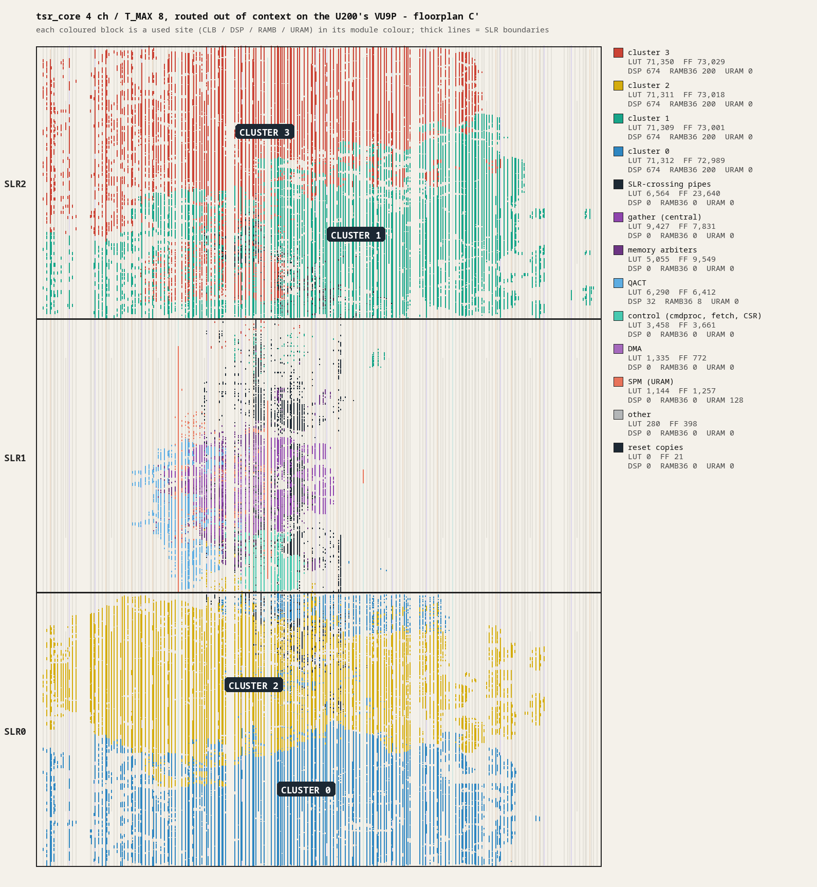
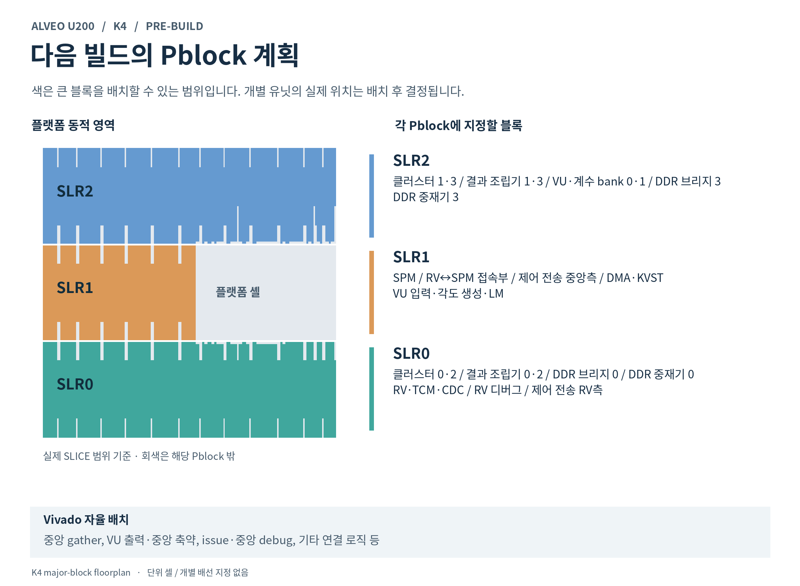
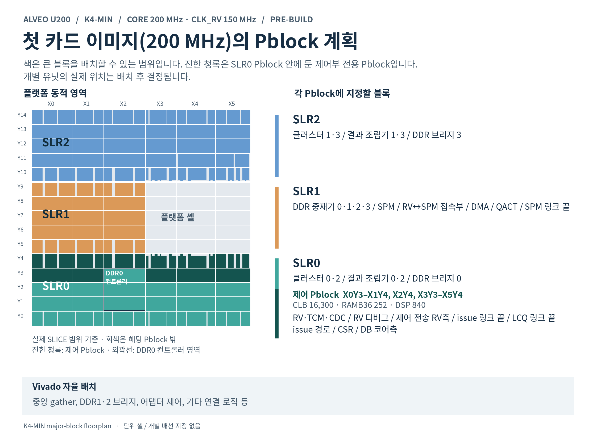

# Alveo U200 platform: XRT adapter, kernels, packaging and build

This document records the platform side of Tesseract on the Alveo U200: the XRT platform adapter
(`rtl/platform/alveo_xrt`) around `tsr_core`, the packaged kernels `tsr_u200_k1` and `tsr_u200_k4`, the
`v++` flow with its floorplan, the hardware results, and the card bring-up runbook with the results
of the card runs. The adapter is the platform adapter of the Alveo XRT target (`docs/spec.md` §2,
System structure): the core sees only its CSR port and one memory port per channel
([`docs/rtl-m2.md`](rtl-m2.md) §4, §6).

> **Scope.** As-built record and measurement record; every number carries its provenance. Status
> words: *on the card* = ran on an Alveo U200 (§14); *in the tree* = the adapter as simulated and
> linted: `ap_ctrl_none`, `MEM_EN`, two kernel clocks and platform error reporting are implemented;
> k1 / k4 builds are enabled. The corrected K4 link is in progress; its card gate remains pending.
> Historical card and link measurements below predate the control core unless a row names W4/W5.
> Current status: [handoff.md](handoff.md). Normative for the adapter:
> [EX](design/01-execution-model.md) §9 and [CC](design/04-control-core.md) §13.3, §14.

| | Before the control core (historical) | Current RTL (W4; card pending) |
|---|---|---|
| Control protocol | `ap_ctrl_none`, `interrupt="false"`; the host reads and writes registers | same; `ap_ctrl_hs` remains an unused design fallback (EX §9.1) |
| Kernel arguments | `ch<c>` at 0x040 + 8c | same |
| Channel bases | used live from the registers | latched at the rising edge of `ADAPTER_CTRL.MEM_EN`, locked while set |
| `ADAPTER_VERSION` | `{16'h0001, 8'h00, NUM_CH}` | unchanged |
| Clocks | `ap_clk` | `ap_clk` and `ap_clk_2` / `ap_rst_n_2` (control core clock `clk_rv`) |
| Core boundary | no `done`; the core issues no memory request | `clk_rv`, `rst_rv_n`, `plat_err_i`, `host_irq_o` (unconnected on the U200) |
| xclbin build | k1 and k4 stop with exit status 4; the M0 kernel builds | k1 and k4 enabled |

| Path | Content |
|---|---|
| `rtl/platform/alveo_xrt/tsr_xrt_kernel.sv` | the kernel body: reset distribution, control bridge, `tsr_core`, one AXI4 bridge per channel; AXI ports as packed `[NUM_CH]` vectors |
| `rtl/platform/alveo_xrt/tsr_xrt_ctrl.sv` | `s_axi_control` (AXI4-Lite slave): `ch<c>_base`, `ADAPTER_STATUS`, `ADAPTER_VERSION`, the core CSR window and its port arbiter |
| `rtl/platform/alveo_xrt/tsr_xrt_axi_bridge.sv` | one channel: core memory port ↔ AXI4 master, register slices, response ID filter, error events |
| `rtl/platform/alveo_xrt/tsr_xrt_slices.sv`, `tsr_xrt_reset.sv` | N register slices in series (`tsr_rslice`); reset pipeline and replication |
| `rtl/platform/alveo_xrt/tsr_u200_k1.v`, `tsr_u200_k4.v`, `kernel_k1.xml`, `kernel_k4.xml` | the packaged kernel tops (Verilog-2001, named ports) and their Vitis kernel descriptions, generated by `gen_tops.py` |
| `rtl/platform/alveo_xrt/filelist.f`, `lint.sh`, `package_xo.tcl` | platform filelist (after a core filelist), lint, `.xo` packaging |
| `hw/u200/k1.cfg`, `k4.cfg`, `k4_floorplan.tcl`, `build_xclbin.sh` | `v++` link configurations, the k4 SLR floorplan C'' (§8.1, §8.4), the xclbin build (§8) |
| `hw/u200/bw/` | the M0 kernel's link configuration and build script (`docs/m0-bw.md` §4) |
| `tb/platform/` | `test_platform.py` (adapter lint, build-script checks), the wrappers `sv/kwrap_*.sv`, `viv/kernel_ooc.tcl`; `bw/` is the M0 bench |
| `sw/transport/tsr_kdev_vkernel.cpp`, `sw/transport/tsr_vkernel_proto.h` | the `vkernel` client of the transport; the two-clock server is P5.3 (§13) |

---

## 1. Kernel interface

Vitis RTL kernels, module name = kernel name. The control protocol is **`ap_ctrl_none`**
(`hwControlProtocol="ap_ctrl_none"`, `interrupt="false"` in `kernel_k*.xml`): there is no
`ap_start` / `ap_done` and no interrupt; the host opens the compute unit with `xrt::ip`, reads and
writes registers and polls (EX §9.1; `docs/xrt-host.md` §2). The only kernel arguments are the
channel buffers `ch<c>`. Clocks: `ap_clk` / `ap_rst_n` for the core and `ap_clk_2` /
`ap_rst_n_2` for the control core. K4 requests 250 / 166.7 MHz; Vitis 2024.2 records the
second request as 166 MHz (§8). K4 acceptance is a core clock of at least 250 MHz, per the
user's 2026-11-02 decision. K1 retains its 300 MHz core request.
The earlier k4 image without the control core achieved
276.3 MHz (§8.2); that is not a result for the corrected design. Clock source and reset checks
are described in CC §11.1.

| Kernel | `NUM_CH` | `T_MAX` | Role |
|---|---|---|---|
| `tsr_u200_k1` | 1 | 1 | 1-channel bring-up bitstream (the M3 gate, Qwen2.5-0.5B Q8_0 on the card) |
| `tsr_u200_k4` | 4 | 8 | the target (4 channels, prefill up to 8 tokens) |

Both: the U200 bitstream parameters of `docs/rtl-m3.md` §14.2 (SPM 4 MiB with `SPM_RD_LAT` 4,
`MVM_BC_PIPE` 2, `MVM_RES_PIPE` 2, `MVM_MAC_LAT` 9, `RST_PIPE` 3: the core's own reset stages with a
copy per block, §5), `CH_BYTES` 16 GiB, the other `tsr_core` parameters at the U200 defaults
(`tsr_pkg::TSR_DEF_*`), `AXI_SLICES` 2, `RST_STAGES` 3 (`gen_tops.py` `COMMON`). `ap_rst_n` must stay
low for at least 4 cycles (§5). Synthesis sources: `rtl/filelist_xilinx.f` (Xilinx technology
wrappers, behaviour identical to `rtl/filelist.f`) + `rtl/platform/alveo_xrt/filelist.f`.

Ports: `s_axi_control` (AXI4-Lite, 32-bit data, 13-bit address, control range 0x2000) and
`m_axi_ch<c>` for c < `NUM_CH` (AXI4, 512-bit data, 64-bit address, 4-bit ID; signals ID, ADDR,
LEN, SIZE, BURST, LOCK, CACHE, PROT, QOS on AR / AW, DATA / STRB / LAST on W, ID / RESP on B,
ID / DATA / RESP / LAST on R).

Kernel arguments (`kernel_k*.xml`): `ch<c>` at 0x040 + 8c, 8 bytes, `void*` on `m_axi_ch<c>` (the
buffer bound to channel c); the argument ids are 0 to NUM_CH - 1. The core CSR window at 0x1000 has no
arguments.

The current core boundary (EX §9.3): the core has no `done` and has `clk_rv` / `rst_rv_n` (from
`ap_clk_2` / `ap_rst_n_2`), `plat_err_i` (a level from the platform: on the U200 `ADAPTER_STATUS` bits
0-2 or the error count not 0; it shows in `STATUS.PLAT_ERR`) and `host_irq_o` (not connected on the
U200).

## 2. `s_axi_control` register map

Byte offsets, decoded on bits [12:2]; unmapped offsets read 0 and ignore writes; every response is
OKAY. RW registers honour WSTRB. The historical column records the pre-control-core adapter;
the current column is implemented in `tsr_xrt_ctrl.sv` and follows EX §9.2.

| Offset | Name | Access | Before the control core (historical) | Current RTL (W4; card pending) |
|---|---|---|---|---|
| 0x000-0x03C | reserved | R | reads 0 | unchanged |
| 0x040 + 8c | `ch<c>_base` lo / hi | RW (c < NUM_CH) | device byte address of beat 0 of channel c; the host writes a 4 KiB-aligned address; the bridge uses the register value as written (no latch, no refusal of a misaligned base; the bridge only asserts the alignment in simulation) | written while `MEM_EN` = 0; a write while `MEM_EN` = 1 is ignored and sets `BASE_LOCKED` |
| 0x0E0 | `ADAPTER_CTRL` | RW | not implemented (reads 0) | bit0 `MEM_EN`: at its rising edge every base is checked for 4 KiB alignment and latched into the bridges (else `MEM_EN` stays 0 and `ADAPTER_STATUS` bit3 is set); core memory requests are held, not dropped, while it is 0 (`REQ_HELD`) |
| 0x0F0 | `ADAPTER_STATUS` | R / W1C, sticky | bit0 RRESP error, bit1 BRESP error, bit2 response with no outstanding request for its ID; bit3 reads 0; bits [31:16] saturating count of error responses (R beats and B responses with RRESP / BRESP not OKAY). W1C: a 1 in bit k (k < 3) clears bit k; a 1 anywhere in bits [31:16] clears the count (0xFFFFFFFF clears everything). An event in the same cycle wins over the clear | bit3 base not 4 KiB aligned at the `MEM_EN` edge, bit4 `REQ_HELD`, bit5 `BASE_LOCKED` (W1C for bits k < 6) |
| 0x0F4 | `ADAPTER_VERSION` | R | `{16'h0001, 8'h00, NUM_CH}`: major from `tsr_tables_pkg::TSR_ADAPTER_MAJOR` | unchanged |
| 0x1000 + off | core CSR window | | `off` < 0x1000 passes to the core CSR port at any time. Writes need WSTRB = 0xF (the CSR port has no byte enables; partial writes are dropped, still OKAY) | unchanged; the map behind it is EX §5 |

Access latency (measured in RTL simulation, ideal AXI4-Lite master, cycles from the
issuing cycle to the response handshake): adapter register read 5, write 5; window read 10,
write 10. One transaction at a time; when a read and a write are both pending they alternate.

The host (`docs/xrt-host.md` §3) reads and clears `ADAPTER_STATUS` at open, binds the channels
(bases, then `MEM_EN`) and reads it again when a launch answers `PLAT_ERR`. Under `xrt::ip` the
register access is memory-mapped MMIO and the compute unit is opened exclusively (EX §2.4, §9.1).

## 3. Launch protocol

The kernel has no start / done protocol. The host binds the channels with `MEM_EN`, loads and boots
the firmware image and launches kernels through the core CSR window (launch queue and completion
ring, EX §2-§4; `docs/xrt-host.md` §3). The launch costs are EX §4.11 and §14.5.

## 4. Memory bridges (one per channel)

| Core memory port (rtl-m2 §4) | AXI4 |
|---|---|
| read / write request `{addr, len, id}` | AR / AW: AxADDR = ch<c>_base + addr · 64, AxLEN = len − 1 (≤ 63), AxSIZE 6, AxBURST INCR, AxID = id, AxCACHE 4'b0011, AxPROT 0, AxLOCK 0, AxQOS 0 |
| write data `{data, last}` | W: WDATA, WLAST, WSTRB all ones |
| read response `{data, id, last}` | R: RDATA, RID, RLAST (RRESP → events) |
| write response `{id}` | B: BID (BRESP → events) |

- The core keeps every burst inside one 64-beat block of its channel, so with an aligned base no
  burst crosses 4 KiB. R beats of different IDs may interleave and arrive in order per ID (exactly
  what the core allows); one B per AW. The bridge passes them through unchanged.
- **Register slices**: `AXI_SLICES` (default 2) `tsr_rslice` stages on AR, AW, W, R and B (full
  throughput, valid / ready / payload registered on both sides) for the SLR crossings; R and B get
  one more slice after the ID filter, so every output of the kernel comes from a flop. The slice's
  payload registers load on enables of its own flops, never on the incoming valid (§8.3). Added
  latency: +2 cycles on requests, +3 on responses; measured in RTL simulation on the Qwen2.5-0.5B output-head MVM
  (569,760 weight beats per channel, `fast` memory): 569,853 MVM cycles through the kernel vs
  569,848 on the core alone — +5 cycles per MVM, no throughput loss (1.0002 cycles / beat).
- **ID filter**: per ID the number of bursts whose AR (AW) handshake happened at the AXI boundary
  and whose last R beat (B) has not passed the filter (8-bit read / 16-bit write counters; the
  handshake is registered once when `AXI_SLICES` ≥ 2, so the AXI READY inputs reach only the slices
  and one flop). A response for an ID with nothing outstanding is consumed, **dropped** (never
  forwarded: `tsr_mem_arb`'s outstanding counter would underflow) and reported (ADAPTER_STATUS
  bit2). A legal response always finds its count ≥ 1: it is presented at the earliest in the cycle
  after its request's handshake (edge t) and reaches the filter `AXI_SLICES` edges later, while the
  count is updated at edge t + 1 (registered handshake) or t (`AXI_SLICES` = 1) — one cycle of
  margin either way; the mutation campaign shows that a count one cycle too late is detected and
  that the zero-margin variants are equivalent (§10.3).
- **Errors**: R beats / B responses with RRESP / BRESP ≠ OKAY are forwarded like OKAY ones (the core
  has no error path for memory: its data may be wrong) and counted (ADAPTER_STATUS bits 0 / 1 and
  the count). The host reads ADAPTER_STATUS (§11) and treats a set bit as a failed launch.
- The bases are registered next to the adders (64-bit add per request). The current adapter reads
  the copy latched at the `MEM_EN` edge (§2); the pre-control-core adapter read the live registers.

## 5. Reset behaviour

`tsr_xrt_reset`: `ap_rst_n` → one register (`rst1_q`) → separate copies for the control bridge and
for every part of every channel bridge (stage 2, marked `keep` so synthesis does not merge them;
12 per channel: request slices, AXI-side slice stages and AR / AW handshake, read path, write path,
read and write counters in 4 ID groups each, so each copy can sit next to its part, also in another
SLR; §8.3) and a chain for the core (stage `RST_STAGES` = 3). Assertion reaches
every copy one cycle after `rst1_q` (each chain stage is AND-ed with `rst1_q`, which also keeps it
out of shift-register primitives); deassertion ripples, so the core leaves reset after the bridges
(a bridge slice in reset reports s_ready = 1 and would drop a request of a core already running).
Inside the core, `RST_PIPE` (passed through `tsr_xrt_kernel`; 3 in the U200 tops) adds
`RST_PIPE` − 2 = 1 shared stage and two stages replicated per block (CSR,
DMA, QACT, SPM, the arbiter of every channel, the MVM top, gather and every cluster; `tsr_core.sv`,
rtl-m3 §14.4): with the arbiters and clusters of the four channels in three SLRs, one reset net from
`tsr_xrt_reset` to all of them would miss 300 MHz. The core is a `RST_PIPE`-cycle-delayed copy of
itself (results and cycle behaviour after the reset unchanged), so its blocks see both edges of
`ap_rst_n` `RST_STAGES` − 2 + `RST_PIPE` = 4 cycles after the bridges.
All reset registers start at 0 (configuration INIT; simulation: no random start state), so the
kernel is held in reset until `ap_rst_n` is first seen high. They load in plain `always` blocks
(an `initial` value plus `always_ff` is illegal by IEEE 1800 9.2.2.4 and XSim, used by hw_emu,
rejects it; both packaged tops compile and elaborate in XSim 2024.2).

Requirements and guarantees:
- **Minimum reset**: `ap_rst_n` low for **≥ max(3, `RST_PIPE` + 1) cycles = 4 in the U200 tops**
  (Vitis' processor-system reset holds it far longer; not measured on a card). Two bounds:
  - 3, the AXI side: the AXI-side flops are reset 3 edges after `ap_rst_n` falls, so AxVALID /
    WVALID may stay high during the first 3 cycles of a reset (the interconnect is in reset then
    too) and are low from then on and in the first cycle after `ap_rst_n` rises. A 1-cycle pulse is
    shorter than the pipeline and leaves VALIDs high after the release (seen in the bench).
  - `RST_PIPE` + 1, the core: with `ap_rst_n` sampled low at edges 0 .. L − 1, the control and
    channel bridges are in reset at edges 2 .. L + 1 and take their first transfer at edge L + 2,
    while the core's blocks are reset from edge `RST_PIPE` + 2 on, so its outputs are quiet only
    after that edge. A released bridge sees only a quiet core when L + 1 ≥ `RST_PIPE` + 2, i.e.
    L ≥ `RST_PIPE` + 1; a shorter pulse lets a request or write beat of the pre-reset core through.
    Measured in RTL simulation on the packaged k1 (`RST_PIPE` 3): with 3-cycle pulses the directed `reset` test failed
    in 5 of 8 seeds ("write data offered while no run is active", always after a 3-cycle pulse);
    with 4, 5 and 20 cycles it passed seeds 1–12. The core itself sees its `rst_n` low for
    L + `RST_STAGES` − 2 = L + 1 cycles, ≥ `RST_PIPE` + 1 (rtl-m3 §14.4) for every L ≥ 3, so
    `tsr_xrt_reset` with `RST_STAGES` 3 needs no change.
  `tsr_xrt_kernel` checks the minimum in simulation (`$error` "ap_rst_n low for N cycles, minimum
  M"); the directed `reset` test used 4, 5 and 20 cycles (4 is the minimum for every
  `RST_PIPE` ≤ 3; the test returns with the adapter bench in Y5).
- **Everything inside the kernel is reset**: every slice, counter and FSM of the adapter and every
  control flop of the core. No beat buffered in the adapter before the reset reaches the core
  afterwards; ADAPTER_STATUS and the bases read 0; the core CSRs have their power-on
  values (`docs/spec.md` §21, Hardware reset).
- **Responses to pre-reset requests** (`docs/spec.md` §21, Hardware reset: a response to a request issued
  before the reset must not arrive after it; the platform adapter guarantees this): in Vitis the kernel's `ap_rst_n` and the interconnect / memory subsystem of the
  dynamic region come from the same reset and are asserted together (at xclbin load; XRT has no
  per-kernel reset for a kernel, `xbutil reset` resets the whole device), and AXI defines
  one ARESETn per interface for master and slave. So the adapter relies on the platform for the
  interconnect half: no response of a pre-reset request can arrive. On top of that it **detects and
  drops** any response whose ID has no outstanding request (§4) — a stale response that arrives
  before the core reuses its ID never reaches the core, and ADAPTER_STATUS bit2 reports it. It
  cannot tell a stale response from a new one once the core has reissued the same ID, and it cannot
  complete a write burst an interconnect still expects (sending W beats after a reset would corrupt
  the next write when the interconnect *was* reset); both would need a common reset, which Vitis
  provides.

In the designed adapter, `ap_rst_n_2` passes to the core as `rst_rv_n` (CC §13.3); `tsr_xrt_reset` is unchanged for `ap_clk`,
and the reset sequencing of the control core is CC §12.2.

## 6. Kernel tops and kernel.xml

`gen_tops.py` writes, from one table: `tsr_u200_k1.v` / `tsr_u200_k4.v` (Verilog-2001 like the RTL
Kernel Wizard's tops: the IP packager warns that SystemVerilog tops are "not fully supported"; the
body is SystemVerilog), `kernel_k1.xml` / `kernel_k4.xml` (the `ch<c>` arguments at the offsets of §1,
control range 0x2000, `hwControlProtocol="ap_ctrl_none"`, `interrupt="false"`) and the testbench
wrappers `tb/platform/sv/kwrap_*.sv` (the named top with the packed port list of `tsr_xrt_kernel`, so
one C++ testbench can drive the body and both packaged tops). `gen_tops.py --check` (run by
`lint.sh`) fails when a generated file is stale; it passes in the tree. The M0 kernel keeps
`ap_ctrl_hs` and an `interrupt` port (`docs/m0-bw.md` §2); Vitis names that port `interrupt`, a C++
keyword, which Verilator renames (`__SYM__interrupt`), with a targeted `SYMRSVDWORD` waiver in
`gen_bw.py`. Y5 adds `ap_clk_2` / `ap_rst_n_2` to the tops and confirms in its first smoke link that
`v++` 2024.2 accepts an `ap_ctrl_none` RTL kernel with `s_axi_control` and `m_axi` arguments and
honours its `sp=` connectivity; the fallback that needs no RTL change is EX §9.1's (`ap_ctrl_hs`
with `interrupt="false"`, 0x000 reading a constant `ap_idle`, never started).

## 7. Packaging (`package_xo.tcl`)

```
vivado -mode batch -nojournal -nolog -source rtl/platform/alveo_xrt/package_xo.tcl \
       -tclargs <repo> tsr_u200_k1|tsr_u200_k4 <outdir> [core_filelist]
```

A project with every source (core filelist, default `rtl/filelist_xilinx.f`, + the platform
filelist) and the kernel as top → `ipx::package_project` (sources imported) → Vitis kernel
properties (`sdx_kernel` rtl, no user parameters, ap_clk associated with `s_axi_control`,
`m_axi_ch<c>` and `ap_rst_n`, FREQ_HZ 300 MHz, m_axi hints MAX_BURST_LENGTH 64 /
NUM_READ_OUTSTANDING 16 / NUM_WRITE_OUTSTANDING 32, the register map with the args) →
`ipx::check_integrity -kernel` and `-xrt` → `package_xo` with `kernel_<k>.xml`.

The IP also carries the clock-domain-crossing constraints of the control core (CC §11.3, gate T3):
`rtl/ctrl/viv/tsr_ctrl_cdc.xdc`, copied to `xdc/tsr_ctrl_cdc.xdc` with `set tsr_cdc_core_port ap_clk` and
`set tsr_cdc_rv_port ap_clk_2` in front, in the IP's synthesis file group (used in synthesis, implementation and
out of context, processed late). It is plain XDC: Vivado's constraint reader accepts no `if`, `foreach`,
`proc` or `dict` (the first version with them was refused when the IP was read, "Command 'if' is not supported
in the xdc constraint file", and left every crossing unconstrained). It sets `ASYNC_REG` on the synchroniser
stages, `set_max_delay -datapath_only` (the smaller period) in both directions between `ap_clk` and `ap_clk_2`
and `set_bus_skew` on the gray registers; the `report_cdc` waivers (`rtl/ctrl/viv/tsr_cdc_waivers.tcl`) are
not constraints and stay out of the IP. Include files one directory below an include directory
(`common_cells/assertions.svh`, which `fifo_v3.sv` includes) are added to the IP under that relative path as
well: without them the packaged sources did not synthesise on their own ("cannot open include file").
`tb/platform/viv/xo_cdc.tcl` checks a packaged `.xo` (opt-in, Vivado): `create_ip` and `synth_ip` of the
kernel IP out of context, then `report_cdc` and `report_clock_interaction` of the two kernel clocks. For
`tsr_u200_k1` (2026-11-01, W4-B review): the IP's synthesis applies `xdc/tsr_ctrl_cdc.xdc` (1,464
`ASYNC_REG` cells), `report_cdc` lists 44 Info endpoints and nothing else, and both directions
`ap_clk` → `ap_clk_2` and back are "Max Delay Datapath Only"; without the constraints the two clocks
are "Timed (unsafe)" in both directions (whole-core out-of-context run: WNS -0.59 / -0.25 ns on the false
crossing paths), which is what a link of the earlier package would have had. The link repeats
the check on the routed design: `hw/u200/cdc_check.tcl` is the post-route hook of `k1.cfg` and `k4.cfg` and
fails the implementation run on an unconstrained or unsafe crossing (§8).

Clock/reset integration is checked before routing too. The configs request the two U200
scalable clocks with `kernel_frequency=0:250|1:166.666667` for K4 (core 300 for K1). Vitis 2024.2 truncates the second
request to 166 MHz in `clk_info` and the generated timing constraints (6.024096 ns).
The generated BD connects `ap_clk` to `ss_ucs/aclk_kernel_00` and `ap_clk_2` to
`ss_ucs/aclk_kernel_01`, with separate reset generators. `[clock] id` accepts only fixed
reference clocks on this platform (IDs 2/3/4); using it for scalable IDs 0/1 fails CFGEN.
This matches the PCIe `kernel_frequency` setting in AMD's
[two-clock RTL example](https://xilinx.github.io/Vitis_Accel_Examples/2024.1/html/rtl_vadd_2clks.html)
and the scalable-clock option in
[UG1702 2024.2](https://docs.amd.com/r/2024.2-English/ug1702-vitis-accelerated-reference/v-General-Options).
All external AXI interfaces remain on `ap_clk`; the secondary clock drives internal RV logic.

The installed Vitis 2024.2 helper has a separate compatibility problem: it passes the project
name to Vivado's part-keyed clock calculator and omits its input-period argument. The actual
retry reported `Invalid part string Project`, emitted a 1:1 generated clock and was stopped by
the pre-opt check at 9.999 ns. `clock_vitis_compat.tcl`, an `INIT_DESIGN.PRE` hook, adapts those
calculator calls for the pinned U200 part and tool version. It checks calculation success and
the effective ratio after the native writer's integer conversion, and cleans up on failure.
The native XDC creation/application remains in use. This is a repository workaround, not an
AMD-published patch. The real API probe calculates 166 MHz. The resumed link's pre-opt check
also passed with core/RV periods of 3.333/6.023 ns, all 4,225 RV FFs on the RV clock and the
reset sources in separate domains. The corrected build has also completed placement with
zero errors and passed its actual SLR locality check. Routing and frequency signoff are
pending; the placed comparison and remaining central congestion are in `docs/handoff.md`.
No installed or generated tool files are edited.
`hw/u200/clock_bd_check.tcl` checks the connected BD nets and each reset generator's clock.
`impl_pre.tcl` checks the synthesized domain clocks, every RV FF and reset sources before
`opt_design`, restores the scoped CDC XDC on the effective clocks, then applies the TCM
power-optimisation exclusion. `cdc_pre_route.tcl` repeats the clock/reset and effective CDC
checks before routing. The final pre-bitstream hook
checks `_new_clk_freq` after Vitis scaling against the window of the kernel it finds in the design:
`tsr_u200_k4` accepts exactly core 200 MHz and `clk_rv` 100 MHz (§8.7), `tsr_u200_k1` core 250 to
300 MHz and RV within the request's tolerance. These clock checks always fail the run on an error. `TSR_CDC_GATE=warn`
only relaxes the final CDC report gate. A 125 MHz RV fallback needs an explicit request and
frequency-window change. The early netlist check validates the current clock request, not
the minimum accepted performance. For a route-only run, check timing at an accepted core
frequency of the kernel's window (k4: 200 MHz; k1: at least 250 MHz) before claiming success;
retain RV, hold and CDC checks. Do not repeat implementation solely for 300 MHz after that
criterion passes.
The K4 locality post-hook also writes timing and congestion reports from the open design:
`k4_<step>_timing_summary.rpt` covers setup, hold and unconstrained paths, and
`k4_<step>_congestion.rpt` records congestion. The reports use separate placement, physical
optimisation and post-route physical-optimisation names. They do not change constraints.

The corrected linked physopt checkpoint exposed a separate constraint loss. Both clocks and
resets were correct, but FIFO crossings had a 0.040 ns related-clock requirement and no
datapath-only exception. Restoring the original `tsr_ctrl_cdc.xdc` at the kernel instance
restores the 3.333 ns requirement and kernel Gray-bus skew coverage. Reapplying the native
RV clock XDC afterwards did not reproduce the loss. The integration stage responsible remains
unproven. `cdc_restore.tcl` generates a run-local scoped XDC from the original source and
requires nonempty crossing paths, the intended bound, the CDC gate and kernel skew coverage.
It adds no false paths or new waivers. The route-pre hook fails if that coverage is lost.

Each packaging writes `build/u200/xo/<kernel>.sources.sha256` next to the `.xo`: the sha256 of
both filelists, every source, `kernel_<k>.xml`, `rtl/ctrl/viv/tsr_ctrl_cdc.xdc` and `package_xo.tcl`, with repository paths.
`cd <repo> && sha256sum -c build/u200/xo/<kernel>.sources.sha256` tells whether an `.xo` still
matches the working tree; `hw/u200/build_xclbin.sh` repackages when it does not (or the manifest
is missing), so a later core change can no longer slip into a link through a stale `.xo`
(review finding: the `.xo` of the first packaging predated core changes of the same evening).

Packaging of the tops on the dev host (Vivado 2024.2; first packaging 2026-10-23 evening, repackaged 2026-10-24
02:10 with `RST_PIPE` 2 in the tops, and again 2026-10-24 07:15 with the U200 bitstream parameters
(`MVM_MAC_LAT` 9, `RST_PIPE` 3), the reset-pulse check of §5 and the XSim-legal reset block, after
the core changes of part C — the table shows this packaging. Its manifests matched the working tree
then, and all 30 HDL sources inside each `.xo` (9 in `tsr_bw_k4.xo`) were compared byte for byte
with the working tree (the two technology wrappers with `rtl/tech/xilinx/`): equal. The core RTL
may still change: check the manifest before linking; `build_xclbin.sh` repackages by itself):

| Kernel | Time | Integrity (kernel / xrt) | `.xo` | Content |
|---|---|---|---|---|
| `tsr_u200_k1` | 17 s (1 min 47 s cold; first packaging) | passed / passed | `build/u200/xo/tsr_u200_k1.xo` 167,812 bytes, manifest of 35 files | `kernel.xml` (semantically equal to `kernel_k1.xml`), `xo.xml` (flows HW_EMU, SYSTEM), the IP: 30 sources, `component.xml` with bus interfaces m_axi_ch0, s_axi_control (aximm), ap_rst_n (ACTIVE_LOW), ap_clk (ASSOCIATED_BUSIF s_axi_control:m_axi_ch0, ASSOCIATED_RESET ap_rst_n, FREQ_HZ 300 MHz) |
| `tsr_u200_k4` | 17 s | passed / passed | `build/u200/xo/tsr_u200_k4.xo` 171,852 bytes, manifest of 35 files | the same with m_axi_ch0..3 and ch0..ch3 |
| `tsr_bw_k4` (M0, `docs/m0-bw.md` §4) | 16 s | passed / passed | `build/u200/xo/tsr_bw_k4.xo` 47,915 bytes, manifest of 12 files | repackaged for the reset block it shares (`tsr_xrt_reset.sv`) |

The k4 `.xo` was repackaged on 2026-10-25 (35 manifest files, integrity passed) for the k4 link (§8.2).
No k1 or k4 `.xo` has been packaged with the current `kernel_k*.xml` (`ap_ctrl_none`, `ch<c>` arguments
only) and `package_xo.tcl`; Y5 does it (§8).

Remaining packager warnings are cosmetic (no product guide, IP description = name) or transient
(FREQ_HZ / association warnings printed by `ipx::package_project` before the script sets them).

## 8. xclbin build (`hw/u200`)

`hw/u200/build_xclbin.sh k1|k4 [hw|hw_emu]`: packages the `.xo` when it is missing or its source
manifest no longer matches the working tree (§7), then `v++ --link -t <target> --platform <xpfm>
--config <out>/<k>.link.cfg` → `build/u200/<k>/tsr_u200_<k>.xclbin` (`TSR_U200_OUT` names another output
directory three levels below the repository, e.g. `build/link/<k>`). The k1 and k4 builds are enabled again
with the control core, the issue path, the vector unit, the attention modes, the DB block and the two-clock
adapter in the kernels (2026-11-01; `test_build_xclbin_args` checks the argument errors). `TSR_U200_PLATFORMINFO=1`
resolves the platform and prints its `platforminfo` (`test_build_xclbin_platform`, `test_build_xclbin_no_platform`).
The M0 kernel builds as before: `hw/u200/bw/build_bw_xclbin.sh [hw|hw_emu]` (`docs/m0-bw.md` §4).
`TSR_BUILD_JOBS` sets the link's synthesis / implementation jobs and Vivado's `general.maxThreads` (the configs: 8).
`TSR_U200_SYNTH_JOBS` independently sets concurrent IP synthesis jobs. The user changed the
K4 setting from 1 to the available logical CPU count (16) on 2026-11-02. `TSR_BUILD_JOBS`
remains 8, and the native flow reserves both host slots. The two-execution limit applies to
top-level runs; internal Vivado workers and the requested IP jobs are allowed. The general thread limit and
implementation jobs are requested as 8. Native Vitis lowers `general.maxThreads` to 1 for
synthesis runs; the generated synthesis script records that override. Invalid limits stop before
packaging. The isolated build-script regression checks the rendered jobs, clock request and hooks.

`<k>.link.cfg` is `hw/u200/<k>.cfg` with its hook paths made absolute: the configs give them relative
to `build/u200/<k>`, because v++ resolves a `TCL.PRE` path against its working directory (measured: a
path relative to the config file's directory fails with `[v++ 82-1104] A file path set by
'vivado.prop' option ... does not exist`). Platform `xilinx_u200_gen3x16_xdma_2_202110_1`, searched
in `$PLATFORM_REPO_PATHS` and `/opt/xilinx/platforms`; with `PLATFORM_REPO_PATHS` unset the script
uses `build/platforms/root/opt/xilinx/platforms` (the development platform extracted on the dev
host, §14) when that directory exists; when the platform is missing it stops with exit status 3 and
says what to install (tested: `test_build_xclbin_no_platform`; the dev-platform default:
`test_build_xclbin_platform`). Environment: `TSR_VIVADO_LOCK` (serialises Vivado / v++ runs with
`flock`), `TSR_U200_FLOORPLAN=0` (k4 without the floorplan), `TSR_U200_OUT` (output directory),
`TSR_VPP_TO_STEP` (`v++ --to_step`, e.g. `vpl.config_hw_runs`: project, block design, output
products and the implementation runs with their hooks, nothing synthesised),
`TSR_VPP_FROM_STEP` (`v++ --from_step`, e.g. `vpl.impl`: resume a link after a failed implementation run, the
synthesis is kept),
`TSR_VPP_REUSE_IMPL` (`v++ --reuse_impl <routed dcp>`: import the routed DCP of an earlier link and run only the frequency
scaling, `write_bitstream` and the xclbin packaging; a path that is not a file stops the script; the script also copies
`address_map.xml` and `kernel_service.*` from the earlier link's `tmp/link/int` while v++ runs, see §8.7;
`TSR_VPP_REUSE_INT` names that directory when the DCP path does not show it),
`TSR_U200_PLATFORMINFO=1` (resolve the platform, print its `platforminfo`, stop). Memory: on the
dev host (14 GB RAM, swap) the k1 link peaked at 15.3 GB and the M0 link at 18.3 GB
(Vivado-reported, write_bitstream) and both completed, using swap; the k4 link peaked at 29.6 GB
(§8.2) and completed with swap in 3 h 51 min. The script warns below 30 GiB of RAM.
`hw/u200/bw/build_bw_xclbin.sh` has the same platform default.

For a preserved K4 placement, `hw/u200/resume_impl.tcl` accepts the saved project path,
`k4_resume_pre.tcl` and `cdc_pre_route.tcl` as its three Tcl arguments. Run it through the
Vivado slot wrapper with 2024.2. Archive the existing run first: resetting from
`phys_opt_design` replaces later reports and checkpoints. A GateLvl fileset can have no TOP;
the driver validates the typed checkpoint records in the run's `gen_run.xml`, including run,
part and matching filenames. The helper restores the CDC and
floorplan state, moves only exclusive ATT stall reduction LUTs beside their SLR1 endpoint,
and preserves every other primitive's LOC/BEL. Their source FFs stay in their original
clusters. Each LUT half must report zero for `IS_USED`, `IS_RESERVED` and `PROHIBIT`, and
contain no logical cell. `IS_USED` also catches physical route-throughs that a logical-cell
query misses. It then launches through `route_design` with eight jobs, preserving native
ROUTE.POST processing. It requires successful run status, a new routed DCP and completion
markers. This path stops before bitstream generation and frequency acceptance.

| Config | Connectivity | Implementation |
|---|---|---|
| `k1.cfg` | `nk=tsr_u200_k1:1:tsr_k1`, `sp=tsr_k1.m_axi_ch0:DDR[1]`, `slr=tsr_k1:SLR1` | `kernel_frequency=0:300\|1:166.666667`; synth / impl jobs 8; placer `AltSpreadLogic_high`; phys_opt and post-route phys_opt on |
| `k4.cfg` | `nk=tsr_u200_k4:1:tsr_k4`, `sp=tsr_k4.m_axi_ch<c>:DDR[c]`; no `slr=` (one compute unit spanning three SLRs) | `kernel_frequency=0:250\|1:166.666667`; the same implementation options, plus floorplan C'' (`k4_floorplan.tcl` as the place_design pre-hook, CC §14.2) and locality checks after placement and physical optimisation |

Platform facts (the recorded `platforminfo`, `build/platforms/vpp-smoke/platforminfo.txt`, and the
platform's `hw/hw.xsa`, `tcl_hooks/impl.xdc` / `preopt.tcl`): DDR bank0 SLR0, bank1 SLR1, bank2
SLR1, bank3 SLR2 (so `sp=...:DDR[c]` puts channel c on bank c); the dynamic region has one pblock per
SLR, children of `pblock_dynamic_region`: `pblock_dynamic_SLR0` = CLOCKREGION_X0Y0:X5Y4 minus the
isolation pipeline slices, `pblock_dynamic_SLR1` = CLOCKREGION_X0Y5:X2Y9 (the rest of SLR1 is the
static shell; exactly the SLR1 stand-in of the out-of-context runs), `pblock_dynamic_SLR2` =
CLOCKREGION_X0Y10:X5Y14 minus the isolation slices, all `SNAPPING_MODE ON`; per-SLR resources
388,160 / 205,440 / 385,440 LUT, 2,280 / 1,320 / 2,280 DSP, 720 / 420 / 720 BRAM, 320 / 160 / 320
URAM. The platform's own implementation hooks are opt_design pre / post (`preopt.tcl` pins the DDR4
controllers' reset and clock-crossing logic into the pblock of their SLR, `postopt.tcl` sets clock
priorities). These describe the development platform; the shell flashed on the card is still to be
checked with `xbutil examine` / `xbmgmt examine` (§14 step 3).

Every SLR crossing inside the kernel is registered on both sides: `AXI_SLICES` 2 per AXI channel,
`MVM_BC_PIPE` / `MVM_RES_PIPE` 2 on the broadcast, weight-stream, result and gather pipes; the
per-part reset copies of each channel let every part of a bridge start its reset next to it
(§8.3).

### 8.1 Floorplan C' of `tsr_u200_k4` (`hw/u200/k4_floorplan.tcl`)

`tb/core/viv/core_slr.tcl` (rtl-m3 §14.5: the out-of-context floorplan that met 300 MHz, k4
+0.015 ns) translated to the kernel hierarchy (`<tsr_u200_k4 instance>/u_kernel/...`; the instance
is found by REF_NAME / ORIG_REF_NAME, else by the compute-unit name `*/tsr_k4/inst`) and to the
platform's pblocks, which the script never creates (it stops with an error when one is missing):

| Pblock | Content |
|---|---|
| `pblock_dynamic_SLR0` | clusters 0 and 2 with their result assemblers (`u_core/g_mvm.u_mvm/g_cl[c].u_cl`, `u_gather/g_asm[c].u_asm`); the AXI side of bridge 0 |
| `pblock_dynamic_SLR2` | clusters 1 and 3 with their assemblers; the AXI side of bridge 3 |
| `pblock_dynamic_SLR1` | the four memory arbiters, SPM, central gather, MVM dispatch, DMA, QACT, CSR; the control bridge `u_ctrl`, the reset block `u_rst`, bridges 1 and 2, the core side of bridges 0 and 3 |

The broadcast shares its first stage, `u_bc_head`, in SLR1. Each cluster retains its own
`g_cl[c].u_bcp` tail and decode in its destination SLR. With BC_PIPE=2 this keeps the original
two-cycle delay and one line per cycle while avoiding four independent source registers for
identical traffic. The floorplan also accepts archived checkpoints with the original split pipes.
The other pipes between a cluster (with its assembler) and the centre
(`g_cl[c].u_wrp` / `u_wqp`, `g_asm[c].u_sp` / `u_jp`) get their first stage in the source
SLR and their last in the destination SLR (one register-to-register hop per crossing), the result
pipe `u_rp` stays with its cluster, the core's reset copies stay free. Bridges 0 and 3 cross in
their AXI slices: the last stage of the AR / AW / W slice chains, the first stage of R / B and the
registered AR / AW handshake (`g_hs_q`) go to the DDR's SLR, the rest of the bridge (ID filter,
counters, output slices, base adders) stays in SLR1; the bridge's leaf cells are partitioned by
name, so no cell is in two pblocks. The script runs as the place_design pre-hook, i.e. after
opt_design like core_slr.tcl in the out-of-context flow; v++ sources it after its own hook and the
platform's hooks of that step (`scripts/impl_1/_full_place_pre.tcl` of the partial links, §8.2).
`TSR_K4_FP_BODY` / `TSR_K4_FP_CORE` point it at another hierarchy (validation only).
The VU's `u_lanes/u_share` result selector and its delay registers stay with the lanes in SLR0.
Front/back results share one return bus; the independent reduction drain keeps its own bus.
Both changes retain the four 512-bit weight streams and every numerical pipeline.

The current K4 request is core 250 MHz and RV 166.666667 MHz (Vitis truncates RV to 166).
The early clock gate reads the matching kernel config and rejects a stale 300 MHz core model.
The K1 request remains 300 MHz. Both flows retain a CDC bound no larger than 3.333 ns.

Validation without a link (Vivado 2024.2; stand-in pblocks copied verbatim from the platform's
`impl.xdc`; the script sourced after opt_design):
- **k4 core, T_MAX 8** (the final out-of-context checkpoint of rtl-m3 §14.3, `TSR_K4_FP_CORE=""`):
  every group found, 48 pipe stages pinned, central gather 18,869 and MVM-top 1,143 leaf cells (as
  in the out-of-context C' run), the reset copies free; 6.8 s. Assigned before placement, against
  the sites of the platform's pblocks:

  | Pblock | Sites: LUT / RAMB36 / URAM / DSP | Assigned (k4 core) |
  |---|---|---|
  | `pblock_dynamic_SLR0` | 383,840 / 720 / 320 / 2,280 | 124,448 LUT (32.4 %), 152,852 FF, 400 RAMB36 (55.6 %), 1,348 DSP (59.1 %) |
  | `pblock_dynamic_SLR1` | 199,680 / 420 / 160 / 1,320 | 25,493 LUT (12.8 %), 39,478 FF, 8 RAMB36, 128 URAM (80 %), 32 DSP |
  | `pblock_dynamic_SLR2` | 381,120 / 720 / 320 / 2,280 | 124,483 LUT (32.7 %), 152,920 FF, 400 RAMB36 (55.6 %), 1,348 DSP (59.1 %) |

  (LUT sites = 8 × the SLICE sites in the pblock; the SLR1 pblock counts 199,680, against 205,440
  in `platforminfo` and in the out-of-context stand-in over the same clock regions.)
- **4-channel kernel** (`tsr_u200_k4` with T_MAX 1 under an IP-style wrapper instance `inst`,
  synthesised out of context from the working tree: 2 min 6 s, 5.6 GB peak): the instance found by
  REF_NAME; 48 stages pinned; bridges 0 and 3: 3,595 leaf cells each on the DDR side (the five
  AXI-side slice stages and the handshake flops), 6,404 in SLR1; 12.0 s. Vivado's `-filter {NAME
  =~ ...}` takes `[ ]` literally (the same leaf count as through `current_instance`).

Placement, routing and timing with the shell: the k4 link of §8.2 (floorplan C' as validated here).
The memory subsystem that v++ adds per DDR bank was measured in the M0 link.

**Real placement.** The image below is the routed 4-channel `T_MAX` 8 core without the control core (out of
context, floorplan C'), drawn from the checkpoint by [`hw/viz`](../hw/viz/README.md): every used site
in the colour of its module. Clusters 0 and 2 fill SLR0, clusters 1 and 3 fill SLR2, and SLR1 holds
the central gather, QACT, control, the SPM's URAM column and the pipes that cross the SLR
boundaries. Full-device views after the `v++` link:
[k1 kernel with the XRT shell](fig/floorplan/k1-linked.png) and
[M0 bandwidth kernel with the four DDR4 controllers](fig/floorplan/bw-linked.png).

<p align="center"></p>

### 8.2 What ran: partial links, hardware links, relinks, hw_emu, the k4 link

These runs used `build_xclbin.sh` and `build_bw_xclbin.sh` (2026-10-24 to 2026-10-26), before the control
core, the vector unit and the DB block were in the kernels; the links with them are §8.5. Provenance: *measured in Vivado 2024.2
(linked)* unless stated.

- `TSR_U200_PLATFORMINFO=1 hw/u200/build_xclbin.sh k4` with `PLATFORM_REPO_PATHS` unset: the script
  finds `build/platforms/root/opt/xilinx/platforms/xilinx_u200_gen3x16_xdma_2_202110_1/
  xilinx_u200_gen3x16_xdma_2_202110_1.xpfm` and prints the `platforminfo` of the facts above
  (`test_build_xclbin_platform` checks the bank SLRs).
- `TSR_VPP_TO_STEP=vpl.config_hw_runs TSR_U200_OUT=<scratch> hw/u200/build_xclbin.sh k4`, then `k1`
  (`PLATFORM_REPO_PATHS` unset; the `.xo` manifests matched, so no repackaging): `v++` rc 0 after
  `vpl.config_hw_runs` (system link, block design with the compute unit and the memory subsystem,
  output products, synthesis and implementation runs set up; nothing synthesised), 2 min 7 s (k4) /
  1 min 20 s (k1) of `v++` time. The only warnings: `kernel_frequency=300` equals the platform default
  and is ignored (`[v++ 60-889]`), and no generated-reports log yet. In the generated project:
  - k4: `scripts/impl_1/_full_place_pre.tcl` sources v++'s own place hook, then
    `<repo>/hw/u200/k4_floorplan.tcl`; `_full_opt_pre.tcl` sources v++'s hook, then the platform's
    `preopt.tcl`; `impl_1` has `STEPS.PLACE_DESIGN.ARGS.DIRECTIVE AltSpreadLogic_high` and phys_opt /
    post-route phys_opt enabled.
  - k4 memory paths: `m_axi_ch0` → memory subsystem `S04_AXI` → `interconnect_ddr4_mem00`, whose
    entry pipeline the subsystem's own constraints pin into `pblock_dynamic_SLR0`; `ch1` → `S05` →
    `interconnect_m00_axi_mem00` (DDR[1] through the static region; SLR1); `ch2` → `S06` →
    `interconnect_ddr4_mem01` (SLR1); `ch3` → `S07` → `interconnect_ddr4_mem02` (SLR2). So the
    entries of channels 0 and 3 sit in SLR0 / SLR2, where floorplan C' puts the AXI side of bridges
    0 / 3, and those of channels 1 and 2 in SLR1 with their bridges.
  - k4 has no `slr=`: v++ gives the compute unit `SLR_Affinity SLR0`, so `ap_rst_n` comes from the
    SLR0 processor-system reset `ip_psr_aresetn_kernel_00_slr0` (one flop on the net inside the
    kernel, `rst1_q` of `u_rst` in SLR1) and `s_axi_control` from `ict_axi_ctrl_user_00`. k1:
    `SLR_ASSIGNMENTS SLR1` (`slr=tsr_k1:SLR1`).
- The hook rules (a relative `TCL.PRE` path is resolved against v++'s working directory; user hooks
  are appended to `_full_<step>.tcl` after v++'s and the platform's) were first seen in a partial
  link (to `vpl.config_hw_runs`) of the platform's vadd smoke kernel with a test configuration.
- **k1 hardware link** (first link, the RTL before §8.3): `TSR_VIVADO_LOCK=<lock>
  hw/u200/build_xclbin.sh k1` (target hw, the extracted platform, the `.xo` manifest matched so no
  repackaging): `v++` rc 0 after 57 min 3 s wall: system synthesis 17:49 (140 out-of-context jobs;
  the kernel IP's own synthesis 3:06 at 4.1 GB), implementation 37:56 (link_design 3:23, opt 1:21,
  place 15:10, route 7:43, write_bitstream 4:38). Output `build/u200/k1/tsr_u200_k1.xclbin` (since
  replaced by the relink below), 46,158,952 bytes, xclbin UUID
  `7f2b48cc-9d7a-1838-baed-efb719cd9a6c` (`xclbinutil --info`; platform static UUID
  `0dd37306-b7f6-57a3-bd57-680fe9dad3a1`).
  - Timing: after placement WNS −0.071 ns (1 endpoint); routed and after post-route phys_opt
    **WNS +0.011 ns, TNS 0, WHS +0.009 ns, THS 0**, all constraints met. The worst path is in the
    kernel: the SPM read offset register `u_core/u_spm/g_in_reg.rd_off_s` → URAM cascade address
    `CAS_IN_ADDR_A` of `g_bank[0].u_ram` (3 cascaded URAM288, 1.9 ns of routing, −0.19 ns clock
    skew; bank 1: +0.039 ns), the path of the out-of-context k1 run (+0.121 ns, rtl-m3 §14.3),
    0.110 ns less. Next: the reset copy `u_rst/ch_q[0]` → the bridge's write counters, +0.037 to
    +0.044 ns (0 levels, 3.07 ns of routing).
  - Kernel clock: v++'s auto-scaling computed 301.0 MHz and kept the requested 300 MHz
    (`AUTO-FREQ-SCALING-08`); clock topology DATA 300 MHz, KERNEL 500 MHz.
  - Resources (kernel utilisation report, routed): 33,276 LUT (1,805 as memory), 49,929 FF,
    40 RAMB36, 128 URAM, 182 DSP, all in SLR1 (`slr=SLR1`: 0 leaf cells in SLR0 / SLR2, 0 kernel
    nets crossing an SLR); 4,090 SLLs in the whole design.
  - Memory: Vivado-reported peaks 13.7 GB (place), 13.8 GB (route), 15.3 GB (write_bitstream);
    measured (5 s samples) at most 11.87 GB resident for the implementation process and 16.5 GB
    resident plus swap for the process tree; lowest free memory 948 MB, swap use up to 6.6 GB.
  - Warnings: 5 CRITICAL WARNINGs `[Netlist 29-72]` in the kernel synthesis ("Incorrect value '1'b1'
    specified for property 'KEEP'", `tsr_mvm.sv` 410 / 442, `tsr_mvm_gather.sv` 369; '1'b0' at 484 /
    497): Vivado reads the `tsr_vpipe` parameter named `KEEP` as the instance's KEEP property and
    drops that instance-level value. Harmless: on the kernel synthesis checkpoint every kept stage
    register still has KEEP = yes (`u_bcp` 1,058, `u_wrp` 1,032, `u_sp` 134) and none is packed into
    an SRL; the out-of-context runs of rtl-m3 §14 do not show them. The parameter is `KEEP_REGS`
    (renamed after these links, 2026-10-24); the k1 relink's kernel synthesis (below) has no
    critical warning. Both first hardware links also give 1 CRITICAL WARNING `[Vivado 12-4430]` (the
    HDPR-5 DRC lowered to a warning), from v++'s own `_vpl_pre_place.tcl`.
- **M0 hardware link** (`hw/u200/bw/build_bw_xclbin.sh hw`, `docs/m0-bw.md` §4.1): 1 h 28 min,
  WNS +0.017 ns, 300 MHz kept.
- **Relinks after the margin changes** (§8.3 and rtl-m3 §14.9; from 20:07, M0 first, then k1,
  every Vivado / `v++` call under the shared lock): both `.xo` manifests no longer matched (bw 5,
  k1 11 mismatches), so the build scripts repackaged them (integrity passed; after the links
  12 / 12 and 35 / 35 files match). `xclbinutil --info` of both new xclbins differs from the first
  links only in the UUID (arguments, memory topology, clocks). M0: `docs/m0-bw.md` §4.1 (kernel
  clock +0.025 → +0.055 ns). **k1**: `v++` rc 0 after 57 min 18 s with the repackaging (system
  synthesis 17:53, the kernel's own 3:01 at 4.1 GB with 0 critical warnings; implementation 37:46:
  link_design 3:25, opt 1:21, place 15:07, phys_opt 0:33, route 7:40, write_bitstream 4:34).
  Output 46,356,776 bytes, UUID `11b51190-3570-b60a-d2be-631b8237405b`.
  - Timing: after placement −0.079 ns; routed and after post-route phys_opt **WNS +0.017 ns** (the
    shell's XDMA clock), **TNS 0, WHS +0.009 ns, THS 0**, all constraints met; kernel clock WNS
    +0.060 / WHS +0.010 ns, on shell logic. Auto-scaling computed 305.5 MHz (first link 301.0) and
    kept 300 MHz.
  - Worst kernel paths: the gather job-pipe slice `g_asm[0].u_jp` `rdy_q` replica → `skid_q` CE,
    +0.075 ns (0 levels, fan-out 154, 2.98 ns of routing; the slice enable of §8.3), the same slice
    → `main_q` D +0.083, the result-pipe slice `g_cl[0].u_rp` +0.087 (fan-out 240), the QACT
    multiplier +0.091 (5 DSP levels), cmdproc state → `dma_cmd_q` CE +0.093 (fan-out 596). The
    first link's two worst: SPM cascade address +0.011 → +0.237 ns (enables +0.146 → +0.215; the
    SPM's worst is the shared write data → `CAS_IN_DIN_B`, +0.134), reset copy → bridge
    counters +0.037 → +1.381 ns (the stage feeding the copies +0.379).
  - Resources: 33,502 LUT (+226), 51,212 FF (+1,283: SPM +1,043, bridge +124, MVM +101, reset
    +11), 1,805 LUTRAM, 40 RAMB36, 128 URAM, 182 DSP, all in SLR1, 0 kernel nets crossing an SLR;
    4,099 SLLs in the whole design.
  - Memory: Vivado-reported peaks 13.7 / 13.8 / 15.3 GB (place / route / write_bitstream, as
    before); measured at most 11.85 GB resident for the implementation process, 16.6 GB resident
    plus swap for the tree (synthesis 17.7 GB); lowest available memory 808 MB, swap up to 6.7 GB.
  - The hw_emu xclbin was not rebuilt.
- **k1 hw_emu** (`hw/u200/build_xclbin.sh k1 hw_emu`, 2 min 17 s, `docs/xrt-host.md` §9): the
  memory ranges and the DMA paths pass, with
  `TSR_XRT_CH_GIB=3 TSR_XRT_DMA=staged TSR_XRT_DMA_ALIGN=4096` around two defects of the 2024.2
  simulator models.
- **Memory topology** of both hardware xclbins (`xclbinutil --info`): bank0..bank3 at
  0x4000000000 + 0x1000000000 · bank, 16 GiB each (k1 uses bank1 at 0x5000000000; the hw_emu
  xclbin has bank1 at 0x800000000), plus PLRAM[0..2] and HOST[0]. bank3 has type `MEM_DRAM`, banks
  0–2 `MEM_DDR4`: the transport and `tsr_bw` do not check the type (they take the size of the
  port's memory group), but the metadata-only xclbins of the no-op tests
  (`sw/transport/tests/test_xrt_noop.cpp`, `tb/platform/bw/noop/mk_bw_xclbin.cpp`) use `MEM_DDR4`
  for every bank.
- **k4 hardware link** (2026-10-25; `TSR_VIVADO_LOCK=<lock> hw/u200/build_xclbin.sh k4`: target hw,
  floorplan C' and `AltSpreadLogic_high` from `k4.cfg`; the `.xo` was repackaged first, integrity
  passed, 35 manifest files, so the link has the RTL with the §8.3 changes): `v++` rc 0 after
  3 h 51 min 5 s wall on the 14 GB dev host with swap. Vivado steps (elapsed): opt_design 13:05,
  place_design 58:58, phys_opt 10:07, route_design 59:55, post-route phys_opt 22:42, write_bitstream
  9:20. Output `build/u200/k4/tsr_u200_k4.xclbin`, 75,757,475 bytes, UUID
  `cf69a2cd-981d-ae88-43f0-b8c11f25e63a`.
  - Timing, routed and after post-route phys_opt (identical): **WNS -0.285 ns, TNS -56.460 ns, 809
    failing endpoints of 2,214,116, WHS +0.007 ns**. `v++` scaled the kernel clock from the requested
    300 MHz to **276.3 MHz** (`AUTO-FREQ-SCALING-04`); the xclbin's clock topology has DATA_CLK
    276 MHz (`ss_ucs_aclk_kernel_00`, scalable) and KERNEL_CLK 500 MHz (`ss_ucs_aclk_kernel_01`,
    requested and achieved 500 MHz). The worst paths are in the gather's job pipes (§14.1 step 12).
  - Resources (kernel utilisation report, routed): 280,331 LUT (4,938 as memory), 374,402 FF, 808
    RAMB36, 128 URAM, 2,728 DSP. Whole design with the shell, per SLR (SLR0 / SLR1 / SLR2): CLB LUT
    156,977 / 227,188 / 158,409 (39.8 / 57.7 / 40.2 % of the SLR), DSP 1,351 / 42 / 1,351, RAMB36
    tiles 462.5 / 313 / 462.5, URAM 0 / 148 / 0; 13,822 SLLs in the design.
  - Memory: Vivado-reported peaks 19.8 GB (opt_design), 27.0 GB (place_design), 29.3 GB
    (route_design), 29.6 GB (write_bitstream). Measured with up to 28 GB of swap in use (§14.1).
  - Source: `build/u200/k4/` (`v++_link.log`, `reports/link/imp/*.rpt`; not in git). *Measured in
    Vivado 2024.2 (linked).*

What the measured runs predicted before the k4 link (an estimate, kept to show how it compared):
- Memory: Vivado's place / route peak was 16.5 GB in the M0 link (four DDR banks, a small kernel),
  13.7 GB in the k1 link, 13.5 GB in the out-of-context k4 run (6.1 GB out-of-context k1), so the
  linked k4 was expected to need about 25 GB at place / route and 27 GB at write_bitstream. The
  measured peaks were 27.0, 29.3 and 29.6 GB.
- Placement: the M0 link shows what v++ adds per extra DDR bank in that bank's SLR (about 30.5 K
  LUT, 42.5 K FF, 61 RAMB36, 3 DSP); with floorplan C', SLR0 and SLR2 were then expected at about
  155 K LUT (40 %), 461 RAMB36 (64 %) and 1,351 DSP (59 %) of their pblocks. Measured: 157-158 K
  LUT, 462.5 RAMB36, 1,351 DSP per SLR (whole design with the shell).
- Timing: the first links cost 0.110 ns of margin on k1 and 0.216 ns on the M0 kernel clock against
  their out-of-context runs; with k4's then +0.015 ns out of context its link was expected near
  -0.1 to -0.2 ns (`v++` would then lower the scalable kernel clock to about 291 / 283 MHz). The
  measured link missed by 0.285 ns, at 276.3 MHz.
  Proposals made then: one kept copy of `tsr_spm`'s read / write address register per bank, or
  `cascade_height = 2` on the URAM style of `rtl/tech/xilinx/tsr_sram_1r1w.sv` with the extra
  output mux absorbed in the `SPM_RD_LAT` 4 pipeline (the SPM cascade address: k1's and the
  out-of-context k4's worst); `tsr_rslice` loading `main_q` whenever `m_free` (`if (m_free) main_q
  <= rdy_q ? s_data : skid_q;`, equivalent at the valid-qualified interface; the clock-enable
  fan-out is the M0 link's worst, and the slice is in every bridge); `tsr_xrt_reset`'s `ch_q`
  replicated per bridge part at the same stage (k1's second worst). All three were applied before
  the k4 link: the last two as proposed (§8.3), the SPM as 8 column slices per bank with a kept
  input-register copy per slice (the per-bank copy and `cascade_height = 2` were measured and
  rejected; rtl-m3 §14.9). After them, measured: k4 +0.022 ns out of context (rtl-m3 §14.9); in the
  relinks the worst kernel path is +0.075 ns on k1 (the k1 core out of context: +0.100 ns) and
  +0.110 ns on M0 (out of context: +0.278 ns, §8.3). The linked k4 was limited elsewhere: the
  gather's job-pipe slices; the planned fix (`tsr_rslice` FORM 1 on the last stage of every job pipe,
  pinning the job-pipe stage-0 registers) is CC §14.4 and part of gate T3 (§8.4).

### 8.3 Margin changes after the links: slice enables, reset copies (2026-10-24)

Two of the §8.2 proposals, applied after the first k1 / M0 links (both relinked with them, §8.2;
k4's `.xo` predates them, so `build_xclbin.sh` repackages it):
- **`tsr_rslice` payload enables** (`rtl/core/tsr_mem_arb.sv`): `main_q` loads whenever the main
  entry is free or handed over (`m_free`), `skid_q` whenever the skid entry is empty (`rdy_q`);
  neither enable contains `s_valid`, which in a chain is the previous stage's `main_v_q` (the M0
  link's worst kernel path, ~530 loads). Every valid / ready flop is unchanged, so transfers, their
  order and their cycles are identical; `m_data` differs only while `m_valid` = 0 (don't-care, every
  user qualifies it). With a constant `m_ready` (the R / B chains of `tsr_bw_k4`) the payload
  registers have no clock enable at all.
- **Reset copies per bridge part** (`tsr_xrt_reset` `CH_COPIES`, `tsr_xrt_axi_bridge` `CNT_RST`): per
  channel 12 equal stage-2 copies instead of one (13 in `tsr_bw_k4`, the engine has its own):
  request slices, the AXI-side slice stages with the AR / AW handshake registers (the cells
  floorplan C' moves to the DDR's SLR, §8.1), the read path, the write path, and the read and the
  write counters in 4 ID groups each. The bridge checks in simulation that all copies are equal.
  Stages, the reset minimum (max(3, `RST_PIPE` + 1), §5) and the kernel's reset-pulse check are
  unchanged.

Measured, out of context (`tsr_bw_k4` and `tsr_u200_k1`, the flows of `tb/platform/bw/viv/bw_ooc.tcl`
/ `tb/platform/viv/kernel_ooc.tcl` with opt / place / phys_opt / route; Vivado 2024.2; the RTL of
HEAD 75798f1 ("base") against base plus only these two changes, so other work in progress is not
included):

| | `tsr_bw_k4` base | `tsr_bw_k4` new | `tsr_u200_k1` base | `tsr_u200_k1` new |
|---|---|---|---|---|
| routed WNS (worst path) | +0.286 ns (R slice `main_v_q` → next `main_q` CE, 0 levels, 2.867 ns net) | +0.278 ns (`u_ctrl` result select → engine result register, 2 levels) | +0.110 ns (core: actbuf BRAM address) | +0.075 ns (core: QACT multiplier, 5 levels) |
| worst bridge payload CE path | +0.286 ns (the WNS path) | +0.569 ns (from the AWREADY input) | +0.359 ns (from WREADY) | +0.326 ns (from WREADY) |
| `u_rst` → bridge write counters (reset) | +0.490 ns (0 levels, 2.646 ns) | +1.988 ns (1.148 ns) | +0.437 ns (0 levels, 2.701 ns) | +2.184 ns (0.952 ns) |
| payload CE nets per bridge (synthesis) | 11, max 549 loads | 6 constant + 6, max 83 | 11, max 519 | 2 constant + 9, max 519 |

The worst paths of the new runs are outside the changed logic (the k1 one in the core, which
neither change touches); placement differs between runs, so a different worst path at a similar
slack is expected. An intermediate variant with one copy per bridge part but one copy for all write
counters routed worse than base in `tsr_bw_k4` (+0.183 ns, that copy to `wr_cnt_q`, 2.955 ns): the
counter groups are needed. Linked with these changes (and those of rtl-m3 §14.9), §8.2: the M0
kernel's previous worst path (R slice `main_v_q` → `main_q` CE) is gone and its worst
payload-enable path is +0.168 ns; in k1 the reset copy → bridge counters path went from +0.037 to
+1.381 ns, in M0 from +0.046 to +0.788 ns. The new worst kernel paths of both links start at a
slice's `rdy_q` (k1: `skid_q` CE, +0.075 ns, fan-out 154; M0: a W slice's `main_q` S pin,
+0.110 ns, fan-out 283). Not measured: a k4 link.

Verification (Verilator 5.046; "A/B" = the same replay with the same seeds on base and on base plus
these changes, every per-run field compared: STATUS / ERR, cycles, PERF_*, MVM cycles, per-port and
weight-stream beats, kernel overhead and bases): all identical, 0 failed. `tsr_rslice` alone, old vs
new on the same random stimulus (1 and 3 stages, random and always-ready sinks, random resets, 4 M
cycles each), shows 0 mismatches of s_ready / m_valid / valid m_data; two broken variants (skid
always loaded, main ignoring `m_free`) mismatch at once. Replays on the core (1,952 runs; again with
the U200 parameters and `--reset-each`, 1,952 runs), on the kernel body (1,952 runs; `AXI_SLICES` 1
and 3, 496 each; the U200 parameters with `--reset-each`, 688), on the packaged `tsr_u200_k1` (112
generated 1-channel traces, 448 runs plus 224 with `--reset-each`) and on the packaged `tsr_u200_k4`
(400 runs) are A/B identical.

### 8.4 Floorplan C'' and the SLR1 budget

The control core, issue path, vector unit, debug block and attention modes are in the RTL (W4-A, W4-B) and
designed in [CC](design/04-control-core.md) §14; the floorplan C'' below is `hw/u200/k4_floorplan.tcl`
(2026-11-01), also what `tb/core/viv/core_slr.tcl` applies to the out-of-context core. *Estimate
(docs/design/04-control-core.md section 14.1)* unless stated.

- **Floorplan C''** extends C' (§8.1): the 16 lanes of the vector unit sit in `pblock_dynamic_SLR0` behind
  `VU_LANE_PIPE` 2 register stages on each side (`rtl/core/tsr_vu_lanes.sv`; the input pipes' first and the output
  pipes' last stage beside the injector and writer in SLR1, +4 cycles on every lane exit and partial drain read,
  results bit-exact: unit bench with 2 and 3 stages, `core_m7` with 2); a `ctrl_rv` sub-pblock
  `pblock_tsr_ctrl_rv` of `pblock_dynamic_SLR1` (`CLOCKREGION_X0Y6:CLOCKREGION_X0Y8`: 108 RAMB36, 0 URAM; the SPM's
  URAM columns are X1 and X2) holds `tsr_ctrl_rv` (Ibex, debug module, TCMs, bus, control window); every other block
  of the core (the rest of `u_ctrl` with the CDC, `u_issue`, `u_csr`, the DB block, SPM, DMA, QACT, arbiters, the
  SPM-facing part of the VU, the central gather) is assigned to `pblock_dynamic_SLR1`, whole hierarchical cells or
  leaf cells by name; the clusters, with the attention modes, stay in SLR0 and SLR2, and the attention job pipe
  (`g_ajp.u_ajp`) and the assemblers' job pipe (`g_jp.u_jp` + `u_jl`) are pinned like the other pipes.
  k1 stays entirely in SLR1 (`k1.cfg`: `slr=tsr_k1:SLR1`) and has no floorplan hook; see the budget below.
  The TCMs are RAMB36 in every flow (`rtl/ctrl/viv/tsr_ctrl_tcm.xdc`: `core_ooc.tcl`, `kernel_ooc.tcl`, the kernel IP;
  measured: 128 URAM, the SPM's, in the whole-core synthesis of k4, where the first whole-core synthesis had 140).
- **SLR1 budget** (`pblock_dynamic_SLR1`: 199,680 LUT sites, 420 RAMB36, 160 URAM, 1,320 DSP): the
  k4 core's part in SLR1 (25.5 K LUT, 8 RAMB36, 128 URAM, 32 DSP, measured out of context) and the DDR[2]
  memory subsystem (30.5 K LUT, 61 RAMB36, 3 DSP, measured in the M0 link) plus the control core blocks come to
  about 125-143 K LUT (62-72 % of the LUT sites), 148 RAMB36 (35 %), 128 URAM and 405-407 DSP (31 %).
  The vector unit is the largest item (about 48 K LUT and 366 DSP, +-30 %). **Gate CC-24:** at
  most 65 % of the LUT sites (about 130 K) after synthesis; the remedies, in order, are the VU shrink
  knobs (`VU_EXP_LANES` 8, `VU_BACK_LANES` 4: -8.7 K LUT, -124 DSP), DB `HAS_TRW` = 0 with
  `HIST_DEPTH` = 0, and moving the VU lanes to SLR0 behind registered pipes. The table is CC §14.1.
- **Timing gates** (CC §14.3): T1, the control core out of context at 166.7 MHz (6.0 ns met with at
  least 0.3 ns margin); T2, the k4 core with control core, VU, attention modes, DB and floorplan C''
  out of context at 3.333 ns (WNS not below 0, SLR1 at most 65 %), preceded by the out-of-context
  VU run that fixes the VU configuration; T3, the k4 `v++` link with a kernel clock of at least
  250 MHz (user decision, 2026-11-02), zero unconstrained `ap_clk` / `ap_clk_2` paths
  and a clean `report_cdc`; T4, the k1 link at 300 MHz. The fix of the gather job-pipe paths that
  limited the k4 link of §8.2 (`tsr_rslice` FORM 1, CC §14.4) is part of T3.

### 8.5 The links with the control core, the vector unit and the DB block (2026-11-01)

*Measured in Vivado 2024.2 (out of context, `tb/core/viv/core_ooc.sh k4`, xcu200-2, 3.333 ns, `VU_LANE_PIPE` 2, the
TCM constraint of `rtl/ctrl/viv/tsr_ctrl_tcm.xdc`).* Whole-core synthesis of k4: 600,036 LUT cells (533,573 CLB LUTs),
620,499 FF, 3,360 DSP, 967 RAMB36 + 92 RAMB18, 128 URAM (the SPM's: the TCMs are 48 RAMB36 in `u_ctrl/u_rv`, the first
whole-core synthesis had 140 URAM with the ITCM in a URAM cascade; the kernel IP of the link synthesises to the same
967 / 128); the control subsystem 10.8 K LUT, the issue path 7.7 K, `tsr_csr` 5.6 K, the vector unit 88.0 K (lanes
51.0 K LUT, 73.8 K FF, 368 DSP; their pipes 6,734 FF; the SPM-facing part 37.0 K); `report_cdc` gate PASS (unsafe 0,
unconstrained 0); WNS -0.438 ns after synthesis, in the DB trace writer and stop logic (16 levels). Placed with
floorplan C'' (`core_slr.tcl`, `place_design` directive `AltSpreadLogic_high`, 1 h 08 min on the loaded host): per SLR
(LUT / DSP / RAMB36 / URAM) SLR0 236 K / 1,794 / 440 / 0, SLR1 102.7 K / 140 / 87 / 128, SLR2 187 K / 1,426 / 440 / 0,
i.e. 51 % of `pblock_dynamic_SLR1`'s LUT sites for the core, with the DDR[2] subsystem (30.5 K) and the adapter
≈ 69 %; `tsr_ctrl_rv` (11,872 leaf cells) in `pblock_tsr_ctrl_rv`, the lanes (138 K leaf cells) in SLR0, the clusters
as in C'; 14,798 SLLs (SLR0 ↔ SLR1 9,072 of 17,280, SLR1 ↔ SLR2 5,726). Placed WNS -0.614 ns (before `phys_opt` and
routing): the DB shadow queue write enable behind `u_issue` (9 levels), the cluster attention paths (BRAM → DSP), the
CSR read path; of the 50 worst paths two cross an SLR: the PERF event `att_stall` (cluster `g_att.u_pv/stall_q` in SLR0 →
OR of the four clusters in `tsr_mvm`, -0.582 ns, 2 levels) and the MVM reset copy to an assembler in SLR2 (-0.545 ns).
Candidate fixes if the links miss timing: a pinned two-stage pipe for `att_stall` per cluster, DB logic depth.

The links: `TSR_BUILD_JOBS=8 TSR_U200_OUT=build/link/<k> <vivado_slot> hw/u200/build_xclbin.sh k1|k4` (`<vivado_slot>`: a
`flock` wrapper allowing two Vivado processes on the host), with the Vivado jobs and threads at 8; the logs and
reports are under `build/link/<k>/`. k4 started 2026-11-01 08:01 and its implementation was resumed at 10:11
(`TSR_VPP_FROM_STEP=vpl.impl`, synthesis 1 h on the swapping host) after the floorplan hook stopped it on a clashing
Tcl variable name, found in the first run of its adapter part. k1 (synthesis: 170.5 K CLB LUTs, 194.7 K FF, of the
pblock's 199,680 LUT sites) first ran from 09:30 with the default placer: WNS -3.5 ns after placement, routing
congestion level 7, intermediate WNS -2.6 ns in routing; it was stopped for the `AltSpreadLogic_high` directive (now in
`k1.cfg`) and restarted at 11:49. k1 is the T4 link with the
whole core in SLR1 (§8.4): the measured whole-core synthesis (167 K LUT) plus the DDR subsystem and the adapter is
about the pblock's 199,680 LUT sites.

### 8.6 Interconnect changes after the route stop (2026-11-02)

The earlier four-cluster image reached 276.3 MHz (§8.2). Its weight-stream capacity is the
baseline to preserve. The integrated design adds substantial VU/attention logic and wide
connections around it; the RV subsystem alone is not the dominant resource increment.
The stopped corrected physopt checkpoint has RV 6,206 LUT, VU 83,398 LUT and 86,829 LUT
in the four PV modules. The PV count excludes shared attention logic. These hierarchy counts
are not additive partitions because synthesis combines LUTs across hierarchy boundaries.

| Path | Required concurrency | Change and current evidence |
|---|---|---|
| Cluster broadcast | All clusters receive the same line each cycle | Share the central first stage; keep separate local tails. The old DCP has 529 live nets per cluster. Intended boundary incidences fall from 2,116 to 1,058; physical savings are pending. Cycle/reset regressions use the original independent-pipe model. |
| VU front/back results | The injector schedules at most one consumed exit each cycle | Select before crossing. BACK8 data width falls from 512+256 to 512; add one input selection token. Reduction drain stays independent. Latency and oracle tests cover PIPE 0/2/3. |
| Gather jobs | The central consumer accepts one job per cycle | Implemented for K4: pair clusters {0,2}/{1,3}, arbitrate locally and send a tagged job. Declared connections fall from 4×563 to 2×564. Eight buffered jobs per pair, origin order and central completion are preserved. Saturated traffic remains one job/cycle; startup adds one cycle. Physical savings are pending. |
| DDR0/3 weight response | Local WS and central DMA are distinct consumers | Implemented for K4: move each complete bridge and arbiter beside its DDR controller. Five additional central slices register DMA requests/data/responses. A full-width DMA trunk still crosses. Potential saving is about 512 data connections per boundary; actual synthesis/placement is pending. |
| VU coefficient inputs | Some modes use row scalars, but AMERGE AM_L uses lane-varying vectors | Scalar encoding alone is insufficient. Local coefficient storage and setup ordering would be a larger change. No width reduction is applied. |

Counts above are logical connections or declared bits, not measured physical SLL use. A shared
net may still be replicated or consume different columns after placement. Verify its actual
source and destination SLRs, local decode, per-boundary usage and congestion before routing.
The changed design uses a new XO/netlist; the preserved checkpoint is a comparison reference.

The implemented changes retain 512 bits per cycle on each weight channel: an ideal payload
ceiling of 16 GB/s per channel at 250 MHz. Halving a weight link can nearly double the time of
an equal-row, weight-bound MVM because completion waits for every active cluster. Broadcast
serialization is also unsafe to dismiss as cheap: normal MVM broadcasts are short, while
ATTPV can be limited by the one-line-per-cycle broadcast. The selected changes share existing
traffic without serializing it. No new card throughput or fully routed result exists yet.

#### 8.6.1 DDR0/3 localization feasibility (2026-11-03)

This feasibility estimate predates implementation. The old route failed on 2026-11-03;
the new RTL/floorplan is in integration checks, with no placement result yet. The source is
the recovered shared-BC/VU, core-250 MHz physopt census in
`build/analysis/k4_bc_shared_20261102/k4_20261102_164956_shared_core250_rv166_recovered_20261103_140219/`:
`kernel_util.rpt`, `full_shell_slr_util.rpt` and `native_metadata.txt`. The checkpoint SHA-256 is
`b506339df428e9d6d05f599ff79fdd8201327a82051a40f2e2e2f0cfb443f061`.

| Whole-device resource | SLR0 | SLR1 | SLR2 |
|---|---:|---:|---:|
| Occupied CLB sites | 47,821 / 49,260 (97.08%) | 49,146 / 49,260 (99.77%) | 45,230 / 49,260 (91.82%) |
| Unoccupied CLB sites | 1,439 | 114 | 4,030 |
| LUT use | 68.57% | 77.01% | 56.39% |
| FF use | 43.27% | 50.11% | 33.76% |
| CLBM site use | 98.30% | 99.79% | 93.18% |

These counts include the static shell. Unoccupied whole-SLR sites are not a count of usable
sites inside the dynamic pblock, nor do partially occupied sites accept arbitrary extra logic.
Control sets, SRL eligibility, local routing and the columns beside the boundary matter.
SLR2 has substantially more margin; SLR0 is already dense despite its unused LUT/FF capacity.

| Current scope | LUT | FF | BRAM / URAM / DSP |
|---|---:|---:|---:|
| Channel 0 complete bridge + arbiter | 2,009 | 5,151 | 0 / 0 / 0 |
| Channel 3 complete bridge + arbiter | 1,689 | 5,102 | 0 / 0 / 0 |
| Estimated central logic to move to SLR0, including weight pipe ends | about 1,700 | about 4,000 | 0 / 0 / 0 |
| Estimated central logic to move to SLR2, including weight pipe ends | about 1,400 | about 3,900 | 0 / 0 / 0 |

Each bridge includes 256 LUTs used as SRLs. The incremental estimates subtract the already
local AR/AW/W last stages and R/B first stages, then include the central weight-response
stage (513 FF) and weight-request stage (20 LUT, 72 FF). The few already-local handshake
FFs are conservatively retained in the estimate. Cross-hierarchy LUT combining prevents
exact additive accounting; new packing and timing repair can change these counts. This is
relocation of existing logic, not an equivalent increase in total device resources. There is
no measured incremental occupied-CLB count or proof of fit in either target pblock.

The complete path to localize is bridge receive tail, ID validation/counters/output, arbiter
and the central ends of `g_cl[c].u_wrp` / `u_wqp`. Otherwise the weight path still visits SLR1.
For channel 0 the intended response is DDR0 -> local bridge/arbiter -> local cluster 0,
with a separate consumer branch to the central DMA; channel 3 is analogous in SLR2.
DMA still requires a 512-bit read branch and 512-bit write path across each outer boundary.
The nominal read-data saving is therefore 512 connections per boundary, 1,024 total,
before sideband/control changes. It is not measured physical SLL demand. The shared arbiter
response bus can still toggle on WS beats at the DMA branch even when DMA valid is low.

At the same clock, moving unchanged registers preserves cycle behavior and the ideal
512-bit/cycle rate: 16 GB/s per weight channel at 250 MHz, 64 GB/s across four channels.
It does not double DDR bandwidth or establish application throughput. Retain the pipeline
depths, FIFO capacity, arbitration, reservations and reset phase in the first experiment.

There is a known timing tradeoff: `rtl-m3.md` §14.4 records that outer arbiters previously
gave DMA handshake crossings with 6–8 DMA-side logic levels. C' moved them into SLR1 to
remove those paths. Current DMA ports also include the KVST selection mux; channel 0 writes
pass through the debug trace mux. A whole-arbiter move must inspect these paths, DMA read
capture, ready/credit feedback, reset distribution and status returns. Preserve suitable
central boundary registers or add a registered boundary if timing requires it. One or two
extra stages would add 4–8 ns at 250 MHz on that path; this is a scenario, not a measured
penalty. Full-rate buffering can preserve steady-state throughput, while short transfers
and credit-limited traffic need separate checks. Never allow a DMA beat to block WS responses
by dropping the existing whole-burst reservation guarantee.

The lower-risk first placement comparison is channel 3 only; it cannot by itself fix the
more congested SLR0–1 boundary. Channel 0 is plausible by resource count but needs stronger
packing/timing evidence. After the active build, compare usable pblock sites, occupied CLBs,
control sets, per-column SLL demand and DMA/WS/reset timing at 4 ns before another route.
If boundary registers change, test DMA LD/ST, KVST, concurrent WS traffic, trace writes,
backpressure and reset/error handling against the existing oracle and protocol checks.

#### 8.6.2 Combined benefit and fallbacks (2026-11-03)

DDR localization and paired gather are implemented with the balanced VU partition below,
but their sufficiency is unproven. The failed route and its inputs are archived. This review uses the
same recovered physopt census as §8.6.1, the RTL and the earlier gather traffic analysis in
`build/analysis/repository_map_20261102/bc_sharing_and_gather_review.txt` §3.

| Candidate | Nominal logical connections removed | Throughput condition |
|---|---:|---|
| DDR0/3 localization | 1,024 data bits across both boundaries | Keep four 512-bit/cycle WS streams and full-rate DMA boundaries |
| Per-SLR gather, four links to two | 1,124 payload/control connections | Each pair sends one full job/cycle; central take remains one job/cycle |
| Combined | 2,148, or 1,074 per boundary | New control, replicas and packing are not included |

For scale only, the current full-shell placed connectivity is 15,325 boundary incidences;
2,148 is about 14% of that number. Declared interface connections and mapped incidences are
different measures. Do not subtract these counts to predict physical SLL use, column demand,
congestion level or timing. Removing a few buses can unlock routing, but it can also leave
the limiting hotspot unchanged. The DDR move redistributes about 3.1 K LUT and 7.9 K FF out
of SLR1; it does not remove them. Gather needs local arbitration and storage and cannot be
budgeted as pure area removal.

Gather has a strong aggregate-rate argument, with qualifications. At T_MAX <= 8 the ordinary
full MVM group rate of a cluster pair is at most one job/cycle. The ATTQK average bound is
also below one per pair for the supported D >= 64 shapes. Concurrent bursts, partial groups,
ATTPV, ACC, SPM stalls and changed arbitration still need cycle comparisons. Preserve the
existing storage budget and origin tags. Equal slot counts alone do not prevent a shared
queue head from delaying the other source. Completion remains at the central take and final
accepted SPM write, never at local enqueue.

The implemented paired gather passes the same C-oracle whole-SPM checks on four-channel
ATT/MVM traffic. With identical operands, no stalls, fixed memory latency and deterministic
response order, 20 ATT cases total 26,928 -> 26,940 cycles (+0.045%; individual deltas -8..+6).
Three partial/small MVM cases take 169 -> 170, 111 -> 119 and 350 -> 366 cycles (+0.59%,
+7.21%, +4.57%). Sustained gather traffic remains one job/cycle, but these operation-level
penalties are real. They are not a measured model-level slowdown. Evidence is in
`build/pair_cycle_deterministic.json` and `build/pair_att_deterministic.log`.

The current census gives a separate reason to retain a fallback: its largest level-6 central
windows include `u_issue` (16-17%), debug `u_shq` (11-12%) and `u_csr` (11%). Other central
windows include DMA/KVST and platform DDR logic. The outer SLR2 long-wire window includes
cluster 3 PV/MAC logic with local DSP use at 100%. These are hierarchy correlations in the
placer congestion report, not proven causes of specific failed routed nets. DDR/gather do
not directly remove these blocks; a smaller SLL count alone is insufficient evidence.

Fallbacks should follow the remaining hotspot:

| Remaining pressure | Candidate | Performance and implementation limits |
|---|---|---|
| SLR0 density and SLR0-1 traffic | Split VU lanes across SLR0/2, eight each | Keep all 16 front/EXP and eight back lanes. Split local input/output pipe ends and result selection too; preserve lane order, reduction tree, reset phase and latency. This balances traffic rather than removing all boundary wires. |
| Central issue/CSR/debug windows | Reduce queue/readback mux and control-net pressure; separate cold record storage from hot dependency/stop state | Current scopes: issue 8,085 LUT, CSR 5,114, debug shadow queue 3,205. They are investigation targets, not predicted savings. Preserve queue depth, issue rate, completion semantics and debug stop behavior. Multiple write sources prevent a blind conversion to one BRAM. |
| Central debug area, if feature reduction becomes acceptable | Optional trace writer or history reduction | Trace writer scope is 1,796 LUT; history is already mainly BRAM. Disabling tracing does not automatically remove the shadow queue, which also serves completion records and stop state. Preserve RV/GDB and required recovery interfaces. |
| VU input wires remain dominant | Local coefficient storage/expansion and ROPE generation | Current C1/C2 crossing is 1,024 bits. Scalar modes alone are insufficient: AM_L and ROPE need lane-varying values. Preserve setup/use ordering and full-rate operands; net area and wire savings remain unmeasured. |
| Local PV/MAC congestion | Rework PV capture/read selection and FIFO implementation while retaining eight converters | Four PV scopes total 86,533 LUT / 98,436 FF. A capture takes 512 values at once; ordinary BRAM cannot replace it without a port/schedule redesign. Moving the whole block away from its MAC creates a very wide new crossing. No saving is established yet. |
| Area still too high after these changes | BACK_LANES 8 -> 4 before reducing EXP lanes | Back-class arithmetic throughput halves relative to the present design. MVM and front/EXP rates remain intact; SILU/GELU/RECIP and ANORM preparation can slow. Measure exposed cycles for each workload. |

A balanced VU partition must account for unequal lane types. Lanes 0-7 contain back units;
lanes 8-15 do not. Moving lanes 4-7 and 12-15 is one example with four back-equipped lanes
on each SLR. Their current hierarchy scopes contain 23,148 LUT, 36,787 FF, 184 DSP and
12 RAMB18. Boundary stages, shared selector/control/reset replicas and new LUT packing are
excluded. Resource arithmetic alone changes outer LUT use from 68.57% / 56.39% to about
62.69% / 62.27%, and DSP counts from 1,797 / 1,429 to 1,613 / 1,613. This is not a new
placement result or a prediction of occupied CLBs. About 1,536 lane data connections would
change from the lower boundary to the upper one; shared control can add crossings. Prevent
accidental SLR0-to-SLR2 result or selector detours through SLR1. The upper PV/MAC hotspot and
destination pblock fit still require checks. A four-lane intermediate move is also possible.

For BACK_LANES 8 -> 4, the current four removable lanes' back child scopes contain 5,802
reported LUT and 48 DSP before cross-hierarchy combining and remapping. Treat this as a
few-thousand-LUT candidate, not a measured net saving. The older §7.10 VU shrink figures are
estimates; only the combined EXP8/BACK4 OOC alternative has a recorded area comparison.
If affected operations contribute fraction p of exposed device time and their time doubles,
total time grows by approximately p; the current full-size K4 value of p is not measured.
Do not transfer the old short-context activation estimate to long-context attention, MoE or
GDN. Keep EXP16, T_MAX8, the four clusters and weight512 first: reducing these can directly
hurt softmax, GQA/prefill/MTP or sustained matrix throughput. TOPK/DQROW are already disabled
in this K4 configuration, so removing them provides no current saving. MVM/VU arithmetic
and their independent execution remain separate.

The user subsequently selected DDR localization, paired gather and balanced VU 8+8 for the
next full native build. If that attempt still fails, the user authorizes halving VU processing
width/throughput to prioritize a working image, while retaining the four clusters and weight
streams. That fallback is not applied to the first attempt. Existing EXP8/BACK4 knobs only
reduce those arithmetic classes; a true half-width VU also needs front-lane scheduling and
result assembly changes. Preserve bit-exact numerics and ISA behavior, then compare exposed
cycles on the same firmware/oracle workloads. No fallback performance penalty is measured yet.

The initial source review of that fallback proposes FRONT8/EXP8/BACK4 with two logical lane
contexts per physical front lane. Keep 512-bit architectural SPM lines; serialize their two
halves and assemble the original result order. Reduction must retain all 16 logical partial
accumulators and the original tree/order: combining two lane histories into one accumulator
would change floating-point rounding. NEOX's existing two subslots describe two output lines,
so a half-width implementation needs four subslots with separate line and part indices.
Audit NORM/ROPE coefficient indices, tails, row tokens, drain credits and final angle release.
This fallback is now implemented and under full regression after the full-size route failure.
Physical area savings remain unmeasured; halving arithmetic does not imply halving VU area.

The kernel itself has 532,818 LUT, 632,820 FF, 3,360 DSP, 1,013 BRAM tiles and 128 URAM.
This is a large multi-SLR integration with a fixed shell and two clock domains. Its earlier
four-cluster success remains useful evidence, but the new logic needs a revised physical
budget: the VU was estimated at about 48 K LUT and now measures 82,918; the PV subtotal
alone is 86,533. Total arithmetic capacity is not a guarantee of routability. AMD UG949
2024.2 likewise calls for per-SLR balance and deliberate pipelining of wide crossings.

After the active build, assess each variant after placement: usable dynamic-pblock capacity,
per-column demand, local congestion, central control paths and core250/RV/hold/CDC timing.
Use operation-cycle and byte-trace comparisons for changes to buffering or scheduling.
Level 4 or below is a useful congestion objective, not a sufficient or necessary pass rule;
only legal completed routing and timing checks establish success. Retain separate results
for DDR/gather and any lane split so their benefits and regressions can be attributed.

#### 8.6.3 Placed result of the combined changes (2026-11-04)

Placement and the actual placed-locality gate pass for the combined DDR/gather/VU changes.
The comparison below uses the Fully Placed reports in the `impl_1` directories of
`build/link/k4_20261102_003908_core300_rv166/` and
`build/link/k4_20261103_182205_locality_core250_rv166/`, respectively. The files are
`tmp/link/vivado/vpl/prj/prj.runs/impl_1/slr_util_placed.rpt`; timing and estimated congestion
are in each run's `runme.log`. Values separated by slashes are SLR0 / SLR1 / SLR2.

| Metric | Previous full system | Combined locality changes |
|---|---:|---:|
| LUT | 271,588 / 303,813 / 222,771 | 249,145 / 301,413 / 249,908 |
| FF | 341,212 / 396,760 / 266,236 | 311,351 / 389,339 / 313,874 |
| BRAM tiles | 530.5 / 394 / 518.5 | 524.5 / 394 / 524.5 |
| URAM | 0 / 148 / 0 | 0 / 148 / 0 |
| DSP | 1,797 / 150 / 1,429 | 1,613 / 150 / 1,613 |
| Occupied CLB sites | 94.97% / 99.84% / 89.56% | 95.73% / 99.88% / 96.57% |
| Lower-boundary SLL | 9,830 | 5,785 (-41.1%) |
| Upper-boundary SLL | 7,375 | 7,356 (-0.3%) |
| Total SLL | 17,205 | 13,141 (-23.6%) |

The locality gate verifies DDR0/3 bridges, arbiters and weight streams, the paired gather
stages, both eight-lane VU banks and their transport. DSP and BRAM distribution corroborate
the intended balance. Central LUT usage falls slightly, 77.09% to 76.49%, while occupied
central CLB sites remain almost full. Occupied CLB percentage is not LUT percentage.

Post-placement estimated global congestion improves east from 64x64 to 16x16 and west
from 64x64 to 32x32. North and south remain 64x64. Both runs carry the high-congestion warning.
These are reported congestion-window sizes, not percentages or router per-column demand.
Current router demand and legal routed results are not available at this comparison.

Placement-estimated WNS improves from -3.139 to -1.874 ns but remains negative. The core
target also changed from 300 to 250 MHz, and the previous placement predates restored CDC
constraints. Both runs use Vivado 2024.2. These results show lower crossing count and better
balance, but do not isolate each RTL change or prove routing and timing success.

The combined full-size attempt later failed actual routing at 03:22 KST on 2026-11-04.
Verification rejected 16,100 signals with routing conflicts and 13,267 overlapping nodes;
the previous route failure reported 286,682 failed signals and 352,035 overlaps. The router's
preceding summary had zero unrouted or partially routed nets. Paths existed but illegally
shared routing resources; calling all 16,100 signals "unrouted" is inaccurate.
The new route ran about 2 h 30 min and saved
`level0_wrapper_routed_error.dcp` (744,673,765 bytes). This is an error checkpoint, not a
legal routed result. Failed-net examples include DDR1 response-interconnect logic and
cluster 1/3 activation, PV and backend paths; the first ten examples are not a complete
distribution or proof of one root cause. Placement/locality, clock/reset and pre-route CDC
had passed. The user-authorized FRONT8/EXP8/BACK4 fallback is now in implementation as
described in §8.6.2. Four clusters and four independent 512-bit weight streams remain.

#### 8.6.4 Half-width fallback validation (2026-11-04)

K4 selects FRONT8/EXP8/BACK4. Structural Verilator elaboration confirms eight physical front
and EXP lanes and four back lanes, with four front and two back lanes in each outer bank.
All 16 logical reduction histories and 256 double-buffered partial words remain. Two drain
read ports reconstruct the original logical order. K1 and default 16-front behavior remain.

The VU oracle suites pass for half width at PIPE0/2/3, full16/EXP16/BACK8 at PIPE0/2, and
full16/EXP8/BACK4 at PIPE3: 78 cocotb case executions. Directed cases exercise separate
contexts, long cancellation reductions, partial tails, AMASK freshness, mixed two/four-part
exits, NEOX angle reuse and reset during NEOX/queued reduction. M7 tiny decode/prefill and
four-channel K4 smoke/DB also pass at half width, including the unchanged C-oracle outputs.
Evidence is in `build/analysis/k4_vu_half_20261104/functional_completion.json` and
`build/analysis/k4_half_vu_20261104/integration_frozen.json`.

The following deterministic command-to-done cycle comparison uses full16/EXP16/BACK8 versus
half8/EXP8/BACK4, PIPE2, identical operation/data streams and no SPM contention. Readback and
separate RoPE setup are excluded. Whole-SPM and scalar-register digests match.

| Operation / elements | Full-width cycles | Half-width cycles | Ratio |
|---|---:|---:|---:|
| ADD / 896 | 128 | 182 | 1.42 |
| COPY / 4096 | 325 | 581 | 1.79 |
| EXPK / 1024 | 133 | 197 | 1.48 |
| SILU / 4864 | 713 | 1321 | 1.85 |
| RED.SUMSQ / 5120 | 471 | 791 | 1.68 |
| ROPE NORM / 128 | 472 | 488 | 1.03 |
| ROPE NEOX / 128 | 473 | 489 | 1.03 |

These are per-operation measurements (`build/analysis/k4_vu_half_20261104/cycles.json`),
not whole-model throughput estimates. The four MVM clusters and independent weight paths
are unchanged. The default bench suite passes 518 tests with 115 opt-in skips; CTest passes
297 tests with one disabled. Physical qualification remains separate.

#### 8.6.5 Half-width placed result (2026-11-04)

The fresh half-width attempt is `build/link/k4_20261104_041621_half_vu_core250_rv166/`.
Placement completed in 1 h 47 min 39 s. The actual placed-locality gate passed, and the
placement reports completed at about 07:48 KST. Native physical optimisation continues.
The comparison uses Fully Placed reports against the full-width locality attempt in §8.6.3;
both target core 250 MHz and RV about 166.7 MHz with restored CDC constraints.
Values separated by slashes are SLR0 / SLR1 / SLR2.

| Metric | Full-width locality | Half-width locality |
|---|---:|---:|
| LUT | 249,145 / 301,413 / 249,908 | 236,866 / 301,515 / 237,356 |
| FF | 311,351 / 389,339 / 313,874 | 292,291 / 387,060 / 294,982 |
| Occupied CLB sites | 95.73% / 99.88% / 96.57% | 94.54% / 99.84% / 94.98% |
| BRAM tiles | 524.5 / 394 / 524.5 | 521.5 / 394 / 521.5 |
| URAM | 0 / 148 / 0 | 0 / 148 / 0 |
| DSP | 1,613 / 150 / 1,613 | 1,521 / 150 / 1,521 |
| Lower-boundary SLL | 5,785 | 5,135 |
| Upper-boundary SLL | 7,356 | 6,682 |
| Total SLL | 13,141 | 11,817 (-10.1%) |
| Placed WNS / TNS | -1.874 / -40.671 ns | -1.944 / -135.079 ns |
| Placed WHS / THS | -0.345 / -1266.273 ns | -0.319 / -1162.877 ns |

Whole-device LUT use falls 3.1% and FF use falls 4.0%. The reduction is mostly in the outer
SLRs; central LUT use is nearly unchanged, and occupied central CLB sites remain at 99.84%.
This site occupancy is distinct from central LUT utilisation, which is 76.51%.

Maximum global congestion remains level 6. North and south remain 64x64, west remains
32x32, and east grows from 16x16 to 32x32. Both runs carry the high-congestion warning.
The half-width report identifies central VU injection, DMA KV and SPM neighbourhoods,
and cluster 1/3 attention-PV and MAC neighbourhoods among the congested windows. These
hierarchy percentages describe cells in a window; they do not attribute individual failed
routes to one block. The Router Initial Congestion table is still empty at this stage.

The measurements establish reduced resource and crossing counts, not reduced peak congestion
or timing closure. Placed setup slack is slightly worse. Let the native route finish before
judging routability. Source reports are `slr_util_placed.rpt`,
`k4_place_design_congestion.rpt` and `k4_place_design_timing_summary.rpt` under each attempt's
`tmp/link/vivado/vpl/prj/prj.runs/impl_1/`. Extracted values and report hashes are retained in
`build/analysis/k4_half_vu_20261104/placed_comparison.json`.

At the router's initial SLL-demand estimate, full-width versus half-width totals are
9,104 to 8,516 on SLR1-2 and 6,789 to 6,190 on SLR0-1. Each boundary has 17,280 SLLs,
with 1,440 per column. Peak column demand changes from 1,222 (85%) to 1,553 (108%) on
SLR1-2, and 1,390 (97%) to 1,352 (94%) on SLR0-1. Thus the lower aggregate demand still
includes a local capacity excess. These are estimates before detailed routing, not final
legal use or proof that this one column causes every conflict. The half-width run is still
in initial routing and has emitted the congestion warning. Evidence is
`build/analysis/k4_half_vu_20261104/router_initial_sll_comparison.json`.

The previous full-width failed checkpoint has 16,100 parent nets with resource conflicts.
The complete parent-name list matches the 16,099 nets returned by Vivado's CONFLICTS API
plus `GLOBAL_LOGIC0`; no API-only name remains. Names under the platform DDR1 controller
account for 3,282 and the DDR1 interconnect for 877 (including one inserted tie at the
wrapper). Kernel DMA accounts for 1,939, SPM for 1,122 and issue for 829. Of 1,805 VU
names, just 88 are under the distributed lane banks. The VU writer, reduction and injector
account for 507, 347 and 324 respectively. These last three are subsets of the 1,805.
The complete list differs materially from the ten selected node examples in the router log.
It supports investigating shared central datapaths before removing more lane arithmetic.
It does not by itself locate physical conflict nodes or attribute the failure to one block.
The full report and classification are recorded in
`build/analysis/k4_route_census_20261104/report_first/full_net_name_counts.json`.

#### 8.6.6 Where the previous full-width route actually failed

An exhaustive read-only query of the failed checkpoint retrieved the explicit conflicting
routing nodes for all 16,100 parent nets. Each physical tile was mapped to its device SLR;
no tile is unknown. The numbers below describe the failed full-width attempt, not the still
running half-width route. Only explicit conflict-node lists are counted, not route trees.

| Physical SLR | Unique conflicted nodes | Excess owners on those nodes |
|---|---:|---:|
| SLR0 | 102 | 102 |
| SLR1 | 12,893 (97.2%) | 12,894 |
| SLR2 | 268 | 271 |
| Total | 13,263 | 13,267 |

There are 13,259 nodes shared by two nets and four by three nets. Counting owners beyond
the first on each node gives exactly the router's 13,267 overlaps. The four triple-owner
nodes were separately checked in Vivado. The terminal count is not the number of distinct
physical nodes. This distinction also explains the unequal raw unique-count flag in the
first summary. Full per-node/per-net evidence and the original reports are under
`build/analysis/k4_route_census_20261104/node_worker/session_objects_20261104/`.

The most frequent pair from different hierarchies is kernel DMA versus the platform DDR1
controller: 853 unique SLR1 conflict nodes, including 716 involving `u_dma/g_kv.u_kv`.
SPM versus DDR1 accounts for 286, and DMA versus SPM for 284. There are also 1,927 nodes
shared by two DDR1-controller nets. Do not add pair counts to estimate the benefit of moving
one block; removing a block can change placement and both sides' routes. The largest 16x30
tile bin (X32-47, Y450-479) contains 3,029 unique nodes. These measurements locate the
dominant failure in central SLR1. They supersede guesses from ten printed examples, which
mostly describe outer-cluster paths. Next investigate the kernel's KV/DMA placement and
SPM-facing buses against the DDR1 footprint; the platform DDR1 controller is not a movable
kernel block. Reducing outer VU lanes can indirectly help but does not directly address this
hotspot. Use the ongoing half-width route to test sufficiency before another RTL change.

#### 8.6.7 Why the earlier four-cluster K4 routed

The October 25 card image ran four MVM clusters at T_MAX=8 and 276.3 MHz (§8.2).
The host still ran attention, normalization and RoPE. The old central SPM served DMA,
QACT and MVM through one read and one write port. SLR1 already contained the DDR1
platform logic, DMA, the central gather and SPM. The integrated design adds the KV
store engine to DMA, the VU's SPM-facing read/write and reduction paths, two-bank
2R2W SPM arbitration, the RV subsystem and debug logic. Attention also adds PV logic
in the outer clusters. The wider central connections must be physically routed even
when a workload uses them in different cycles.

All resource counts below use the native Fully Placed reports with Vivado 2024.2 on the
same U200 platform. The kernel LUT row excludes the platform. SLR1 rows cover the whole
SLR, including the shell. The three output roots are `build/u200/k4/`, the full-width
attempt in §8.6.3 and the half-width attempt in §8.6.5. Sources are `slr_util_placed.rpt`,
`kernel_util_placed.json` and the per-column router estimates in `runme.log` under each
`tmp/link/vivado/vpl/prj/prj.runs/impl_1/` directory.

| Measure | October card image | Full-width failed route | Half-width attempt |
|---|---:|---:|---:|
| Kernel LUTs, whole device | 280,325 | 537,415 | 512,797 |
| SLR1 CLB LUTs | 227,182 (57.65%) | 301,413 (76.49%) | 301,515 (76.51%) |
| SLR1 occupied CLB sites, out of 49,260 | 45,371 (92.11%) | 49,200 (99.88%) | 49,181 (99.84%) |
| SLR1 empty CLB sites | 3,889 | 60 | 79 |
| SLR1 BRAM tiles / URAM | 313 / 148 | 394 / 148 | 394 / 148 |
| Placed SLLs, both boundaries | 13,724 | 13,141 | 11,817 |
| Peak estimated SLL column demand, SLR0–1 / SLR1–2 | 103% / 122% | 97% / 85% | 94% / 108% |
| North / south global placement congestion window | 32x32 / 32x32 | 64x64 / 64x64 | 64x64 / 64x64 |

The successful router could resolve its provisional column overloads and ended with zero
node overlaps. The integrated full-width run had fewer crossings, but added 74,231 LUTs
in SLR1 and doubled the north/south congestion window dimensions. The failure census in
§8.6.6 locates 97.2% of its distinct collisions in SLR1 and identifies actual competition
between the new KVST datapath and the platform DDR1 controller. Site and LUT use measure
different things. A partially used CLB can still accept compatible logic, and an empty
site elsewhere in the SLR gives no guarantee of a free wire through the congested region.
This comparison identifies the physical failure mechanism. Several features and floorplan
constraints changed together, so it cannot isolate a resource cost or benefit for each.

Cluster attention increases both outer logic and central traffic. ATTQK reuses the MVM
MAC lanes and adds score assembly and buffering. ATTPV reuses MAC and activation ports
and adds alignment, capture, conversion and partial-result storage. The earlier physical
optimisation measurements in §8.6 put the four PV blocks at about 87 K LUTs. In the
full-width failed DCP, 101 conflicted signals named under `g_att.u_pv` touch 30 distinct
nodes in SLR0 and 45 in SLR2. The shared MAC, activation and gather paths also serve MVM,
so hierarchy names alone cannot measure the marginal cost of enabling attention.

Scores and PV partials pass through gather to SPM, while KVST uses the DMA memory ports
to store K/V. Counting a physical node once per group with a contending signal, the same
DCP has 1,711 SLR1 nodes involving the shared MVM/attention gather and 2,028 involving
KVST. The latter include the 716 also used by DDR1-controller signals. Counts from
different groups can overlap. This links outer cluster attention to both the visible
PV/MAC congestion and the shared central datapath where routing failed.

#### 8.6.8 Direct source comparison and the DMA response selector

All 30 HDL sources extracted by the October link in `tmp/link/int/xo/ip_repo/` match
Git `3df6443` byte for byte. Each link also retained its synthesized kernel IP checkpoint.
The following LUT counts come from `report_utilization -hierarchical` on those three
checkpoints before shell integration. The rows include child instances, so MVM includes
the clusters and gather, each cluster includes its PV block, and DMA includes KVST.

| Synthesized kernel hierarchy | October K4 | Full integrated K4 | Half-VU K4 |
|---|---:|---:|---:|
| Whole kernel | 285,449 | 548,415 | 528,063 |
| MVM unit | 261,301 | 396,237 | 396,241 |
| Four cluster instances | 234,824 | 363,079 | 363,085 |
| Four attention PV blocks | absent | 88,389 | 88,395 |
| Gather | 24,756 | 28,106 | 28,106 |
| VU | absent | 87,271 | 66,361 |
| RV subsystem (`u_rv`) | absent | 6,229 | 6,229 |
| DMA | 1,589 | 7,264 | 7,265 |
| KVST inside DMA | absent | 5,086 | 5,087 |
| SPM | 1,179 | 4,658 | 4,656 |

The old DMA selected one 512-bit return from four DDR channels for LD. The integrated
DMA kept this choice and passed all four buses into KVST for a second selection when
filling the metadata read-modify-write FIFO. The engines take turns on the DMA command
port. This makes the duplicate response tree a target inside the measured SLR1 hotspot.
The separate weight channels and the two-bank SPM have independent simultaneous consumers.

An isolated candidate selects the active engine's channel first, then selects the DDR
response data once for both FIFOs. Their valid bits, credit tracking and write channel
tags stay separate. At the K4 parameters the paired out-of-context DMA syntheses report
6,430 to 5,694 LUTs (736 fewer), 2,661 to 2,654 FFs, eight RAMB36s and four DSPs in each.
Each of the 2,048 DDR response input bits now drives one direct load instead of two.
The estimated setup slack at a 4 ns period is +0.798 ns before and +0.793 ns after. The
post-synthesis hold estimate is -0.135 ns for both. These measurements precede placement.
The hardware link started at 04:16 KST uses the original two selectors.

With the same stall schedule, all 72 tested command latencies matched. Together the 12 LD,
12 ST and 48 KVST commands took 16,919 cycles in each design. Tests checked memory against
the C oracle on channel changes, partial K/V metadata updates and full groups. The census,
archived-source hashes and paired synthesis reports are under
`build/analysis/k4_central_delta_20261104/`. Integrated route impact remains to be measured.

#### 8.6.9 Options for reducing SLR1 use

The busiest bin in the full-width error DCP contains 3,029 unique conflict nodes. Of
these, 1,086 carry a KVST signal and 457 carry an SPM signal. A node can count in both
groups. Shrinking central logic elsewhere can free placement sites, while changes around
this bin can also reduce demand on the particular wires where routing failed.

| Candidate | Evidence and expected effect | Performance constraint |
|---|---|---|
| Shared LD/KVST response selector | Implemented and measured in §8.6.8. All four DDR response buses now feed one selector. | One accepted beat per cycle. The 72 measured command latencies match. |
| KVST output FIFO mapping | Its 8×512-bit data queue is associated with 426 unique full-width conflict nodes, including 109 shared with DDR1. A synchronous BRAM implementation would trade distributed storage and read muxes for about eight RAMB36s to provide the required width. Area benefit is unmeasured. | Preserve eight credits including prefetched beats, a sustained beat per cycle, simultaneous push/pop and stable payload, channel and last under a write stall. Measure first-beat latency separately. |
| First reduction level in the two outer VU banks | On the half-width mapping each first-stage input pair is local to a bank in both logical contexts. Four pair nodes use 2,322 LUTs and 2,024 FFs in native kernel synthesis. Returning four 32-bit results would reduce the declared drain payload from 512 to 128 bits, excluding control. | Retain the exact FP pairing, NaN/empty handling, drain credits and one group per cycle. Verify controls align across the transport and measure SLL columns and local packing. |
| Move only the RoPE sin/cos pipeline | `u_ang/u_sc` has 4,784 LUTs, 4,592 FFs and 40 DSPs, with a 32-bit input and two 32-bit outputs. Its table stays in SLR1. Only one central conflict node names this pipeline, outside the busiest bin. | Check the input and return paths at 4 ns, including token alignment. The outer SLRs each use 1,521 of 2,280 DSPs, but fit depends on the actual DSP columns and dynamic pblock. |

Relocating the RV and TCM together could transfer 6,229 LUTs and 48 RAMB36s. Their
interface also carries a 387-bit instruction FIFO input, per-unit error/sequence fields
and debug signals, and needs a legal RV clock/reset and CDC boundary. The full-width
census found 518 nodes involving RV signals in SLR1, none in the busiest bin. Moving
the entire DMA/KVST would add wide links to the central SPM and the DDR1/2 ports. The
2R2W SPM uses both banks for concurrent clients. Dropping a bank would change throughput.
These are larger changes than sharing an existing response or computing a reduction
pair beside its inputs. Resource footprints above describe synthesized units. Their effect
on occupied sites and conflicted nodes needs an integrated physical run.

The first half-width run (§8.6.5) subsequently failed route verification with 104
conflicted signals and 71 overlaps. The intermediate global-iteration WNS was -7.002 ns.
The router wrote `level0_wrapper_routed_error.dcp`; no timing-qualified image was produced.
The shared selector was then promoted and a fresh native build began at 11:34 KST in
`build/link/k4_20261104_113409_central_rsp_core250_rv166/`, with the same floorplan and
clock targets. The 71 overlaps belong to the earlier netlist with separate selectors.

The half-width error checkpoint has 71 unique conflict nodes, each with two owners.
67 are in SLR1 and four in SLR0. Endpoints were recovered for all 104 affected nets.
61 have endpoints in SLR1/2, eight in SLR0/1, seven span all three, and 28 stay in
SLR1. Thus a conflict on a central routing tile may involve a signal travelling to
an outer SLR. The channel 3 DMA write-data slice participates in 49 conflict nodes.
33 involve two of its own signals, eight are shared with the MVM broadcast head, six
with the channel 3 request slice and two with the VU injector. All 53 affected channel
3 write-data payload nets have a driver in SLR1 and loads in SLR2. There are no KVST
queue or SPM net names in this 104-net set. For a future placement experiment, inspect
the distribution of the channel 3 write-data source registers and their receivers across
northbound wiring columns, separating them laterally from the upper broadcast tails.
Compare this against the current selector run at identical clocks and payload width.
Counts, placed endpoint sites and clock regions are in
`build/analysis/k4_half_error_20261104/session/physical_conflict_nodes.tsv`,
`endpoints.tsv` and `footprint_summary.tsv` in that directory.

The final failed DCP reports WNS -7.000 ns and TNS -79,264.719 ns with 123,153 failing
setup endpoints. Among the 100 worst distinct core endpoints, 93 start at CSR address
bit 0 and end in debug or trace logic. Five start at a RoPE angle address bit. The
worst single path has 10.408 ns of routing in 10.866 ns of data delay. Its address net
drives 128 loads and detours through three SLR1 clock-region columns. The worst RV path
has -2.650 ns slack. None of the data nets on the 100 core and ten RV paths is one of the
104 conflicted nets, including their hierarchical aliases. This sample describes the
worst paths only. The failed DCP clock/reset checks passed at 4.000 and 6.023 ns, as did
the checked CDC and kernel bus-skew constraints. Keep timing signoff open for a legal route.

#### 8.6.10 Next implementation comparison

The 15:36 link used the shared DMA selector and the major-block Pblocks in the pre-build
map. It removed the prescribed placement of individual pipeline stages and the placement
ECO. It also used the default placer directive. The kernel XO and clocks matched the
11:34 build. AMD describes how flexibility at SLR boundaries lets placement and physical
optimisation move or replicate interconnect logic. Its soft SLR assignment is distinct from
the platform's existing hard Pblocks used here. [UG949, SLR floorplanning](https://docs.amd.com/r/2024.2-English/ug949-vivado-design-methodology/Using-Soft-SLR-Floorplan-Constraints)

Placement improved the estimated WNS from −2.077 to −1.134 ns. SLR1 still used
49,153 CLBs (99.78%). The 11:34 comparison ended before routing. Against the earlier
completed half-width route, the maximum estimated SLL column demand fell from 108% to
88% on SLR1–2 and rose from 94% to 97% on SLR0–1. Detailed routing ended with
24,587 conflicted signals and 19,799 node overlaps. The earlier half-width run had
104 conflicted signals and 71 node overlaps. Both runs had zero wholly or partly
unrouted nets. None of these failed routes qualifies the core clock.

The 15:36 router's final north congestion window spans 64×64 tiles in SLR1. The
largest south windows span 32×32 tiles in SLR2. Nine of its ten listed physical
conflict nodes lie in SLR1. Three involve the platform DDR subsystem and two involve
channel 0 DMA write bits. Others include the VU injector and SPM. A paired MVM gather
appears in SLR2. These ranked examples cover only ten nodes.

A single `report_route_status -return_nets -route_type CONFLICTS` on the saved error
checkpoint returned 24,586 distinct names, one fewer than the router message. Of those,
7,778 belong to the platform memory subsystem. Kernel hierarchy names include MVM gather
(2,001), VU injector (1,994), cluster 1 (1,515), SPM (1,336), DMA (1,133), VU angle
(967) and VU reducer (549). The channel 0 DMA write-data slice has 208 names and the
channel 3 slice has 47. This failure spans several blocks. A signal count by hierarchy
does not assign physical conflicts to a single cause. The names and counts are in
`build/analysis/k4_pblocks_failure_20261104/`.

The next trial puts the first reduction level inside each existing outer VU bank.
In isolated synthesis the registered return per bank per stage goes from 384 to
192 bits and the input grows from 541 to 544 bits. The complete reduction still
uses the same logical histories and floating-point operation order.

The previous half-width DCP provides a specific follow-up if the same DDR3 conflict
recurs. For all 53 affected write-data nets, the two loads per bit were in clock region
X1Y10 of SLR2, at the arbiter's main/skid write slice. The 53 drivers were in SLR1 at
X1Y8 (36), X1Y7 (14), X2Y7 (2) and X2Y8 (1). The source `g_dma_pipe.u_wd` uses
`tsr_rslice` FORM 1, whose two storage slots feed an output mux. FORM 0 launches the
payload from its main register, moving selection and enable logic to the source side.
Trying FORM 0 on channel 3's write-data slice alone would keep its two-entry capacity,
512-bit payload and ready/valid transfer schedule. It could introduce a new wide enable
path and the receiver would still have two loads. Its physical benefit is unmeasured.
If another elastic stage is required, measure the added latency and maintain one accepted
beat per cycle under sustained traffic. AMD's wide-bus guidance explicitly qualifies its
three-stage recommendation by clock frequency (above 250 MHz). [UG949, wide SLR buses](https://docs.amd.com/r/2024.2-English/ug949-vivado-design-methodology/SLR-Crossing-for-Wide-Buses)

The timing comparison has a separate control candidate. In the half-width failed DCP,
93 of the 100 worst distinct core endpoints were reached from the CSR low address bit.
The integrated CSR qualifies aligned debug requests before forwarding them. A prepared
word-address binding on that internal port removes the redundant debug alignment dependency.
It preserved data, effects and latency in 59 integrated CSR transactions, including
39 debug accesses. Use it if that timing family recurs. Check the single worst RoPE path
separately. Synthesis timing estimates and timing on an illegal route do not establish
the operating clock. [UG949, timing closure](https://docs.amd.com/r/2024.2-English/ug949-vivado-design-methodology/Timing-Closure)

#### 8.6.11 Central communication and consumer locality investigation (2026-11-05)

This is an investigation after the final T4 failure, not an implementation plan
in progress. The goal remains paused. Sol reviewed the DMA/SPM and VU paths;
Astra reviewed the proposed changes. No RTL, constraints, tests or CAD runs were
changed or started for this investigation. The final failure and retained evidence
are in `handoff.md` under "Final failure analysis".

Runtime traffic, declared bus width and physical routing demand are different
quantities. Sending fewer beats over an unchanged bus does not remove its wires.
A change must remove or narrow a physical interface, reduce its fanout or shorten
its route to support a congestion claim. Synthesis may already merge identical
payloads and constant fields. All bit counts below describe RTL interfaces;
none is a measured SLL saving.

AMD recommends keeping tightly connected modules in the same SLR and avoiding
repeated SLR crossings. Its congestion example also shows that low device-wide
utilization can coexist with a congested wide mux in one SLR.
[UG949, SLR utilization example](https://docs.amd.com/r/2024.2-English/ug949-vivado-design-methodology/SLR-Utilization-Example?contentId=s3H0Ea_V91Z0uT2BGkL33w),
[UG949, SLR balance](https://docs.amd.com/r/2024.2-English/ug949-vivado-design-methodology/Balance-SLR-Utilization-for-SSI-Devices).
The user's major-block-Pblock-only policy remains in force.

Current transport limits:

| Path | Current RTL behavior | Consequence |
|---|---|---|
| DMA LD/ST | One command active; at most one 512-bit payload beat per cycle across channels. LD and KVST already share the response selector. Write payload is broadcast with one-hot channel validity. | 16 GB/s at 250 MHz is a supported stream rate. A 256-bit same-clock path would halve peak payload capacity. Four declared channel values are not four independent DMA streams or necessarily four duplicated physical buses. |
| SPM | Two parity banks, each with one 512-bit read and one 512-bit write per cycle. Accepted reads return after four cycles without response backpressure in K4. | VU can use both read banks. Moving a parity bank does not establish consumer ownership; all clients address both. |
| VU lane bank | Four lanes per bank: 512 operand bits plus 32 control bits enter; 128 ordinary result bits and 64 local-reduction bits return. | Current 544-bit input and 192-bit return already include the implemented bank-local first reduction. |
| KVST metadata | Converts one 64-bit FP32 scale pair to 32 FP16 bits per active conversion cycle, with separate load/phase cycles. QRUN still drains full 512-bit beats. | A narrow metadata patch is plausible; narrowing the complete KVST/DMA datapath is not equivalent. |
| Trace | Serializer supplies at most one 256-bit record per cycle. Writer assembles up to two records into one DDR beat. | The present DDR0 write mux already shares DMA's 512-bit path. A new record link is not automatically a net saving. |

Contracts: `docs/design/04-control-core.md` §10 and §13.2,
`docs/design/02-vector-unit.md` §7.5–§7.8,
`docs/design/03-attention-kv.md` §8.3, and
`docs/design/05-debug.md` §5.5 and §8.2–§8.3.

**First candidate: select VU operands centrally and expand beside each lane bank.**
Keep SPM-facing selection close to SPM. Transmit four A/B pairs per bank (256 bits)
and, when needed, two common C values (64 bits). Including the existing 32 control
bits gives a 352-bit subtotal, versus 544 today. Additional packet selectors,
preload/context control and coefficient delivery are not included in that subtotal.
The gross 35.3% reduction is not an estimate for the whole VU interface or SLLs.

AMERGE needs elementwise C values. Its existing `SK_CL1` and `SK_CL2` slots offer
an opportunity to preload local C storage before use. Each bank serves eight
logical elements across two contexts, so C1 and C2 each need 256 bits per bank.
`C_CLW` must still select an arbitrary logical word; `C_CLE` follows the element.
A defined delivery and lifetime protocol must prevent premature reuse. Existing
load slots alone do not prove unchanged throughput after adding transport latency.

ROPE can keep one angle generator and partition the angle storage beside the
consumers. The generator produces one coefficient pair write at a time. A write
uses 64 data bits, nine effective index bits, half and valid: 75 bits, before any
new link controls. The declared index is ten bits, but bit 9 is unused by the
current buffer. NORM and NEOX require different bank mapping. Preserve the total
65,536-bit angle storage and both halves. Local ready/release must account for
writes still in flight. A separate coefficient link adds wires; sharing the packet
link instead requires a schedule that preserves simultaneous production and use.
The current 1,024-bit angle read interface is local where its producer and consumer
are colocated, so it must not be counted as 1,024 removed SLLs.

The change belongs in `tsr_vu_inj.sv`, `tsr_vu_lanes.sv`, `tsr_vu_angle.sv` and the
corresponding slot/transport logic. It keeps MVM and VU arithmetic independent,
retains the existing FP operations and reduction order, and targets one subslot
per cycle. Required cases include AMERGE, scalar C selection, both ROPE layouts,
DQROW, tails, reset, context reuse, result descriptors and simultaneous angle writes.

**Second candidate: reduce central debug formatting and queue read logic.**
`tsr_dbg_shq.sv` formats a 256-bit TRW record and a 128-bit REC record in each
active unit branch, then selects one source per cycle. K4 has five active unit
queues. Each branch performs timestamp reconstruction and duration subtraction.
Selecting captured raw fields before a shared formatter could remove duplicated
formatting arithmetic and wide selection logic. The stored fields total 212 bits
before any extra timestamp/context capture. Do not treat 384-to-212 as a measured
wire saving: TRW and REC share fields which synthesis may already merge.

This is debug formatting, not sharing MVM/VU arithmetic. The live outstanding-head
probes and stop logic must remain timely. Preserve `fresh_q`, timestamp rollover,
marker/STOP priority, queue advancement, independent REC/TRW enables and drop
behavior under backpressure. Additional formatter latency can change observability
and record loss even when numerical model results are identical.

The shallow wide LUTRAM queues are a separate area/fanout candidate. KVST's 8x512
output queue and trace's 64x256 staging queue have asynchronous read paths. A
synchronous BRAM implementation with prefetch can reduce those local mux networks.
It must retain credits and stable stalled output. Trace needs two records per
cycle, including odd starts, carry/PAD rewrites and concurrent staging writes;
even/odd banking is a possible implementation, not a validated replacement.

**Third candidate: keep partial KV metadata updates beside their DDR channel.**
In `tsr_dma_kvst.sv`, partial META updates read an old 512-bit beat, queue it centrally,
merge the new slot pairs and send the beat back. A DDR0/3-local endpoint could retain
the old metadata and merge it with a stream of 32-bit converted slot pairs plus
address, pair index and control. Keep QRUN payloads full width. This can remove
central old-metadata storage and merge fanout while avoiding that transaction's
round trip. It does not eliminate the full-width ordinary LD or quant-data buses
which are already shared with KVST.

Preserve the current conversion bits, untouched slots, repeated updates, ordering
with ordinary writes, channel-0 trace arbitration, response ownership and completion
only after all writes commit. Local buffering must cover outstanding reads; a slow
metadata converter alone does not justify reducing queue credits. This is a larger
protocol change than packetizing the VU lane interface.

Lower-priority alternatives:

- Moving the whole VU and SPM to an outer SLR is plausible by aggregate resources,
  but moves DMA, QACT, MVM and RV memory traffic too. Current parity banking is not
  a per-consumer memory partition. Physical fit and net benefit are unproven.
- Moving TRW assembly and its write mux to DDR0 leaves the DMA 512-bit crossing and
  can add a 256-bit record crossing. It may relieve central logic, but cannot be
  advertised as halving the existing boundary bus.
- A tagged shared DMA trunk must replace physical duplication to help. Broadcast
  values already share logic, and both outer SLR destinations still need a route.
- Another bank-local first reduction or another shared LD/KVST selector is not new
  work: both changes are already implemented.

The recommended investigation order is VU packet width, debug formatting/queue
logic, then local KV metadata handling. Keep the original sixteen-Pblock T4 attempt
as the matched failed reference. Before any later integrated build, verify C-oracle
bits, handshake/credit corner cases and sustained transfer rates; then measure
synthesized interface and fanout changes. Declared width, resource estimates and
failed-route signal names do not establish a routing success or a model-throughput
percentage. No implementation or retry had started at the end of this investigation.
The subsequently authorized VU work is recorded below.

#### 8.6.12 Compact VU inputs and bank-local coefficients (2026-11-05)

The user authorized this candidate alone, followed by one native K4 build. DMA,
debug formatting, queue changes and local KV metadata remain proposals. The
earlier long-running build goal remains paused; no automatic retry is scheduled.

For FRONT8, selected A/B operands cross in a 366-bit packet with scalar C1/C2 and
coefficient metadata. Each outer lane bank caches its elementwise coefficients
and RoPE angles. CL1/CL2 use existing operand load slots; angle writes use a
separate 74-bit channel. Including reset, each bank has 441 declared input bits
instead of 545, a 19.1% reduction. The return remains 192 bits per bank. This is
an elaborated interface measurement, not a measured reduction in physical SLLs.
Numerical formats, ISA, reduction order and arithmetic parallelism are unchanged.
The full-width configuration retains its existing path. VU §7.10 gives the storage
and lifetime details.

The six SPM-facing VU modules (`u_gen/u_rd/u_ang/u_inj/u_lma/u_lmb`) return to SLR1
beside SPM. The two whole lane banks include their coefficient stores in SLR0/2.
The other assignments from the 11:34 attempt remain: clusters and assemblers 0/2
in SLR0 and 1/3 in SLR2, local DDR0/3 endpoints, and SPM/control/DMA in SLR1.
Writer, reducer, gather transport and individual stages remain free to place.
Only the existing SLR Pblocks constrain placement; no leaf ownership gate or
placer directive is added. The map is `docs/fig/floorplan/k4-pblock-plan.png`.

The pre-change sources and benches are frozen under
`build/analysis/k4_vu_compact_20261105/baseline/`. Standalone validation passed:

- 52 existing C-oracle case executions across half-width pipe depths 0/2/3 and
  full-width pipe depth 0, plus the existing ordered local-reduction regression.
- Three focused baseline/candidate pairs. At each pipe depth, all 764 accepted
  SPM/SREG writes matched in payload, order and cycle, as did all nine batch cycle
  counts. Cases include CLW/CLE, both contexts, back-four addressing, NORM/NEOX,
  partial heads, angle-half reuse, reset, both DQROW formats and SPM contention.
- All 16 angle releases retained their half ordering. The generator sees the
  intended 0/2/3-cycle release delay. The tested workloads had no extra cycles;
  whole-model throughput and all possible reuse schedules are not measured.
- Strict VU lint at the same pipe depths and default full width. Astra review
  found no blocker. The separate angle-write path still needs 250 MHz timing
  signoff in the native implementation.

Receipts are `vu_validation_completion.json`, `vu_validation_inputs.json` and
`comparison.json` in that analysis directory. Integrated verification and native
launch status are recorded in `docs/handoff.md`. The fresh-packaging driver is
`build/analysis/k4_vu_compact_build_20261105/`; its fifteen runner checks pass.
It preserves the baseline package and copies the previous platform IP cache
privately, excluding the old kernel cache so the changed RTL is synthesized.
The target is T_MAX4, VU8/8/4, core250/RV166.666667 MHz, synth16/impl8, using the
existing swap. Placement congestion, legal routing and final timing remain open.

#### 8.6.13 Central memory access and accuracy-preserving research (2026-11-05)

This investigation leaves the compact-VU native build unchanged. Sol inspected
SPM and DMA/KVST RTL and firmware; Astra reviewed the candidate boundaries. No
candidate below was implemented during that investigation. The later masked-write
implementation and support evidence are in §8.6.14. Arithmetic, rounding points, reduction
order, four weight streams and independent MVM/VU execution remain requirements.

**Existing structure.** SPM already has registered one-hot round-robin arbitration
at each physical parity bank. Each bank accepts one read and one write per cycle.
DMA, QACT, MVM and the RV bridge each have a parity-steered single port. VU can
read both banks, but writes at most one line per cycle. AT has no separate live
SPM client: its operations use DMA and MVM. Accepted reads return after four
cycles without response backpressure. See CC §10. Simply adding bank arbiters,
changing module hierarchy or splitting parity banks across SLRs is not a new
solution to the existing connectivity.

**First candidate: masked META writes instead of core-side RMW.** The current
`tsr_xrt_axi_bridge.sv` drives `m_axi_wstrb` to all ones. Partial KVST metadata
updates therefore read an old beat into the central KQ, merge and write it back.
AT §5.1 explicitly permits future byte enables with identical architectural data.
Propagating write masks could remove KQ's 16x512 logical storage bits, its
read-ahead walker/credits and the 512-bit merge. It does not remove ordinary LD's
512-bit return trunk or reduce all central traffic by the META traffic fraction.

Supported consecutive K/V updates produce contiguous 32-bit slot-pair masks.
An 8-bit inclusive first/last-word range can represent a partial write; 0..15
represents a full beat. Expand the range to 64 byte strobes at the AXI bridge.
The outer write payload would grow from 513 to 521 bits rather than to 577 with
raw strobes. Prove pair alignment and contiguity for every supported layout/tail;
use a general mask if that invariant does not hold. The range must accompany
each queued beat through KVST, DMA, the trace mux, memory arbiter, DDR slices,
core/kernel wiring and bridge W slices. ST, quant data and trace use a full mask.
The existing shared LD/KVST response selector is already optimized; its LD
channel selection remains necessary after removing KVST reads.

AMD documents partial writes, including controller-internal RMW for ECC:
[PG150 ECC](https://docs.amd.com/r/en-US/pg150-ultrascale-memory-ip/ECC).
This does not prove the installed U200 shell's end-to-end behavior. Verify all
four channels with initialized nonzero sentinel data, partial and overlapping
writes, and untouched-byte readback. ECC may still cause physical DDR reads.
Preserve independent AW/W progress, response ownership and completion after B.
The current `KVST_RMW` event means explicit core RMW work; a masked path must
document its counter behavior, rather than silently retaining an obsolete meaning.
If the platform cannot support masks, a DDR-local RMW endpoint is the fallback;
it retains machinery that the masked-write candidate can eliminate.

**Conditional interface cleanup.** Each single-port SPM adapter already selects
between the two 512-bit parity returns. If a client is physically remote, keeping
that select beside SPM can expose one return bus to that client. Do not count a
saving when the native placement already does so. A regional shared return must
still support two simultaneous bank responses when different clients can win
both banks. VU's two-read capability must remain. RV's narrow stores can expand
near the bank, but repeated 32-bit data may already share wires after synthesis.
Any new partial write mux must replace existing branches, not just add buffering.

**Larger candidate: producer/consumer-owned tile buffers.** Private buffer sections
with free/ready ownership tokens can make selected intermediates local and avoid
central materialization. MVM already has local activation storage, and the FA
firmware already tiles and overlaps work. A new buffer must remove a real shared
SPM path to improve routing. Transparent distribution of the whole SPM requires
address ownership, remote access, DMA visibility and RV/debug coherence rules.
Start with one producer/consumer edge; preserve the existing operation/chunk order
and rounded intermediate values. Adding a cache or buffer without removing an
interface is not evidence of fewer wires.

Relevant primary research, with applicability limits:

- [AutoBridge, FPGA 2021](https://about.blaok.me/publication/autobridge/) and
  [TAPA, TRETS 2023](https://arxiv.org/abs/2209.02663) combine coarse partitioning
  with pipelined communication and throughput-aware buffering. Apply the
  interface principles to RTL; the current native flow and whole-block Pblock
  policy remain. Registers alone do not reduce wiring and can consume more CLBs.
- [PASTA, FCCM 2023](https://about.blaok.me/publication/fccm23-pasta/) supports
  latency-insensitive buffer channels, partitioning and ping-pong storage.
  Its buffer ownership model is a closer reference for local SPM intermediates
  than a FIFO-only conversion. [Reference implementation](https://github.com/SFU-HiAccel/pasta).
- [RapidStream IR, ICCAD 2024](https://arxiv.org/abs/2410.13079) represents
  communication protocols across mixed handwritten RTL, HLS and vendor IP.
  This supports investigating explicit endpoints without rewriting arithmetic
  in HLS; it is not an adopted tool or a measured improvement for K4.
- [LaForest et al., multiported memory work](https://fpgacpu.ca/multiport/index.html)
  explores banking, replication, LVT and XOR tradeoffs. SPM already uses parity
  banking and 128 URAMs. Replicating it to add ports is not a free area reduction.
- [FlashAttention](https://arxiv.org/abs/2205.14135) demonstrates IO-aware tiling,
  but its [official tests](https://github.com/Dao-AILab/flash-attention#tests)
  permit numerical tolerance. AT §6.6 already specifies chunking, online merges
  and exact operation order. Changing chunks, accumulation order or rounding
  cannot be called a bit-preserving replacement merely because a paper says exact.

Paper frequency and compile-time gains are not K4 routing predictions. A candidate
must first preserve C-oracle data and memory ordering under contention, byte writes,
reset and independent channel stalls. Measure sustained service capacity, not just
average traffic. Then compare synthesized central storage/muxes and native placed
congestion against the same baseline before claiming a physical benefit. No new
whole-model performance benchmark or additional build is scheduled by this research.

#### 8.6.14 KVST masked-write implementation and U200 support (2026-11-05)

The user authorized U200 partial-write verification and removal of the central
KVST RMW while the compact-VU build continues unchanged. The candidate is isolated
in `/home/limagin-dev/tesseract-kvst-masked-20261105`, branch
`codex/kvst-masked-writes`. It includes the frozen compact-VU changes. It has not
been merged into the running build's checkout or packaged for a new native link.
The user waived numerical bit-for-bit equivalence for this work. No arithmetic
change was needed; exact mask, preserved-byte and ordering checks remain required.

**Platform evidence.** The installed `xilinx_u200_gen3x16_xdma_2_202110_1`
platform and retained native HWH connect all four kernel ports' 64-bit WSTRB
through the memory subsystem. Dynamic DDR0/2/3 controllers expose 512-bit AXI,
WSTRB and enabled ECC. DDR1 reaches the locked static boundary with all 64 strobes;
its controller internals are not available in the readable metadata.
[AMD PG150 ECC](https://docs.amd.com/r/en-US/pg150-ultrascale-memory-ip/ECC)
documents partial-write support and controller-internal RMW. Initialize memory
before masked writes; internal ECC work can still incur DDR latency.

An XRT probe allocated its own 4,096-byte BO in each of the four physical banks.
It initialized the full buffer, poisoned the host copy outside each update, and
checked the entire device buffer after every partial and overlapping write.
All 136 contiguous 32-bit-word intervals in a 64-byte beat were exercised per
bank, each followed by an overlapping word write: 1,088 updates passed.
The loaded image UUID and CU usage count stayed unchanged; no image was loaded,
CU launched or device reset. This verifies the host XDMA/controller route, not
sparse masks or bursts from the modified kernel. The new kernel still needs card
qualification after a successful link. Support source, log and platform reports
are in `build/analysis/k4_masked_write_20261105/support/` in the main checkout.

**Implementation.** Keep the existing 16-bit word mask instead of the proposed
8-bit interval encoding in §8.6.13. This avoids a new contiguity invariant and
preserves arbitrary masks in the generic transport. Each bit enables four bytes
at the final AXI W endpoint. Data plus LAST plus mask is 529 bits, previously 513.
The mask accompanies every queue entry and elastic slice through KVST, DMA,
trace arbitration, channel arbitration, DDR locality pipes and the AXI bridge.
ST, quant data, full metadata, trace and the bandwidth kernel use all-one masks.
Read requests, burst IDs, AW/W independence and write response ownership retain
their existing protocols. Completion waits for every accepted write response.

The core no longer reads metadata before a partial KVST write. KQ's 16×512 logical
storage bits, read-ahead walker/credits and 512-bit merge are removed. Ordinary
LD's 512-bit return path remains. `KVST_RMW` counts actual core RMW events and is
zero; it does not report hidden DDR ECC RMW. The simulator estimates KVST as
40 + written beats, with no controller/stall model. Its legacy
`tsr_kvst_stats.meta_rmw` field still counts partial metadata coverage for ABI
compatibility. Capture retains partial metadata preimages so whole-beat replay
checks preserve untouched bytes; capture dependencies are not memory traffic.

Matched Vivado OOC synthesis of `tsr_dma` on XCU200, NUM_CH4, HAS_KVST1 and
SPM_RD_LAT4 gives 5,694 → 4,781 CLB LUTs (−913, 16.0%) and 2,654 → 2,560
registers (−94, 3.5%). The LUT reduction comprises 629 logic LUTs and 284 memory
LUTs. RAMB36 remains 8 and DSP remains 4. These are DMA-block measurements;
additional masks in the outer queues/pipes are outside this total. They do not
establish a net whole-K4 saving or placement improvement.

Sol implements and verifies; Astra reviews. Validation receipts and synthesis
reports are in the candidate's handoff and `build/analysis/kvst_masked/`. The candidate has no placed congestion, routing,
250 MHz timing or modified-kernel card result. Do not infer build success from
logical FIFO removal or standalone synthesis.

#### 8.6.15 Audit of native platform and memory features (2026-11-05)

Sol audited the masked-write candidate and the retained native shell; Astra
reviewed the contracts. The compact-VU build and both checkouts' implementation
sources remain unchanged. Only an ignored standalone Verilator harness was added.
This investigation authorizes no implementation change or further native build.

**Confirmed trace corruption and unused write strobes.** `tsr_dbg_trw` still
saves a 256-bit `carry_q`, fills an unused half with PAD, and replays the saved
half on the next odd-position write. `tsr_dbg_wrmux` supplies an all-one trace
mask even in the masked-KVST candidate. DB §8.3 defines record-granular WPTR/RPTR;
the CSR and host reader accept odd RPTR values. The C simulator stores individual
32-byte records and preserves their neighbors.

A focused simulation of the actual writer and mux reproduced a boundary defect:

1. Enable STOP_FULL and fill a 16-beat ring: 32 records, acknowledged WPTR = 32.
2. The host consumes one record: RPTR = 1, leaving one free record slot.
3. Flush record 32. The writer sends one full-mask beat at the wrapped address,
   containing `{PAD, record32}`, then publishes WPTR = 33 with zero drops.
4. The upper half held unread record 1. It is now PAD. The preservation assertion
   fails. This is conditional trace corruption, not a numerical datapath failure.

The writer is byte-identical in the active checkout and masked candidate; the
full-mask trace behavior predates KVST masking. Reproduction logs, harness and
source-integrity receipt are in
`build/analysis/k4_native_capabilities_20261105/` in the main checkout. The
simulation exits 1 at the intended unread-record assertion. No card was written.
The previously passing trace regression did not advance RPTR to this odd wrapped
position. This defect is recorded, not fixed by the investigation.

The next bounded change is to propagate trace masks `0x00ff`, `0xff00`, or
`0xffff` for lower, upper or paired records. It can remove the preservation carry
and its selectors. Keep staging, two-record packing, burst/ring boundaries, drops,
same-ID ordering and B-acknowledged WPTR publication. Verify odd flush followed
by an upper-half write, odd RPTR at wrap, STOP_FULL, overwrite mode, reset/stalls
and concurrent masked KVST. Two separately arriving halves can still require two
512-bit beats. Do not claim a general AXI-beat or physical DDR-traffic reduction;
ECC may add controller work. Area benefit is unmeasured and likely modest.

**Central storage candidates.** These use dedicated FPGA memories more directly;
they do not replace application queues with a DDR-controller queue.

| Order | Candidate | Source evidence and tradeoff |
|---|---|---|
| 1 | MVM gather write queue in BRAM | `tsr_mvm_gather.wq_mem` is a 1W/1R queue with an existing registered read. Current U200 depth is 16; nominal width is 592 bits, with 544 independent data/address/word-enable bits. Approximately 8–9 RAMB36 slices can hold it, depending on parity-bit packing. Preserve full-rate acceptance, read latency, empty/full and stall behavior. Measure LUT and output-register absorption before linking. |
| 2 | KVST data/response queues in BRAM | Masked DMA synthesis maps `dq_mem` 8×512 and `rb_mem` 4×512 to distributed RAM. The complete KVST module has 610 LUTs used as memory, not 610 per queue. Synchronous RAM needs prefetch/credits; the current shallow asynchronous interfaces are not drop-in BRAM ports. Start with the output queue only. |
| 3 | SPM depth selection through native UltraRAM cascade | Two depth groups currently feed two 512-bit fabric muxes and a 1,024-bit output register. Eight-deep URAM columns could keep both parity banks and 128 URAMs while replacing some fabric selection/registers. Earlier address-cascade timing was critical (rtl-m3 §14.9); fixed latency, read-first ordering and 250 MHz timing are gates. |
| 4 | Outer cluster assembler in asymmetric BRAM | T4's four `tsr_mvm_gasm` buffers declare 16,384 payload register bits. A lane-banked 64-bit-write/32-bit-read mapping is approximately 32 RAMB36 per cluster, with prefetch and some muxing retained. It targets SLR0/2 rather than the central hotspot. Logical register bits are not a measured net saving. |

The failed 11:34 T4 placement used 377.5 of 720 BRAM tiles in SLR1 (52.43%),
while occupying 98.51% of its CLB sites. This supports testing selected BRAM
mappings, but does not guarantee free sites within each Pblock or accessible
routing columns. Counts are from that archived placement, not the ongoing build.
AMD documents [independent BRAM port widths](https://docs.amd.com/r/en-US/ug573-ultrascale-memory-resources/Independent-Read-and-Write-Port-Width)
and [UltraRAM cascade attributes](https://docs.amd.com/r/en-US/ug573-ultrascale-memory-resources/Cascade-User-Attributes).
No new synthesis or placement result exists for these candidates.

**Existing functionality to retain.**

- SPM and TCM already use native byte enables. SPM uses URAM and output registers;
  TCMs use BRAM. DTCM forwarding resolves a cross-port store/load collision.
  Native WRITE_FIRST on the writing port does not guarantee a valid opposite-port
  read on collision; see [AMD UG573](https://docs.amd.com/r/en-US/ug573-ultrascale-memory-resources/Address-Collision).
- MVM ACC, attention row maxima and O/l updates read old values to add or compare.
  Write strobes cannot perform those operations. The Xilinx MAC already uses
  DSP48 multiplication and post-adder/accumulator feedback.
- The actual shell sees one host master and one K4 master per DDR bank. It does
  not see separate DMA, weight-stream and trace clients. Core ownership arbitration
  and reserved capacity for fixed-latency SPM responses remain necessary. Shell
  packet buffering is beyond those boundaries. AXI's 4 KiB rule still limits a
  512-bit burst to 64 beats despite a configured 256-beat interconnect limit.
- Bridge unexpected-response filters are additional functionality. SmartConnect
  explicitly does not detect a response ID without an outstanding command:
  [AMD PG247](https://docs.amd.com/r/en-US/pg247-smartconnect/Error-Signaling).
  Some unused counters/skid storage already disappear in integrated synthesis.
  Counter narrowing or merging co-located R stages is a separate measured timing
  experiment, not a reason to remove SLR boundary stages. The separate DDR1
  register-slice IP is configured to bypass; the active host C2H slice is not a
  duplicate K4 DDR pipeline.
- Real-card XRT direct mode already uses alignment 1. Host edge RMW belongs to
  aligned staged/M2M/fallback paths and emulation workarounds. It saves no FPGA
  LUTs to remove it. Staging previously improved model-load throughput (§14.3).
  Separating host-pointer alignment from device-range alignment is a host-only
  experiment, with explicit fallback retained.

#### 8.6.16 Expected build impact and remaining structural options (2026-11-05)

KVST masking and trace masking do not establish routing closure. Matched DMA OOC
synthesis saved 913 LUTs; this is 0.34% of the last placed SLR1 LUT count only as
a scale comparison, not a measured central saving. Trace masking fixes the
reproduced unread-record corruption and can remove 256 carry bits. Its physical
saving is unmeasured. Selected BRAM queues could ease memory-capable CLB pressure;
the route effect needs an integrated placement.

Native synthesis provides one measured result for the running compact-VU build:

| Kernel resource | Previous T4 DMA-central build | Compact VU build | Change |
|---|---:|---:|---:|
| LUT | 378,867 | 373,702 | -5,165 (-1.36%) |
| Registers | 435,139 | 433,991 | -1,148 (-0.26%) |

LUT-as-memory, BRAM, URAM and DSP counts are unchanged. Source reports are
`kernel_util_synthed.rpt` under the 11:34 and 16:48 native builds. The latter has
entered detail placement; no completed placement or route result is available at
this assessment. It includes compact VU transport and local coefficients, but
not the isolated KVST candidate.

The original T4 placement had 296,178 central LUTs and 8,054 route node overlaps.
The last failed T4 placement had 265,510 central LUTs and 35,335 overlaps: 30,668
fewer LUTs, but 4.39 times the overlaps. SLR0-1 connections increased from 5,388
to 7,429. SLR1 still occupied 98.51% of CLB sites and 98.62% of memory-capable
CLB sites. These are occupied sites, not LUT percentages. The evidence points to
local packing and communication topology around the fixed DDR1 footprint. Total
logic reduction alone does not establish progress toward a legal route.

Remaining options, not implemented or physically measured:

| Candidate | Intended effect | Constraint or cost |
|---|---|---|
| Shared debug formatter after source selection | Remove replicated timestamp reconstruction and wide formatting/selection logic across five active queues | Preserve event capture, live head/stop probes, ordering and drop behavior. It does not share MVM/VU arithmetic. See §8.6.11. |
| Central gather queue in BRAM, then selected KVST/debug payload queues | Move shallow wide storage and some read selection out of memory-capable CLBs | Preserve full-rate service, latency and credits. SLR1 aggregate BRAM occupancy was 52.43%; useful nearby placement is not established. See §8.6.15. |
| Narrow only DDR0/3 central write payloads from 512 to 256 bits | Remove 256 declared payload lanes at each boundary; reconstruct the 512-bit AXI beat locally | At 250 MHz the affected write ceiling falls from 16 to 8 GB/s. Fully exposed transfer time adds 65.536 us per MiB. Four 512-bit weight reads and ordinary LD remain wide. Model impact is unmeasured. |
| Native SLR TDM register slice | Halve crossing payload wires while retaining interface throughput | Requires an edge-aligned 2x clock: 500 MHz for a 250 MHz interface. It adds pipeline latency and a new timing/clock integration obligation. |
| Native SPM URAM depth cascade | Replace two 512-bit fabric depth muxes and potentially absorb output registers | Preserve 128 URAMs, two reads/two writes and four-cycle reads; earlier address-cascade timing was critical. |
| Give one attention score/P intermediate local producer-consumer ownership | Remove central SPM materialization and a physical interface or mux from ATTQK-ASMAX-ATTPV | Larger protocol/firmware scope. Preserve overlapping work and full-rate broadcast; merely adding a local buffer while retaining all old paths is not a routing reduction. |

The write serializer must retain independent AW/W progress, word masks, WLAST,
B ownership and trace arbitration. Bound AW lead when serialized W stalls:
the trace mux has a seven-bit signed address/data balance. Do not serialize the
four weight streams as part of this option. A slower write path can delay later
DMA operations even when MVM bandwidth is unchanged.

AMD documents the
[SLR TDM mode](https://docs.amd.com/r/en-US/pg373-axi-register-slice/SLR-TDM-Crossing)
and its [clock requirements](https://docs.amd.com/r/en-US/pg373-axi-register-slice/Clocking).
The installed Vivado 2024.2 register-slice IP contains this mode. Its availability
does not establish that a suitable platform clock exists or that the resulting
link will meet 500 MHz. Any placement constraint would remain at Pblock scope.

Use the running build's local congestion and boundary demand to choose the next
physical change. Trace masking is independently justified for correctness.
Shared debug formatting and selected BRAM storage are bounded candidates when
central packing remains dominant. Narrow write crossings directly address wire
count if boundary demand remains high. A success probability cannot be derived
from the present area deltas. Closure still requires legal routing with zero
overlaps and timing at an accepted core frequency of at least 250 MHz, together
with RV, hold and CDC checks. The ongoing build remains unchanged; no additional
native link or implementation is started by this investigation.

#### 8.6.17 Standalone SLR TDM measurements (2026-11-05)

The user authorized isolated wire-count and 500 MHz feasibility tests while the
compact-VU native build continued. Sol implemented and measured; Astra reviewed.
No production RTL, platform input or running build was changed. The runtime
source hash comparison covers 141 files. All experiments and original reports
are retained under `build/analysis/slr_tdm_20261105/`.

**Scope and method.** The part is `xcu200-fsgd2104-2-e`, using Vivado 2024.2.
Two native AXI Register Slice W links run simultaneously from SLR1 to SLR0 and
SLR2. Each carries 512 data bits, 16 independent word masks expanded to 64 byte
strobes, and LAST. The baseline is native SLR mode 10; TDM is mode 11.
This compares two vendor W-channel implementations, not the current K4 custom
`tsr_rslice` path against a complete replacement. AW/B are idle; this is not
full AXI, DDR-controller or NoC qualification.

Both variants use the same functional endpoint Pblocks. Sources and complete
master endpoints use CLOCKREGION_X0Y5:X2Y9; lower destinations and complete slave
endpoints use X0Y0:X5Y4; upper equivalents use X0Y10:X5Y14. The Pblock preview was
shown before launch. No cell/stage LOC, BEL, clock-root assignment or placement
ECO was used. Clocks and other harness logic remain free to place.

The initial clock pair uses two outputs of one physical MMCM: 250 and 500 MHz
from a 250 MHz reference and 1 GHz VCO. Generated clocks are derived through the
real primitives. Both variants retain 50 ps input jitter, 50 ps system jitter,
100 ps setup uncertainty and 50 ps hold uncertainty on internal clock pairs.
Vendor XDCs are loaded. There are no false-path or multicycle exceptions hiding
transport paths. Timing checks cover fast payload, READY, phase/sample controls,
rate conversion and source/sink interfaces; a worst clock-pair path alone can
hide a second failure under a worse harness reset path.

After the first comparison, one standard post-route physical optimization and
reroute was run on copies of both checkpoints. It did not close TDM timing.
One separate clock-topology experiment then used a single MMCM 500 MHz output
feeding parallel BUFGCE_DIV buffers with divide factors 1 and 2, common CE and
common CLR. This removes inter-output phase error as recommended by
[AMD UG949](https://docs.amd.com/r/2020.2-English/ug949-vivado-design-methodology/Using-BUFGCE_DIV-to-Reduce-Clock-Uncertainty).
Data logic, Pblocks and timing margins stayed unchanged. CLOCK_DELAY_GROUP was
not added. No frequency or placement search followed.

**Measured routing and resources.** Every design routed legally with zero
routing errors. The counts below are post-route, not estimates.

| Measurement | Ordinary SLR slice | TDM, separate MMCM outputs | TDM, common output/dividers |
|---|---:|---:|---:|
| Live payload nets crossing each boundary | 529 | 273 | 273 |
| Whole-probe SLL incidences | 1,093 | 594 | 590 |
| Whole-probe LUTs | 2,589 | 1,242 | 1,239 |
| Whole-probe CLB FFs | 2,225 | 5,920 | 5,920 |
| All FF primitives, including dedicated SLR registers | 4,349 | 5,920 | 5,920 |
| LUTs used as shift registers | 1,059 | 1 | 1 |
| Occupied SLR1 CLB sites | 146 | 321 | 311 |

The measured payload saving is 256 nets per boundary, 512 across the two:
48.39%. The divider probe's whole-design SLL saving is 503 incidences (46.02%).
That second count includes probe I/O, reset and handshake routing; it is not
just the payload. Neither percentage is a whole-K4 saving. The current native
placement reports 11,750 SLLs; 512 is about 4.4% of that count only as a scale
comparison, not an integrated result.

The ordinary slice uses 2,124 dedicated SLR flip-flops which are excluded from
its CLB-register count. TDM maps these paths into fabric registers. Comparing
2,225 against 5,920 as total FFs would overstate growth. Even with this distinction,
the TDM implementation increases central CLB use in the probe. Its large total
LUT reduction mostly removes SRL-based storage outside the central source.
It is not evidence that TDM frees SLR1 capacity. The divider variant uses one
MMCM, one BUFGCE and two BUFGCE_DIVs; the ordinary baseline uses one MMCM and two
BUFGCEs.

**Timing result: no complete 500 MHz transport closure.** Slack is in ns.
The initial pair's physical crossing paths pass, but its 500-to-250 receiver
conversion fails at -0.098. The bounded post-route pass also reveals a -0.293
READY return path, which has a half-cycle 250 MHz requirement. A fast payload
pass alone is insufficient.

| Setup path | Initial TDM / bounded post-route evidence | Common-output divider TDM |
|---|---:|---:|
| SLR1 to SLR0 payload at 500 MHz | +0.163 | -0.100 |
| SLR1 to SLR2 payload at 500 MHz | +0.090 | +0.074 |
| 250 to 500 MHz conversion, worst pair | +0.005 initially; +0.015 after optimization | +0.129 |
| 500 to 250 MHz conversion, worst pair | -0.098 | +0.166 |
| Native READY return, worst path | -0.293 after optimization | -0.225 |

The divider variant eliminates the reported 0.120 ns inter-output phase error.
All 2,116 reported 500-to-250 endpoints then pass setup; that pair's hold margin
is +0.016 ns. But seven lower-boundary 500 MHz endpoints still fail setup, and
READY fails on both boundaries (-0.225 lower, -0.195 upper). All reported hold
checks are nonnegative. Do not combine passing paths from different variants
to claim closure.

The source and harness also have setup failures. The divider run has a source
backpressure/CE path at -0.536 ns, a reset-distribution path at -0.724 ns and a
synthetic external stall-input path at -1.872 ns. The ordinary probe likewise
does not meet its entire harness timing. These limitations are recorded rather
than hidden with exceptions. They do not invalidate the routed wire counts,
and the native READY/payload violations independently prevent a 500 MHz pass.

**Functional checks.** Actual generated-IP XSim models pass 400 consecutive
transfers, 300 with source gaps and destination stalls, an in-flight reset, and
200 further consecutive transfers on each boundary. Data, all byte strobes,
LAST, order and stable stalled outputs are checked. Consecutive phases have no
output bubbles after startup. The divider variant uses actual MMCM/BUFGCE_DIV
simulation models, verifies 250/500 periods and rising-edge alignment after
lock and orderly restart, and checks 64 more transfers per boundary after
relocking. This is 964 checked transfers per boundary for that variant. Abrupt
UCS throttling/DRP recovery and on-card operation are not tested.

**Integration limits and disposition.** The current K4 boundary is a custom
ready/valid link before its local memory arbiter; the AXI W channel is created
later by the bridge. An AXI IP insertion needs a protocol/location decision.
The real shell exports core and RV clocks from separate single-output MMCM
paths, with independent adaptation/throttling. It does not expose a ready-made
aligned 250/500 pair. A local MMCM derived from the existing core clock is a
candidate, not a validated production clock tree. Exact edge relationship,
clock loss/relock, shell interfaces and legal resources in the dynamic partition
remain unresolved. The divider test's controlled restart is not transparent
recovery through arbitrary clock interruption.

The transport census also projects data-only reductions for DMA R, multicast,
paired gather and VU input/return: 2,624 of 5,518 declared boundary incidences
over those paths plus W. This is arithmetic, not a routed implementation.
It must preserve four independent weight streams, broadcast/gather service,
VU alignment and accepted SPM response timing. Merging streams can reduce
throughput even if each individual TDM link sustains its original rate.

Wire reduction is demonstrated. Full 500 MHz timing, full-K4 congestion relief,
complete AXI behavior and clock integration are not demonstrated. Further CAD
experiments stopped after the bounded optimization and one clock-topology
variant; no production TDM change or full-K4 retry is scheduled.

Reproduction and review:

- `sandbox/final_receipt.json` and `review/final_review.json`: consolidated
  measurements, explicit failed timing verdicts and independent review.
- `sandbox/run_variant.sh baseline|tdm`, `sandbox/completion.json` and
  `sandbox/comparison.json`: first routed comparison and bounded post-route pass.
- `sandbox/clock_divider/run_variant.sh tdm`: common-output experiment; its
  routed directory is `sandbox/clock_divider/tdm.dsNI74dr/`.
- Each run keeps simulation logs, routed DCP, clock/exception/CDC reports,
  payload nets and timing paths. Supplementary native-IP and negative-endpoint
  reports separate real transport failures from synthetic I/O.
- `transport/report.md` and `transport/census.json`: current K4 connections,
  projected wire counts and platform clock evidence.
- `review/` holds Astra's independent source and result review.
  `production_integrity.json` records unchanged production runtime sources.

#### 8.6.18 RV transport and outer placement candidate (November 5)

The user authorized reducing RV communication width and moving the control
subsystem out of central SLR1. The candidate is in
`/home/limagin-dev/tesseract-rv-local-20261105`, branch
`codex/rv-local-transport`, based on the complete dirty compact-VU checkout.
It does not include the separate masked-KVST candidate. The running
`k4_20261105_164800_t4_vu_compact_core250_rv166` build remains unchanged.
No new full K4 link or card operation is part of this validation.

`RV_LOCAL_TRANSPORT=1` enables three same-core-clock links in the generated
K4 top. Both clocks remain at their 250/166.7 MHz targets. RV control traffic
uses complete packets over several cycles; the RV's 64-byte line buffer and
all existing CDC primitives remain local to the relocated `u_ctrl`.

| Selected interface | Direct signal bits | Segmented signal bits | Payload cycles |
|---|---:|---:|---:|
| SPM response, including valid/error | 514 | 130 | 4 |
| Issue entry, including valid/accept | 389 | 131 | 3 |
| LQ/LCQ request, including valid | 302 | 143 | 1 ordinary / 2 POST |
| Total of these selected interfaces | 1,205 | 404 | |

This is a declared-interface saving of 801 signals (66.5%) against moving
those same interfaces without narrowing. It is not a measured reduction
against the currently central control subsystem, nor a whole-K4 SLL count.
Sequence counters, error records and other control/debug buses still cross.
The serializers add register and logic cost at both ends. Functional and
latency validation passes below; no routing or frequency result is claimed.

The Pblock plan moves whole `u_ctrl`, including Ibex, DM, ITCM/DTCM and CDC,
and `g_db.u_dbg_rv` to SLR0. The three RV-side endpoint modules follow them.
SPM, its RV bridge and the central endpoint modules remain in SLR1, together
with DMA and the SPM-facing VU frontend. At the user's further request, both
VU lane banks and their coefficient stores move to SLR2: all eight front/EXP
lanes and four back lanes. Cluster and DDR0/3 assignments stay the same.
Other logic remains under normal Vivado placement. The active hook is
`hw/u200/k4_major_blocks.tcl`; the older `k4_floorplan.tcl` is not sourced.



The preview was shown before the candidate's synthesis checks. It depicts
allowed regions, not placed cells. Earlier native hierarchy measurements put
`u_ctrl` at about 9.1 K LUTs, 12.8 K FFs and 48 RAMB36 blocks. Those are not
new candidate area measurements. The current compact-VU placement used
99.83% of SLR1 CLB sites, versus 76.03% in SLR0 and 76.94% in SLR2. Each outer
SLR had 402.5 unused BRAM tiles device-wide. These counts motivate SLR0 as
an initial destination; they do not prove fit in its dynamic Pblock or
routability after relocation. Moving both VU banks to SLR2 also concentrates
their input and return traffic on the upper boundary, whose earlier peak
estimated demand was 130%, versus 104% on the lower boundary. This tradeoff
requires a new physical run; it is not an established congestion improvement.

Moving all of `u_vu`, including its SPM frontend, is a different proposal.
That exports two 512-bit SPM read-data buses and two 512-bit write-data buses,
plus enables, addresses and control, across the upper boundary. The chosen
plan retains the existing pipelined compact bank links instead. No VU RTL,
arithmetic capacity or pipeline depth changes for this placement proposal.

Validation passed the maintained protocol/drain tests, eight narrowed-link
controller cases, 25 stock control pytest entries and the four integrated
Cocotb cases in three pytest entries. The directed tests cover randomized
complete packets, eight continuously queued FIFO heads, six reset phases,
SPM timeout and late responses, line-buffer reuse, FIFO pressure and RV reset.
The actual datapath/CSR test rejects QCLEAR and keeps SOFT_RESET busy while
an incomplete issue entry remains reserved. A review found and corrected the
premature idle indication before these final runs.

Matched production-firmware tests use identical ELF, inputs, reference results,
seed and 4 ns core / 6 ns RV clocks. `DONE.r7` measures the firmware duration
from launch pop to completion post; host polling is not the timing source.

| Tiny M7 case | Direct core cycles | Segmented core cycles | Increase |
|---|---:|---:|---:|
| Decode | 52,968 | 53,181 | 213 / 0.402% |
| Prefill | 68,703 | 68,993 | 290 / 0.422% |

All numerical outputs remain bit-identical to the C oracle. Neither case
observed issue-credit or SPM bank-arbitration waits. These are small synthetic
layer tests, not whole-model throughput measurements. The T4 four-channel
smoke and debug runs also pass: per-channel weight/DMA traffic, history,
trace, breakpoints and final architectural state match the baseline.

The local endpoint tests measure five extra core cycles for SPM responses,
four before an issue entry can be consumed, two for ordinary LQ accesses and
three for LCQ_POST. An unstalled issue link services a head every six core
cycles. The retained FIFO count stays conservative through the return ACK.

Separate Vivado synthesis/optimization of the six endpoint modules totals
422 LUTs and 1,620 FFs, with no BRAM or DSP. The planned central endpoints
account for 148 LUTs/827 FFs; outer endpoints for 274 LUTs/793 FFs. This is
gross isolated logic, not a measured integrated area delta or occupied CLB
count. All six multi-driver checks and XSim static elaboration pass. The
actual generated K4, default core and composed control bench pass Verilator
lint. Tables and generated tops pass freshness checks. Astra's final review
found no remaining functional or source-Pblock blocker.

Receipts in the candidate are `build/analysis/rv_local/rtl-check/completion.json`,
`validation/comparison.json`, `synthesis/receipt.json` and `review.json`.
The new packet and drain tests are maintained in `tb/core/test_rv_local_transport.py`;
`tb/ctrl/test_ctrl.py` also has an opt-in narrowed-link composition test.

The main checkout's `build/analysis/rv_local_20261105/` holds the baseline
hashes and candidate location. Candidate test and synthesis evidence is under
`build/analysis/rv_local/`. See the candidate's CC §11.4 for transaction, reset and FIFO-count
semantics. Physical benefit still requires an integrated placement and route.

#### 8.6.19 Native RV-local/VU-SLR2 attempt (November 5, 19:59 KST)

The user stopped the previous compact-VU native build during route phase 5.2
and authorized one fresh full build of §8.6.18. All previous owned processes
were terminated; the logs and checkpoints were preserved. The validated source
patch is now applied in the main checkout and its generated K4 top was rebuilt.
The 18 changed source/test/build files match the isolated candidate exactly.

The new output is
`build/link/k4_20261105_195907_t4_rvlocal_vuslr2_core250_rv166/`.
It uses T4, VU FRONT/EXP/BACK 8/8/4, RV_LOCAL_TRANSPORT, core 250 MHz and RV
166.666667 MHz. The layout is the preview in §8.6.18: RV in SLR0, both VU banks
in SLR2, SPM and its frontend/bridge in SLR1. This does not include masked KVST
or TDM. No fine-grained placement constraints were added.

Fresh XO validation passed before native VPL entry: 139 manifest sources and
140 HDL/XDC payload files. The old kernel synthesis cache is excluded; only
privately copied platform IP cache entries are reused. One top-level wrapper
slot covers packaging and link, with synthesis concurrency 16, implementation
jobs/threads 8 and existing swap. Strict clock/reset, CDC and final-frequency
hooks remain enabled. Native completion requires a separate report signoff.

The source/runner review and 25 runner tests pass. At launch, placement,
routing, timing and integrated resource benefit remain unknown. The local
supervisor and event logger run without a periodic LLM monitor. The user
cleared the broader goal, and this attempt does not schedule automatic retries.
See `build/analysis/k4_rvlocal_vuslr2_build_20261105/launch.json` and the live
attempt's `status.json` for ownership and state.

#### 8.6.20 Distributed SPM and local output tiles: feasibility (November 5)

The user requested an analysis while preserving the current native build, then
proposed cluster-local storage and accumulation of output matrix tiles. No RTL,
firmware or native build input was changed. The payload calculations are in
`build/analysis/spm_locality_20261105/estimate.json`; these are analytical bounds,
not simulated performance or measured routing savings.

**Current matrix partition.** For W[N,K] and X[K,T], each cluster owns a
contiguous output-row range of ceil(N/4) rows and reads only its DDR channel.
Each owns the entire K reduction for those rows. Its activation buffer already
holds a replicated quantized X, loaded once per MVM tile. Its local accumulators
and reduction tree finish the dot products; ordinary MVM gather assembles disjoint
output rows, not a cross-cluster sum. ACC optionally adds an old destination in
the gather. See `docs/spec.md` §4 and §8 and `docs/rtl-m3.md` §5–§7.

The current firmware tiles the token dimension at at most T_MAX=4, possibly
less to fit scratch. It does not implement general K tiling: K above K_MAX is
rejected. `sw/ctrl/kernels/k_mulmat.cpp` loads FP32 X from DDR, quantizes it,
issues MVM and stores Y back to DDR. Consequently, retaining outputs between
graph records also requires firmware/host residency and layout changes; moving
SPM alone does not eliminate those transfers. The next dense row-partitioned
layer needs the complete preceding activation vector, so some redistribution
remains even when outputs stay on-chip.

For N=K=8192, Q4_K and T=4, each cluster owns 2048 output rows. The tile reads
36 MiB of weights across four channels, broadcasts 36.5 KiB of unique QA data
(four receiving copies), and produces 128 KiB of FP32 output. At an ideal one
512-bit beat per channel per cycle and 250 MHz, weight streaming alone takes
589.824 us. Average aggregate output is only 0.889 bytes per core cycle. A
128-bit output path could serialize that payload in 32.768 us if entirely
exposed, or 5.56% of the weight time. This is not an end-to-end slowdown
prediction; buffering and overlap matter, and small shapes differ.

**Local accumulation proposal.** Preserve the existing fast local accumulator
pipeline. Put completed row/tile results in a local bank and consume them there
with local vector operations. Do not send every MAC update through a general
SPM port. Local K-panel accumulation would be a further arithmetic/scheduling
change, not a free consequence of moving memory. The established GPU analogy
is tiled operand reuse and local accumulator storage, followed by an epilogue;
the conventional CUTLASS path accumulates in registers. See
[NVIDIA's GEMM description](https://docs.nvidia.com/cutlass/latest/media/docs/cpp/efficient_gemm.html).

**Placement candidate.** Four logical owners can share two physical memory
groups: clusters 0/2 in SLR0 and 1/3 in SLR2. Place the consumers beside their
banks, with a small control/shared region and explicit transfers. Repartitioning
the existing eight VU front/EXP lanes as 4+4 would retain arithmetic capacity,
but requires scheduling and port checks. This differs from the active build,
which places all VU arithmetic in SLR2. Four independent copies of the full SPM
or unrestricted remote access from every client would add storage, arbitration
and wide remote paths; neither is the intended candidate.

Capacity alone is plausible. The previous compact-VU placement used zero URAM
in either outer SLR and 148 in SLR1, including the shell; SPM itself uses 128.
Four 1 MiB banks need 32 URAM each under the existing 64-bit data mapping, or
64 per outer SLR. This excludes a retained central region, port replication and
extra buffers. Dynamic-region sites and access bandwidth remain to be checked.
URAM's dedicated depth cascade stays within an SLR; cross-SLR access still
uses fabric. See [AMD UG573](https://docs.amd.com/r/en-US/ug573-ultrascale-memory-resources/UltraRAM-Resources).

**Attention is the stronger locality case.** KV groups already belong to
channel u mod 4. Keep each group's scores and P values in its owner's bank,
run ASMAX beside them, then feed the local PV unit. Common row maxima must
still be exchanged before ASMAX; independently normalizing each channel would
be wrong. Final PV vectors and sums still need AMERGE. Preserve PV segment
scaling and the existing channel tree ((0+1)+(2+3)); physical pairs 0/2 and 1/3
are not that numerical tree. A different reduction order requires an explicit
numerics revision and accuracy validation.

For a valid T4 pass with R=32 rows, GS=4, T_q=1, D=128 and n=2048 cells,
scores and P each occupy 256 KiB total, or 64 KiB per cluster. The score write,
ASMAX read/write and PV read account for 1 MiB of central SPM accesses. Score
collection plus P distribution carry 512 KiB of unique logical payload.
Three in-place score/P buffers need 768 KiB total. Local processing could
remove those central accesses and transfers, while four PV output vectors
still total 64 KiB and four sets of row maxima total 512 bytes. These counts
exclude Q, masks, other metadata and final output. Existing quantization and
arithmetic can be retained; no lower precision is required for this locality.

Simply narrowing the current attention transport is a different tradeoff.
AT §8.1 requires 64*C*GS*T_q/(17*D) gather lines per cycle. The example needs
7.53 GB/s at 250 MHz, above a single 128-bit link's 4 GB/s. Local score/P
processing avoids that link bottleneck; dense MVM's low output rate does not
justify applying the same narrow path to attention.

Traffic reduction is not automatically wire reduction. If every legacy
512-bit gather/broadcast/remote-SPM route remains, local buffers alone leave
the physical burden. A useful implementation must replace those paths with
local access and a bounded transfer path, while maintaining service rates.
Current SPM clients also assume a fixed response latency. Remote access needs
explicit completion/backpressure or sufficiently provisioned fixed-latency
links. Arbitrary aliases, partial lines, RV/debug visibility and DMA completion
cannot be dropped. Row owners vary with N and quantization/RoPE block boundaries
need explicit handling.

The first candidate to model is local attention score/P buffers plus their
VU consumers, followed by resident MVM output tiles and local epilogues. Keep
four weight streams and current arithmetic capacity. Validate dense T1/T4,
small shapes, attention D64/128/256/512 and GQA passes, with port conflicts,
triple/double buffering, stalls, masks and final reduction order. Compare
whole decode/prefill cycles as well as line traffic before selecting bank
sizes or claiming a performance benefit. Full placement and routing remain
necessary to establish central congestion relief. No candidate is implemented
or new native run authorized by this analysis.

#### 8.6.21 Local memory overflow and software-stack coverage (November 5)

The user asked whether large outputs fit local SPM and which parts of the
llama.cpp/PyTorch stack support tiling. Sol audited the two host paths separately;
Astra reviewed the architecture. The active build and its inputs remain unchanged.
A small host probe called the existing `plan.hpp` with the active T_MAX=4 and
4 MiB SPM. Its source, executable and CSV are under
`build/analysis/spm_stack_20261105/`. No model, RTL or CAD run was started.

**Capacity and overflow.** Model weights stay in DDR. Only live input, output
and intermediate tiles need local memory. For Y[N,T] in FP32, an owner's output
is at most 4*ceil(N/4)*T bytes before padding. This is not its complete working
set: input/QA, epilogue operands, queues and multiple buffers also consume space.

| Shape | Owner output at T=1 | Owner output at T=4 | Current firmware T tile for a large batch |
|---|---:|---:|---:|
| Qwen2.5-32B FFN up, N=27648 K=5120 Q4_K | 27 KiB | 108 KiB | 4 |
| Qwen2.5-32B head, N=152064 K=5120 Q8_0 | 148.5 KiB | 594 KiB | 3 |
| Gemma 4 12B head, N=262144 K=3840 Q8_0 | 256 KiB | 1 MiB | 1 |

The T4 column is a hypothetical output-only capacity comparison. The current
head kernels actually use the smaller T tile in the last column. For 512
all-logits tokens the Gemma head is a 512 MiB result in backing memory; it is
not a 512 MiB SPM allocation. The firmware streams token tiles to DDR.
Changing the existing global SPM configuration to 1 MiB rejects this head
with RET_SCRATCH. That probe is not a model of four distributed 1 MiB banks.

When an owner's full output does not fit, use bounded row tiles, consume them
locally when possible and write completed tiles to their final DDR destination
otherwise. A 1024-row, four-token FP32 tile is 16 KiB per owner; double buffering
the output alone needs 32 KiB. Retain the full K reduction locally before that
write. N tiling does not change each dot product; shrinking T from four to one
can instead require four weight passes where one previously sufficed. N tiling
adds repeated input delivery, setup and possibly QACT work, so maintaining the
arithmetic count does not establish equal end-to-end performance.

**The host paths differ.**

| Layer | Implemented behavior | Missing for local output residency |
|---|---|---|
| Firmware `plan.hpp`, `k_mulmat.cpp` | Full N and K per MUL_MAT record; T tiling; LD/QACT/MVM/ST; scratch released after ST | Per-owner budgets, row windows, tile completion, local consumers and explicit overflow destinations |
| llama.cpp `ggml-tesseract.cpp` | Uses the shared T=1 planner to accept shapes; emits full-N/K records; large tensor/host staging can split T | General N/K partition metadata and lowering, or a new device row-window path; resident tensor layout/lifetimes |
| PyTorch-facing `sw/rt` | Already splits N/K into independently packed weight parts, emits records, chunks T for IO, assembles CPU output | Local bank-aware planning and storage; several operations in one resident graph |
| Python/FX backend | Offloads eligible constant-weight matmuls; keeps weights in DDR; returns each matmul to CPU | Device execution of surrounding ops and multi-op graph partition/fusion |

The llama.cpp acceptance check rejects a full-N one-token scratch overflow or
K>K_MAX. Its existing T staging is not N/K tiling. Unsupported-op placement is
handled by ggml scheduling; this is not automatic FPGA out-of-core execution.
The firmware probe confirms N=2,000,000/K=32 gets RET_SCRATCH and K=65536 is
rejected as a direct record. These conclusions concern that path, not `sw/rt`.

`sw/rt/tsr_rt.cpp::make_plan` already partitions large N and K>K_MAX. Each part
is repacked and scattered across channels independently. `run_linear` emits
MUL_MAT records; later K parts use ACC_DST, which reloads the prior DDR result,
adds and stores it again. Its sequential FP32 sums differ from an unsplit dot
product and have their own matching reference. N-only tiling keeps each row's
arithmetic unchanged. The runtime retains a conservative full-X-row capacity
check. Its default 256 MiB DDR IO window must also fit one token's X plus all
padded Y parts; T is split across launches, but a single-token IO overflow
throws. DDR weight exhaustion can trigger per-weight CPU fallback in Python;
there is no general live-weight paging engine.

**Do not reinterpret the existing weight layout.** For original N=8192,
R=2048 rows per channel. Issuing N=1024 with the same W_OFF requests 256 rows
from each original channel, not the first contiguous 1024 rows. Options are
to reuse `sw/rt`'s independently repacked N parts, or retain the original
partition and add per-owner row windows and global output offsets. Bounded
buffers under an unchanged full-N command alone do not solve this: existing
MVM completion promises that all output is visible in logical SPM. Reusing
the buffer early needs explicit tile/consumer/spill semantics, or must keep
draining into the old central SPM, which retains its capacity and traffic.
Initially align interior output tiles to 16 rows: gather tail-zeroing and
full-line stores must not overwrite an adjacent tile. Reuse a tile only after
all consumers and transfers finish. Whole-operation completion, errors and
abort must still drain every owned tile and DDR response. Local DDR writes
share the channel with weight reads, so queue reservation and service rates
remain part of the performance and deadlock checks.

Keeping current final DDR tensor layouts, host-visible results and call
boundaries allows llama.cpp/Python application code and the XRT transport to
remain compatible. Internal RTL, firmware, shared planners and simulator still
change. If the existing weight format is retained, a row-window mode can avoid
host repacking changes. If independently packed parts are chosen, ggml needs
part metadata, upload/readback handling and lowering similar to `sw/rt`, with
correct ties, views, alignment and hazards. Spilling to each cluster's own DDR
instead of the existing tensor destination is itself a layout change; it cannot
be hidden from existing consumers without a transfer or mapping mechanism.

Retaining results across graph records is larger work. Current OPL handles name
DDR channel/beat addresses, and its dependency builder tracks DDR RAW/WAR/WAW
ranges. A resident path needs bank/region ownership, lifetimes, aliases, transfers
and spill tracking. Keep old handle meanings; expose new semantics through a
negotiated capability/record or internal firmware commands. Update versioning
when contracts or numerical behavior change. Next-layer dense input still
requires redistribution; RMS/global reductions require shared statistics; a
pointwise consumer can remain local. FLASH_ATTN already chunks KV context and
keeps online state instead of storing an entire attention matrix, but its
buffers/planner still assume the shared SPM and need local-bank accounting.

**Verified scope.** Existing C++ runtime regressions cover forced N/K splits,
K>K_MAX, automatic N=130000/K=896 splitting at T_MAX=8, and IO-sized multi-launch
T splits. Python tests include a 151936-row head and K>K_MAX. Full HF evidence
is Qwen2.5-0.5B on sim and historical pre-control-core k1 XRT, including the
archived FP32 and BF16 logs under `build/card/`. It does not qualify current
control-core K4, larger full HF models or distributed SPM. Current PyTorch
attention, norms, RoPE, KV and activations remain CPU operations; the llama M7
device kernels are not yet wired into that FX path. Existing software tests
were inspected, not rerun by this audit. Only the small planner probe ran.

Recommended scope is full-K, bounded N output tiles with explicit completion
and a DDR fallback while preserving external tensor contracts. Reuse existing
partitioning, staging and reference code where possible. Local attention
score/P consumers remain the first locality candidate from §8.6.20. Cross-op
residency and full PyTorch device graphs are later work, not prerequisites for
returning a large output correctly. Validate per-bank overflow, backpressure,
uneven/tail rows, aliased tensors, partial DDR writes, and decode/prefill traffic
before claiming the same model throughput.

The follow-up [implementation plan](intermediate-locality-plan.md) orders local
attention score/P processing, bounded dense output epilogues, and explicit
sharing/materialization. It defines the common tile lifetime contract first
and distinguishes traffic savings from removal of shared physical paths. It
includes llama.cpp and PyTorch integration and validation. It is proposed work;
the active native attempt is unchanged.

### 8.7 The reduced first card image (`tsr_u200_k4`, 2026-11-06)

Every link since the control core and the vector unit joined the kernel failed because SLR1, which the
XRT shell already half fills, was over-full (§8.6.7: the routed 2026-10-25 image had 92.1 % occupied CLB
sites in SLR1 with 227 K LUTs; every later placement had 97.8 to 99.9 %; the SLLs were not the cause). The
first image for the card therefore drops what the M6 gate does not need, and keeps what it does: the RISC-V
control core, the issue path and the CSR block. The elaboration is selected by parameters, not by
deleting code; every other configuration of the RTL is unchanged.

| | `tsr_u200_k4` (this image) | what the elaboration removes |
|---|---|---|
| Channels, clusters | `NUM_CH` 4, four MVM clusters, `T_MAX` 8 (the cluster configuration of the routed 2026-10-25 image, 261,306 LUTs) | |
| Control | Ibex in SLR0 behind the narrow RV transport (`RV_LOCAL_TRANSPORT` 1), issue path, `tsr_csr`, 2R2W SPM, DMA without KVST, QACT, DB block (DBG registers and DMI gate: GDB works) | |
| Vector unit | absent: `HAS_VU` 0 | the VU, its lanes, SPM client and queue |
| Attention | absent: `HAS_ATT` 0 | ATTQK / ATTPV in the clusters, the attention path of the gather, KVST in the DMA, the AT checker class |
| Local intermediates | absent (`LOCAL_*` 0) | local FAST attention, local scale / softcap epilogues |
| DB | `HAS_TRW` 0, `HIST_DEPTH` 0 | the trace writer with its write mux, the dispatch history |
| Clocks | core 200 MHz (accept exactly 200), `clk_rv` 100 MHz on `ap_clk_2` (accept exactly 100); the first link ran 250 / 166.666667 MHz, the second 200 / 150 MHz | |
| `CAPS` | 0; `CFG3` 0; `Q_DEPTH` VU 0 | |

`gen_tops.py` carries the parameters (`HAS_VU`, `HAS_ATT`, `HAS_TRW` and `HIST_DEPTH` are new
pass-through parameters of `tsr_xrt_kernel`; their defaults are the earlier behaviour, so `tsr_u200_k1` is
byte for byte as before). `tsr_u200_k4` is this image on this branch; the full elaboration
(the earlier `tsr_u200_k4`) is `core_ooc.sh k4` and `hw/u200/k4_major_blocks_full.tcl`.

**Software.** `CAPS` 0 is the M6 convention. `tsr_build_supports` refuses every non-trivial op but MUL_MAT when the device's
`CAPS` is 0, the planners refuse a VU kind without `CAPS.VU` (`BAD_RECORD`), and the checker refuses the AT and
VU opcodes (`ILLEGAL_OP`), so llama.cpp runs MUL_MAT on the device and everything else on the CPU. The simulator models the
device with `TSR_SIM_VU=0 TSR_SIM_TMAX=8` (CAPS 0, `Q_DEPTH` VU 0, T_MAX 8; `sim` and `mock`). It still
models the DB trace writer and the dispatch history: `DBG_ID` reads HIST and TRW set, the card will read them clear.
The M6 logits are independent of both knobs (bit-identical at `TSR_SIM_TMAX` 1 and 8, with and without VU).

**Tests (2026-11-06, simulator, RTL and tools).** `tsr-selftest --device sim` and `--device mock` with
`TSR_SIM_VU=0 TSR_SIM_TMAX=8` pass (195 checks on sim; `tools_selftest_sim_k4min` also checks CAPS 0, T_MAX 8 and no VU queue).
Qwen2.5-0.5B Q8_0 in M6 (`klcheck all --phase m6 --n-prompts 2 -n 16`, 32 rows) on that device: mean KL 2.59e-3 against
3 x floor 4.03e-3 (ratio 0.64), top-1 100 %, a repeat is bit identical. With `TSR_KINDS=all` the device still takes
MUL_MAT only (1,183 records, no other kind), because `CAPS` is 0. The device logits, `dev.klc`, are the identity baseline
for the card (`build/k4min/IDENTITY_BASELINE.txt`). RTL: Verilator lint of `tsr_core` and `tsr_u200_k4` is clean, and so is
`rtl/tech/xilinx/lint.sh` (Verilator on the Xilinx filelist, XSim static elaboration of the k4 core, the Vivado multi-driver
check); XSim first rejected `rcv_g` / `rcv_l` in `tsr_mvm_cluster.sv`, used in the attention branch before their
declaration (not elaborated here, netlist unchanged), and the declaration moved. The full `rtl/lint.sh` still has the
checkpoint's failures, none from this change: the C16 `WIDTHCONCAT` in `tsr_vu.sv` (6 runs) and 12 testbench-HDL lint
runs (unconnected pins of the local-intermediate ports);
`core_smoke` on the Verilated k4 core (`test_core_k4min`: four channels, T_MAX 8, `RV_LOCAL_TRANSPORT` 1, no VU / AT /
trace / history) matches the simulator on every DRAM region, the identity registers and the final CSR state;
`test_core_m6_k4min` runs the production image's graph kernel on that core with an op list of the layer's seven
MUL_MAT records (decode and a T = 8 tile) and compares every output row bit for bit.

**Placement gate (out of context, Vivado 2024.2, xcu200, `core_ooc.sh k4min`).** Synthesis of the core: 299,245 CLB
LUTs (the routed 2026-10-25 kernel had 280,331), 377,259 FFs, 2,737 DSP, 864 RAMB36, 128 URAM; the four clusters are
261,306 LUTs, as in October; `report_cdc` gate PASS. Placement with the major-block map
(`core_slr.tcl` with `TSR_SLR_SCRIPT=hw/u200/k4_major_blocks.tcl`, default `place_design`, 3.333 ns core clock and 6.0 ns
`clk_rv` as in every out-of-context run):

| Placed core, SLR0 / SLR1 / SLR2 | A: issue, CSR, DB in SLR1 | B: issue, CSR, DB beside the RV in SLR0 |
|---|---:|---:|
| CLB sites (whole-SLR %) | 27,943 (56.7) / 9,292 (18.9) / 26,279 (53.4) | 31,935 (64.8) / 6,122 (12.4) / 26,426 (53.7) |
| CLB LUTs (whole-SLR %) | 133,111 (33.8) / 38,938 (9.9) / 123,844 (31.4) | 148,659 (37.7) / 23,529 (6.0) / 123,713 (31.4) |
| LUT cells in SLR1 | 45,675 | 29,504 |
| Placed SLLs (SLR0-1 / SLR1-2) | 9,348 (5,902 / 3,446) | 8,007 (3,824 / 4,183) |
| Placed WNS, `clk` at 3.333 ns | -0.327 ns (CSR load CRC, 6 levels) | -0.332 ns (issue to DB stop, 11 levels) |
| Placed WNS, `clk_rv` at 6.0 ns | +0.276 ns | -0.208 ns (inside Ibex, 18 levels, 80 % routing) |
| Placed WHS | 0.000 | -0.016 ns |
| Estimated congestion, largest window | 16x16 (SLR1 north, south) | 16x16 (SLR1 north, south) |
| SLR1 occupancy with the shell (estimate) | 94.7 % to 100.2 % | 88.2 % to 91.6 % |

The placed numbers are before `phys_opt_design` and routing. The core clock is constrained at 300 MHz, so the
paths have 0.67 ns more at the 250 MHz target. The previous failed links had 64x64 north / south windows and the
routed October image 32x32; no window above level 5 is reported for A or B. The placed SLLs are 9.3 K and 8.0 K; the routed
October image used 13.8 K.

*SLR1 estimate with the shell.* The out-of-context core has no shell, so the shell share comes from the routed
2026-10-25 image (`build/u200/k4/.../level0_wrapper_routed.dcp`, counted with `tb/core/viv/slr_clb.tcl` and
`slr_clb.py`): 45,378 occupied CLBs in SLR1 (92.12 %), of which the October core is 8,035 (30,517 LUT cells), the
adapter and bridges 2,577, the platform's dynamic region (DDR controllers, interconnect) 14,019 and the static shell
22,795; sites shared by two of these groups make the groups add up to 2,792 more. The estimate keeps everything but the
core: SLR1 = 45,378 - 8,035 + the placed core. Method 1 takes the placed CLB count as it is (A 46,635, B 43,465). Method 2
packs the core's LUT cells at the October link's density (0.263 CLBs per LUT cell, against about 0.20 out of context:
A 49,369, B 45,111), which is the pessimistic bound. A's SLR1 is therefore above the 93 % target and the map the first
plan named (SPM, DMA, QACT, issue, CSR, DB and arbiters in SLR1) does not pass. B keeps the data path in SLR1 and puts
the control plane beside the RV: its SLR1 core is 29,504 LUT cells, about the size of October's (30,517), and its estimate is
88 % to 92 %. SLR0 rises from 72.7 % to 78 % to 84 % and SLR2 stays between 68 % and 75 % (October: 75.0 %). B is the map of
`k4_major_blocks.tcl` (`docs/fig/floorplan/k4min-pblock-plan.png`). The two cheap reductions of the survey were not
applied, because the map change alone clears the target. Their upper bounds from A's per-block counts: every LUT-as-memory
cell of SLR1 (5,074, including the gather's write queue) moved to BRAM would free at most 630 CLBs (1.3 points) and cost
about 16 more RAMB36; the SPM's two tied-off clients (VU, AT) are constant-folded by synthesis already (at most a few hundred LUTs of its 3,783).

*Risks the placement shows.* B's `clk_rv` placed slack is -0.208 ns at 166.7 MHz on paths inside Ibex (A: +0.276 ns for the
same RTL), so the 6.0 ns RV target is not safe before routing; the link's frequency scaling and the clock gates decide.
B's worst core paths are the done and record strobes from DMA and MVM (SLR1) into the issue path (SLR0), 10 to 11
logic levels with a crossing; they have 0.34 to 0.42 ns left at 4.0 ns. The out-of-context run does not model the platform's DDR controllers, which
take 14,019 of SLR1's CLBs in October, so legal routing is not proven by this gate.

**First link (2026-11-06, `build/link/k4min`): routed, timing not met.** The link placed and routed legally: no overlaps,
CLB occupancy SLR0 / SLR1 / SLR2 78.4 / 88.1 / 70.3 % (October: 72.7 / 92.1 / 75.0 %). It was stopped in the optional
post-route `phys_opt_design`, because no xclbin could come out of it. Routed timing (`hw_bb_locked_timing_summary_routed.rpt`):

| Clock | Requirement | WNS (ns) | TNS (ns) | Failing endpoints |
|---|---|---:|---:|---:|
| core (`clk_kernel_00`) | 4.0 | -2.557 | -7,708 | 25,491 |
| `clk_rv` (`clk_kernel_01`) | 6.0 | -0.795 | -293 | 762 |
| DDR4 user clocks of the shell, MIG 0 / 1 / 2 (`mmcm_clkout0_1`, `_2`, `_3`) | 3.33 | -0.329 / -0.232 / -0.065 | -45 / -25 / -1 | 441 / 282 / 40 |
| `mmcm_clkout0` (memory interconnect to the PCIe DMA), `dma_ip_axi_aclk_1` | 3.33, 4.0 | -0.054, -0.163 | -0.3, -20 | 6, 366 |

The October routed image (`build/u200/k4`, core constrained at 3.33 ns, WNS -0.285) met every shell clock, by 0.017 to 0.066 ns;
post-route `phys_opt_design` changed none of them. The shell clocks are therefore the first thing a crowded kernel breaks.

Triage of every failing endpoint of the routed checkpoint (`get_timing_paths -setup -nworst 1 -slack_lesser_than 0` per capture
clock, binned by the block of the start and end cell). Core clock, 25,491 endpoints:

| Start block to end block | Endpoints | Worst (ns) | TNS share | Levels | Route share | What it is |
|---|---:|---:|---:|---:|---:|---|
| `u_mvm` reset register to cluster 0..3 | 16,472 | -0.975 | 59 % | 1 | 96 % | one last-stage reset register per cluster, 708 to 720 pins over a whole SLR (nets of 2.8 ns) |
| CSR to CSR | 2,657 | -1.277 | 10 % | 5 | 87 % | LQ ring write enable (256 loads), PERF counter enable (1,345 loads), LCQ ring |
| unit `done` to issue (MVM 575, QACT 461, DMA 440) | 1,476 | -1.196 | 14 % | 9 to 11 | 77 % | SLR1 to SLR0 crossing of 1.4 to 1.7 ns, then the 28-bit done counter add and compare |
| DB to DB | 428 | -2.557 | 5 % | 13 | 68 % | memory-tap counters (a LUT in SLR2 between two flops in SLR0) and the stop logic (15 levels) |
| issue to DB | 340 | -1.825 | 3 % | 6 | 86 % | a LUT in `u_dma`'s Pblock (SLR1) inside a path between two SLR0 registers |
| cluster to cluster | 720 | -0.809 | 1 % | 1 | 96 % | `cfg_fmt` fan-out (453 loads), activation write data to the BRAMs |
| others (gather, QACT multipliers, shell AXI interconnect, bridges, arbiters) | 3,398 | -1.569 | 9 % | | | |

By SLR: 12,864 endpoints SLR1 to SLR0 (the reset registers of clusters 0 and 2 sit in SLR1 at the boundary row), 6,067 SLR2 to
SLR2 (the same for clusters 1 and 3), 4,342 inside SLR0. 201 of the worst 600 paths cross SLR boundaries two or three times:
a LUT that synthesis merged across a block boundary took the Pblock of the block it was named under (`u_dma`,
`g_ch[c].u_br`) and sits in SLR1 or SLR2 between two SLR0 flops.

`clk_rv`, 762 endpoints, all in SLR0 (mostly clock regions X0Y1 to X1Y2, 91 to 95 % occupied): Ibex decode to the TCM address and
the bus (17 to 20 levels, 420 endpoints, -0.77 ns), bus to control window (6 levels, 156), control window (78), CDC (44).

Shell clocks: every failing path is inside a DDR4 controller (calibration, address decode) or the memory interconnect, 2 to 4
levels with 86 % routing (nets of 2.4 to 3.7 ns). MIG 0 sits in clock regions X2Y1 to X2Y3 of SLR0: 98.9 to 99.9 % of the slices
occupied, of which cluster 0 holds 414 to 831, `u_ctrl` up to 597, the CSR 255, the DDR0 bridge 332 CLBs. MIG 1: X2Y7 to X2Y9 of
SLR1 at 97.7 to 99.4 % with the MVM broadcast stages, the SPM and the DDR bridges inside. MIG 2: X3Y10 to X4Y13 of SLR2 at 76 to
96 %. Kernel logic placed inside the MIG regions leaves the calibration logic spread over three clock regions. The Pblocks are
whole SLRs, so nothing keeps kernel logic out of those regions; only a sub-SLR Pblock or another SLR for a block would (not done).

Changes for the next link (all with one rule: a register where the protocol allows latency; no placement or flow change):
the cluster reset in copies inside the cluster (`tsr_mvm_cluster` `RST_COPY`), a register on every unit `done` strobe at the
entry of `tsr_issue` (`DONE_REG`) and two register stages on the DB memory taps (`MT_PIPE`); the last two apply with
`RV_LOCAL_TRANSPORT` (docs/design/04-control-core.md §11.4), the first with `RST_LOCAL` > 0 (docs/rtl-m3.md §14). Out-of-context
placement with the same major-block map (3.333 ns): 1,072 failing endpoints before, 448 after; the done-to-issue paths (623
endpoints, -0.248 ns), the memory taps and every SLR1 to SLR0 path are gone, the cluster reset registers went from -0.001 to 0.2 ns
worst slack (largest net 882 pins) to 0.6 ns and more (largest 413 pins). What remains there is the DB stop logic, which these
changes do not touch: 15 levels, 1.1 ns of logic and 3.0 ns of routing (post-synthesis estimate -0.262 ns at 3.333 ns in both
runs; the placed WNS moved from -0.332 to -0.786 ns with the placer's choice). The CSR, the DB stop logic, the Ibex paths and the
shell clocks are not changed: the first two are deep logic inside SLR0 (no crossing to register; a register there changes the
CSR / DB timing contracts), the Ibex paths are inside the vendored core and its bus. The next link is not expected to meet all
clocks; see the handoff for what comes after it.

**Second image: core 200 MHz, `clk_rv` 100 MHz and a control Pblock (branch `k4m200`, 2026-11-06).** The user decided
to run the four-cluster image at core 200 MHz if that can work, first with `clk_rv` at 150 MHz, then at 100 MHz (below).
The 100 MHz image reuses the routed 200 / 150 MHz result and has no new place and route. `k4m200` starts from `e7488b0` of `k4-min`, which has
the three register changes above. Lower clocks do not fix the other two failures by themselves. The shell's DDR4 clock is
not a kernel clock. The Ibex paths are routing-bound (17 levels, 77 % routing): the 0.667 ns of the longer `clk_rv` period
leaves them at about -0.13 ns by arithmetic, if placement does not change. So this image also moves the control plane off
the DDR0 controller's clock regions.

Clocks. The periods go from 4.0 to 5.0 ns (core) and from 6.0 to 10.0 ns (`clk_rv`; 6.667 ns in the 150 MHz attempt). Of the 25,491 failing core endpoints
of the first link, 641 would still fail at 5.0 ns: the DB `u_stop` and `s_q` registers, the issue `rec_q`, the DMA, MVM
and QACT done strobes into issue, the CSR `ast_q`, the CDC handshake `cap_v_q` and the adapter's `g_gate` `mem_en_q`. The
three register changes aim at most of them.

- `hw/u200/k4.cfg` requests `kernel_frequency=0:200|1:100`.
- `hw/u200/clock_final_check.tcl` names the kernel from the open design (`tsr_clock_kernel_kind` in `clock_common.tcl`,
  the same lookup as the request check) and takes its window from a table. `tsr_u200_k4` accepts core 200.0 to 200.1 MHz and
  `clk_rv` 100.0 to 100.1 MHz: a clock that Vitis scaled down fails the link. `tsr_u200_k1` keeps core 250.0 to 300.1 MHz and
  RV 158.33 to 166.8 MHz. An unknown kernel stops the check.
- `clock_net_check.tcl` reads the request from the kernel's own config and accepts a period within 0.5 % of it, so it follows
  `k4.cfg` and needed no change (5.0 and 10.0 ns). `clock_bd_check.tcl` checks nets, not frequencies.
- The CDC cap of 3.333 ns stays (`tsr_ctrl_cdc.xdc`, `cdc_restore.tcl`): both new periods are above it, so the bound that
  the cap sets is still the smaller one and the 300 MHz crossing budget is kept. `tb/platform/test_link_checks.py` has the
  new request and window cases, and the cap cases at 5.0 / 10.0 ns and 5.0 / 6.667 ns.

The 200 / 150 MHz link and the 100 MHz image. The link at core 200 MHz and `clk_rv` 150 MHz ran from `464bb6e`
(output moved to `build/link/k4m200-rv150`). It routed, and the core and every shell clock met. Only `clk_rv` failed: WNS
-0.048 ns after route, -0.008 to -0.015 ns during the post-route `phys_opt_design`, on 71 endpoints, all from the Ibex
`if_stage` to `u_bus` `igrant_q`, 15 logic levels. The final clock hook would have stopped the link at `CLKFINAL`. The
user decided on 2026-11-06 to stop that link and lower `clk_rv` to 100 MHz (10.0 ns); the core stays at 200 MHz. The
Pblocks are unchanged, and the map above is the one for this link.

The 100 MHz image is not placed and routed again. It reuses the routed DCP of the 200 / 150 MHz link,
`build/link/k4m200-rv150/tmp/link/vivado/vpl/prj/prj.runs/impl_1/level0_wrapper_routed.dcp`, through
`TSR_VPP_REUSE_IMPL` (`v++ --reuse_impl`) with `kernel_frequency=0:200|1:100`: Vitis imports the DCP and runs only the
frequency scaling, `write_bitstream` and the xclbin packaging. The paths that missed by 0.048 ns at 6.667 ns have about
3.3 ns of slack at 10.0 ns (arithmetic, not a new timing run). Hold and the 3.333 ns CDC caps do not depend on the period.
The packaged `.xo` is the one of the 200 / 150 MHz link (its source manifest still matches, and `k4.cfg` is not part of
it). The host tools read `RV_FREQ` at run time, so firmware and host need no change.

What the reuse run did (2026-11-06, output `build/link/k4m200`, commit `9a8dd54` plus the script change below).

- First attempt (`build/link/k4m200-reuse-fail1`). Vitis imported the DCP, scaled the clocks and wrote `partial.bit`, then
  `rtdgen` / `cf2sw` stopped with `Cannot open .../tmp/link/int/address_map.xml`. The `--reuse_impl` flow of `vpl` skips the
  block-design stage that writes `address_map.xml` and `kernel_service.json` / `.pb`, and the runtime-data step reads them.
  `--from_step` cannot be combined with `--reuse_impl` (v++ 60-1540); `--from_step rtdgen` alone starts a full
  implementation and must not be used here.
- Fix. These three files do not depend on the clocks. `build_xclbin.sh` now copies them from the earlier link's
  `tmp/link/int` into `<out>/tmp/link/int` while v++ runs (a background copy of the missing files, stopped on exit).
  The directory is derived from the DCP path (`<link>/tmp/link/vivado/vpl/prj/prj.runs/impl_1/<dcp>`), or taken from
  `TSR_VPP_REUSE_INT`; the script stops with status 2 when `address_map.xml` is not there. `tb/platform/test_link_build.py`
  has the cases (explicit, derived, missing DCP, no `int` directory) with a fake `v++` that fails when the files do not
  arrive.
- Second attempt: finished, exit 0, 23 min 5 s (`open_checkpoint` 5 min 38 s, `report_route_status` 51 s,
  `write_bitstream` 12 min 53 s). The flow checks `report_route_status -boolean_check ROUTED_FULLY` right after
  `open_checkpoint` and stops with an error when the design is not fully routed; it did not stop. The routed run itself
  ended with `Number of Failed Nets = 0`, `Number of Unrouted Nets = 0`, `Number of Partially Routed Nets = 0` and
  `Routing Is Done.`
- Scaling. Vitis read the DCP with its constraints of 4.999 ns and 6.666 ns (200 and 150 MHz) and reported what each clock
  can reach: `ss_ucs/aclk_kernel_00` 200.4 MHz, `ss_ucs/aclk_kernel_01` 148.9 MHz (= 1 / (6.666 + 0.048) ns). Both are above
  the request (200 and 100 MHz), so it kept the request: `_new_clk_freq` reads `kernel:0:ss_ucs/aclk_kernel_00:200.0` and
  `kernel:1:ss_ucs/aclk_kernel_01:100.0`.
- Timing at the shipped clocks. The routed summary of the 200 / 150 MHz run (`hw_bb_locked_timing_summary_routed.rpt`) has
  WNS -0.048 ns and WHS +0.003 ns over the design, and only `clk_kernel_01` fails setup (71 endpoints, TNS -1.766 ns). The
  other clocks: `clk_kernel_00` +0.009 ns, `mmcm_clkout0_1` +0.001, `mmcm_clkout0` +0.045, `mmcm_clkout0_2` +0.035,
  `mmcm_clkout0_3` +0.049, `bufg_div_BUFGCE_O` +6.864, `io_clk_pcie_user_00` +4.616. Hold meets on every clock (worst
  +0.003 ns on `clk_kernel_01`). At 10.000 ns the `clk_kernel_01` paths gain 10.000 - 6.666 = 3.334 ns:
  -0.048 + 3.334 = +3.286 ns. The two crossings between the kernel clocks (WNS +0.938 and +1.601 ns at 6.666 ns) do not get
  tighter, because the 100 MHz edges are every second edge of the 200 MHz clock; the 3.333 ns CDC caps do not depend on
  the period. This is arithmetic on the routed 200 / 150 MHz summary, not a new timing run.
- Checks. `CLKFINAL` is a `WRITE_BITSTREAM.TCL.PRE` hook of the full flow and does not run in the reuse path (no
  `CLKFINAL` line in the log). Applied by hand: 200.0 is in 200.0 to 200.1 and 100.0 is in 100.0 to 100.1, PASS.
  `CLKBD`, `CLKNET` and `CDCCHK` run before routing, so they are the lines of the 200 / 150 MHz run (same netlist and
  routing): `CLKBD ap_clk_2 <- /ss_ucs/aclk_kernel_01` PASS; `CLKNET` PASS (`clk_rv` hart clock on 4,263 registers; it
  checked the request of that run, 150 MHz); `CDCCHK cdc_gate(link) PASS unsafe 0 unconstrained 0`.
- xclbin: `build/link/k4m200/tsr_u200_k4.xclbin`, 76,777,347 bytes, sha256
  `7a662c678fb7a370059659205fce96741b0bd959690995a67e0001ebdb21e556`, UUID `5ec6fdb4-acd5-5f50-14d7-f85cf5c74b71`,
  interface UUID `0dd37306b7f657a3bd57680fe9dad3a1` (the platform's). `xclbinutil --info` shows `DATA_CLK` 200 MHz and
  `KERNEL_CLK` 100 MHz, and `ss_ucs_aclk_kernel_00` / `_01` requested 200 / 100 MHz, achieved 200 / 100 MHz. The
  `CLOCK_FREQ_TOPOLOGY` section holds 2 entries: 200 (DATA) and 100 (KERNEL). Kernel `tsr_u200_k4`, compute unit
  `tsr_k4` at 0xc10000, `ch0` to `ch3` on banks 0 to 3. The host tools take the path from `TSR_XCLBIN`, so the file stays
  in the link directory.

Control Pblock. In the first link the control plane (the control core with its TCMs, issue path, CSR block and the DB
core side) took 7,584 CLBs (the CLBs touched by any block of it; counted one by one `u_ctrl` has 3,463, CSR 2,033, issue
1,855 and the DB core side 1,260, and they share CLBs). It sat mostly in clock
regions X0Y1 to X3Y3 of SLR0, 5,505 of the CLBs in X0 and X1. The three clock regions of the DDR0 controller, X2Y1 to X2Y3, hold 5,940
CLBs and 5,913 were occupied: platform logic 3,715, cluster 0 1,316, the control plane 642, the DDR0 bridge, assembler and
gather 150, cluster 2 91. Without the plane's 642 they would be 88.7 % occupied, if nothing took the space.

What the plane needs: 7,584 CLBs, 48 RAMB36 (the TCMs) and one RAMB18 (the CSR), 8 DSP48E2 (issue 7, `u_ctrl` 1; read from
the checkpoint). It must be near the SLR0 to SLR1 boundary, because issue and CSR talk to SPM, DMA and QACT, which are in
SLR1's dynamic Pblock (X0 to X2). Cluster 0 stays around DDR0. Candidates, per clock-region set (CLB capacity is what the
platform leaves; "free" is CLBs not occupied in the routed first link; "plane there now" counts a CLB that two blocks share
in proportion to their cells, while the need of 7,584 counts every CLB the plane touches; "move out" is the slices of other
blocks that must leave the set so that the plane, the platform logic and the blocks that stay fill 85 % or less):

| | Clock regions | CLB | Free now | Plane there now | Others there: cluster 0 / cluster 2 / assemblers, gather | Platform logic | Move out for 85 % | RAMB36 free | Verdict |
|---|---|---:|---:|---:|---|---:|---:|---:|---|
| a1 | SLR0 row Y4 and column X5 (Y0 to Y3) | 14,500 | 7,864 | 174 | 570 / 3,644 / 2,120 | 1,409 | 3,000 | 117 | L shape; the plane would stretch along the whole row and into X5, far from SLR1's units |
| **a2** | **SLR0 rows Y3 and Y4, all six columns, without X2Y3** | **16,300** | **5,710** | **1,050** | **2,301 / 3,567 / 2,305** | **2,647** | **4,550** | **81** | **chosen** |
| a3 | a2 and column X5 (Y0 to Y2) | 21,040 | 8,539 | 1,050 | 2,301 / 5,476 / 2,305 | 2,649 | 2,430 | 122 | same use as a2; the arm only adds far slack |
| b1 | SLR2 rows Y10 and Y11, column X5 (Y12 to Y14) | 22,680 | 8,135 | 2 | clusters 1 and 3 7,709, assemblers 2,786 | 5,668 | 4,470 | 104 | holds MIG 2 (X3 to X4, Y10 to Y13), whose clock failed by 0.07 ns |
| b2 | SLR2 X0 to X2 of Y10, Y11 and column X5 (Y10 to Y14) | 17,120 | 7,379 | 2 | clusters 1 and 3 6,201, assemblers 2,774 | 1,703 | 3,710 | 97 | two pieces; the free area is in the far rows and column |
| c1 | SLR0 west: X0 to X1 of Y1 to Y4, and X2Y4 | 14,460 | 2,813 | 4,921 | 4,548 / 67 / 2,205 | 265 | 2,380 | 43 | where the plane was; the west is full (the BRAM of X0Y1 to X0Y3 is 94 to 100 % used), so 2,380 CLBs of cluster 0 would be pushed toward X2 and the MIG 0 regions |
| c2 | SLR0 east: X3 to X5 of Y2 to Y4, and X5 (Y0 to Y1) | 16,420 | 6,326 | 72 | 10 / 7,849 / 249 | 2,833 | 4,570 | 98 | cluster 2 pushed down; the plane is two to three clock regions from SLR1's units |

All figures are before placement and count the CLBs of the first link. The plane's 7,584 CLBs and the platform logic fill
62.8 % of a2 by themselves. SLR2 has no compact set at its boundary: outside column X5 the rows Y10 and Y11 are 76 to 97 %
occupied by clusters 1 and 3, and the free CLBs are in row Y14 and column X5. East of the MIG, in SLR0, the free CLBs are far from SLR1's units.

**Choice: a2**, the Pblock `pblock_tsr_ctrl_plane`, a child of `pblock_dynamic_SLR0`: `CLOCKREGION_X0Y3:CLOCKREGION_X1Y4`,
`CLOCKREGION_X2Y4` and `CLOCKREGION_X3Y3:CLOCKREGION_X5Y4` in `hw/u200/k4_major_blocks.tcl`. It holds `u_ctrl`, the RV debug,
the three RV-side link ends, and with `TSR_K4_CTRL` slr0 (default) `u_issue`, `u_csr`, the DB core side and the issue and LCQ
link ends. It leaves out X2Y1 to X2Y3 and every row under them. It has all of row Y4 at X0 to X2, directly across the boundary
from SLR1's dynamic Pblock. It leaves the west of rows Y0 to Y2 to cluster 0, and the 3.9 K CLBs the plane leaves at X0 to X1
of Y1 to Y2 are free for it. Cluster 0 gives up its top-left corner (2,301 CLBs in the set), cluster 2 the top of its area.

The Pblock does not exclude other logic, so clusters and the BRAM and DSP columns inside it stay usable. The slices of
other blocks that must move out (4,550) go to the 3.9 K the plane leaves and to the free column X5 and row Y0 of the east.
BRAM: 171 of its 252 RAMB36 sites were in use in the first link and 81 are free, against the 48 of the TCMs (which
sat in X0Y2 and X0Y3, partly in the set).

*Legality check* (`tb/platform/viv/k4_pblock_check.tcl`, one Vivado batch through `vivado_slot.sh`, 4 min 12 s of which
3 min 50 s open the routed checkpoint of the first link, read only; log in `build/k4m200/pblock_check/vivado.log`). It
sources `k4_major_blocks.tcl` on the checkpoint, which has the platform's own pblocks and the kernel hierarchy. The hook runs
without error. Vivado resizes the child to its parent when the first cell is assigned (`Constraints 18-12550`,
`SNAPPING_MODE NESTED`), so the capacity is counted after the assignments. No site of the child is outside the parent.
Every range resolves. The platform cuts row Y4: of the 17,580 CLBs of the eleven clock regions 16,300 remain.

| Pblock | CLB | RAMB36 | RAMB18 | DSP48E2 | URAM288 |
|---|---:|---:|---:|---:|---:|
| `pblock_dynamic_SLR0` | 47,980 | 720 | 1,440 | 2,280 | 320 |
| `pblock_dynamic_SLR1` | 24,960 | 420 | 840 | 1,320 | 160 |
| `pblock_dynamic_SLR2` | 47,640 | 720 | 1,440 | 2,280 | 320 |
| `pblock_tsr_ctrl_plane` (new) | 16,300 | 252 | 504 | 840 | 112 |
| of it: `CLOCKREGION_X0Y4:CLOCKREGION_X5Y4` | 8,140 | 144 | 288 | 456 | 64 |
| of it: `CLOCKREGION_X3Y3:CLOCKREGION_X5Y3` | 4,860 | 60 | 120 | 192 | 32 |
| of it: `CLOCKREGION_X0Y3:CLOCKREGION_X1Y3` | 3,300 | 48 | 96 | 192 | 16 |

The first batch ran the west option (c1) and stopped at the hook's own RAMB36 floor (43 sites against 64): the
checkpoint is placed, and an occupied RAMB36 site no longer reports `SITE_TYPE` `RAMBFIFO36`, so only the 43 free ones
were counted of 228. The hook and the check script now count sites by name (`RAMB36_*`, `SLICE_*`), which is right
before and after placement.

Not verified: placement. The plane's links to SLR1 stay short only if Vivado puts the plane in the left half of the rows.
A Pblock cannot keep cluster 0 out of X2Y1 to X2Y3. If the DDR0 clock still fails after this link, the next lever is a Pblock
for cluster 0 that leaves out those three regions.

The map is `docs/fig/floorplan/k4m200-pblock-plan.png`. `hw/viz/k4_pblock_preview.py` draws it from the hook and the Pblocks
as Vivado resolved them (`build/k4m200/pblock_check/pblock_properties.txt`, written by the check; run it with
`build/tools/svgvenv/bin/python hw/viz/k4_pblock_preview.py hw/u200/k4_major_blocks.tcl <properties> <png>`). Colors show where
a block may be placed, not where it is placed; the outline marks the DDR0 controller's clock regions.



**Launch (`k4m200`).** From `/home/limagin-dev/tesseract-k4m200`; `build/platforms` links to the development platform and
`third_party/ibex`, `riscv-dbg` and `common_cells` are checked out at the pinned commits:

```sh
mkdir -p build/link/k4m200
TSR_BUILD_JOBS=8 TSR_U200_SYNTH_JOBS=16 TSR_U200_OUT=$PWD/build/link/k4m200 \
  nohup hw/u200/vivado_slot.sh hw/u200/build_xclbin.sh k4 > build/link/k4m200/launch.log 2>&1 &
```

The first launch packaged the kernel. The 100 MHz image is made in `build/link/k4m200` from the routed DCP of the
200 / 150 MHz link (output `build/link/k4m200-rv150`); it adds `TSR_VPP_REUSE_IMPL=<routed dcp>` to the command above and
reuses the packaged `.xo` (the wrapper repackages only when the source manifest no longer matches). The wrapper brings
`address_map.xml` and `kernel_service.*` over from the earlier link; `CLKFINAL` does not run in that path, so check
`_new_clk_freq` by hand. Read the same logs as for
the first link, with `CLKFINAL PASS k4` for the clocks, and `K4 major blocks: pblock_tsr_ctrl_plane` in the log of the
implementation run for the Pblock's capacity. Then check the DDR4 clocks (`mmcm_clkout0_1` to `_3`), `clk_rv` and the core
clock in the routed timing summary, and the occupancy of X2Y1 to X2Y3.

**Launch (`k4-min`).** From `/home/limagin-dev/tesseract-k4min` (the first link used `build/link/k4min`; a repeat uses a new output directory):

```sh
mkdir -p build/link/k4min
TSR_BUILD_JOBS=8 TSR_U200_SYNTH_JOBS=16 TSR_U200_OUT=$PWD/build/link/k4min \
  nohup hw/u200/vivado_slot.sh hw/u200/build_xclbin.sh k4 > build/link/k4min/launch.log 2>&1 &
```

`build/platforms` links to the development platform of the main checkout. The link config is `hw/u200/k4.cfg` (core
200 MHz, `clk_rv` 100 MHz on `ap_clk_2`, Vitis clock-calculator fix, linked CDC constraints, the major-block hook).
It is finished when the wrapper exits: status 0, the last line of `launch.log` is `== .../build/link/k4min/tsr_u200_k4.xclbin`
and the file exists. Then read: the hooks' `CLKBD PASS` (ap_clk_2 on `aclk_kernel_01`, not `aclk_kernel_00`), `CLKNET PASS`,
`CDCCHK`, `CLKFINAL PASS` (`grep -r` in `build/link/k4min/tmp/link/vivado/vpl/`: the Vivado log and the `runme.log` of the
implementation run; each check stops the link on failure); the routed
`reports/link/imp/impl_1_slr_util_routed.rpt` (SLR1 CLB against 93 %), `impl_1_hw_bb_locked_timing_summary_postroute_physopted.rpt`
(setup, hold, both clocks) and the scaled clocks in `_new_clk_freq`. A zero exit is not sign-off.

**Card check.** `TSR_DEVICE=xrt` build, `tsr-selftest`, then `klcheck run --device xrt --phase m6 --tokens
build/k4min/klcheck/qwen05b-q8-m6/dev.klc` and `klcheck compare --ref dev.klc --dev card.klc --expect-identical`.

**Card bring-up (`k4m200`, 2026-11-06).** The 200 / 100 MHz image (sha256 `7a662c67…e556`, UUID
`5ec6fdb4-acd5-5f50-14d7-f85cf5c74b71`) was loaded by `tsr-selftest` through `load_xclbin` as an ordinary user and ran the
checks above. Details and numbers: [`performance.md`](performance.md) "The first card image with the control core",
[`handoff.md`](handoff.md).

- `tsr-selftest --device xrt`: 205 checks passed, 0 failed. `CAPS` 0, `T_MAX` 8, `NUM_CH` 4, `Q_DEPTH` VU 0 and ATT 0, `CTL_ID`
  0x5d01, `RV_FREQ` 32768 (F_RV / F_CORE 0.5000), `ADAPTER_VERSION` 0x00010004, 16 GiB per channel at 0x4000000000 + 0x1000000000 x c.
  Cold boot to HELLO 8.4 ms (19,108 `LOAD_DATA` words), warm restart 2.5 ms, `PING` 6.57 µs median.
- Debug: `tsr-selftest --debug` (halt, `dpc` / `dcsr`, step, resume) passed, and a `riscv-none-elf-gdb` session through
  `tsr-dbg gdb --stdio --device xrt` halted at boot, hit a software breakpoint, a hardware breakpoint in a kernel and a hardware
  watchpoint, stepped, read and wrote memory, and detached with the launch answered. The history is empty (`HIST_DEPTH` 0).
- 0.5B M6: the baseline `dev.klc` is reproduced bit for bit (32 of 32 rows; the sha256 over tokens and logits is
  `58fa2a9b…ab27`), and so is a replay of 8 x 64 tokens on the simulator (512 of 512). 32B: KL ratio 0.750, top-1 100 %,
  32 of 32 rows bit-identical to the simulator.
- Decode 47.3 tok/s (0.5B) and 2.24 tok/s (32B) with the host loaded; `MVM_EMPTY` 22.5 % of the device time on 0.5B and
  2.3 % on 32B.
- Timing: no fault appeared in any run. The setup and hold figures remain arithmetic on the 200 / 150 MHz route.


## 9. Timing and resources (Vivado OOC synthesis of `tsr_u200_k1`)

*Measured in Vivado 2024.2 (out of context).* `tb/platform/viv/kernel_ooc.tcl` (synth only, 3.333 ns `ap_clk`, every I/O budgeted 1.6 ns outside,
`rtl/filelist_xilinx.f`, final adapter logic, Vivado 2024.2, 2026-10-23, i.e. the generated top of that
date, before the U200 parameters `MVM_MAC_LAT` 9 / `RST_PIPE` 3; the core with them: rtl-m3 §14.3;
synthesis 1 min 55 s, 5.1 GB peak with the timing queries):

| | LUT | FF | DSP | RAMB36 | URAM | LUTRAM |
|---|---|---|---|---|---|---|
| `tsr_u200_k1` total | 39,333 | 43,455 | 182 | 40 | 128 | 2,877 |
| control bridge (`u_ctrl`) | 634 | 752 | | | | |
| reset (`u_rst`) | 6 | 5 | | | | |
| channel bridge (`g_ch[0].u_br`) | 3,599 | 6,286 | | | | |
| core (`u_core`) | 34,126 | 36,412 | 182 | 40 | 128 | 2,877 |

Post-synthesis timing estimate: kernel WNS +0.249 ns (a core MAC-lane path, 12 levels); the
adapter's worst paths: AXI4-Lite `awvalid` input → slave FSM +1.129 ns (2 levels), `m_axi_ch0_rvalid`
→ R slice +1.247 ns (1 level), outputs straight from flops (+1.593 ns = the output budget),
internal +1.748 ns (7 levels: ADAPTER_STATUS write decode → error count). Before registering the
AR / AW handshake for the ID counters, `m_axi_ch0_awready` → write counter → `wr_nz_q` was the
adapter's worst path (+0.585 ns, 6 levels). The adapter adds no long path; per channel it costs
~3.6 K LUT / 6.3 K FF (mostly the 512-bit R and W slices). Placement and routing of k1: the
hardware link (§8.2). The 4-channel kernel: the k4 link of §8.2 and the whole-core out-of-context runs of rtl-m3 §14.3 (the
control bridge in the tree is smaller than the one measured here; not re-measured).

## 10. Verification

What exists in the tree today (all without hardware):
- `rtl/platform/alveo_xrt/lint.sh`: `gen_tops.py --check` and 27 Verilator `-Wall` runs, clean (§10.4).
  The M0 kernel has its own (`rtl/platform/alveo_xrt/bw/lint.sh`, clean).
- `tb/platform/test_platform.py`: adapter lint, build-script argument errors (exit 2), platform
  lookup and missing-platform errors (exit 3). k1/k4 are enabled; exit 4 is historical.
- `tb/platform/test_adapter.py`: register behaviour against the mock adapter model, including
  `MEM_EN`, base latching/alignment/locking, status and reset, plus a reduced two-clock kernel smoke.
  The host-side `mock` kdev tests cover protocol and DMA alignment separately (`docs/xrt-host.md` §6).
- `tb/platform/bw/test_bw.py`: the separate M0 bench (`docs/m0-bw.md` §5). These tests are part
  of `tb/run_all.sh`.

§10.1-§10.3 record what was measured in RTL simulation (Verilator 5.046) for the memory bridges, the
reset scheme and the register slices, which the tree keeps.

### 10.1 Adapter bench

The current adapter bench is `test_adapter.py`. The historical M0 bench (`docs/m0-bw.md` §5) drives
the same bridge, register slices and reset block against an AXI4 checker and a randomised memory
model.

### 10.2 Results (2026-10-23 and 2026-10-24, Verilator 5.046)

Trace replays through the kernel body (5 configuration groups of 1 / 3 / 4 / 16 channels and T_MAX
1 / 2 / 3 / 8) and through the packaged `tsr_u200_k1` and `tsr_u200_k4`, in all four memory regimes
with an AXI4 checker on every channel and every cycle, 0 failed:
- the kernel body: 778 traces × 4 regimes = 3112 runs, 47.3 M simulated cycles, 9852 distinct
  channel bases from 0x0 to 0xffffffffbfb7b000;
- the packaged k4 (624 runs) and k1 (320 runs), with `rtl/filelist_xilinx.f` and with
  `rtl/filelist.f` (the same cycle totals);
- `AXI_SLICES` 1 and 3 (496 runs each);
- injected SLVERR / DECERR responses (112 runs): the results are unchanged and
  `ADAPTER_STATUS` equals the injected errors after every run;
- the directed tests (register map, window, errors, misaligned accesses, reset) on nine builds.

The directed `reset` test with pulses of 3, 4 and 20 cycles on the packaged k1 (`RST_PIPE` 3) failed
on 5 of 8 seeds, each after a 3-cycle pulse ("ch0: write data offered while no run is active": a
write beat of the pre-reset core through a released bridge, §5); with 4, 5 and 20 cycles it passed
seeds 1-12. With `ap_rst_n` low for 3 cycles the simulation check fires ("ap_rst_n low for 3
cycles, minimum 4"); for 4 cycles it passes.

Throughput through the adapter: the Qwen2.5-0.5B output-head MVM (569,760 weight beats per
channel, U200 bitstream parameters, `fast` memory) takes 569,853 MVM cycles through the kernel and
569,848 on the bare core (§4). Simulation speed through the kernel: 1-channel ~0.3 M cycles/s,
U200 T_MAX 1 ~0.1–0.14 M, T_MAX 8 ~20 K, 16 channels ~15 K cycles/s per process.

Findings fixed on the way: reset registers started random in simulation and could release a
bridge for one cycle at time 0 (now INIT 0, which matches the FPGA); a 1-cycle `ap_rst_n` pulse is
shorter than the reset pipeline (now a documented minimum of 3 cycles; 4 since `RST_PIPE` 3, §5);
Vivado warnings in the control bridge (a function assigning its input, block-local variables
inferred as registers).

### 10.3 Mutation campaign

Every mutant is applied to a scratch copy of `rtl/platform/alveo_xrt`; stage 1 = replay of three
trace sets through the kernel (rand, fast, slow; stop at the first failure), stage 2 = the six
directed tests on the 3-channel build. The unmutated baseline (`NONE`) passes both stages. The table
lists the mutants of the bridge (`B_*`) and of the reset block (`R_*`), which apply to code that
remains in the tree: 16 mutants, 13 killed, 3 survived, all 3 equivalent on analysis (only
`R_core_first` was predicted equivalent in advance; the other two were first expected to be killed).
`R_ch_copy_late` was added after the §8.3 changes (2026-10-24).

| Mutant | What it breaks | Killed by (first error) |
|---|---|---|
| B_len_no_minus1 | AxLEN = len | 1: hang (write burst never completes) |
| B_no_base / B_base_low32 | base not added / 32-bit address adder | 1: results (STATUS 0x6: DRAM data from the wrong place) |
| B_wstrb | WSTRB misses byte 63 | 1: AXI checker `WSTRB 0x7fff…` |
| B_cache | ARCACHE 0000 | 1: AXI checker |
| B_rid_swap | R id bit 2 flipped towards the core | 1: hang |
| B_rlast_drop | RLAST of id 4 (DMA) not forwarded | 1: tsr_dma assertion |
| B_filter_r_off / B_filter_b_off | stale R / B forwarded to the core | 2 (`errors` stale): tsr_mem_arb "read response 'last' with no read request outstanding" / tsr_dma "write response … without an ST" |
| B_cnt_no_ws | weight-stream bursts (id 8) not counted | 1: hang (their beats dropped) |
| B_hs_late | read handshake registered 3 times | 1 (fast regime): hang — the first beat reaches the filter before its count |
| B_rresp_ev_off | RRESP errors not reported | 2 (`errors`): ADAPTER_STATUS 0x00080002, expected 0x005f0003 |
| R_ch_copy_late | the last reset copy of each channel (write counters of IDs 12–15) one cycle late | 1: the bridge's check "reset copies differ" at the first reset |
| **survived** B_hs_reg_slices1 (`AXI_SLICES` 1) | handshake registered with a single slice | equivalent: the count is updated exactly when the earliest beat reaches the filter (zero margin instead of one cycle) |
| **survived** B_hs_late2 | read handshake registered twice (2 slices) | equivalent for the same reason (the 3-register version is killed) |
| **survived** R_core_first | core leaves reset one cycle before the bridges | equivalent in practice: the core issues no memory request until it is given work, many cycles after a reset |

### 10.4 Lint

`rtl/platform/alveo_xrt/lint.sh`: `gen_tops.py --check` and 27 Verilator `-Wall` runs (every module
with edge parameters, the kernel body in 6 configurations incl. `HAS_MVM = 0`, `AXI_SLICES` 1 / 4,
`RST_STAGES` 2 / 6, `RST_PIPE` 1 / 8, 1 and 4 channels with the U200 parameters (`MVM_MAC_LAT` 9,
`RST_PIPE` 3), the packaged tops (U200 parameters) with `rtl/filelist.f` and `rtl/filelist_xilinx.f`,
the two wrappers): all clean (re-run 2026-10-24 with the U200 parameters, the reset-pulse check and
the plain-`always` reset block; `rtl/platform/alveo_xrt/bw/lint.sh` also clean). XSim 2024.2
(`xvlog` / `xelab`, the hw_emu simulator): `tsr_u200_k1`, `tsr_u200_k4` and `tsr_bw_k4` compile and
elaborate; the previous `tsr_xrt_reset` (initial value + `always_ff`) failed `xelab` with
`[VRFC 10-3818] variable 'rst1_q' is driven by invalid combination of procedural drivers`.
After the §8.3 changes (2026-10-24): the 27 runs (new: `tsr_xrt_reset` with `CH_COPIES` 4 / 5,
the bridge with `CNT_RST` 1 / 16) and `rtl/lint.sh` (213 lint runs with its sub-scripts) clean; XSim 2024.2 compiles and
elaborates the three tops (0 warnings) and simulates `tsr_xrt_reset` with 4 copies per channel in
4-state (INIT 0, every copy equal to `rst1_q` one edge later, the core copy as before; 200 cycles
of random `ap_rst_n`, 0 errors).
Waivers: `SYMRSVDWORD` on the `interrupt` port of the M0 kernel only (the k1 / k4 tops have no
interrupt port). In the tree `lint.sh` gives 27 `lint ok` lines and `gen_tops.py --check`
passes; `rtl/platform/alveo_xrt/bw/lint.sh` is clean too (both run for this document).

## 11. Host software notes

- Open: read `ADAPTER_VERSION` first (major 1, `[7:0]` = NUM_CH, cross-checked against the number of
  channel buffers bound), then ID, VERSION (capability major 1), CFG0-3, CAPS, CTL_ID and RV_FREQ through the
  window (`docs/xrt-host.md` §3).
- Bind: write `ch<c>_base` (4 KiB aligned; XRT buffers are) while `MEM_EN` = 0, then set
  `ADAPTER_CTRL.MEM_EN` and check that it reads back 1 (EX §9.2). The tree has no `MEM_EN` yet: the
  bridges use the registers directly.
- `ADAPTER_STATUS` is sticky and W1C. The protocol layer reads and clears it at open and reads it
  again when a launch answers `PLAT_ERR` (the adapter raises `plat_err_i` for bits 0-2 or a nonzero
  count, EX §9.3); any bit set means the launch is not trustworthy. Clear with 0xFFFFFFFF.
- Access: `xrt::ip` with exclusive access to the compute unit, so one process owns the card at a
  time (the debugger runs inside it, EX §2.4). XRT 2.18's `xrt::kernel` refuses an `ap_ctrl_none`
  unit. The range check uses the kernel XML range 0x2000 (`docs/xrt-host.md` §2, §4.1).

## 12. Open items

- **No routed xclbin with the control core.** The first K4 link placed but failed on localized
  SLL demand. Its two kernel clocks also aliased clock ID 0. The corrected source selection,
  early connection checks and floorplan changes are in the resumed link. The actual pre-opt
  clock/reset and actual placed-locality checks passed. Placed SLL use fell from 28,506 to
  17,205 in matching reports, while SLR1 CLB site occupancy remains 99.84 %. That attempt was
  stopped after physopt to restore missing CDC exceptions and correct the ATT stall
  aggregation placement. Both original checkpoints are archived. The real-DCP repair passes
  clock/reset, CDC and locality checks with no DRC changes. A native physopt/route restart
  from the saved placement completed physopt and entered routing at 08:24 KST on 2026-11-02,
  with actual route-pre clock/reset and CDC gates passing. Route completion and final timing
  are pending. It passed the previous SLL failure stage, but localized SLL warnings and
  general wire congestion remain. The Phase 5 footer was printed at 10:46 KST, with no later
  routing log before the user's stop request. The implementation worker was stopped at
  14:00:55 KST and the native supervisor exited at 14:01:01; no routed result exists. The
  placed/physopt checkpoints and logs are archived with hashes. SLR interconnect reduction
  and bandwidth costs are under review; no replacement build is running. See `docs/handoff.md`.
- **k4 clock.** The k4 link of §8.2 missed 300 MHz by 0.285 ns and ran at 276.3 MHz (§8.2). Gate T3 now
  accepts at least 250 MHz with the control core (user decision, 2026-11-02). Do not repeat a
  successful implementation just to reach 300 MHz. The new K4 request is 250 MHz (§8.4).
  If two `keep` reset copies of the core merge (rtl-m3 §14.8), they want `DONT_TOUCH`.
- **k4 compute-unit placement.** k4 has no `slr=`, so `v++` takes SLR0 as its affinity (reset and
  control from SLR0, §8.2). The link of §8.2 worked that way. If those inputs limit timing,
  `slr=tsr_k4:SLR1` is the alternative to try (not tried: it may also put the whole compute unit
  into `pblock_dynamic_SLR1`).
- **`ap_rst_n` minimum.** 4 cycles with `RST_PIPE` 3 (§5). The platform's processor-system reset is
  expected to hold it much longer; not measured on a card.
- **PCIe CSR latency.** MMIO posted-write and read latency over PCIe is not measured; EX §4.11's
  launch round trip (4-8 µs) is an estimate, and `docs/spec.md` §20 keeps the open item.
- **Slice enables and reset copies.** The register slices' `rdy_q` drives the payload enables
  directly (§8.3): its paths are the worst inside the kernel in both relinks (§8.2) and, out of
  context in k4, +0.064 / +0.066 ns in the arbiter response and result-pipe slices (rtl-m3 §14.9).
  `rst1_q` drives about 50 reset copies at k4 (54 in `tsr_bw_k4`; `rst1_q` → copies +0.890 ns out
  of context in `tsr_bw_k4`, +0.130 ns in the M0 relink, +0.379 ns in the k1 relink); with `u_rst`
  in SLR1 under floorplan C' the AXI-side copies of bridges 0 / 3 cross an SLR (not measured
  separately). phys_opt still moves loads between the equal reset copies (`DONT_TOUCH` would stop it
  but also blocks replication; not tried).
- **Stale `.xo`.** The `.xo` files capture the RTL of their packaging time (§7). The manifest
  `build/u200/xo/<kernel>.sources.sha256` tells whether an `.xo` still matches the working tree;
  `build_xclbin.sh` repackages when it does not (a link outside the script must check it first).
- Closed: the `tsr_vpipe` parameter `KEEP` gave `[Netlist 29-72]` critical warnings in the v++ flow
  (harmless, §8.2); it is `KEEP_REGS` and the k1 relink's kernel synthesis has none.
  Closed: the shell flashed on the card is `xilinx_u200_gen3x16_xdma_base_2` (§14.1).

---

## 13. End to end without hardware: `TSR_DEVICE=vkernel`

`vkernel` runs the host software against the RTL kernel instead of a card: the `vkernel` kdev
(`sw/transport/tsr_kdev_vkernel.cpp`, built into every host build) talks to a server process that
holds the Verilated kernel, so no host binary links Verilator. **Status:** the client is in the tree
and speaks the kdev interface; the two-clock server for the `ap_ctrl_none` adapter is P5.3
(`docs/design/06-software-verification.md` §11); without a server, `TSR_DEVICE=vkernel` stops at open
with "not available until P5.3".

### 13.1 Results (RTL simulation, 2026-10-24, Verilator 5.046)

Every run below: 0 findings of the AXI4 checker and the memory model and 0 reads of unwritten
memory. The simulation ran at 17 K to 355 K cycles/s (355 K on k1), not at 300 MHz, so wall times
are simulation times. Memory regime `fast` (always ready, latency 0..2).

**Qwen2.5-0.5B Q8_0** (`models/qwen2.5-0.5b-instruct-q8_0.gguf`), one greedy run:
`klcheck run -m MODEL --device <dev> --prompts P --n-prompts 1 -n 3 --prompt-tail 64 -t 8` with the
prompt "The history of the printing press" (6 tokens), 3 generated tokens (" is a story"), logits
recorded at all 6 prompt positions and both decoded positions (8 rows × 151,936), FA off, KV cache on
the host (klcheck's fixed settings, `docs/klcheck.md`):

| Device | Logits vs `sim` | Prefill (6 tokens) | Decode |
|---|---|---|---|
| `sim` (ISA simulator, 4 ch, T_MAX 1) | — | 0.57 s | 120.7 ms / token |
| `vkernel` `k4t1` (4 ch, T_MAX 1) | `klcheck compare --expect-identical`: 8 / 8 rows bit-identical; tokens + logits sha256 `a588c22d…77c0` = `sim` | 114.2 s | 20.2 s / token |
| `vkernel` `k1` (1 ch, T_MAX 1) | the same: 8 / 8 bit-identical, same sha256 | 158.0 s | 28.3 s / token |
| `vkernel` `k4` (4 ch, T_MAX 8) | the same: 8 / 8 bit-identical, same sha256 (the prefill ran as T = 6 MVMs) | 194.4 s | 153 s / token |

Cycles from the device's `PERF_*` counters (one decoded token; output-head MVM N = 151,936;
169 MVMs, 494.0 M MACs):

| Config | PERF_CYCLES per decoded token | of which PERF_MVM_CYCLES | at 300 MHz | Prefill, 6 tokens |
|---|---|---|---|---|
| `k4t1` | 2,281,377 / 2,281,351 (tokens 2, 3) | 2,084,158 | 7.60 ms | 13,669,379 (45.6 ms; T_MAX 1: one weight pass per token) |
| `k1` | 8,476,150 / 8,476,142 | 8,278,932 | 28.25 ms | 50,838,034 (169.5 ms) |
| `k4` (T_MAX 8) | 2,281,378 / 2,281,379 (decode is T = 1) | 2,084,158 | 7.60 ms | 3,141,698 (10.5 ms; one pass at T = 6: 4.35× fewer cycles than T_MAX 1, MVM cycles 2,108,260 vs 12,504,944) |

These are device busy times with the `fast` memory (no DDR4 refresh, bank conflicts or interconnect
latency) and exclude the host, whose share is measured on the card (§14.2). The output head alone
is 580,047 cycles per token on `k4t1` (25 %) and 2,289,322 on `k1`.

The packaged k1 (2026-10-24, after `gen_tops.py` took the U200 bitstream parameters: the generated
`tsr_u200_k1` behind `kwrap_tsr_u200_k1`, `MVM_MAC_LAT` 9, `RST_PIPE` 3, `rtl/filelist_xilinx.f`) with
the same prompt and `-n 2` (6 prompt tokens, one decode; " is a") against `--device sim` with the
same options: 7 / 7 rows bit-identical (5 prompt-tail, 2 generated). Prefill 164.1 s, decode 26.3 s
/ token (simulation wall time); 0 findings; PERF_CYCLES 59,314,184 = the body k1's 50,838,034
(prefill) + 8,476,150 (one decoded token) above, cycle for cycle; 313 K cycles/s.

### 13.2 Tests

The tests of the `vkernel` path come with the server (P5.3).

## 14. Hardware bring-up runbook

The commands below are those of the current tree. Steps 7 and 9-12 ran with the kernels of §8.2, before the
control core; the xclbins with it are built by `build_xclbin.sh k1|k4` (§8.5). Bring-up with the control core is W6 of
[`docs/design/README.md`](design/README.md) §10 (§14.5).

The steps in order, each with its pass criterion. Steps 1-12 ran on the card on 2026-10-25 / 26 and
passed (§14.1). The k4 link ran on the 14 GB dev host with swap and auto-scaled the clock to
276.3 MHz (§8.2). What exists on the dev host: Vivado / Vitis 2024.2 (`/tool/Xilinx`, not on PATH), the
U200 **development** platform extracted without installing
(`build/platforms/root/opt/xilinx/platforms/xilinx_u200_gen3x16_xdma_2_202110_1`, sha256-verified,
`build/platforms/scripts/finish-dev-platform.sh`), the **deployment** packages (signature-verified,
`build/platforms/deploy/`: base 2-3498633, validate 2-3514848, CMC 1.2.23, SC firmware 4.6.21), the
XRT 2.18.179 deb (`build/xrt-driver/deb-dl/`) and the patched driver series (`sw/xrt-driver/`, the
19-patch port). `platforminfo` of the extracted platform was recorded on 2026-10-23
(`build/platforms/vpp-smoke/platforminfo.txt`): DDR banks bank0 SLR0, bank1 SLR1, bank2 SLR1,
bank3 SLR2; dynamic region per SLR 388,160 / 205,440 / 385,440 LUT, 2,280 / 1,320 / 2,280 DSP,
720 / 420 / 720 BRAM, 320 / 160 / 320 URAM; kernel clocks 300 MHz (default) and 500 MHz.

**Before the first link** (done 2026-10-24): `gen_tops.py` `COMMON` carries the U200 bitstream
parameters of rtl-m3 §14.2 (`MVM_MAC_LAT` 9, `RST_PIPE` 3), the `.xo` files are repackaged (§7;
`build_xclbin.sh` repackages by itself when a manifest no longer matches), and
`hw/u200/k4_floorplan.tcl` implements floorplan C' on the platform's pblocks, applied by `k4.cfg`
(§8.1).

1. **Card.** Power off; the U200 in a PCIe Gen3 ×16 slot with its auxiliary power cable (AMD
   UG1301); boot. Pass: `lspci -d 10ee: -nn` lists two functions (management PF .0, user PF .1).
2. **XRT and the patched driver** (sudo; `sw/xrt-driver/README.md`, "Applying it on this
   machine", steps 1–5): `apt install` the 2.18.179 deb (its DKMS step fails on the 6.17 / 7.0
   kernels), check the pristine source with `build.sh --src`, apply `patches/*.patch` to
   `/usr/src/xrt-2.18.179`, `dkms remove / add / build / install` for every installed kernel,
   install the udev rules, `modprobe xclmgmt xocl`. Pass: the README's "Checks once the U200 is
   installed" (modules loaded with `vermagic` = `uname -r`, no `drm_open_helper` / remove-callback /
   CRC messages in dmesg, render node and `/dev/xclmgmt*` present).
3. **Platform packages** (sudo): `apt install ./build/platforms/deploy/*.deb` (needs XRT; does not
   flash). Then `source /opt/xilinx/xrt/setup.sh; sudo xbmgmt examine`: the shell must be
   `xilinx_u200_gen3x16_xdma_base_2` (the user flashed the stock shell after delivery and the
   `xbutil` tests passed then; `docs/spec.md` §20). Only on a mismatch or the golden image:
   `sudo xbmgmt program --base --device <mgmt BDF>`, then a cold power cycle. `sudo` resets
   `PATH`, so give the full path `/opt/xilinx/xrt/bin/xbmgmt`. On 2026-10-25 the card came up as
   the golden image (`10ee:d000`, one function, shell `xilinx_u200_GOLDEN_5`). The first
   `program --base` wrote the shell only. A second one after the cold boot updated the SC firmware
   from 4.2 to 4.6.21 (validate warns `SC firmware mismatch` until then), followed by another cold
   boot.
4. **Card checks.** `xbutil examine -d <user BDF> -r all` (record the memory topology and DIMM
   sizes: the 32 GB card caveat of `docs/spec.md` §20, closed by M0 in §14.1) and `xbutil validate -d <user BDF>`. Pass: every
   validate test PASSED.
5. **Platform SLR check.** `platforminfo -p xilinx_u200_gen3x16_xdma_2_202110_1` (with
   `PLATFORM_REPO_PATHS=$PWD/build/platforms/root/opt/xilinx/platforms`, after sourcing Vitis'
   `settings64.sh` with `set +u`). Pass: the DDR bank SLRs and dynamic-region resources above
   (recorded already; repeat only if the platform files change), matching `hw/u200/k1.cfg`
   (`sp=...:DDR[1]`, `slr=SLR1`), `k4.cfg` and the k4 floorplan.
6. **Host builds** with the installed XRT: `cmake -S . -B build/xrt -DCMAKE_BUILD_TYPE=Release
   -DTSR_WITH_XRT=ON && cmake --build build/xrt -j4`. The build has the transport, `tsr-selftest`
   and `tsr_bw`. Pass: the build is clean and its transport and tool ctests pass (§14.1); the
   `transport_xrt_noop` test needs only the XRT no-op shim (`docs/xrt-host.md` §6, §7).
7. **xclbins, k1 first** (§8). `TSR_VIVADO_LOCK=<lock> hw/u200/build_xclbin.sh k1` (with
   `PLATFORM_REPO_PATHS` unset it uses the extracted platform under `build/platforms`; §8) →
   `build/u200/k1/tsr_u200_k1.xclbin`
   (also `hw/u200/bw/build_bw_xclbin.sh` for M0). Pass: `v++` rc 0, the link summary shows the
   kernel clock at 300 MHz (or record the clock `v++` chose) and no timing failure. Done on the dev
   server on 2026-10-24 and redone after the margin changes (§8.2): k1 in 57 min (kernel clock WNS
   +0.060 ns, 300 MHz, UUID `11b51190-…-631b8237405b`) and M0 in 1 h 28 min (kernel clock WNS
   +0.055 ns, 300 MHz, UUID `709e512f-…-073cd64b03b6`); rebuild only when a `.xo` manifest no
   longer matches the working tree.
8. **M0 bandwidth** (`docs/m0-bw.md` §7): `TSR_XCLBIN=build/u200/bw/tsr_bw_k4.xclbin tsr_bw
   --dry-run`, then `tsr_bw --pcie --sweep-outstanding --ids 1 --csv m0_ids1.csv` and
   `tsr_bw --ids 16 --csv m0_ids16.csv`. **Channel capacity / aliasing** (the 32 GB card caveat):
   `tsr_bw --sizes 8G --ch-mib 16384 --bursts 64 --modes w,r --reps 1 --verify full` — the fill
   writes [0, 8 GiB), the write run [8 GiB, 16 GiB), the read run then checksums [0, 8 GiB) against
   the fill: an upper half that aliases the lower half fails the read. Pass: 0 failed checks; record
   the GB/s figures in `docs/m0-bw.md`. If a channel holds 8 GiB, stop: `CH_BYTES` and the transport
   channel size become 8 GiB (`docs/spec.md` §20). Result: 16 GiB per channel (§14.1).
9. **Selftest on k1.** `TSR_XCLBIN=build/u200/k1/tsr_u200_k1.xclbin tsr-selftest --device xrt`, with
   `--traces DIR` for the trace sets that fit one channel (`docs/xrt-host.md` §5). Pass: exit 0. On
   failures: `TSR_XRT_DMA=staged` / `TSR_XRT_DMA_ALIGN=64` (DMA alignment), `docs/xrt-host.md` §8.
10. **Backend on k1.** `TSR_DEVICE=xrt TSR_XCLBIN=... test-ggml-tesseract` and
    `test-backend-ops test -o MUL_MAT -b Tesseract0`. Pass: all OK.
11. **M3 gate: Qwen2.5-0.5B Q8_0 on k1.** `klcheck run -m models/qwen2.5-0.5b-instruct-q8_0.gguf
    --device sim --prompts P --n-prompts 1 -n 3 --prompt-tail 64 --out sim.klc` and the same with
    `--device xrt --out xrt.klc` (P: one line, "The history of the printing press"), then
    `klcheck compare --ref sim.klc --dev xrt.klc --expect-identical`. Pass: 8 / 8 rows
    bit-identical (the device is deterministic, so any difference is a defect). Then the user-facing
    run `TSR_DEVICE=xrt TSR_XCLBIN=... llama-cli -m ... -ngl 99 -nkvo -p "..." -n 32` and `klcheck all --device xrt -m ... -n 64` (KL criterion, `docs/klcheck.md`).
    Record tok/s and the PERF cycles per token next to the 8.48 M of §13.1 (k1).
12. **k4.** `hw/u200/build_xclbin.sh k4` (floorplan C' and `AltSpreadLogic_high` from `k4.cfg`, §8.1)
    on a host with 32 GB of RAM or more (estimate 25–27 GB; projected margin and proposals: §8.2),
    then steps 9–11 with
    `tsr_u200_k4.xclbin` (selftest `--traces traces/m3/tmax8 --traces traces/m3/errors8 --traces
    traces/m2 --traces traces/gen`; the 0.5B compare against `sim`; expected
    PERF per decoded token near §13.1's 2.28 M cycles at T_MAX 1), then M4 (Q4_K, 32B).

### 14.1 Results on the card (2026-10-25)

Host: Ubuntu 24.04, kernel 7.0.0-38, XRT 2.18.179 with the 19 driver patches (DKMS for every kernel
with headers). Card: shell `xilinx_u200_gen3x16_xdma_base_2`, SC 4.6.21, PCIe Gen3 ×16. Logs are in
`build/card/` (not committed).

| Step | Result |
|---|---|
| 1–3 | Golden image at first (step 3 note), then the shell: mgmt PF `01:00.0` (`10ee:5000`), user PF `01:00.1` (`10ee:5001`). No driver warnings in dmesg |
| 4 | `xrt-smi validate`: all 8 tests PASSED (after the SC update). Its kernels: mem-bw 16.8 GB/s per bank, 67.2 GB/s total; DMA host → card 7.3–7.9 GB/s, card → host 13.3–13.5 GB/s. Memory topology bank0–3 16 GB each. `xrt-smi examine -r all` at idle (no hardware context): power 20.4 W (maximum 225 W), FPGA 40 °C, PCB 35-39 °C, no fans listed, P2P disabled |
| 6 | `build/xrt` builds; the transport and tool ctests pass, 10 / 10 |
| 8 | M0 (`tsr_bw_k4.xclbin`, 300 MHz): 16 GiB per channel without aliasing; per channel 18.01 GB/s read, 15.92 write; 4 channels 72.05 read, 63.68 write, 71.2 read + write; 1,633 runs, 0 failed checks (`docs/m0-bw.md` §7.1) |
| 9 | the selftest on k1 with 30 generated 1-channel traces: PASS, 58 checks |
| 10 | `test-ggml-tesseract` 28 / 28 OK (2.3 s); `test-backend-ops -o MUL_MAT`: 1402 / 1402 (every case, including the f16 one with 2,105,344 tokens), 29 s |
| 11 | `klcheck compare --expect-identical` against `sim`: 8 / 8 rows bit-identical, PASS. `klcheck all -n 64`: mean KL 1.0950e-3 ≤ 3 × floor 1.1357e-3, top-1 98.05 %, PASS (device wall 23.6 s). `llama-completion -ngl 99 -nkvo -n 64 --temp 0`: prompt 40.1 tok/s (6 tokens), decode 24.8 tok/s (40.4 ms per token; §13.1's 8.48 M cycles are 28.3 ms at 300 MHz, so the host takes ~12 ms per token) |
| PyTorch | `TSR_DEVICE=xrt TSR_TORCH_VERIFY=1`: suite 85 passed, 2 skipped (sim-only, model path); `test_hf.py` passed; `hf_check.py --forward-only --tokens 8 --expect <sim logits>`: 8 / 8 rows, sha256 `4a5e7b24…7f66` as on `sim` |
| 12 | k4 link (`build_xclbin.sh k4`, floorplan C', 14 GB RAM + swap, up to 28 GB of swap used): 3 h 51 min. The routed design has WNS −0.285 ns at 300 MHz (809 failing endpoints, TNS −56.5 ns), so `v++` scaled the kernel clock to **276.3 MHz** (`AUTO-FREQ-SCALING-04`; xclbin UUID `cf69a2cd-…-b8c11f25e63a`). The worst paths are in the gather's job pipes, at the ready logic of the slices `u_gather/g_asm[c].u_jp/g_slices.g_s[1]` (from `sel_q` replicas and the previous slice's `main_v_q`). On the card at 276 MHz: selftest with `traces/m3/tmax8`, `errors8`, `m2`, `gen` and `model` PASS (620 checks); `test-ggml-tesseract` 28 / 28; MUL_MAT 1402 / 1402; 0.5B `klcheck compare` 8 / 8 bit-identical; `klcheck all` PASS; `llama-completion` decode 54.7 tok/s (18.29 ms per token; §13.1's 2.28 M cycles are 8.25 ms at 276 MHz, so ~10 ms is host) |

### 14.2 Host overhead in decode, 12B and 32B (2026-10-27)

`TSR_STATS=1` (ggml-tesseract) prints the time spent in `graph_compute` and in device execs, and
the device's `PERF_CYCLES` over the same span. The figures below are the difference between a
`-n 65` and a `-n 1` run of `llama-completion -ngl 99 -nkvo -c 4096`, divided by the 64 decode
tokens. *Measured on the card (k4, 276.3 MHz).*

| Per decode token | Gemma 4 12B Q8_0 | Qwen2.5-32B Q4_K_M |
|---|---|---|
| Wall (llama eval time) | 221.9 ms | 340.6 ms |
| Device busy (`PERF_CYCLES` / f) | 184.5 ms (83.2 %) | 298.8 ms (87.7 %) |
| Exec start / completion wait (exec wall − busy) | 10.1 ms (4.6 %), 36 µs per exec | 13.6 ms (4.0 %), 35 µs per exec |
| Backend host work (graph_compute − exec wall: lowering, IO) | 6.3 ms (2.8 %), 22 µs per graph | 8.5 ms (2.5 %), 22 µs per graph |
| Outside the backend (CPU ops: attention, norms, RoPE; scheduling, sampling) | 20.9 ms (9.4 %) | 19.7 ms (5.8 %) |
| Host total | 37.3 ms (16.8 %) | 41.8 ms (12.3 %) |
| Device round trips (graphs = execs) | 281 | 385 |

The largest part of the host share is the CPU work between MUL_MATs. M7 removes it (attention, norms and
RoPE on the device, one launch per token); M6 keeps attention on the CPU. The
exec and backend parts (6–7 %) can be cut in software.

Device counters over the same 64 tokens, per token (`TSR_STATS=1` also prints MVM cycles and
read beats and DRAM-wait cycles per channel):

| Per decode token | Gemma 4 12B Q8_0 | Qwen2.5-32B Q4_K_M |
|---|---|---|
| `PERF_CYCLES` | 50.98 M | 82.56 M |
| `PERF_MVM_CYCLES` | 49.64 M (97.4 %) | 81.11 M (98.2 %) |
| Read beats per channel (ch1–3) | 49.55 M (97.2 % of cycles) | 80.97 M (98.1 % of cycles) |
| Bytes read (4 channels) | 12.69 GB | 20.74 GB |
| Effective read rate | 68.8 GB/s, 17.2 GB/s per channel | 69.4 GB/s, 17.4 GB/s per channel |
| `PERF_CH_WAIT` per channel | 37 K cycles (0.07 %) | 57 K cycles (0.07 %) |

Every channel delivers a beat on 97–98 % of the busy cycles, and DRAM almost never stalls the
core. At 276 MHz the limit is the kernel's 64 B per cycle (17.7 GB/s per channel), slightly below
what the DRAM gives at 300 MHz (18.0 GB/s, M0). Closing timing at 300 MHz is therefore worth about
+4–5 %, not the clock ratio. Beyond that, decode gets faster only by reading fewer bytes per
token: lower-bit formats, native Q6_K instead of the Q8_0 conversion (32B Q4_K_M: about 1.3 GB
of the 20.74 GB), or several tokens per weight pass (T > 1: batching).

### 14.3 Model load time (2026-10-30)

`TSR_STATS=1` also splits `set_tensor`: transport writes, weight stores, and the conversion of
non-native rows to Q8_0. The runs are `llama-completion -n 1` on k4. *Measured on the card (k4, 276.3 MHz).*

| | 12B Q4_K_M, file cached, `direct` | same, `staged` | 32B Q4_K_M, partly cold, `staged` |
|---|---|---|---|
| llama load time | 12.2 s | 6.3 s | 34.9 s |
| Transport writes | 3.42 s for 7.5 GB (**2.20 GB/s**) | 0.88 s (**8.61 GB/s**) | 2.58 s for 20.8 GB (8.04 GB/s) |
| Q6_K → Q8_0 conversion | 4.6 s for 1.29 GB of Q6_K | 4.6 s | 17.1 s for 4.49 GB of Q6_K |
| Repack, page faults | ~0.3 s | ~0.3 s | ~6 s |
| Outside `set_tensor` (llama loader, warmup) | ~0.5 s | ~0.5 s | ~9 s |

- `TSR_XRT_DMA=direct` (the default) writes from pageable memory through XRT's unmanaged path at
  2.2–3.9 GB/s (also `tsr_bw --pcie`'s 1.9 GB/s). `staged` copies through a pinned bounce buffer
  and reaches 8–9 GB/s, as `xrt-smi validate` (7.3 GB/s). For decode's small IO transfers,
  `staged` is 2 % slower (12B Q4_K_M: 147.5 vs 144.7 ms per token).
- The Q6_K → Q8_0 conversion (`to_float` + `quantize_row_q8_0_ref`, one thread) runs at ~0.27 GB/s
  of Q6_K. It is the largest single part of the load.
- Disk: 2.65 GB/s cold sequential read (`cat` of 7.9 GB of shards), so a 32B file not in the page
  cache needs at least 7.5 s.

With parallel conversion (`tsr_weight_store_rows` with `TSR_LOAD_THREADS` workers, default online
CPUs up to 16; the calling thread writes finished batches while the workers convert the next;
`direct` DMA unchanged):

| `llama-completion -n 1` load time | Before | After |
|---|---|---|
| 12B Q4_K_M (file cached) | 12.2 s | **4.0 s** (`set_tensor` 3.5 s, of which DMA 2.3 s) |
| 12B Q8_0 (partly cold) | 18.7 s | 11.7 s |
| 32B Q4_K_M (partly cold) | 34.9 s (70 s in the first run) | **18.2 s** (`set_tensor` 9.2 s, conversion 30 s of CPU time over 16 threads) |

The device bytes are unchanged: on the card the 12B Q4_K_M logits before and after are 14 / 14 rows
bit-identical (`klcheck compare --expect-identical`), and MUL_MAT 1402 / 1402 and
`test-ggml-tesseract` 28 / 28 pass. What remains is the `direct` DMA (2.3–4.2 s), cold disk reads,
and ~9 s outside `set_tensor` for 32B (llama loader and warmup, not analysed).

### 14.4 M4 gate: Qwen2.5-32B Q4_K_M on k4 (2026-10-30)

`klcheck all --device xrt -m models/qwen2.5-32b-instruct-q4_k_m-00001-of-00005.gguf -n 64` (8 prompts,
512 positions): mean KL 2.4113e-3 ≤ 3 × floor 1.8487e-3 (ratio 1.304; M1 on the simulator 1.36),
top-1 agreement 99.02 %, PASS. Wall time: device 197 s, CPU reference 50 s, floor 48 s, embedding
check 49 s. Decode 2.93 tok/s (§14.2), above the M4 criterion of 1 tok/s. *Measured on the card (M4).*

### 14.5 Bring-up with the control core (W6)

Status 2026-11-06: steps 1 to 3 ran with the reduced `k4m200` image (§8.7 "Card bring-up"), except the trace
replays; step 4 (M7) waits for the full image. The steps below are the plan and are unchanged.

The card runs with the control core follow its bitstream (W4 RTL, W5 Vivado with gates T1-T4, §8.4)
and belong to W6 of [`docs/design/README.md`](design/README.md) §10 (P6.1-P6.6 of SW §11). Steps 1-5 of the
runbook (card, XRT with the patched driver, platform packages, `xbutil` checks, platform SLR check)
are done and unchanged. The remaining steps:

1. **xclbin.** Y5 links k1 first (T4, the fast link) and then k4 (T3). The first smoke link confirms
   `ap_ctrl_none` (§12). `hw/u200/build_xclbin.sh k1|k4` is enabled by the same change.
2. **Selftest.** `tsr-selftest --device xrt` with `TSR_XCLBIN=<xclbin>` (`docs/xrt-host.md` §5).
   Pass: identity (ADAPTER_VERSION major 1, ID, Tesseract Core capability 1.x, CTL_ID, RV_FREQ not 0), memory per
   channel, boot (cold, then a second boot that must be warm), PING round trip and rate, the `selftest` kernel against the shadow
   simulator, trace replays through the `replay` kernel, the DMI smoke (`--debug`).
3. **M6 gate** (SW §10.4): the selftest, Qwen2.5-0.5B Q8_0 logits bit-identical to the simulator
   (`klcheck run --device xrt`, `klcheck run --device sim --tokens <file>`, `klcheck compare
   --expect-identical`), the Qwen2.5-32B Q4_K_M KL criterion on the card (`klcheck all --device
   xrt`) and a GDB smoke (halt, register read, breakpoint in a kernel, step, resume).
4. **M7 gate and performance:** one launch per decode token, device KV cache, the KL criterion on
   the card; then DDR utilisation with the H / G / F / E split and the launch costs.

Launch costs: the round trip of an empty launch is estimated at 4-8 µs with a target of at most
10 µs, and a cold firmware load at most about 10 ms (*estimate (docs/design/01-execution-model.md
section 4.11, section 3.3)*). MMIO posted-write and read latency over
PCIe, the pipelined launch rate and the cold and warm load times are measured by `tsr-selftest` on
the card; they replace these estimates.
