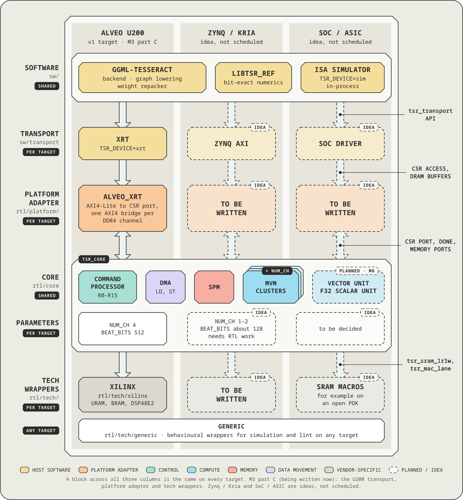
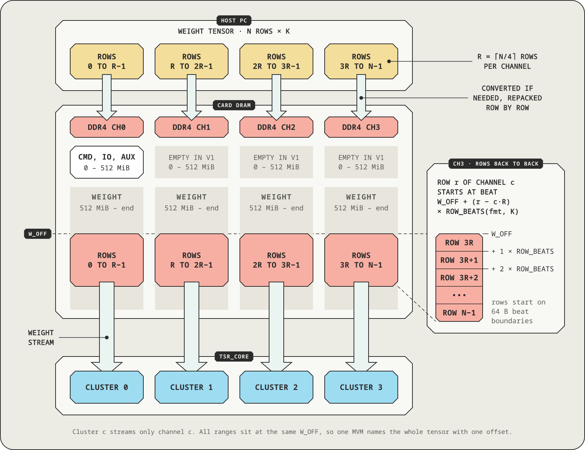
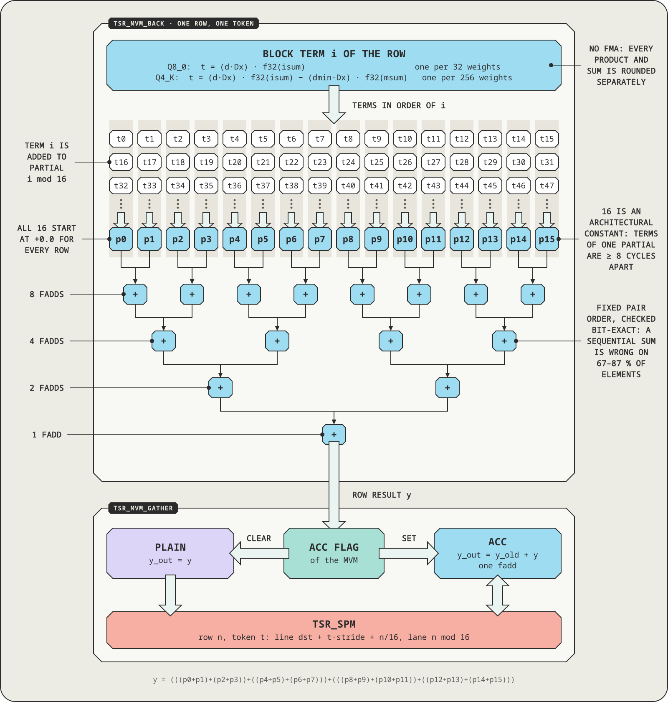

# Tesseract architecture and ISA specification

This is the master specification of the Tesseract core: architecture, data layouts, numerics, ISA,
interfaces and verification strategy. It is the technical entry point. The seven area documents of
[docs/design](design/README.md) hold the detail that this document summarizes:
[EX](design/01-execution-model.md) (execution model, host interface, global tables),
[VU](design/02-vector-unit.md) (vector unit and numerics), [AT](design/03-attention-kv.md)
(attention and KV cache), [CC](design/04-control-core.md) (control core, issue path, SPM, clock
domains), [DB](design/05-debug.md) (debug and profiling),
[SW](design/06-software-verification.md) (simulator, firmware, host software, verification) and
[PV](design/07-graph-scheduler.md) (the graph scheduler of the ggml backend).

A section that points to an area document summarizes it. The area document is the normative
definition and is incorporated here by reference. Every table has one definition
([design/README.md](design/README.md) §4).

## 1. Overview

Tesseract is an open-source LLM inference NPU core. It runs the ggml graphs that llama.cpp hands to
a backend and is implemented as an overlay on an AMD Alveo U200 FPGA. The host loads a firmware
image onto an on-chip RISC-V control core and launches kernels. The control core issues every
256-bit tile op to the units (DMA, QACT, MVM clusters, vector unit), which stream weights from DDR4
and compute.

The configuration of four MVM clusters of 128 MAC lanes (one per DDR4 channel), the 4 MiB SPM, DMA,
QACT, the vector unit and the control core is named Tesseract Core. The kernel SDK that runs on the
control core, together with the host side that drives it, is named Tesseract Basis ("Basis").
Decoding a dense model reads every weight once per token, so the design is built around an unbroken
weight stream and not around raw compute.

### Goals

- GGUF as shipped. The hardware supports two weight formats, Q8_0 and Q4_K. Weights of any other
  type are converted to Q8_0 at load time, including the Q6_K tensors that Q4_K_M files contain.
- A ggml backend, `ggml-tesseract`, that fits llama.cpp's backend structure.
- A portable core. The core RTL is vendor-independent SystemVerilog; only the tech wrappers and the
  platform adapter are written per target.
- One contract. The only contract between hardware and software is the ISA, the memory layouts and
  the numeric rules of this document.
- Correctness first. Running correctly end to end comes before speed.
- Control core. An on-chip RISC-V core (Ibex) issues every tile op asynchronously. The host loads
  firmware and launches kernels; it runs no instruction programs and has no access to the issue path
  (D14, D15).
- Attention on the device. A vector unit for norms, RoPE, activations and reductions, and a q8_0 KV
  cache with flash attention on the MVM clusters (D17).
- One launch per decode token, with the KV cache and attention on the device.
- Debugging. GDB over PCIe on the control core, plus tile-level debug (D18).
- Performance. Keep the DDR bandwidth busy before reducing the bytes per token (section 14).

### Non-goals

- Formats. No hardware path for 5- and 6-bit formats (Q5_K, Q6_K) or I-quants; they are converted to
  Q8_0 at load. Q4_0 and MXFP4 are not implemented.
- Model size. Models larger than the DRAM the design addresses: 64 GiB, four channels of 16 GiB (`CH_BYTES`). The U200 card
  holds 32 GiB.
- Scope. Training and multi-session serving. Multiple cards are not supported.

### Design principles

- Bandwidth-bound by design. One weight stream carries one beat of 64 B per cycle: 12.8 GB/s at the
  200 MHz core clock of the release image. The peak of a DDR4-2400 channel is 19.2 GB/s, so a cluster
  reads two weight streams from its channel for an MVM with T ≤ T_MAX / 2 (`CAPS` bit 16,
  [rtl-mvm.md](rtl-mvm.md) §15). The goal is an unbroken beat supply, not more MACs.
- Weight traffic stays per channel. Cluster c reads weights only from channel c, so the weight
  streams never share a memory port with each other. Where they cross SLRs they pass register pipes
  that carry one beat per cycle, so a crossing costs latency, not bandwidth (section 2).
- Bit-exact determinism. The order and rounding of every floating-point operation are fixed by this
  document, so the simulator, the RTL and the card agree bit for bit. There is one C reference
  implementation of the numerics (`sw/sim`), shared by the backend, the simulator, the firmware's
  host build and the cocotb tests.
- The simulator is the oracle. An RTL change is accepted only if the relevant traces replay
  bit-exactly.
- Strict sequential semantics inside a unit. Tile ops of one unit run in issue order and see every
  effect of the previous one. Across units only dependencies, joins and fences order tile ops
  (section 16, memory model). Execution may overlap further only when the result is provably the
  same.
- Portability through layering. Vendor primitives appear only under `rtl/tech/`. The core exposes a
  CSR port, one memory port per channel (and a read-only second one per channel with the dual weight
  stream), a control-core clock and reset, and error and interrupt levels; it contains no vendor AXI.
- The specification is the single source of truth. A change to the ISA, a layout or the numerics goes
  into the same commit as the matching edit of this document.
- Reserved fields are zero. A tile op with a non-zero reserved field ends with `ILLEGAL_OP`.

### Authority

Order of authority: this document, then the simulator (`sw/sim`), then `docs/design/*`, then the
other documents. A section here that points to a `docs/design` section summarizes it; a difference
between the two is a defect to fix in whichever document is wrong. Numbers that are not fixed by the
design carry their provenance in parentheses: estimate, or model (a figure of the reference
algorithm).

### Terminology

| Term | Meaning |
| --- | --- |
| Channel | One independent DRAM port. On the U200 one DDR4 bank |
| Cluster | The MVM engine dedicated to one channel |
| Beat | One transfer of the memory interface: 512 bits = 64 B |
| SPM, line | The on-chip scratchpad that holds activations and intermediate values; its unit is the line (64 B) |
| Superblock (sb) | The 256-weight unit of K-quants |
| QA | Quantized activation: int8 data plus scales and bsums |
| N, K | Rows (output dimension) and columns (input dimension) of a weight matrix W |
| T | Number of tokens (activation vectors) one MVM processes |
| s0–s15 | One bank of f32 scalar registers inside the VU for reduction results and constants. Only VU ops write them; the control core and the host read them as `SREG0`–`15` (core CSR 0x9C0), section 9 |
| Control core | The RISC-V processor (Ibex) inside the core. It issues every tile op (section 16, [CC](design/04-control-core.md)) |
| Firmware image, kernel | The RV32 ELF that runs on the control core. A kernel is a function of the image that the host launches (`graph`, `replay`, `selftest`) |
| Launch | One host-visible run of a kernel: an 8-word descriptor in the launch queue (LQ) and an 8-word answer record in the completion ring (LCQ), section 10 |
| Op list (OPL), record | The data the `graph` kernel executes: records of kinds such as `MUL_MAT` (section 12) |
| Tile op | One 256-bit instruction that the firmware issues to a unit (section 11) |
| Issue path | The hardware between the control core and the units: issue port, issue FIFO, checker `tsr_chk`, dispatcher and one in-order queue per unit |
| Ticket | The number {unit, sequence} of one issued tile op, used for completion and dependencies |
| Transport, kdev | The host-device layer `tsr_transport` and its device-access implementations (`sim`, `mock`, `vkernel`, `xrt`) |

### Decision index

Design decisions are numbered per area (EX-1, VU-1, AT-1, CC-1, DB-1, SW-1, PV-1) and recorded as short
entries in the Decisions section of each area document: EX §13, VU §11, AT §11, CC §17, DB §12, SW §13 and
PV §10. The standing decisions D1 to D18 are in section 16.

## 2. System structure

The system has four layers. A new target rewrites only the bottom two (the tech wrappers and the
platform adapter) plus a transport. The software and the core change only their parameters.

| Layer | Components | Depends on the target |
| --- | --- | --- |
| Software | `ggml-tesseract` backend, weight repacker, op-list (OPL) builder and cache, simulator, firmware SDK and kernels, transport | The transport only (XRT, Zynq AXI, SoC driver) |
| Core | Control core (RISC-V, ITCM and DTCM, debug module) and issue path (checker, dispatcher, per-unit queues), MVM clusters × C, vector unit (with s0–s15), SPM, DMA, QACT, debug block | Parameters only |
| Tech wrappers | `tsr_sram_*`, `tsr_mac_lane`, clock and reset, CDC synchronizers, a clock gate and reset synchronizer for the control core (a divider only on targets that need one) | Written per target |
| Platform adapter | Control register bridge; memory port to AXI4 or similar | Written per target |

<p align="center"></p>

| Target-specific piece | Alveo U200 | Zynq / Kria | SoC |
| --- | --- | --- | --- |
| Transport | `xrt` | Zynq AXI | SoC driver |
| Platform adapter | `rtl/platform/alveo_xrt`: AXI4-Lite to CSR port, one AXI4 bridge per DDR4 channel and a read-only second bridge per channel in a kernel with the dual weight stream, kernel tops `tsr_u200_k1` and `tsr_u200_k4`, the bandwidth kernel. Register-only, `ap_ctrl_none` | Not provided | Not provided |
| Tech wrappers | `rtl/tech/xilinx`: URAM, BRAM, DSP48E2 (two int8 tokens per DSP), inferred through attributes so that Verilator runs the same files | Not provided | SRAM macros |
| Core parameters | `NUM_CH` 4, `BEAT_BITS` 512 | `NUM_CH` 1–2, `BEAT_BITS` about 128 | Open |

`rtl/tech/generic` holds behavioral versions of the wrappers for simulation and lint on any target. HBM
cards (U280, U55C) would use a large `NUM_CH` with `BEAT_BITS` 256, and Zynq-class parts `NUM_CH` 1–2 with
`BEAT_BITS` about 128; the cluster structure and the ISA stay the same. `NUM_CH` is at most 16 because `LD`
and `ST` name the channel in a 4-bit field (section 3). The RTL elaborates only with `BEAT_BITS` = 512 and
`LANES` = 128 (one beat is one SPM line), so other widths are a porting task.

### U200 configuration

<p align="center"></p>

Fat arrows in the figure are the per-channel memory paths that carry the weight streams: the weight
streams of a channel flow only into the cluster of that channel.

- Host (llama.cpp with `ggml-tesseract`, or PyTorch with `tsr_rt`): turns the graph into an op list
  (OPL), repacks the weights, loads the firmware image and launches kernels through the transport
  (XRT or the simulator). Over PCIe it moves op lists, weights and activations into card DRAM.
- Platform adapter (Alveo XRT): the control bridge (`s_axi_control` to CSR; `ap_ctrl_none` and
  `ADAPTER_CTRL.MEM_EN`, section 10) and one AXI4 memory bridge per channel, with a read-only second
  bridge per channel in a kernel with the dual weight stream. It reaches the core through the CSR
  port and the platform error input `plat_err_i` (Core boundary interface below).
- Core (vendor-independent SystemVerilog): the issue path, the SPM (activations, intermediate
  values, QA; 64 B lines; 4 MiB; even and odd line banks with two read paths), the vector unit
  (element ops, reductions, RoPE, the softmax steps of attention; s0–s15) and clusters 0–3 (stream
  and unpack, 128 MACs, fp accumulate, and the attention modes ATTQK and ATTPV). An x broadcast and a
  y gather bus connect the SPM and the clusters.
- Control core: RISC-V (Ibex RV32IMC), ITCM 128 KiB and DTCM 64 KiB, issue port, SPM window and debug
  module, on its own clock `clk_rv` (derived from `ap_clk_2`; section 16, [CC](design/04-control-core.md)).
- DDR4 ch0–ch3: cluster c receives its weight streams from channel c only (up to 19.2 GB/s per
  channel). Channel 0 also holds the OPL, IO and AUX regions (section 4) and a quarter of the weight
  rows; channels 1–3 hold a quarter each.

The release image is `tsr_u200_k4`: four channels, `T_MAX` 4, the vector unit with 8 front, 8 EXP and
4 back lanes, the attention modes, the fused Gated DeltaNet op, the dual weight stream, the debug block
with trace writer and dispatch history. The core runs at 200 MHz and `clk_rv` at 100 MHz. `CAPS` reads
0x10121 (VU, ATT, GDN, MVM_DUAL). TOPK, DQROW and VMASK are not in the image.

Heavy weight traffic flows only between a channel and that channel's cluster. The U200 platform
places the DDR controllers in SLR0 (ch0), SLR1 (ch1, ch2) and SLR2 (ch3). Clusters 0 and 2 are
placed in SLR0 and clusters 1 and 3 in SLR2. The SPM, DMA, QACT and the arbiters of channels 1 and 2
are in SLR1, the control core with the issue path is in SLR0 and the vector unit is in SLR2 (CC §14).
Every signal that crosses an SLR passes a register pipe: per cluster the activation broadcast, the
weight request and response, the result-gather job and start pipes and the reset copies, plus the
AXI slices of channels 0 and 3. The weight-response pipe moves one beat per cycle without
backpressure, so a crossing does not reduce the channel bandwidth.

### Inside `tsr_core`

<p align="center"></p>

The units use the dispatch handshake `cmd_valid`, `cmd_ready`, `done`, driven by the dispatcher
(CC §8). One `tsr_mem_arb` per channel merges the weight stream and the DMA onto that channel's
memory port (channel 0 also takes the trace writer of the debug block); there is no instruction
fetch.

### Core boundary interface

The normative definition is EX §9.3. The core does not use AXI directly. It exposes only:

- CSR port: 32-bit register read and write (`addr`, `wdata`, `we`, `rdata`, `valid/ready`). The
  adapter converts it to `s_axi_control` or similar. Image load, launches and debug access all go
  through this port.
- Memory ports × C: one per channel. Read request `{addr_beat, len_beats, id}`, read response
  `{data[511:0], id, last}`, and write request, data and response channels; all valid/ready. A core
  with the dual weight stream has a second, read-only port per channel, with the read request and
  response only ([rtl-core.md](rtl-core.md) §4).
- Control-core clock: inputs `clk_rv` and `rst_rv_n`, treated as asynchronous to the core clock.
  `rst_rv_n` is only added to the reset of Ibex and the debug module and is not used at CDC
  endpoints (section 16, Clock domains).
- Platform error input `plat_err_i`: the error level of the platform (U200: `ADAPTER_STATUS` bits
  0–2, or an error count other than zero). It appears in `STATUS.PLAT_ERR` and in the control core's
  `LQ_FLAGS`; a launch answered while it is set has the result PLAT_ERR. A target without an adapter
  ties it to 0.
- Host interrupt `host_irq_o` = `CTRL.IRQ_EN` ∧ (LCQ_WR ≠ LCQ_RD): for ports that have a host
  interrupt (Zynq and similar). The U200 does not connect it and polls.

The core has no completion level output; a launch is answered in the completion ring (section 10).

Memory port rules:

- The address unit is the beat (64 B). The core never issues a burst that crosses a 4 KiB boundary
  (at most 64 beats, within one 4 KiB-aligned span).
- Read responses are ordered only within one `id`. The core may leave at most `RD_OUTSTANDING`
  requests per channel outstanding.
- The cluster's weight stream and the DMA share one channel port, split by the core's internal
  arbiter (the trace writer of the debug block joins as a write source on channel 0). Memory source 0
  (FETCH) is tied off (EX §11). The second weight stream of the dual weight stream uses the read-only
  port and does not go through the arbiter.

## 3. Configuration parameters

Every size is an elaboration parameter. Software reads the same values at start-up from the CSR
registers `CFG_*`. The U200 values are:

| Parameter | Meaning | U200 |
| --- | --- | --- |
| `NUM_CH` (C) | Number of channels = number of clusters (1–16; the 4-bit channel field of `LD` and `ST` is the limit) | 4 |
| `BEAT_BITS` | Memory port data width | 512 |
| `F_CORE` | Core clock | 200 MHz in the release image |
| `LANES` | MAC lanes per cluster (weights per beat). Fixed by `BEAT_BITS` / 4 (the weights of one Q4_K beat); not an independent parameter | 128 |
| `T_MAX` | Maximum tokens per MVM | 4 in `tsr_u200_k4`, 1 in `tsr_u200_k1`; architectural maximum 8 |
| `K_MAX` | Largest supported K | 32768 |
| `SPM_BYTES` | Scratchpad size | 4 MiB |
| `VL` | f32 elements per SPM line, the vector unit's operand width | 16 |
| `NSREG` | Number of f32 scalar registers | 16 |
| `RD_OUTSTANDING` | Outstanding read requests per channel | 16 |
| `CH_BYTES` | Largest DRAM capacity per channel that the core addresses. The U200 card holds 8 GiB per channel, and the transport measures it at open | 16 GiB |
| `ADDR_BEAT_W` | Width of a channel address in beats | 28 |
| `ITCM_BYTES`, `DTCM_BYTES` | Instruction and data SRAM of the control core | 128 KiB, 64 KiB (CC-3) |
| `Q_DEPTH_*` | Queue depth per unit (DMA, QACT, MVM, VU, unit 4, SYNC) | 8, 4, 4, 16, 0 (unit 4 absent), 4 (CC §7.4) |
| `ISSUE_FIFO_DEPTH` | Depth of the issue FIFO (`ISSUE_CREDIT` reports the free space, so it does not depend on the sum of the queue depths) | 32 (U200), 8 (ASIC) |
| `F_RV` | Control-core clock. The implementation decides; `RV_FREQ` reports it (not an RTL parameter) | 100 MHz in the release image |

The control-core parameters are not placed in `CFG_*` (EX §5.1). The control-core revision and
features are read from `CTL_ID` (0x01C), the TCM sizes from `RV_CFG` (0x030), the clock from
`RV_FREQ` (0x02C) and the queue depth of each unit from `Q_DEPTH` (0x088). Control-core software
sees the free space of a queue in `ISSUE_CREDIT`.

`K_MAX` covers the Qwen2.5-32B FFN intermediate dimension 27648 and the Llama 70B class 28672. The
activation buffer of a cluster holds one complete QA vector (QS + D + BS, section 6) per token, so it
needs `QA_LINES(A256, K_MAX) × 64 × T_MAX` bytes: at K_MAX = 32768 that is 584 lines = 37,376 B per token
(A32 needs 576 lines).

`NUM_CH` is at most 16 because `LD` and `ST` name the channel in the 4-bit sub field of w0. The `NUM_CH`
field of `CFG0` has 8 bits, but a configuration above 16 is undefined, and the simulator and the tools
reject it. An HBM part with more pseudo-channels groups several of them into one channel. If more
channels are needed, flags[15:12] of `LD` and `ST` (reserved, 0) can become the upper channel bits, and
existing programs stay valid.

## 4. Memory model

The core sees two address spaces: DRAM (per channel) and the SPM. The host accesses DRAM only and
cannot see the SPM. The control core has its own 32-bit address space (ITCM, DTCM, control window,
SPM window): it reads and writes the SPM byte by byte but cannot see DRAM (section 16). The ordering
rules between the host, the control core and the units are in section 16 (Memory model).

DRAM address: `(ch, addr_beat)`: a channel number and an offset in beats (64 B) inside that channel. The channel size the
host software uses (`ch_bytes` of the configuration) is the capacity that the transport measured at open, at most
`CH_BYTES`; the host places nothing above it.

Symmetric allocation: a quantized weight tensor is placed at the same offset `W_OFF` in every
channel. Its N rows are split into C contiguous ranges.

- R = ceil(N / C). Channel c holds rows [c·R, min((c+1)·R, N)). An empty range is allowed.
- Inside a channel, row r starts at `W_OFF + (r − c·R) × ROW_BEATS(fmt, K)`. `ROW_BEATS` is defined
  in section 5.
- An MVM tile op therefore names a tensor by one offset, and each cluster processes its own channel
  range independently.

<p align="center"></p>

Expert tensors (MoE): a 3D ggml expert tensor `[K, N, n_expert]` is treated as one N×K matrix per
expert, and each expert is split by rows over the channels as above. Expert e sits at
`W_OFF + e × EXP_STRIDE` with `EXP_STRIDE = R × ROW_BEATS` (beats per channel). One expert MVM
therefore uses the bandwidth of all channels, and building the address from an expert number that the
device computed takes one multiplication.

Per-channel DRAM map: the normative definition is [EX](design/01-execution-model.md) §11. Every
channel uses the same map.

- OPL, ch0, 0–64 MiB: op lists, the push streams of the `replay` kernel, kernel argument blocks and
  control-core code overlays. The core does not fetch instructions from DRAM.
- IO, ch0, 64–320 MiB: host-to-device tensors (input tensors, logits) and compute chunks. While
  profiling, the transport reserves the ring of the trace writer of the debug block here (TRW,
  default 64 MiB, `TRW_CH` = 0).
- AUX, ch0, 320–512 MiB: small f32 tensors (norm weights, RoPE frequency-factor tables).
- WEIGHT and heap, 512 MiB to the end, every channel: repacked weights and expert tensors are
  allocated symmetrically upward from 512 MiB. KV planes are allocated symmetrically downward from the
  end of the channel (one plane is one (layer, stream, K or V); layout in
  [AT](design/03-attention-kv.md) §4). Between the two lies the per-channel compute heap, sized from
  the reserve graph ([SW](design/06-software-verification.md) §8, R6).
- Low 512 MiB of ch1–3: compute chunks and other activations.

A 32B Q4_K_M model (about 20 GB) needs about 5 GB per channel and fits the 8 GiB channels of the U200 card.
The same model in Q8_0 (about 35 GB) needs about 9 GB per channel, which fits channels of 16 GiB but not the 8 GiB of the
U200 card.

SPM rules

- Addresses are linear, the unit is the line (64 B). Every operand starts on a line boundary.
- SPM data carries no type tag. The tile op that reads it decides the interpretation (F32 vector, QA
  block, and so on).
- Writes are done in whole lines. The tail bytes after the valid elements of the last line of an
  output vector are zero (section 21, Tail bytes), so that traces are deterministic. Op-list planners
  place different operands so that they do not share a line.

## 5. Device weight layout

On upload, weights are rearranged into chunks. A chunk is one meta beat plus several quant beats. The
bits keep the meaning they have in ggml; only their byte positions change. The bandwidth overhead
against GGUF is 0 % for both Q8_0 and Q4_K.

| fmt | Blocks per chunk | Weights per chunk | Meta beat content | Quant beats | Chunk size | Against GGUF |
| --- | --- | --- | --- | --- | --- | --- |
| Q8_0 | 32 blocks | 1024 | `d` fp16 × 32 per block = 64 B | 16 | 1088 B | 0 % |
| Q4_K | 4 sb | 1024 | 16 B per sb: `d`, `dmin`, `scales[12]` | 8 | 576 B | 0 % |

Byte layout per format (block number b or sb number s inside the chunk; all multi-byte values are
little-endian)

- Q8_0: meta bytes [2b, 2b+2) = `d[b]`. The `qs[32]` of block b are bytes [32·(b mod 2), +32) of
  quant beat ⌊b/2⌋. Quant beat j holds the chunk weights [64j, 64j+64).
- Q4_K: meta bytes [16s, 16s+16) = the first 16 bytes of the original block (`d`, `dmin`,
  `scales[12]`) unchanged. The original `qs[128]` stay unchanged in quant beats 2s and 2s+1. Beat 2s
  holds the sb weights [0, 128), beat 2s+1 holds [128, 256).

Load-time conversion: the hardware formats are only Q8_0 and Q4_K. A 2D weight of any other type
(Q6_K, Q5_K, Q5_0, Q4_0, F16, BF16, F32, I-quants and so on) is unpacked in `set_tensor` with ggml's
`to_float` and requantized with `quantize_row_q8_0_ref` into Q8_0. Any GGUF therefore loads; only the
tensors that are not 8-bit or 4-bit use 8-bit bandwidth.

- Q4_K_M files carry Q6_K for `attn_v`, half of `ffn_down` and `output`, so they take this path. It adds
  device memory and bytes read per token in proportion to those tensors.
- Accuracy ([numcheck](numcheck.md)): against the fp64 exact value, Q6_K converted to Q8_0 has a smaller
  relative error than the CPU path (the CPU multiplies Q6_K by Q8_K activations with one scale per 256
  values; the conversion path uses A32 with one per 32). Q5_0 converted to Q8_0 has a larger error than
  the CPU: the Q5_0 grid points are not on the Q8_0 grid, so requantization adds up to half a Q8_0 step
  per weight. When K is not a multiple of 256, llama-quantize uses Q5_0 instead of Q4_K, so Q5_0 shows up
  in small models. The model-level KL criterion (section 17) covers both.
- The MoE router (`ffn_gate_inp`) is F32 in `llama-quantize` output and is converted to Q8_0 as well. 1D
  tensors (norm weights and so on) are not converted; they stay F32 in AUX.

The bit-level interpretation of nibbles and 6-bit scale packing follows `dequantize_row_q4_K`,
`get_scale_min_k4` and `dequantize_row_q8_0` in `ggml-quants.c`. The RTL unpacks with bit slicing.

Row size: with the number of blocks nb = K / block size (Q8_0 32, K-quants 256), blocks per chunk S
and quant bytes per block QB (Q8_0 32, Q4_K 128), let full = ⌊nb/S⌋ and rem = nb mod S. The last
partial chunk has a meta beat (empty entries 0) plus the quant beats of the blocks that exist. Every
row starts on a beat boundary.

```math
\mathrm{ROW\_BEATS} = \mathrm{full}\left(1 + \left\lceil \tfrac{S \cdot QB}{64} \right\rceil\right) + [\mathrm{rem} > 0]\left(1 + \left\lceil \tfrac{\mathrm{rem} \cdot QB}{64} \right\rceil\right)
```

Examples: a Qwen2.5-32B `ffn_down` row (Q4_K, K = 27648) has nb = 108, full = 27, rem = 0, so
243 beats (15552 B), the same as GGUF. A Q8_0 row with K = 5120 has nb = 160, full = 5, rem = 0, so
85 beats (5440 B), also the same as GGUF.

K must be a multiple of the block size (ggml guarantees this for quantized tensors). Repacking is done
in `set_tensor` of `ggml-tesseract`, and the reference implementation uses the same code as the
simulator.

## 6. Quantized activation (QA) layout

The input activations of an MVM are in the int8 QA format. It corresponds to the activation formats
of the ggml CPU backend (`block_q8_0`, `block_q8_K`), and the values are produced by the same rules as
ggml's reference quantization functions (`quantize_row_q8_0_ref`, `quantize_row_q8_K_ref`). The weight
`fmt` selects the QA kind: Q8_0 → A32, Q4_K → A256.

The activations are not always the same as those of the CPU backend. The x86 CPU backend calls the
reference function for Q8_K (`quantize_row_q8_K`), but it makes its Q8_0 activations with the SIMD
implementation `quantize_row_q8_0` (AVX path: id = 127 / amax rounded in one step, q rounded to
even). A32 therefore differs rarely from the Q8_0 activations of the x86 CPU backend (for example
x = {127, 2.5, −0.5, 0, …}: the CPU gives q = {127, 2, 0}, while A32 and `quantize_row_q8_0_ref` give
{127, 3, −1}). The Q8_0 activations or outputs of the CPU backend must not be used as a bit oracle for
QACT A32; the bit reference is the reference function.

| Kind | ggml counterpart | Block size | Scale | bsums |
| --- | --- | --- | --- | --- |
| A32 | `block_q8_0` | 32 | one f32 per block | none |
| A256 | `block_q8_K` | 256 | one f32 per block | int16 sums of 16 values |

SPM layout (one token, length K): three regions, each starting on a line boundary, in this order:

1. `QS`: int8 × K, ⌈K/64⌉ lines
2. `D`: f32 × (K / block size), ⌈4·K/block size/64⌉ lines
3. `BS` (A256 only): int16 × (K/16), ⌈2·(K/16)/64⌉ lines

The sum of the three regions is `QA_LINES(kind, K)`. T tokens are laid out as T QA vectors with stride
`QA_LINES`.

Quantization rules (the `QACT` tile op, the simulator and the RTL agree bit for bit, and the
definition also agrees with the ggml reference)

- A32 (same as `quantize_row_q8_0_ref`): amax = max|x| of the block, d = amax / 127,
  id = (d ≠ 0) ? 1/d : 0 (all f32). q = roundf(x · id), rounding half away from zero. The stored `D`
  is d rounded to fp16 and converted back to f32; q is computed with the f32 id before that rounding.
- A256 (same as `quantize_row_q8_K_ref`): max is the signed value of the element with the largest |x|
  (the first one on a tie). If amax = 0, then d = 0 and q = 0. Otherwise iscale = −127 / max,
  q = min(127, nearest_int(iscale · x)) and d = 1 / iscale. nearest_int rounds half to even and gives
  the same result as ggml's magic-number implementation. `BS[j]` = sum of q[16j .. 16j+15]. The
  constant is −127, as in `quantize_row_q8_K_ref` at the pinned llama.cpp commit.

For both A32 and A256, q lies in [−127, 127] for ordinary input. The QACT special-value rule
(saturating conversion, section 21) can produce −128, and Q8_0 weight q can be −128, so the signed
8-bit multipliers of a cluster accept the full signed range.

## 7. Numeric rules

Integer arithmetic is exact up to the end of a superblock, and fp32 arithmetic happens only a few
times per block (or sb). The simulator and the RTL agree bit for bit, so this section fixes the order
and rounding of every fp operation. The accumulation order differs from the ggml CPU (and the x86
Q8_0 path also differs in activation quantization, section 6), so there is no bit agreement with
ggml; agreement is verified with the NMSE tolerance of `test-backend-ops` (section 17).

Block terms, for one row and one token: d and dmin are weight meta (fp16 → f32), Dx is the block scale
of the activation QA, BS are the bsums.

- Q8_0 (block b, 32 values): isum = Σ q_w · q_x
- Q4_K (sb s, sub-block j = 0..7, 32 values each): sc_j and m_j are interpreted as in
  `get_scale_min_k4`. S_j = Σ q_w · q_x (q_w ∈ [0, 15]), isum = Σ_j sc_j · S_j,
  msum = Σ_j m_j · (BS[2j] + BS[2j+1])

```math
\begin{aligned}
t_{\mathrm{Q8\_0}} &= (d \cdot D_x) \cdot \mathrm{f32}(\mathit{isum}) \\
t_{\mathrm{Q4\_K}} &= (d \cdot D_x) \cdot \mathrm{f32}(\mathit{isum}) - (d_{min} \cdot D_x) \cdot \mathrm{f32}(\mathit{msum})
\end{aligned}
```

Evaluate in the order of the parentheses. Each multiplication and each addition is rounded separately
(no FMA fusion).

Integer widths (an int32 accumulator is enough for all of them; integer arithmetic is exact, so the
order is free)

| Value | Maximum magnitude | Required width |
| --- | --- | --- |
| Q8_0 isum | 32 × 127 × 128 ≈ 0.52M | signed 21 bits |
| Q4_K S_j | 32 × 15 × 128 = 61,440 | signed 17 bits |
| Q4_K isum | 8 × 63 × 61,440 ≈ 31M | signed 26 bits |
| Q4_K msum | 8 × 63 × 4,096 ≈ 2.1M | signed 23 bits |
| Q4_K msum (arbitrary BS) | 8 × 63 × 65,534 ≈ 33M | signed 26 bits |

An MVM accepts any bytes of the SPM as QA (the SPM has no type tag, so a QA loaded with `LD` is
legal). QS can therefore use the full int8 range, Dx can be any f32 (subnormals are DAZ, NaN and Inf
follow the fp rules) and BS can be any int16, and the hardware agrees with the simulator bit for bit
in these cases too. For BS made by QACT (|BS| ≤ 2,048) msum fits in 23 bits, but for arbitrary BS the
sum BS[2j] + BS[2j+1] needs 17 bits and msum a signed 26 bits.

Row accumulation: let i be the number of the term in the row: a block (Q8_0) or an sb (K-quant).
Sixteen partial sums p_0..p_15 start at +0.0, and term i is added to p_(i mod 16) in order. The final
value y is the complete binary-tree sum of the 16 partial sums, ((p0+p1)+(p2+p3)) + ((p4+p5)+(p6+p7))
and so on, paired from the left in 4 levels. If the ACC flag of the MVM is set, y_out = y_old + y.

The number of partial sums, 16, is an architectural constant. Even in the worst case of Q8_0, two
terms that enter the same partial sum are at least 8 cycles apart, so a pipelined fp adder with a
latency of at most 8 cycles keeps II = 1.

<p align="center"></p>

Common fp rules

- f32 is IEEE binary32 with round-to-nearest-even.
- fp16 → f32 conversion is exact, including fp16 subnormals.
- Subnormals are treated as zero in the inputs and results of f32 operations (DAZ + FTZ). The sign is
  kept. The exact decision point is in section 21 (FTZ decision point).
- int → f32 conversion rounds to nearest even (the Q4_K isum has up to 26 bits and can exceed 24
  bits).
- A NaN result is produced as the canonical NaN `0x7FC00000`. Inf propagates as in IEEE.
- The transcendental functions of the vector unit (exp, rsqrt and so on) are defined by one shared C
  reference implementation, and the RTL matches it bit for bit.

Approximate math: the vector unit's functions are defined by integer algorithms and the primitives
above, not by libm ([VU](design/02-vector-unit.md) §6, summarized in section 9). Their accuracy is a
property of the algorithms (VU §6.9). Agreement with the ggml CPU is not bit-exact in general and is
covered by the KL criterion (section 17).

## 8. MVM cluster microarchitecture

A cluster is a straight pipeline that consumes the weight range of its channel at one beat per cycle
for each weight stream: one stream, or two for an MVM with T ≤ T_MAX / 2 on a core with `CAPS` bit 16
([rtl-mvm.md](rtl-mvm.md) §15). Matching the beat rate to the channel bandwidth means the aim is not
compute but an unbroken supply of beats.

<p align="center"></p>

A cluster also has two attention modes, ATTQK and ATTPV, that feed the MAC lanes from KV planes
([AT](design/03-attention-kv.md) §8; the tile ops are in section 11).

Pipeline stages (valid/ready flow control in every stage; if the DRAM response stalls, everything
stalls)

1. Stream requester: the row range of a channel is contiguous in DRAM, so it requests
   rows_c × ROW_BEATS beats back to back in bursts of 64 beats (rows_c = the number of rows of
   channel c = max(0, min((c+1)·R, N) − c·R); it can be 0, in which case nothing is requested.
   R × ROW_BEATS is only the upper bound and the allocation size on channel 0, not the amount read).
   At most `RD_OUTSTANDING` requests are outstanding.
2. Chunk parser: tags each beat with {META, QUANT, row number, block number, end of row}. A counter
   handles partial chunks and row boundaries.
3. Meta register: holds the meta beat of the current chunk. The Q4_K 6-bit scale unpacking is done
   here by bit slicing.
4. Weight unpack: turns both formats into signed 8-bit lane values. Q4_K gives q (0..15) and Q8_0
   gives q unchanged. Q4_K uses 128 lanes per beat, Q8_0 64 lanes.
5. Activation read: from the cluster-local activation buffer it reads, per token, the 128 int8 values
   at the K position of the current beat. Dx and BS are read from the same buffer.
6. MAC lanes × 128: s8 × s8 products are summed in groups of 32, giving 4 sub-block (block) sums per
   beat for Q4_K and 2 for Q8_0.
7. Integer scale stage: accumulates sc_j × S_j into the isum of each sb (or block). The Q4_K msum
   needs only meta and BS, so it is computed in parallel with the weight path.
8. fp term stage: computes the term t of the numeric rules (section 7).
9. Accumulator: 16 partial sums per (row, token). At a row boundary two sets alternate, and the tree
   sum of the previous row is finished in the background.
10. Output: the row result y goes through the gather network to the SPM. Row r of channel c is
    written to SPM `dst + t × stride + (c·R + r)`.

Resource estimate (U200, `LANES` = 128; design values)

| Item | T = 1 | T = 8 |
| --- | --- | --- |
| MAC per cycle per cluster | 128 | 1024 |
| DSP per cluster | 128 (no packing) | 512 (two tokens packed) |
| DSP of 4 clusters (of 6840 on the VU9P) | 512 | 2048 |
| Activation buffer per cluster (per token `QA_LINES(A256, K_MAX)` = 584 lines) | 1024 bits × 292 (37,376 B) | 8192 bits × 292 |

The 1024-bit width of the activation buffer is the width that reads, in one access, the 128 QS values
(one token) that belong to one beat. The depth 292 is QS 256 + D 4 + BS 32 words for the A256 QA of
K_MAX (A32 needs QS 256 + D 32 = 288). Stage 5 needs this capacity to read Dx and BS. Dx and BS may
live in a memory separate from QS (the Dx/BS side then needs at least 36 words × 1024 bits per
token), but the total must not be smaller than this value. The broadcast copies the whole QA vector
(`QA_LINES` lines). The release image has `T_MAX` 4.

DSP packing needs two products that share one operand. A beat contains different K positions of one
row, so neither the weight nor x is shared, and nothing is packed at T = 1 (running some of the 4-bit
products in LUT multipliers is optional). For T ≥ 2 the packing multiplies the same weight by two
tokens. This choice is enclosed in the `tsr_mac_lane` tech wrapper and is not visible in the core
structure. The DSPs of the MAC lanes are 128 per cluster at T_MAX 1 (one DSP per product) and 512 at
T_MAX 8 (two tokens share a DSP).

Activation broadcast: at the start of an MVM the QA vector in the SPM is copied to the local buffers
of all clusters at the same time. At K = 27648 that is about 500 lines, which is negligible against
one `ffn_down` MVM (about 310,000 cycles per cluster).

Placement: only the broadcast, the weight request and response, the result gather and the reset cross
SLRs, and all of them pass pipeline stages whose depth is a parameter (`MVM_BC_PIPE`, `MVM_RES_PIPE`,
`RST_PIPE`). The SLR of a cluster is set only in the floorplan files (`hw/u200`); the RTL does not know the
placement. The whole core runs on one kernel clock regardless of SLR. The clusters are matched to the
channel bandwidth, an MVM divides the rows equally among the channels and so waits for the slowest
cluster, and the paths that cross SLRs are already cut by register pipes. A clock domain is split only
between blocks whose throughput differs (the RISC-V control core is such a block). If timing is short, fix
the paths, and if that fails lower the whole kernel clock.

Overlapping consecutive MVMs: if the next MVM does not read the dst of the previous MVM, a cluster may
overlap the tail of the previous MVM with the weight requests of the next one. The result equals
sequential execution, so this is an allowed as-if optimization (the memory model of section 16 allows
it). It hides the fill cost of 1–2 µs (estimate) that every MVM pays, which matters for the short expert
matrices of MoE.

### Attention and the KV cache

The normative definition is [AT](design/03-attention-kv.md). Attention runs in the MVM clusters and
not in the VU: one SPM port moves 64 B per cycle while the four DDR channels deliver 256 B per cycle,
so only the clusters, each streaming its own channel, can consume the KV cache at the DDR rate.

- KV cache. It holds exactly llama.cpp's q8_0 values (the same 32-element blocks, fp16 scales and
  `quantize_row_q8_0_ref` rounding); only the byte placement changes, so `get_tensor` and `set_tensor`
  convert losslessly. Cells form groups of 16, and group u lives in channel u mod C. K planes are
  token-major (the whole row of a cell is contiguous), V planes are slice-major (64-value slices of
  all cells are contiguous), and both use the Q8_0 chunk format of section 5. Planes are allocated
  symmetrically downward from the end of each channel (section 4).
- Ops (section 11). `KVST` (DMA unit) stores new K and V rows; `ATTQK` and `ATTPV` (MVM unit) compute
  scores with row maxima and P·V partial outputs with row sums over a range of KV groups; `ASMAX`,
  `AMASK`, `AMERGE` and `ANORM` (VU) are the softmax steps. The flash-attention tile-op sequence is
  normative (AT §6.6).
- Numerics. Scores follow the Q8_0 row rule of section 7 on each head segment. P·V is an exact
  integer accumulation with a 24-bit block-floating-point weight per 64-cell segment and one f32
  addition per segment. The softmax is two-pass within a chunk and online across chunks.
- Scope. The query heads of one KV head (and up to `T_MAX` query tokens in prefill) are the token
  slots T of the MVM (grouped-query attention). Not supported: attention logit softcap, ALiBi, sinks,
  sparse `n_kv_max`, DK ≠ DV, head dimensions other than 64 to 512, K-shift, and the KV Hadamard
  rotation (turned off).

## 9. Vector unit and scalar registers

This section is a summary. The normative definition of the VU programming model, encodings, dispatch
checks and numerics is [VU](design/02-vector-unit.md) §4–§6 and Appendix A. The vector ops of attention
(ASMAX, AMASK, AMERGE, ANORM) take their meaning from [AT](design/03-attention-kv.md) §5.4–§5.7 and are
executed by the VU (VU §5.11).

The vector unit (VU, unit 3) streams the 32-bit elements of the SPM, one line (16 elements) per cycle with
16 front lanes and two cycles per line with the 8 front lanes of the release image; SILU, GELU, SIGMOID,
TANH, RECIP and similar run at half that rate (VU §7.4).

- Operands are two-dimensional: one op processes `rows` × `m` elements, rows start on a line boundary, every
  operand has its own row stride in lines, and a source stride of 0 repeats the same vector for all rows
  (norm weights, bias). The per-row scalar c comes from an s register (`cmode` 1) or from an SPM row vector
  (`cmode` 2). The tail of the last line of a destination row is written as zero (section 21, Tail bytes).
- Operations: VOP (0x30, 25 functions), RED (0x31, per-row SUM, SUMSQ and MAX with the post-ops RCP and RMS),
  ROPE (0x32), SOP (0x40, 15 scalar functions) and GDN (0x39, the fused Gated DeltaNet state update). TOPK
  (0x33), DQROW (0x12) and VMASK (0x38) are specified; the simulator implements TOPK and DQROW, and the
  release image has none of the three (`ILLEGAL_OP`).
- Reductions: per row, element i is added to partial sum (i mod 128) in order, and the 128 partial sums are
  combined by a complete binary tree (128 is an architectural constant). SUMSQ rounds x·x separately before
  adding. An empty row gives +0.0 for SUM and SUMSQ and -inf for MAX. Comparisons (MAX, MIN, TOPK) use the
  bit total order -inf < … < -0 < +0 < … < +inf < NaN.
- Scalar registers s0–s15: one bank (16 × 32 bits, D8). Only RED (TO_S) and SOP write it; the control core
  and the host read it as `SREG0`–`15` (core CSR 0x9C0 + 4i). It is +0.0 after a hardware reset and is not
  changed by `SOFT_RESET`, a control-core reset, QABORT or QCLEAR. A kernel writes an s register before it
  reads it (SOP.MOVI).
- VU ops see all SPM and s effects of earlier ops in VU queue order. A source may overlap the destination
  only if it is exactly the same (in-place); any other overlap is undefined. There are no run-time errors:
  every check happens at dispatch, and a shape violation is error code 13 `OPERAND`.

Numerics (bit-exact definition, VU §6): the fp functions are defined only with the primitive operations
`tsr_fadd`, `tsr_fsub`, `tsr_fmul`, `tsr_fdiv`, `tsr_fsqrt` and `tsr_frecip`, which follow the fp rules of
section 7 (RNE, DAZ + FTZ, canonical NaN), and with integer operations. A VU fp result is never subnormal and
a NaN is always 0x7FC00000. The shared C reference is `sw/sim/tsr_ref_math.c` (the approximate functions),
`sw/sim/tsr_ref_vu.c` (reductions, ROPE, TOPK, DQROW), `sw/sim/tsr_ref_at.c` (the vector ops of attention and
the flash-attention reference) and the primitives in `sw/sim/tsr_ref.c`; it is checked against a separately
written numpy model and by exhaustive comparison of the unary functions over all 2^32 inputs
([SW](design/06-software-verification.md) §10.1).

- Every reciprocal (VOP.RECIP, the RED post-ops, the reciprocals inside SIGMOID, SILU, GELU and TANH) is the
  correctly rounded `tsr_frecip`; there is no RECIP_APPROX.
- GELU16 and GEGLU16: the GELU and GEGLU of llama.cpp graphs run as these (SW-31). Like ggml CPU
  (`GGML_GELU_FP16`) they clamp at ±10 and round input and result to binary16. The tanh-form GELU serves
  PyTorch (SW-98).
- RoPE angles follow the recurrence of ggml-cpu: θ_0 = f32(p), θ_(i+1) = θ_i × TS, with
  TS = `powf(freq_base, -2/n_dims)` of the host libm passed in an s register, so with ext_factor = 0 the
  angles are bit-identical to the CPU's. Only YaRN (ext_factor ≠ 0) uses a table A_i folded by the host. The
  modes are NORM and NEOX; head_dim must be a multiple of 16 (at most 1024), and n_dims a multiple of 32 for
  NEOX and of 16 for NORM (otherwise `OPERAND`).

No VU op is bit-exact with the ggml CPU in general; the KL criterion (section 17) covers the differences.

RMSNorm example (length n, eps): `SOP.MOVI` sets s2 = 1/n and s3 = eps once. Then `RED.SUMSQ` (TO_S, post-op
RMS, sk = s2, se = s3) gives s1 = RC(SQ(sum·(1/n) + eps)), and `VOP.MULCB` computes y = (x × s1) × w. That is
two ops, and bit-identical to the seven-op sequence (RED.SUMSQ → SOP.MULI → ADDI → SQRT → RECIP → VOP.MULS →
VOP.MUL), which is the definition in terms of unfused ops. T tokens are done in one op with rows = T and a
per-token vector c (VU §8.1).

## 10. Execution model and control interface

This section summarizes [EX](design/01-execution-model.md). EX is the normative definition of the host model,
the firmware image and its load, the launch protocol and the runtime contract R1–R10, the core CSR map,
PERF, the error codes and check order, the control actions and the XRT adapter.

Host model (EX §2). The host does not run programs. It opens the device (`xrt::ip`, one buffer per channel),
resets it unless it attaches, writes the channel base addresses, sets `ADAPTER_CTRL.MEM_EN`, loads and
verifies the firmware image into the TCMs, boots the control core, waits for HELLO and then launches
kernels. Weights, inputs and op lists are written to and read from DRAM by PCIe DMA. The control core issues
all tile ops; the host cannot reach the issue port (D15). One process owns the device (the exclusive context
of `xrt::ip`); GDB and the profiler run inside that process. The ordering between host and device is rules
H1–H5 (EX §2.3).

Firmware image (EX §3). A static RV32 ELF whose `PT_LOAD` segments lie inside ITCM (from 0x0000_0000) or DTCM
(from 0x0010_0000). It carries the kernel table `.tsr_kernels`, the requirements note `.note.tsr`, the kind
table `.tsr_kinds` and the image id `.tsr_id`. Loading happens while `RV_RUN` = 0 (`LOAD_ADDR` and
`LOAD_DATA` words, a receive CRC-32, and `LOAD_CTRL.VERIFY`, which reads the TCM back and checks its CRC).
Boot is `CTRL.RV_RUN` = 1; the control core posts a HELLO record (image id, Basis ABI, kind table signature,
number of kernels, Basis version). After a TRAP, or when the same image is resident, a warm restart reloads
the DTCM segments, verifies ITCM and boots.

Launch protocol (EX §4). The host writes an 8-word descriptor {TYPE, PROF, KERNEL, ARG0–ARG6} to
`LQ_W0`–`7` with posted CSR writes and then writes `LQ_PUSH`; a launch needs no PCIe DMA. Every descriptor
gets exactly one 8-word answer record, in order, in the completion ring (LCQ); the host keeps at most
`LQ_DEPTH` (8) launches without an answer. At most one launch runs at a time. The runtime follows R1–R10 (EX
§4.7): it pops and validates the descriptor, calls the kernel, joins every tile op that the launch issued
(R6) and posts the answer with the first error (the error record with the smallest `ERR_PIDX`). STATUS is
OK, TILE_ERR, BAD_DESC, KERNEL_ERR, TRAP, ABORTED, PLAT_ERR or STOPPED (precedence: EX §4.4). `LQ_CANCEL` is
a hard cancel (QABORT), `LQ_STOP` a soft stop that the kernel polls. The log reaches the host through a
256-word log ring (record header: DB §6.1). The default image has the kernels `graph` (op-list executor),
`replay` and `selftest`.

Core CSR map (EX §5). 12-bit offsets, 32-bit registers; on the U200 the window is `s_axi_control` 0x1000 +
offset. Reads have no side effects (except the PERF LO sample), and an undefined offset reads 0 and ignores
writes. The blocks: identity, capability and control (0x000–0x03C: `ID` "TSR1", `VERSION` = Tesseract Core
capability 1.0 = 0x0000_0100, `CFG0`–`CFG3`, `CAPS`, `CTL_ID`, `CTRL`, `STATUS`, `RV_BOOT`, `RV_FREQ`,
`RV_CFG`); launch queue, ring pointers and watermarks (0x040–0x09C); image loader (0x0C0–0x0D4); `PERF_0`–`63`
(0x100–0x2FC); LCQ records (0x300–0x3FC); log ring (0x400–0x7FC); debug block `DBG_*` (0x800–0xAFC, with
`SREG0`–`15` at 0x9C0–0x9FC, [DB](design/05-debug.md) §10.1); the DMI window of the debug module
(0xC00–0xDFC); the queue status `Q_*` (0xE00–0xF1C, readable even if the control core is dead). `CTRL` has
the level bits `RV_RUN`, `HOST_HOLD`, `HOLD_ON_HALT` and `IRQ_EN` and the pulse bits `QABORT`, `QCLEAR` and
`SOFT_RESET`. `CAPS` has bit 0 VU, bit 3 TOPK, bit 5 ATT, bit 6 DQROW, bit 7 VMASK, bit 8 GDN and bit 16 MVM_DUAL (two weight streams per
channel for an MVM with T ≤ T_MAX / 2; timing only); the retired
bits 2 and 4 are never set or reused (EX §7.5). The backend reads `CAPS` to choose its path.

PERF counters (EX §6). Time counters count while the device is ACTIVE and not stopped by the debugger
(QHALT); event counters count only while ACTIVE. The runtime joins every tile op before it answers, so PERF
does not change between launches, and the difference of two reads is the value of one launch. `SOFT_RESET`
zeroes all counters, and a read of the LO word of a 64-bit counter samples the whole counter (section 21,
Performance counters). Index 0 `CYCLES`, 1 `RETIRED`, 2 `MVM_CYCLES`, 3 `VU_CYCLES`, 5 + c `CH_RD_BEATS`,
5 + C + c `CH_WAIT`; from X = 5 + 2C extension counters; 61–63 belong to debug.

Determinism ([SW](design/06-software-verification.md) §4.7). A program (image, launch arguments, DRAM
inputs) is valid if it is race-free, and then the per-unit op streams, the records r0–r6 (r7 is timing), the
control core's SPM store stream and the final written DRAM and SPM lines are identical under every schedule.
Firmware rule (SW-30): a value read from a timing-dependent register (`DONE_SEQ`, credits, `QSTATUS`,
`MTIME`, `LQ_AVAIL`, `LCQ_FREE`, `LOG_FREE`) may end a wait loop but must not influence pushed words,
dependencies, SPM stores or records.

Errors (EX §8). Codes 1–13 (3 `QA_MISMATCH`, 9 and 10 are reserved and never raised). The dispatch check
order is `ILLEGAL_OP` → `BAD_DEP` → `BAD_FMT` → `K_RANGE` → `T_RANGE` → `OPERAND` → `SPM_RANGE` →
`DRAM_RANGE`. A tile op that has started does not fail; data-dependent conditions (NaN, a length read from
the SPM) are defined behavior. A unit that raised an error ends the following ops as `ABORTED` until QCLEAR
(EX §8.2). `SOFT_RESET` is a device-level procedure that works without `clk_rv`: it puts the control core in
reset, drains the queues and clears the error state, the rings, the watermarks, PERF and the sticky bits,
and leaves DRAM, SPM, the TCMs, the s registers, the channel bases, the debug settings and all sequence
numbers (EX §8.5). There is no forced release of a stuck unit; recovery is a card reset (EX §8.6).

XRT adapter (EX §9). The kernel is `ap_ctrl_none` and has no interrupt. The host accesses the registers with
`xrt::ip` and polls; it never uses `xrt::run`, so a control core halted by the debugger cannot break the XRT
scheduler. The kernel arguments are the channel buffers `ch<c>` (base address at 0x040 + 8c) and, in a kernel with
the dual weight stream, `chb<c>` at 0x100 + 8c, the arguments of the read-only ports `m_axi_chb<c>`, which have no
register behind them. Setting `ADAPTER_CTRL.MEM_EN` checks the 4 KiB alignment of the bases and latches them; while it
is clear, memory requests are held. The memory bridges and the reset scheme are in
[platform-u200.md](platform-u200.md) §4–§5. The control core receives a second clock `ap_clk_2`.

## 11. ISA

([EX](design/01-execution-model.md) §7.) A tile op is a fixed 256 bits (32 B) split into 32-bit
words w0–w7 (little-endian). The control core issues every tile op through the issue port. An address
field is the immediate word itself (A = imm); there is no base register.

w0 format

| Bits | Field | Meaning |
| --- | --- | --- |
| [7:0] | opcode | The instruction |
| [11:8] | sub | Sub-code per instruction: format code, mode, channel |
| [15:12] | flags | Per-instruction flags |
| [31:16] | x16 | Per-instruction field. x16 bit i = w0 bit 16 + i. Bits that the definition of the instruction does not use must be 0 (otherwise `ILLEGAL_OP`). LD, ST, QACT, MVM, NOP and FENCE have x16 = 0; the VU and AT ops define their own fields |

Common rules

- In the table below, A1, A2 and A3 are the first, second and third address field, and the value is
  that immediate word as it is. All other fields are immediates too.
- SPM addresses are in lines (only the SPM word access of SOP is in 4-byte words), DRAM addresses are
  in beats, and lengths are in elements.
- Reserved fields and bits, and x16 bits that the instruction does not use, must be 0; otherwise
  `ILLEGAL_OP`.
- The number of an f32 scalar register is a 4-bit field in an immediate word or in x16.
- A started instruction does not fail. Every error is found by the dispatch check (section 10,
  Errors).

Instruction list. The global table that fixes unit and status per opcode is
[EX](design/01-execution-model.md) §7.2. The encodings, checks and semantics of the VU and AT ops
are fixed by VU §5–§6 and [AT](design/03-attention-kv.md) §5–§6; the table only points to those
rows. The last column says whether the release image implements the opcode in RTL.

| Opcode | Name | sub | Operands | Action | Release image |
| --- | --- | --- | --- | --- | --- |
| 0x00 | `NOP` | – | – (w1–w7 = 0) | Join point of the SYNC unit: completes when its dependencies are done | yes |
| 0x01–0x03 | (reserved) | – | – | `ILLEGAL_OP`. Never reused | – |
| 0x04–0x09 | (retired) | – | – | `ILLEGAL_OP`. Never implemented, never reused | – |
| 0x10 | `LD` | ch | A1 = SPM dst (w1), A2 = DRAM src (w2), w3 n_lines | DRAM → SPM | yes |
| 0x11 | `ST` | ch | A1 = SPM src (w1), A2 = DRAM dst (w2), w3 n_lines | SPM → DRAM | yes |
| 0x12 | `DQROW` | fmt | VU §5.6 | Repacked row loaded to the SPM → f32 (VU unit) | simulator only (`CAPS` bit 6) |
| 0x14 | `KVST` | | AT §5.1 | Store a K or V row into a KV plane (DMA unit) | yes |
| 0x18 | `QACT` | 0 A32, 1 A256 | A1 = QA dst (w1), A2 = f32 src (w2), w3 K, w4 T, w5 src_stride | T f32 vectors → T QA vectors | yes |
| 0x20 | `MVM` | fmt | A1 = dst (w1), A2 = x (w2), A3 = W_OFF (w3), w4 N, w5 K[15:0]·T[19:16], w6 dst_stride | Matrix × activations. flags bit 0 ACC | yes |
| 0x21 | `ATTQK` | | AT §5.2 | Scores and row maxima over a range of KV groups (MVM unit) | yes |
| 0x22 | `ATTPV` | | AT §5.3 | P·V partial outputs per channel and row sums (MVM unit) | yes |
| 0x30 | `VOP` | cmode | VU §5.2 | 25 element functions, rows × m | yes |
| 0x31 | `RED` | kind | VU §5.3 | Per-row SUM, SUMSQ and MAX, post-ops RCP and RMS | yes |
| 0x32 | `ROPE` | mode | VU §5.4 | Rotate T tokens, angles from the ggml-cpu recurrence | yes |
| 0x33 | `TOPK` | – | VU §5.5 | Top k ≤ 16 (index, value) pairs per row | simulator only (`CAPS` bit 3) |
| 0x34–0x37 | `ASMAX`, `AMASK`, `AMERGE`, `ANORM` | | AT §5.4–§5.7, VU §5.11 | Softmax numerator, general mask, channel tree and online merge, normalization (VU unit) | yes |
| 0x38 | `VMASK` | | VU §5.7 | Position-window mask | no (`ILLEGAL_OP`, `CAPS` bit 7) |
| 0x39 | `GDN` | – | VU §7.12.4 (w1 d, w2 a, w3 k, w4 q, w5 v, w6 o, w7 m·rows; x16 sa·sb) | Fused Gated DeltaNet state update of one head (S' and o) | yes (`CAPS` bit 8) |
| 0x40 | `SOP` | function | VU §5.8 (w1 sd·sa·sb, w2 imm, w3 SPM word) | 15 f32 scalar functions | yes |
| 0x7F | `FENCE` | – | – (w1–w7 = 0) | Barrier of the SYNC unit: completes when every earlier instruction is done | yes |

The reserved opcode blocks (VU: 0x13, 0x3A–0x3F, 0x41–0x47; AT: 0x15–0x17, 0x19–0x1B, 0x23; SYNC
class: 0x0A–0x0F, 0x70–0x7E) and all other numbers are in EX §7.2. A retired or reserved opcode is
never reused for another instruction.

Issue and units (EX §7.2–§7.3). The issue port accepts every opcode. An opcode that is reserved,
retired or not built into the bitstream still gets a ticket on the SYNC unit (5) and ends with
`ILLEGAL_OP`, so every issue has a completion. The opcode → unit table is static and is generated
from the table source (`sw/tables/tsr_tables.py`, EX-30) into the RTL, the simulator and the SDK. The
units are 0 DMA (LD, ST, KVST), 1 QACT, 2 MVM (MVM, ATTQK, ATTPV), 3 VU (VOP, RED, ROPE, TOPK, SOP,
DQROW, GDN, ASMAX–ANORM, VMASK), 4 reserved (absent) and 5 SYNC (NOP, FENCE, QCLEAR, rejected
opcodes). A dependency on an absent unit or on units 6–14 is `BAD_DEP`. QCLEAR, QABORT, QHOLD and
TRACE_MARK are control window entries, not opcodes ([CC](design/04-control-core.md) §5.1).

MVM `fmt` codes: 0 = Q8_0, 1 = Q4_K, 2–15 reserved. The only candidates for new codes are 4-bit
formats (Q4_0, MXFP4); there is no 5- or 6-bit path.

VU function codes (VU §5.2, §5.8): the VOP functions are numbered 0–24 (0x00–0x18; the multiply and
add with c, MULC and ADDC, take `cmode` 1) and the SOP sub-codes 0–14 (9–14 are SUB, DIV, RSQRT, MAX,
MIN, EXP).

MVM semantics

```
kind = (fmt == Q8_0) ? A32 : A256            # Q4_K → A256
for t in 0 .. T-1:
    x = QA(kind, K) at  x + t × QA_LINES(kind, K)
    for n in 0 .. N-1:                       # row n belongs to channel ⌊n/R⌋, R = ⌈N/C⌉
        y = DOT(fmt, W_OFF, n, K, x)          # terms and row accumulation of section 7
        p = f32 at SPM  dst + t × dst_stride, element n
        p = (flags.ACC) ? p + y : y
```

- `ACC` fuses a residual addition into the MVM. The MoE kinds do not use it for the expert sum: they
  add the weighted expert outputs in slot order after the down MVM, as ggml does (section 13).
- `dst_stride` = 0 is interpreted as ⌈4N/64⌉ lines. If the dst and x regions overlap, the result is
  undefined.
- An expert MVM is expressed by putting A3 = tensor W_OFF + expert number × EXP_STRIDE into the
  immediate (the control core computes it). There is no separate opcode.

Other semantic points

- The `QACT` dst has a spacing of `QA_LINES(kind, K)` per token, and the src is read with a spacing
  of `src_stride` lines.
- The semantics of `ROPE` are VU §5.4 and §6.7. The table holds n_dims/2 freq factors (FF) or the A_i
  for YaRN (ATAB). Each head is head_dim contiguous elements; if n_dims < head_dim the rest is
  copied unchanged.
- The semantics of `DQROW` are VU §5.6 and §6.8. A repacked row, whose channel and position inside
  the channel the control core computed (`tsr_row_location`) and loaded into the SPM with LD, is
  unpacked to f32 by the bit interpretation of section 5 (`tsr_dequant_row`; d × q, and for Q4_K
  d × sc × q − dmin × m). Each multiplication and subtraction is rounded separately.

## 12. ggml backend integration

`ggml-tesseract` registers one card as one device. For each split it receives, it builds an op list (the op
list format, [SW](design/06-software-verification.md) §7.2), writes it to the OPL region of DRAM and
launches the `graph` kernel once. The backend is pinned to one llama.cpp commit (`third_party/llama.cpp`,
[llama-pin.md](llama-pin.md)); the names and signatures of the backend interface are those of
`ggml-backend-impl.h` of that commit.

The backend runs in one of two execution modes, matmul mode and full mode, defined in [design/README.md](design/README.md) §2.

<p align="center"></p>

Components

| Component | Role |
| --- | --- |
| reg / device | Registers one device, "Tesseract0", with the type `GGML_BACKEND_DEVICE_TYPE_GPU` so that layer offload (`-ngl`) targets it ([llama-pin.md](llama-pin.md)) |
| buffer type | One virtual address space. The real location is chosen per buffer at its first data access (set, get, memset, clear) from the buffer usage, because llama.cpp calls `init_tensor` while the usage is still ANY and sets WEIGHTS only afterward. WEIGHTS buffer: a MUL_MAT weight (2D) is allocated symmetrically in the WEIGHT heap in a hardware format (Q8_0 or Q4_K); everything else (1D tensors and so on) stays unchanged in AUX. ANY and COMPUTE buffers: bytes stay as they are, in one IO window when the IO region has a free window and in host memory otherwise; an ANY buffer that holds only leaf tensors (LoRA adapters) lives in host memory and its MUL_MAT src0 is converted lazily in graph_compute and cached in the WEIGHT heap |
| set_tensor, get_tensor | Weights in a WEIGHTS buffer: collect in a host staging area (a large tensor may arrive in several calls; repacking happens when a complete row range has arrived), convert to Q8_0 if needed, repack, split by rows and write per channel; `get_tensor` unpacks the repacking (a converted type re-encodes the device copy). Everything else: bytes unchanged to or from the IO window, host memory or AUX |
| supports_op | The conditions below |
| graph_compute | Split → OPL, OPL cache looked up by content, `graph` launch, wait for the answer record. On TILE_ERR the first error is traced back to the ggml node (SW §9.3) |
| transport | `tsr_transport` (the normative API is [EX](design/01-execution-model.md) §10) over the kdevs `sim` (the built-in simulator, which advances deterministically when the host reads), `mock` (adapter register model), `vkernel` (Verilated kernel) and `xrt` (`xrt::ip`); all share one protocol layer |

<p align="center"></p>

The figure shows model load once and then one launch: a graph split in matmul mode, one decode token in full mode.

supports_op for MUL_MAT. Only a `MUL_MAT` that meets all of the following is true. Every other op is sent to
the CPU by the scheduler, except the kinds that full mode and the MoE path add (SW §9.3).

- src0 is a 2D weight that lives in a Tesseract buffer (not a COMPUTE buffer). Whatever its GGUF type, the
  device holds it as Q8_0 or Q4_K; the backend keeps its own table of the real device format per tensor. A
  src0 that is not allocated yet is accepted only if it is a leaf tensor and not a graph input
  (`test-backend-ops` asks before allocation); an unallocated src0 in llama.cpp scheduling is an activation
  (for example the Hadamard rotation matrix applied to Q) and is rejected.
- src1 has type F32, src0 and src1 are contiguous, and the 3rd and 4th dimension of src0 are 1. K ≤ `K_MAX`.
- There is no condition on the token count T. llama.cpp decides in which buffer a weight lives with a probe
  fixed at T = 512 (`weight_buft_supported`), and rejecting an op because of an activation size that grows
  with T would leave the output weight of a large-vocabulary model on the CPU. Cases where the activations do
  not fit into IO are handled by the staging path (lowering constraints below).

Attention (D17; the normative definition is [AT](design/03-attention-kv.md) §2.6): attention is accepted only
as llama.cpp's `FLASH_ATTN_EXT`. `SOFT_MAX`, the attention `MUL_MAT` on the KV cache and the Hadamard rotation
`MUL_MAT` are never accepted (the rotation is turned off with `LLAMA_ATTN_ROT_DISABLE=1`). In matmul mode the backend
runs with `offload_kqv` = false (`-nkvo`), which keeps the KV cache and attention on the CPU. In full mode the KV
cache is q8_0 for K and V (device layout in AT §4); `FLASH_ATTN_EXT` is accepted when k and v are q8_0 views
of KV cache tensors in a Tesseract KV buffer, D = DK = DV ∈ {64, 128, 256, 512}, and ALiBi, logit softcap, sinks
and `n_kv_max` are not used; `SET_ROWS` is accepted when its dst is such a KV cache tensor (the full
conditions are in AT §2.6). Other KV types run with `-nkvo`. The `GET_ROWS` of `token_embd` stays on the CPU.
The backend reads the CSR `CAPS` and chooses the path that matches the features of the bitstream.

Lowering and the op list. The firmware's `MUL_MAT` kernel issues the sequence `LD` of src1, `QACT`, `MVM` and
`ST` of dst for every `MUL_MAT` record of the op list. A `MUL_MAT` of one T-tile can also be two records,
`MUL_MAT_BEGIN` (the `LD`, `QACT` and `MVM`) and a later `MUL_MAT_END` (the `ST`), so that the records between them
run under its `MVM` (SW §7.4). The tiling (tokens beyond `T_MAX` form `T_MAX` tiles) is
done by `plan.hpp`, which the host and the firmware share, and the OPL cache is keyed by content (SW §7.4,
§9.3). Input tensors that change per token (token ids, positions, KQ mask, KV write indices) are read by the
kernel every time, so a cached op list never needs patching. `src1` and `dst` are placed by ggml-alloc in a
Tesseract compute buffer; if that buffer is an IO window, the kernel reads and writes it in place, and if it
is host memory, graph_compute moves the data through the IO staging area.

Order of the nodes. Before ggml-alloc runs, the backend's `graph_optimize` hook orders the nodes of each split with
Tesseract Pivot, the graph scheduler ([PV](design/07-graph-scheduler.md)). A cost model of the control core, the glue
pipeline and the MVM unit ranks the orders, and independent matrix products move to where the MVM unit is idle and
become `MUL_MAT_BEGIN` / `MUL_MAT_END` pairs. The pass changes the order of the nodes and no output bit. `TSR_PIVOT=0`
turns it off.

Lowering constraints (details in [sw/ggml-tesseract/README.md](../sw/ggml-tesseract/README.md) and
[llama-pin.md](llama-pin.md)):

- The activations that a program reads and writes directly (src1, dst) live in the ch0 IO region (256 MiB), which
  the software divides into a compute-buffer window (lower part) and a staging area (top, max(16 MiB,
  2 × `SPM_BYTES`)). The backend's `get_max_size` is the window capacity, so ggml-alloc cuts the compute buffer
  into chunks of at most that size; a chunk becomes an IO window if it fits into the free window at its first
  data access, and host memory otherwise (the logits chunk of n_ubatch outputs is such a chunk, SW §8 R6).
- A `MUL_MAT` whose src1 or dst is in a host-memory chunk runs alone, after the ops queued before it have run,
  in tiles of the number of tokens that fit into the staging area: the src1 rows are written host to staging
  (or loaded in place with LD if src1 is an IO window), and after LD/QACT/MVM/ST the dst rows are read staging
  to host. Only one tile of activations must therefore be in IO at a time, and `-ub` has no IO limit. If
  x + QA + y of one token fits into the SPM, one token also fits into the staging area.
- K must be a multiple of 32 so that the f32 rows of src1 start on a line boundary (the same condition as for
  the Q8_0 conversion). A shape for which x + QA + y of one token does not fit into the SPM is rejected.
- If N·4 is not a multiple of 64 and T > 1, the start of a token row of dst is not on a beat boundary; this
  case takes the staging path (ST writes into a staging area padded to lines and the host copies each tile
  compactly into dst), and one split runs as several launches. The weight matrices of LLMs have N that is a
  multiple of 16, so this does not occur. If T = 1 and N·4 is not a multiple of 64, ST writes the tail (zeros)
  of the last line into the bytes after dst; `get_alloc_size` rounds the tensor size up to a multiple of 64 B,
  so the tail falls into the padding of the tensor itself.

Number of splits: in matmul mode only `MUL_MAT` goes to the device, so there are hundreds of splits per token; the
backend stays inside the scheduler's split and input limits at the pinned commit (`GGML_SCHED_DEBUG` shows the
split structure). Verification hooks: `test-backend-ops` registers the Tesseract backend and compares it with
the CPU; `TSR_DEVICE=sim|xrt|mock|vkernel` and `TSR_TRACE=<directory>` choose the device and dump traces
([xrt-host.md](xrt-host.md), [platform-u200.md](platform-u200.md)).

PyTorch backend: `torch.compile(model, backend="tesseract")` of `sw/torch` runs a PyTorch model on Tesseract in
one of the two execution modes. In full mode, the default, the aten graph is partitioned into regions of ops that
lower to op list kinds (the weight matmuls, RMSNorm, RoPE, attention, activations and residual adds), and a
region runs as one op list; the rest runs eagerly on the CPU. In matmul mode only the weight matrix
multiplications go to the device (`mm`, `addmm`, `linear`, `matmul` and `mv` where one operand is a parameter,
buffer or graph constant). It is for inference only. The
device is reached through the same `tsr_transport`, and the numeric rules are those of the llama.cpp path:
float32, float16 and bfloat16 weights become Q8_0 with `quantize_row_q8_0_ref` at upload (byte-identical to
llama.cpp's load-time conversion), the activations are quantized on the device with QACT A32, and the products
are f32. In matmul mode bias and scale factors are applied on the CPU in f32. Below it, the runtime `tsr_rt`
(`sw/rt`) provides weight upload, `y = x·Wᵀ` and the run of a region program without a ggml graph (one `graph`
launch per list, SW §9.4) and shares the op-list builder, the allocator, the weight layout (`tsr_lower`) and the
load-time conversion with `ggml-tesseract`. The oracle of a region is the reference executor, the op list run on
the host with the per-kind references. At model level the KL is examined against a reference (cpu-q8) that
computes the same 8-bit operands with a torch f32 GEMM ([torch-backend.md](torch-backend.md)).

## 13. MoE support

MoE is the workload that fits the U200 best. All the parameters of a model of this class fit into the 32 GiB of the card
(64 GiB by design) while the bytes read per token are small: a model with 25 B parameters and 4 B active per token reads about one sixth of the bytes
per token of a dense 32B.

The shape that ggml emits: router `MUL_MAT` (F32 in the GGUF, converted to Q8_0 at load) → softmax → top-k →
`MUL_MAT_ID` × 3 (gate, up, down) → multiplication by the router probabilities → sum. `MUL_MAT_ID` takes a 3D
expert tensor and an I32 tensor of expert numbers per token (ids). src1 is one per token for gate and up
(broadcast), and differs per expert for down. The expert tensor layout is `EXP_STRIDE` of section 4. Some
models differ in three points: the router input may pass through an rms_norm, a scale and a multiplication
by a vector; a vector of per-expert scales may multiply the down output; gate and up may be one tensor
(`ffn_gate_up_exps`), so a layer has two `MUL_MAT_ID` and not three. Down experts whose K is not a multiple
of 256 are stored as Q5_0 or Q8_0 in the GGUF, and the card holds Q8_0.

Execution

| Path | Method | Needs |
| --- | --- | --- |
| Device selection (full mode) | The device does the router, softmax, top-k and the expert MVMs by itself, one launch per token | Control core: reads the selection from the SPM window, computes the expert addresses, issues asynchronously. The top-k is integer compares on the RISC-V; the TOPK op is not needed. Firmware kinds MOE_ROUTE and MUL_MAT_ID (SW §7.9) |
| Host selection (matmul mode) | The host issues the matrix products; llama.cpp's own CPU ops select the experts | `TSR_KINDS=m6,+MUL_MAT_ID` |
| Prefill and batches | The (token, slot) pairs of a batch are grouped by expert while the ids are read: one MVM of up to T_MAX rows per tile of pairs of one expert, so the weights of an expert are read once per tile (SW-62, SW-66). A decode token runs one MVM of one row per slot | none |

Implementation (SW §7.9, SW-60 to SW-66). The expert tensors are placed with the `EXP_STRIDE` layout of
section 4: expert e of a tensor at `W_OFF + e × EXP_STRIDE` on every channel, each expert split by rows over
the channels. The router is an ordinary 2D weight converted to Q8_0 at load. Two firmware kinds do the rest:
MOE_ROUTE (0x1E) computes the softmax on the VU, selects the k largest probabilities by integer compares on
the RISC-V (the order of the VU TOPK: larger value first, equal values by the smaller index, NaN first) and
renormalizes their weights by the tree sum of the VU; MUL_MAT_ID (0x1F) runs the (token, slot) pairs against the
weights of the experts whose numbers it reads from DRAM, the pairs of one expert as the rows of one MUL_MAT tile, with
an optional per-expert output scale. The backend fuses llama.cpp's router nodes (softmax, argsort, get_rows, sum_rows, clamp, div and their
views) into one MOE_ROUTE record, and the scale nodes (reshape, repeat, get_rows, mul) into the MUL_MAT_ID
record of the down projection. The combine follows ggml's order: the expert output is multiplied by its scale
and then by its router weight after the down MVM, and the outputs are added in slot order, so the
model-level KL compares like with like.

Device-only example with the TOPK op (a C++ kernel of the control core, one token, 8 experts, a gate-up
matrix 2816 → 1408 in Q4_K and a down matrix 704 → 2816 in Q8_0, the router weight multiplied into h
beforehand and summed by the ACC of the down MVM). The builder names are simplified; the kernels use the
field structs of `sw/ctrl/include/tsr/kernel.hpp` and `vu.hpp` (`sw/ctrl/kernels/k_moe.cpp` is the kernel in
the tree, which selects with integer compares). This sketch applies to an image that has the TOPK RTL.

```cpp
join(issue(TOPK(sel, probs, 128, 8)));                    // sel = (idx, val) × 8. Join before reading the numbers
for (uint32_t e = 0; e < 8; ++e) {
  const uint32_t id = spm_ptr<uint32_t>(sel)[2 * e];               // expert number (SPM window)
  ticket gu = issue(MVM(GU, xq, {W_gate_up + id * EXP_STRIDE_GU, Q4_K}, 1408, 2816, 1));  // gate = GU[0, 704), up = GU[704, 1408)
  issue(VOP_GEGLU16(H, GU, GU + 704, 704), after(gu));
  issue(SOP_LDS(1, spm_word(sel, 2 * e + 1)));             // s1 = router weight (VU queue order)
  ticket m = issue(VOP_MULS(H, H, 1, 704));
  ticket q = issue(QACT(qa::a32, HQ, H, 704, 1), after(m));
  issue(MVM(Y, HQ, {W_down + id * EXP_STRIDE_DN, Q8_0}, 2816, 704, 1, 0, /*acc=*/true), after(q));
}
join_all();
```

The control core issues the tile ops of all 8 experts without waiting (if a queue has no free slot, `issue`
waits for one). The queue order protects the reuse order of GU, H and HQ: the gate-up MVM of the next expert
is behind the previous down MVM in the MVM queue, and that down MVM starts after the QACT and VU ops. s1 is
written and read in VU queue order, so no op of another kernel can come in between (there is one s register
bank). The `VOP_MULS` is the VOP MULC with `cmode` 1. y is initialized with 0 before the loop: a model that
applies an RMS norm to the sum of the experts cannot put the residual into the ACC. Because the router
weight is multiplied before the down MVM, the accumulation order differs from ggml (which multiplies after
down), so the model-level KL criterion verifies it.

Limits: models of the gpt-oss-120b and GLM-4.5-Air class do not fit into 64 GB, the most the design addresses, and not into the
32 GiB of the U200 card. gpt-oss-20b fits but needs
the MXFP4 format (a reserved fmt code).

## 14. Performance model

The first optimization priority is to remove the time during which the DDR is idle. Decode speed is bounded
by the 4-channel concurrent read bandwidth B_M0 (the bandwidth kernel `hw/u200/bw` measures it) divided by
the bytes that must be read per token (weights, and the KV cache). Techniques that reduce the bytes per
token themselves (lower-bit formats, sparsity) come after that. A performance figure states its
measurement conditions (working rule 7).

Metric: DDR utilization U = (bytes read per token × tokens per second) / B_M0. It is measured in wall-clock
time, so host time counts. By cause, U is split as follows (the product is an approximation):

- H: the share of wall-clock time in which the device is not BUSY (no launch is ACTIVE): host CPU work, PCIe
  round trips, synchronization between launches.
- G: the share of device time outside the MVM (LD, QACT, VU, ST). The counters `MVM_WAIT` and `MVM_EMPTY`
  split it into a dependency-bound and an issue-bound share (section 10, PERF counters).
- F: fill, broadcast and tail inside the MVM, counted against the stream limit of the core (one 64-byte beat per
  cycle and weight stream). Two weight streams ask for more than B_M0 at the core clock ([rtl-mvm.md](rtl-mvm.md) §15),
  so F then also holds the time the DDR cannot follow.
- E: the effective bandwidth while the MVM reads weights, divided by B_M0. DDR efficiency (refresh, bank
  conflicts), `PERF_CH_WAIT` and an unbalanced row distribution between channels are in it. E is counted over the
  ideal MVM time of F, so on two weight streams it is above 1 ([prof-dbg.md](prof-dbg.md) §3.1).

U ≈ (1 − H) × (1 − G) × (1 − F) × E. H is measured with host timestamps, the rest with the `PERF_*` counters
([prof-dbg.md](prof-dbg.md)).

Order of reduction (check each step with measured H, G, F and E)

1. H: remove host round trips. Putting norms, RoPE, activations, attention and the KV cache on the device
   makes a decode token one launch.
2. G: start the weight stream of the next MVM while ops that are not MVMs run. The asynchronous issue of the
   control core (fork and join) does this.
3. F: overlap the fill and tail of the MVM (the as-if overlap of section 8), and batch small MVMs.
4. E: tune the DDR address layout, burst length and outstanding requests against the bandwidth kernel's
   measurement, and balance the row distribution between channels.

Speculative decoding fits this model: llama.cpp proposes draft tokens on the host (n-gram or prompt lookup,
a draft model, or a model's MTP head), and the device verifies the k + 1 positions as one small ubatch (up
to `T_MAX` tokens), which the MVM clusters stream once per weight pass.

## 15. Host independence

llama.cpp builds a graph for every token, but while the KV length bucket is the same the graph shape is the
same, and only the input tensors change from token to token (token id, position, KQ mask, KV write index).
Host involvement can be reduced in three levels. The op-list cache of level A uses this property.

| Level | What the host does per token | What the device needs | Status |
| --- | --- | --- | --- |
| A. Whole graph on the device | Write input tensors, one launch, read logits, sample | Attention and KV cache on the device, every other op, an op-list cache per graph shape | Full mode |
| B. One-token decode in a control-core kernel | Write 2 arguments (token id, position), read the result | A C++ decode-step kernel, DQROW (embedding lookup), TOPK | Not implemented |
| C. Resident decode loop on the device | Poll the output token ring, signal stop or a new prompt | A resident C++ decode loop in the control core, device sampling, the token ring | Not implemented |

ggml ops of level A: `RMS_NORM`, `MUL`, `ADD`, `SCALE`, `GLU` (SwiGLU, GEGLU), `ROPE` (position tensor),
`GET_ROWS` (f32 rows), `SET_ROWS` (KV write, KVST), `CPY` and `CONT`, `UNARY`, attention only as
`FLASH_ATTN_EXT` (q8_0 KV; D17, [AT](design/03-attention-kv.md) §2.6) and the metadata ops (`VIEW`,
`RESHAPE`, `PERMUTE`, `TRANSPOSE`). The list per model and the conditions are in
[SW](design/06-software-verification.md) §8 and §9.3. A token then has one split and one launch.

Level B: a C++ kernel of the control core decodes one token. The host writes only the token id and the
position as launch arguments. The control core computes the embedding row (DQROW), the RoPE position, the KV
write address and the number of KV blocks that attention runs over. In single-sequence decode the causal
mask is "everything up to the position is valid", so no mask tensor is needed.

Level C: llama.cpp is used only for model loading, the tokenizer, the chat template and graph generation,
and the decode loop is resident in the control core. A launch starts the loop; the host stops it with the
stop watermark (`LQ_STOP`, EX §4.9; the loop checks `stop_requested()` at a token boundary), and tokens
leave through a ring buffer in the IO region, which is a region that the kernel's own protocol defines (H3).
The outline is as follows (C++, illustrative).

```cpp
uint32_t tok = arg_token();                    // first token, from the launch arguments
for (uint32_t pos = arg_pos(); !stop_requested(); ++pos) {
  decode_step(tok, pos);                       // embedding → layers × L → output head (issue and join)
  tok = sample();                              // TOPK k = 1 (greedy), or TOPK candidates + VU softmax + software random number
  ring_push(tok);                              // write to the SPM, then ST into the DRAM output ring
  if (tok == eos) break;
}
```
## 16. Control core (RISC-V)

The control core issues every tile op (D14). This section is a summary. The normative definition is
[CC](design/04-control-core.md) (RTL: control core, issue path, SPM, clock domains),
[EX](design/01-execution-model.md) (host-visible model) and [DB](design/05-debug.md) (debug).

Standing decisions

| # | Decision |
| --- | --- |
| D1 | Embed a RISC-V control processor: simple, in-order, no branch prediction, superscalar, out-of-order execution or cache |
| D2 | Code, data and stack in local SRAM (TCMs); instruction fetch uses no DRAM bandwidth |
| D3 | Issue the 256-bit tile ops asynchronously (issue and continue); several units run concurrently; software joins later |
| D4 | The SPM is mapped into the RISC-V address space |
| D5 | Own clock domain; the clock is chosen by the implementation |
| D6 | Kernels in C++ with stock GCC or Clang and a header library; a JIT calls precompiled kernels |
| D8 | One s0–s15 bank |
| D10 | Decode steps are C++ kernels that issue tile ops |
| D11 | One checker, `tsr_chk`, in front of the dispatcher (CC-9) |
| D12 | The control-core clock is chosen by the implementation; the release image runs `clk_rv` at 100 MHz |
| D13 | The control core must not lower the core clock: the k4 link meets the requested core clock with setup, hold and CDC checks passing (CC-23) |
| D14 | The host loads firmware and launches kernels; every tile op is issued by the RISC-V |
| D15 | No host debug access to the issue port; bring-up, selftest and trace replay are RISC-V kernels |
| D16 | One execution path in the tree; the software path runs end to end on the simulator |
| D17 | Device KV cache in q8_0; attention as `FLASH_ATTN_EXT`; klcheck and numcheck baselines with FA on |
| D18 | Full debug: RISC-V debug module, GDB over PCIe, tile-level debug |

The numbers D7 and D9 are not used.

The core. lowRISC Ibex, pinned and unmodified, RV32IMC + Zicsr + Zifencei, machine mode only, no F and
no A, in the "maxperf" pipeline configuration (CC-34); ITCM 128 KiB and DTCM 64 KiB (CC-3); clock
`clk_rv`; the upstream riscv-dbg debug module (RISC-V Debug Spec 0.13.2). Ibex and riscv-dbg are
vendored unmodified under `third_party/`. Firmware does no f32 arithmetic (SW-8): elementwise
numerics are VU tile ops, and constants are computed by the host.

Address map (CC §4.1; 32-bit byte addresses, everything not listed is an access fault)

| Range | Content | Fetch | Load / store |
| --- | --- | --- | --- |
| 0x0000_0000–0x0001_FFFF | ITCM (128 KiB) | yes | byte, half, word |
| 0x0010_0000–0x0010_FFFF | DTCM (64 KiB): .rodata, .data, .bss, stack | no | byte, half, word |
| 0x1000_0000–0x1000_0FFF | Debug module memory | yes | word |
| 0x2000_0000–0x2000_0FFF | Control window: issue port, tickets, queue control, LQ and LCQ, log, timer | no | word only |
| 0x2000_1000–0x2000_1FFF | Core window: read-only view of the core CSR space, including `SREG0`–`15` | no | word loads only |
| 0x4000_0000–0x403F_FFFF | SPM window, 0x4000_0000 + 64 × line + offset | no | byte, half, word |
| 0x5000_0000–0x503F_FFFF | SPM window with a line-buffered alias (CC §10.5) | no | byte, half, word |

There is no DRAM window. Data moves between the SPM and DRAM only by tile-op DMA (`LD`, `ST`): DRAM
bandwidth belongs to the weight stream, and a 4-byte access would pay a 64 B beat and the DRAM
latency and add a memory-ordering path next to the DMA.

Issue path (CC §7–§9, EX §7–§8). The control core stages the op words in the control window, optionally with up to
two dependency tickets, and writes `ISSUE_PUSH` after checking `ISSUE_CREDIT`. A push enters the issue FIFO,
is checked by `tsr_chk` in the order of EX §8.1, and the dispatcher places it in the in-order queue of its unit.
The ticket {unit[31:28], sequence[27:0]} of a push is done when `DONE_SEQ[u]` has passed its sequence; more
than two dependencies are joined with a SYNC `NOP`, and `FENCE` completes when everything before it is done.
Every entry, whether it runs or not, completes only after its dependencies. An entry that ends with a non-zero
code puts its unit into the error state: it ends the following entries as `ABORTED` until a `QCLEAR`, and the
first error (smallest `ERR_PIDX`) is kept. The queue heads can be held by the host, the control core and the
debugger.

SPM and bus (CC §10). The 4 MiB SPM has even and odd line banks with two read and two write ports and per-bank
round-robin arbitration. The control core reads and writes SPM bytes through the SPM window, one access at a
time, without cache or speculation; a store is complete when `tsr_spm` has accepted it, and the issue port
passes an op on only when no SPM store is outstanding. An access waits at most 4,096 control-core cycles and
then ends with an access fault and `BRIDGE_TIMEOUT`.

Memory model (concurrent execution). Rules 1–4 and 7 are the architectural rules; the race detector of
the simulator implements them, and the RTL asserts the invariants of CC §9.4.

1. The result of one tile op is as defined by its semantics in this document, and for a program
   without races it is bit-identical whatever runs beside it.
2. Order arises only from the following. Any two other tile ops (different units, no dependency
   chain) run in any order, and may overlap.
   - Ops of the same unit execute and complete in issue order and see all effects of the earlier
     ones.
   - An op that depends on ticket t starts after t is done and sees its effects.
   - An SPM read of the control core after it has observed the completion of t (reading `DONE_SEQ`,
     or a `WAIT_TICKET` interrupt) sees the effects of t. An op issued after an SPM store of the
     control core has completed sees that value.
   - The tickets of `FENCE` and `QCLEAR` are done only when every op issued before them is done.
   - An entry that ends without running is also done only after its dependencies, so a completed
     ticket stands for everything that it chains to.
3. "The effects are visible" means the done of the unit: `tsr_spm` has accepted all SPM writes and all
   DRAM write responses have been received.
4. A race is two agents (a queue op, the control core, the host) that are not ordered by rules 2 and
   5 and access the same SPM byte, DRAM beat or s register, at least one of them writing. A program
   with a race is a software defect and its result is undefined. The hardware does not detect it; the
   race detector of the simulator does.
5. Host and device: rules H1–H5 of EX §2.3.
6. A serial chain of tile ops obtains sequential semantics from the SERIAL flag of the `replay` kernel
   (EX §4.6).
7. As-if optimizations inside a unit (the overlapping of consecutive MVMs, section 8) stay allowed.

Clock domains (CC §11–§12). The control core (Ibex, debug module, ITCM and DTCM, control window) runs on
`clk_rv`, asynchronous to the core clock. Issue and queue-control entries cross in an asynchronous FIFO
(32 entries on the U200, Gray pointers), the issue, completion and credit counters in 28-bit Gray code,
error records by a tagged handshake, and the control-window and core-window accesses by tagged handshakes.
The LQ, LCQ and log ring live in the core domain. The reset of the control-core side is `ap_rst_n`
synchronized to `clk_rv`; `rst_rv_n` is only added to the reset of Ibex and the debug module. A control-core
reset (`RV_RUN` 1 → 0, debug-module `ndmreset`) is a procedure: the core applies QABORT, the control-core
side accepts no new accesses and waits for the accesses in flight (at most 4,096 cycles), then the reset is
applied (TCMs are kept). On the U200 `clk_rv` is generated from `ap_clk_2` (CC-18).

Software (SW §6–§9). The SDK `sw/ctrl` is freestanding C++20 without exceptions and RTTI: the header library
`tsr/kernel.hpp` and its companions (tile-op builders, `issue`, `ticket`, `after`, `join`, `join_all`, SPM
views), crt0, the linker script, the runtime (launch loop, traps, log) and the kernels. The same headers
build for the host and call the queue model of the simulator; the reference result is the RISC-V binary run
on the RV32 interpreter of the simulator. Kernel arguments are the seven words of the launch descriptor
(integers, SPM line numbers, or DRAM handles {channel[31:28], beat[27:0]}); larger arguments are passed in an
argument block in the OPL region. A JIT does not generate RV code; it selects a precompiled kernel from the
kernel table and fills in its arguments, and an op without a matching kernel stays on the host.

## 17. Verification strategy

Verification is an oracle chain: the ggml CPU checks the simulator, and the simulator checks the RTL
and the hardware bit for bit. The backend uses the simulator as a fake device with `TSR_DEVICE=sim`.
The control core adds two references: the Spike RISC-V simulator checks the RV32 interpreter, and the
host build of the firmware kernels checks the RISC-V build.

<p align="center"></p>

| Stage | Reference (oracle) | Pass condition | Tool |
| --- | --- | --- | --- |
| Op level | ggml CPU backend | NMSE within tolerance | `test-backend-ops` |
| Whole model | ggml CPU backend, and the CPU itself with a 1-ulp input change (the floor) | Mean KL ≤ floor KL × 3 and top-1 agreement ≥ 80 %, the floor KL being the mean over three floor seeds | `klcheck`, `llama-perplexity` |
| Whole-model numerics | `libtsr_ref`, a numpy spec model that shares no code with it, the fp64 exact value | Every output element of every weight MUL_MAT bit-identical to both models; zero violations of the fp32 error bound | `numcheck` |
| Control core | Spike | riscv-tests and riscv-arch-test signatures match; random programs match instruction by instruction in lockstep | RV32 interpreter `tsr_rv` of the simulator |
| Concurrency and issue path | Race-free programs: the fixed schedule | Eight or more schedules (fixed and random) give the same per-unit op streams, final state and answer records; the race detector finds no race | Scheduler, queue model and race detector of the simulator; ctest labels `fw`, `rv` |
| Firmware | The host build of the kernels and the C++ references (composed per layer), ggml-cpu for whole layers | The same push stream from the RISC-V build and the host build; every record bit-exact against the references | ctest labels `fw`, `rv` |
| Trace replay | The recorded expected state | Every trace replays on the `sim` and `mock` kinds, tile-only and through the `replay` kernel | `tsr-trace-replay` |
| RTL blocks | The shared C reference functions | Bit-identical | cocotb + Verilator |
| RTL whole core | The simulator | Tile-only replay of `push.bin` into the issue FIFO bit-identical; Ibex lockstep co-simulation with zero mismatches at all clock ratios; final state of race-free programs identical (all clock ratios, random delays); zero violations of the completion-rule and error-visibility assertions; zero `report_cdc` violations; the k4 link meets the requested clocks | cocotb + Verilator (two clocks), `tb/ctrl`, Vivado |
| Kernel and host software on RTL | The simulator | Same logits and tokens for the same model run; zero adapter and AXI check violations | `TSR_DEVICE=vkernel` (Verilated kernel server) |
| Hardware | The simulator | Trace replay, logits and tokens bit-identical for the same model run | `tsr-selftest`, `klcheck compare --expect-identical` (`TSR_DEVICE=xrt` against `sim`) |

Model-level KL criterion: bit agreement with the CPU is impossible because the accumulation order of
the device differs from the CPU's, and one int8 value that is rounded differently spreads into the
later layers. The floor is therefore "how far the CPU itself moves when its input is shaken by 1 ulp",
and the question is whether the device is near that floor. The tokens that the device produced for a
prompt are fed to the CPU again, so every position is compared in the same context. The floor of one
seed is a random draw and can differ a lot from another seed's, so the floor KL is the mean over N = 3
floor runs with the seeds 1, 2 and 3: the mean of each run's mean KL. The pass line is
mean KL(CPU ‖ device) ≤ 3 × that floor KL and top-1 agreement ≥ 80 %. The baseline settings are FA on,
q8_0 KV cache, rotation off, and `offload_kqv` false in matmul mode (true in full mode; D17). Method and settings are
in [klcheck.md](klcheck.md).

Model-level numeric check (numcheck): KL only measures the distance to the CPU, so a short prompt separately
checks that the device performs the specified arithmetic exactly ([numcheck.md](numcheck.md)). The MVM of the
simulator and `libtsr_ref` call the same `tsr_dot_row`, so a numpy model written from this document alone
(numcheck check B1b) is kept as well; a mutant model with sequential summation is wrong in most elements of
real tensors, so the check is sensitive to the accumulation order. The fp32 error bound (check B2) holds for
any summation order and cannot check the order, which is verified by bit agreement. The CPU is not always the
more accurate side (for Q6_K the device error is smaller, section 5), and in quantized models the 1-ulp floor
disappears at some positions because the 8-bit activation quantization of every MUL_MAT absorbs the
perturbation, so the mean floor comes out low.

Exception to op-level NMSE: a single-output F32-weight MUL_MAT (`type_a=f32,type_b=f32,m=1,n=1,k=2048`
in `test-backend-ops`) exceeds an NMSE of 5e-4 on a share of random inputs, because the path of this
document quantizes both weights and activations to 8 bits. The exact dot product of the same 8-bit
values exceeds it on the same inputs, so it is not an implementation defect. The tolerance and the
hardware path are not changed; ctest leaves this one shape out of the `test-backend-ops` comparison
and verifies it with `ggml_tesseract_scalar_nmse` instead (bit-identical to the reference model; see
[llama-pin.md](llama-pin.md)).

Trace format (the normative definition is [SW](design/06-software-verification.md) §5). The SPM is undefined
at the start, so every input comes from DRAM. One trace is one launch and one directory: `meta.json` (the
configuration, the kind `launch` or `ops`, the image id, the descriptor, the expected DONE record, the init
and expect regions), `ops/push.bin` (48-byte records of every entry the control core sent to the issue
FIFO, in push order, with dependency tickets relative to the issue count of the unit at kernel entry),
`init/` and `expect/` DRAM regions and `expect/tickets.bin`. A `launch` trace boots the image, pushes the
recorded descriptor and waits for the DONE record; an `ops` trace is replayed by the `replay` kernel. A
replay compares the DONE fields, the expect regions bit for bit, the sets of written and read DRAM, the
completion counts and the error records, and where the push stream can be observed (the simulator, the
issue-FIFO monitor in Verilator) the push stream per unit. The RTL tile replay bench pushes `push.bin` into
the issue FIFO directly, without RISC-V. With `TSR_TRACE=<directory>` the `sim` device dumps a `launch`
trace for every launch of a real llama.cpp run, so the real tensor shapes of real models become RTL
regression tests. The regression trace sets (SW §5.6) regenerate byte-identically from fixed seeds with the
`regen.sh` of each directory; the data is not in git ([traces/README.md](../traces/README.md)).

Block-level test coverage

- Unpack and dequant: compare with the ggml dequantization result per format.
- Chunk parser: K random among the multiples of the block size, partial chunks and N < C, odd N.
- QACT: amax = 0, ties of the maximum, rounding boundary values, subnormal elements mixed with an ordinary
  amax and blocks of only subnormals (DAZ; the directed vectors of `test_ref_ggml.c`).
- fp terms and accumulator: subnormals (FTZ, including the boundary vectors of [2^-126 - 2^-150, 2^-126) of
  section 21), Inf, NaN, signed zeros.
- Memory port: a cocotb memory model with random response delays and backpressure; the bound on outstanding
  requests. The result does not change when the SLR pipeline depth parameters change.
- VU and AT ops: every op of the tables, with the exhaustive 2^32 comparison of the unary functions (opt-in
  `TSR_REF_MATH_FULL=1`), the numpy models and the traces `traces/vu` and `traces/at`.

Performance verification: the simulator also counts beats per channel, so it gives the theoretical cycles.
They are compared with the `PERF_*` counters of the hardware, and the share of DRAM wait cycles gives the
effective bandwidth.

## 18. Profiler and debugger

This section is a summary. The debug and profiling design is [DB](design/05-debug.md) (D18); the tools and
the access paths are described in [prof-dbg.md](prof-dbg.md). Neither the profiler nor the debugger changes
the datapath, the numeric rules, the ISA encoding or the sequential semantics, and with the debugger on, the
bytes that the device writes are the same as with it off unless the debugger itself modifies registers, SPM
or DRAM.

Control-core debug. The control core halts and single-steps through the RISC-V debug module (riscv-dbg, Debug
Spec 0.13.2) and its DMI window in the CSR space (0xC00–0xDFC, active only while `DBG_CFG.DMI_EN` is set).
GDB attaches without OpenOCD, to an RSP server inside the process that owns the device (`libtsr_dbg`) or to
the standalone `tsr-dbg`. The debugger reads and writes memory through the system bus (SBA) of the debug
module; SBA cannot write the control window and the core window (D15). There are 2 hardware breakpoints and
unlimited software breakpoints, 2 data watchpoints, and halt at boot and at kernel entry. The tile level
adds a stop point that holds the queue heads at a push-index threshold, one tile op at a time (QSTEP, serial
mode), tile breakpoints on an opcode, ticket, SPM range or DRAM range, a 512-entry dispatch history, and
per-unit probes. When the queues are drained at a push threshold T, the SPM lines and DRAM beats that tile
ops wrote, the completion counts and the error records equal those of the simulator running the same program
serially and stopped at T (DB §5.8). The debug block is at core CSR 0x800–0xAFC (`s_axi_control`
0x1800–0x1AFC on the U200).

Profiler. The profiler uses the PERF counters of EX §6 (DB owns slots 61–63), the completion records (REC),
the hardware trace writer (TRW: 32-byte records into a DRAM ring on channel 0) and the `TSR_STATS` output.
What the existing CSRs and the simulator comparison can answer is done without RTL; RTL is added only for
stops between tile ops, internal state during a run and SPM access. PERF does not change between launches
(section 10), so the difference of the reads before and after a launch is its value; the host is the only
PERF reader. Records and self-checks are on only with `TSR_PROF`, and the speed figure of a pass criterion
is always measured with them off.

Access paths and JTAG

| Target | Access to `DBG_*` and `PERF_*` | JTAG | Signal level |
| --- | --- | --- | --- |
| sim, mock | Function call (the reference model) | – | – |
| U200 (XRT) | The PCIe CSR window (XRT adapter, section 10) | Not used | ILA in debug builds (XVC over PCIe) |
| Zynq, Kria | PS AXI-Lite | Optional: BSCANE2 → CSR bridge | ILA |
| ASIC, boards without a host bus | JTAG TAP + DTM → core CSR space | Main path | – |

The U200 does not use JTAG: the XRT shell is DFX, so configuration primitives such as BSCANE2 can only be
placed in the static shell, and the debug network of the kernel logic is reachable only by XVC over PCIe. An ILA on the U200
is for problems that the debug block cannot show (AXI deadlock, firewall, CDC, cycles inside an instruction),
only in debug builds, and no RTL outside `rtl/tech` instantiates one (working rule 6). The core has no JTAG
port; on Zynq and Kria an arbiter in the platform layer connects the host bus and JTAG (the `dmi` of the DTM)
to the one core CSR port.

Not provided: stopping on an error (post-mortem reading is enough), instruction injection and breakpoints
that replace instructions, stopping inside an instruction, a U200 JTAG bridge, ILAs in regular builds,
llama.cpp patches and node stops via `cb_eval`, and always-on RTL instrumentation in the default path.

## 19. Repository layout

The repository maps the layer separation onto directories. llama.cpp is pinned to one commit; the
backend is linked into `ggml/src/ggml-tesseract` and enabled with the CMake option `GGML_TESSERACT`.

```
tesseract/
├── docs/                    # spec.md (this document), design/ (the normative design set), figures (fig/)
├── sw/
│   ├── tables/              # table source tsr_tables.py and generator gen_tables.py: SV package, C header, mmio/vu/at.hpp, tb Python (EX-30)
│   ├── ggml-tesseract/      # backend: reg/device/buffer, repacker, OPL builder and cache, KV buffers, Tesseract Pivot
│   ├── sim/                 # simulator and references: tsr_ref*.c, CSR and queue model, VU and AT units, RV32 interpreter, scheduler, race detector, trace format, debug models
│   ├── ctrl/                # firmware SDK: header library tsr/*.hpp, runtime, graph executor, kernels, host build, tsr-elf
│   ├── transport/           # tsr_transport: protocol layer and the kdevs sim, mock, vkernel, xrt
│   ├── rt/                  # tsr_rt: runtime without ggml (weight upload, linear, graph API), shares tsr_lower
│   ├── torch/               # PyTorch backend: torch.compile backend "tesseract", extension module, tests
│   ├── tools/               # klcheck, numcheck, tsr-selftest, tsr-log, trace tools (gen, replay), tsr_bw, tsr-dbg, tsr-prof
│   └── xrt-driver/          # patches that build the XRT drivers for current Linux kernels
├── rtl/
│   ├── core/                # vendor-independent SV: DMA, QACT, MVM clusters, SPM, memory arbiter, FP units, issue path, VU, debug block
│   ├── ctrl/                # control subsystem: Ibex, debug module, TCMs, control window, CDC
│   ├── tech/generic/        # tsr_sram_*, tsr_mac_lane, generic implementation
│   ├── tech/xilinx/         # URAM/BRAM, DSP48E2 packing
│   └── platform/alveo_xrt/  # control bridge, AXI4 memory bridge, kernel tops, kernel XML, bw/ (bandwidth kernel)
├── tb/                      # cocotb tests (block tests, tech/ equivalence, platform/)
├── traces/                  # regression trace sets: regen.sh scripts, trace_tools.sh, MANIFEST.sha256 (data not in git)
├── third_party/             # llama.cpp (pinned, patches/ and apply-patches.sh), ibex, riscv-dbg (unmodified)
├── hw/u200/                 # v++ configuration (k1, k4, bw), floorplan, build_xclbin.sh
├── hw/viz/                  # floorplan images
├── models/                  # model files (not in git)
└── build/                   # build output (not in git)
```

## 20. Limits and deferred features

- Weight formats: only Q8_0 and Q4_K have a hardware path. Q4_0 and MXFP4 (gpt-oss-20b) are the only
  candidates for further formats; 5- and 6-bit formats and I-quants are converted at load.
- TOPK, DQROW and VMASK are specified (VU §5.5–§5.7) and are not in the release image; VMASK assumes
  that cell j holds position k0 + j, which llama.cpp's ring-shaped caches break (VU-13).
- `T_MAX` is 4 in the release image. The output head (N of about 150,000) needs about 9,600 lines of
  x + QA + y per token, so the 4 MiB SPM holds only 6 tokens of it; with more tokens the head weights
  are read twice unless the backend splits the head along N.
- Host independence levels B and C (section 15) are not implemented.
- No hardware path for a target without a host bus: the TCMs are undefined after reset and the load
  path is CSR writes only.
- A stuck unit cannot be released by force (EX §8.6).
- Multi-chip scale-out is not designed.
- Licenses: Apache-2.0 for everything the authors can grant ([LICENSE](../LICENSE),
  [NOTICE](../NOTICE), [REUSE.toml](../REUSE.toml)); third-party parts keep their own licenses.

## 21. Implementation clarifications

These points fix behavior that the simulator and the RTL agree on bit for bit. The C mirrors are
`sw/sim/include/tsr_isa.h` and `tsr_ref.h`. The CSR behavior, the performance counters and the errors
are defined in [EX](design/01-execution-model.md) §5 (CSR), §6 (PERF) and §8 (errors, check order,
`SOFT_RESET`), and in rule H4 of EX §2.3 (SPM preservation).

- FTZ decision point: an f32 operation first turns subnormal inputs into signed zero (DAZ), computes
  with IEEE RNE in the binary32 exponent range as it is (including gradual underflow), and turns the
  result into signed zero if the rounded result is subnormal. Equivalently, if the magnitude of the
  exact result is below 2^−126 − 2^−150 the result is signed zero, and otherwise the ordinary RNE
  result. This rule differs both from the "tininess after rounding" of IEEE 754 §7.5 (judged by
  whether the value rounded to 24 bits without exponent limit is below 2^−126; the x86 MXCSR.FTZ works
  this way) and from tininess before rounding. For an exact result in [2^−126 − 2^−150, 2^−126) this
  rule gives ±2^−126, while the before-rounding judgment gives ±0 over this whole interval and the
  unlimited-exponent after-rounding judgment gives ±0 in [2^−126 − 2^−150, 2^−126 − 2^−151).
  Addition and subtraction never give a result in this interval (a sum in the subnormal range is
  exact), so it occurs only for multiplication and division. The boundary vectors
  (0x3F7FFFFF × 0x00800000 = 0x00800000, 0x3F1FA0BA × 0x00CD4708 = 0x00800000,
  0x00FFFFFF / 2 = 0x00800000, 0x3F7FFFFE × 0x00800000 = 0) are in `sw/sim/tests/test_ref_fp.c` and go
  into the RTL fp block tests as well.
- QACT input: the search for amax and max also uses the DAZ values. For A32, d = amax / 127, id = 1 / d
  and x · id are operations that follow the f32 rules above, and `D` is d converted to fp16 with RNE
  and back to f32. For A256, iscale = −127 / max, iscale · x and d = 1 / iscale follow the same f32
  rules.
- QACT special values (defined by `tsr_ref.c`): NaN inputs are excluded from the search for amax and
  max (they do not take part in the comparison). The f32 → int8 conversion maps NaN → 0 and saturates
  the rounded integer to [−128, 127] (A32 half away from zero, A256 half to even;
  `tsr_q8_round_away` and `tsr_q8_round_even`). As a result, for A32 with amax = Inf, d = Inf, id = 0,
  `D` = Inf and q = 0; for A256 with max = ±Inf, iscale = ∓0, d = ∓Inf and q = 0; and if max = ±m with
  m so small that −127 / max overflows, iscale = ∓Inf and q saturates (an element with x = 0 is
  NaN → 0) and d = ∓0. The `BS` of an A256 block whose elements are all 0 (or NaN) is 0 (ggml does not
  write bsums in this case).
- Agreement with ggml: QACT is bit-identical to `quantize_row_q8_0_ref` and `quantize_row_q8_K_ref` if
  the input has no subnormal, NaN or Inf and the block amax is ≥ 2^−119 (the range in which d stays a
  normal number) or is 0 (checked with `sw/sim/tests/test_ref_ggml.c`). Outside that range it can
  differ because of the DAZ/FTZ rules above (for example in A32, if d = amax / 127 is subnormal, FTZ
  gives d = 0 and q = 0). DQROW (`tsr_dequant_row`) is bit-identical to `dequantize_row_q8_0` and
  `dequantize_row_q4_K` if d and dmin are finite; for non-finite scales only the NaN encoding differs
  (ggml gives the x86 default NaN 0xFFC00000 or a payload NaN, Tesseract the canonical NaN).
- NaN in fp16 conversion: fp16 → f32 keeps the sign and payload of a NaN and sets the quiet bit.
  f32 → fp16 turns a NaN into sign | 0x7E00. Both conversions are bit-identical to ggml's
  `GGML_FP16_TO_FP32` and `GGML_FP32_TO_FP16` for all inputs. A conversion is not an f32 operation, so
  the canonical NaN rule does not apply (a NaN becomes canonical in the f32 operation that follows).
- Tail bytes: instructions that write the SPM, such as QACT and MVM, write zero into the bytes after
  the valid elements of the last line of an operand, so that traces are deterministic. The tail is 0
  for MVM ACC as well.
- Stride 0: `src_stride` = 0 of QACT is interpreted as ⌈4K/64⌉ lines (the same rule as `dst_stride`).
- `QA_MISMATCH`: the SPM has no type tag, so the simulator and the hardware do not raise this error
  (the code is only reserved). Matching the kind is the planner's responsibility.
- Error check order (when several conditions apply to one tile op, the first is reported):
  `ILLEGAL_OP` (opcode, sub, flags, reserved fields) → `BAD_DEP` → `BAD_FMT` → `K_RANGE` → `T_RANGE` →
  `OPERAND` → `SPM_RANGE` → `DRAM_RANGE` (EX §8.1). `ERR_INFO` is the overflowing address for a range
  error (SPM line or DRAM beat; see Range check) and 0 otherwise. A tile op that raised an error
  changes no state.
- Initial SPM contents: the simulator fills the SPM with 0xA5 at start. A program must not read SPM
  that it has not written (the race detector reports a read of data left by an earlier launch as
  `SPM_STALE`).
- Trace `meta.json`: the fields follow the comments of `sw/sim/include/tsr_trace.h`.
- Fields used per instruction (all other bits, words and fields are reserved, and `ILLEGAL_OP` if
  non-zero; x16 = 0 for these instructions):

  | Instruction | Fields of w0 that are used | Words used |
  | --- | --- | --- |
  | `NOP`, `FENCE` | opcode | none |
  | `LD`, `ST` | opcode, sub (channel) | w1–w3 |
  | `QACT` | opcode, sub (QA kind) | w1–w5 |
  | `MVM` | opcode, sub (fmt), flags bit 0 (ACC) | w1–w4, w5[19:0], w6 |

  The VU and AT ops define their own fields (VU §5, AT §5).
- Sub values: for `LD` and `ST` a channel ≥ `NUM_CH` is `ILLEGAL_OP`. A `QACT` sub (QA kind) of 2 or
  more is `ILLEGAL_OP` (it is not a weight format, so not `BAD_FMT`). An `MVM` fmt of 2 or more is
  `BAD_FMT`. The opcode of a feature whose `CAPS` bit is 0 (a simulator with `CAPS` = 0 has no VU, SOP
  or TOPK at all; `DQROW` and `TOPK` in the release image), the reserved opcodes 0x01–0x03 and the
  retired opcodes 0x04–0x09 (always) and undefined opcodes are `ILLEGAL_OP`.
- K and T of QACT: K must satisfy 0 < K ≤ `K_MAX` and be a multiple of the QA block size (A32 32, A256
  256), otherwise `K_RANGE`. T must satisfy 1 ≤ T ≤ `T_MAX`, otherwise `T_RANGE` (the same rule as
  MVM).
- Range check: for the start address a of an operand (the immediate word) and the extent e (lines or
  beats, computed in 64 bits), the check passes if a + e ≤ limit (without wrap). e is n_lines for `LD`
  and `ST`; for an operand that places T tokens with a stride, (T − 1) × stride + the length per token
  (stride 0 replaced by the rule above); for the `MVM` weights, R × `ROW_BEATS` (taken at channel 0,
  which has the most rows; 0 if N = 0). The same formula is used when e = 0 (a ≤ limit). The SPM limit
  = `SPM_BYTES`/64 lines, the DRAM limit = min(`CH_BYTES`/64, 2^`ADDR_BEAT_W`) beats. If range errors of
  the same kind apply to several operands, the first in the order of the address fields (A1, A2, A3) is
  reported, and `ERR_INFO` (the overflowing address) is the start address a of that operand.
- Zero length: `MVM` with N = 0 and `LD` or `ST` with n_lines = 0 are legal and write nothing (the
  range check follows the formula above). An `MVM` with N = 0 reads neither the weights nor x in the
  SPM (there is no observable difference).
- Overlapping operands: the per-token dst ranges of an `MVM` that overlap each other (T > 1 and
  dst_stride < ⌈4N/64⌉) and a `QACT` whose dst and src overlap have an undefined result, like an `MVM`
  whose dst and x overlap. Planners do not emit such programs. (The simulator computes all y of an
  `MVM` first and then writes them in token order, and `QACT` reads and writes per token.)
- ACC addition: y_out = y_old + y is one f32 addition that follows the common fp rules (DAZ, FTZ,
  canonical NaN).
- Performance counters: the cycle values of `PERF_*` in the simulator are a deterministic model
  described in the comments of `tsr_sim.c` and are not subject to bit agreement. Among the per-channel
  read beat counts, those of the `MVM` weights (channel c: rows_c × `ROW_BEATS`) and of `LD` must
  equal the hardware's.
- Trace replay rules (the normative definition is [SW](design/06-software-verification.md) §5.4): DRAM
  outside the init regions is 0. The replayer loads the init regions, runs the launch (or replays
  `push.bin` with the `replay` kernel), and compares the DONE fields and the expect regions bit for
  bit. The set of DRAM beats written by the launch must equal the union of the expect regions, and the
  DRAM that the launch read must lie inside the init regions or have been written earlier in the same
  launch. `perf` is informational.
- CSR reads while running: every CSR can be read at any time, and a read has no side effect. The only
  exception is the `PERF_*` snapshot below. The host polls `STATUS` and `PERF_*` while a launch runs.
- `PERF_*` hardware meaning: `PERF_CYCLES` is the number of cycles in which the device is active
  (ACTIVE and not QHALT, section 10); `PERF_CH_WAIT[c]` is the number of cycles in which channel c has
  at least one unfinished read and no read beat arrives (a core with the dual weight stream has two read ports per channel:
  the beats of both count in `PERF_CH_RD_BEATS[c]`, and the wait is a cycle with an unfinished read on either port and no beat
  on either). `PERF_MVM_CYCLES` is the number of cycles in
  which the MVM unit holds an instruction (from the cycle after acceptance up to the done cycle); an
  MVM with N = 0 adds 1, and an MVM that ended in the check with an error adds 0. A read of the LO word
  of a 64-bit counter takes a sample of the whole 64 bits at that moment, and the next read of the HI
  word of the same counter returns the HI of that sample once. Other HI reads give the current value,
  and `SOFT_RESET` discards the sample.
- Hardware reset: `ap_rst_n` is synchronous active-low. After the reset all CSRs have their power-on value,
  and unlike `SOFT_RESET` the SPM content is undefined (and the TCMs are undefined too). The memory side is
  reset together with the core: a transaction that has not finished is dropped, and a response to a request
  made before the reset must not arrive after it. The platform adapter guarantees this (U200:
  `tsr_xrt_reset`); the per-source outstanding counters of `tsr_mem_arb` rely on it. With the implementation
  parameter `RST_PIPE` = P the reset reaches every flip-flop through a P-stage pipe, exactly P cycles late,
  so `rst_n` must stay low for P + 1 cycles or more (with P = 3 on the U200 the minimum `ap_rst_n` width is
  4 cycles, or with the control core max(P + 1 core cycles, 3 `clk_rv` cycles)).

## 22. Working rules

This document is the contract. If the document and the code disagree, fix the document first and then
make the code match.

1. This document (`docs/spec.md`) is the single source of truth. A change to the ISA, the memory layout
   or the numeric rules goes into the same commit as the edit of the document (and of the
   `docs/design` section it summarizes).
2. The simulator is the oracle. An RTL change is merged only if the relevant trace replay is
   bit-identical.
3. There is one reference implementation of repacking, QA quantization, dot products and approximate
   functions, in `sw/sim`, shared by the backend, the simulator, the firmware's host build and the
   cocotb tests.
4. Only the pinned commit of `third_party/llama.cpp` is used. The commit hash and the backend API that
   was checked are recorded in [llama-pin.md](llama-pin.md).
5. Reserved fields are written as 0, and the simulator and the hardware both stop with `ILLEGAL_OP` if
   they are not.
6. RTL is written in SystemVerilog with no Verilator lint warning, and every module has a cocotb test.
   Vendor primitives are not used outside `rtl/tech/`.
7. A performance figure states its measurement conditions (model, prompt length, number of generated
   tokens, build).
