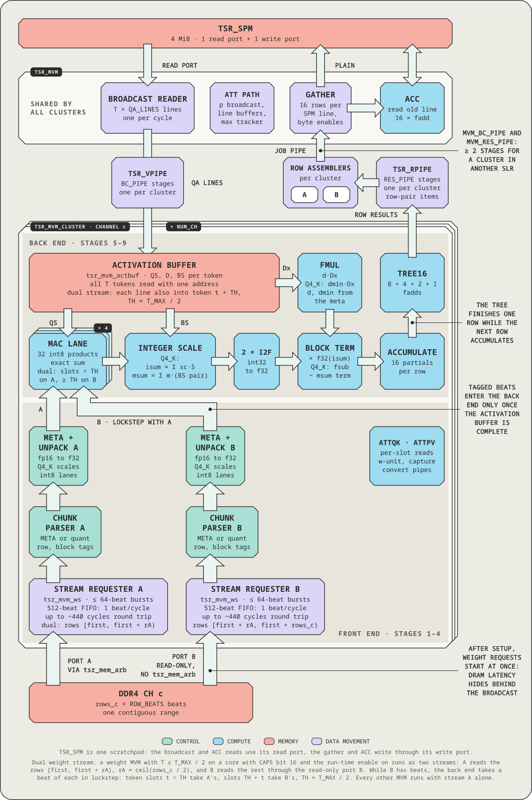
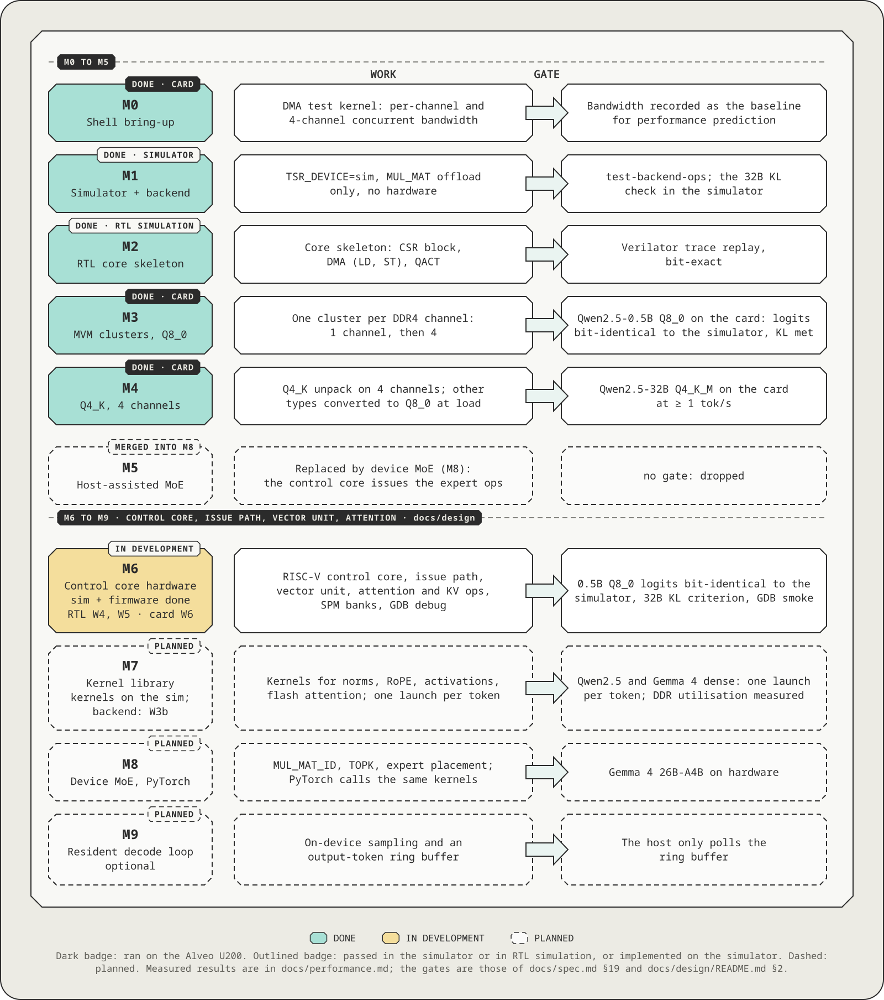

# Tesseract: an open-source LLM inference NPU core. Architecture and ISA specification

Oct 22, 2026 · Jiwoo Kim

This is the master specification of the Tesseract core: architecture, data layouts,
numerics, ISA, interfaces, verification strategy, milestones and open items. It is the single
technical entry point. The detail that this document summarises lives in the six area documents of
[`docs/design/`](design/README.md): [EX](design/01-execution-model.md) (execution model, host interface, global
tables), [VU](design/02-vector-unit.md) (vector unit and approximate math), [AT](design/03-attention-kv.md)
(attention and KV cache), [CC](design/04-control-core.md) (control core, issue path, SPM, clock domains),
[DB](design/05-debug.md) (debug and profiling) and [SW](design/06-software-verification.md) (simulator,
firmware, host software, verification).

> **Scope.** The architecture contract of the Tesseract core and of the software that drives it. A
> section that summarises a `docs/design` section says so; that `docs/design` section is the normative
> definition and is incorporated into this document by reference (one definition per table,
> `docs/design/README.md` §4). Status words: *on the card* (ran on the Alveo U200), *on the
> simulator* (implemented in this tree and tested against it), *designed* (specified in `docs/design`,
> no implementation), *planned* (a work package not started), *idea* (not scheduled).

**Revision note.** This revision is written in English; earlier revisions were Korean. The design
decisions D14 to D18 are in section 16. The v0.2.1 clarifications are section 21.

**Contents**

1. [Overview](#1-overview)
2. [System structure](#2-system-structure)
3. [Configuration parameters](#3-configuration-parameters)
4. [Memory model](#4-memory-model)
5. [Device weight layout](#5-device-weight-layout)
6. [Quantized activation (QA) layout](#6-quantized-activation-qa-layout)
7. [Numeric rules](#7-numeric-rules)
8. [MVM cluster microarchitecture](#8-mvm-cluster-microarchitecture)
9. [Vector unit and scalar registers](#9-vector-unit-and-scalar-registers)
10. [Execution model and control interface](#10-execution-model-and-control-interface)
11. [ISA](#11-isa)
12. [ggml backend integration](#12-ggml-backend-integration)
13. [MoE support](#13-moe-support)
14. [Performance goal: keep the DDR bandwidth busy](#14-performance-goal-keep-the-ddr-bandwidth-busy)
15. [Host independence roadmap](#15-host-independence-roadmap)
16. [Control core (RISC-V)](#16-control-core-risc-v)
17. [Verification strategy](#17-verification-strategy)
18. [Profiler and debugger](#18-profiler-and-debugger)
19. [Repository layout and milestones](#19-repository-layout-and-milestones)
20. [Open items](#20-open-items)
21. [Implementation clarifications (v0.2.1)](#21-implementation-clarifications-v021)
22. [Working rules](#22-working-rules)

## 1. Overview

Tesseract is an open-source LLM inference NPU core, designed from the ground up. It runs the ggml
graphs that llama.cpp hands to a backend, and today it is implemented as an overlay on an AMD Alveo
U200 FPGA. The host loads a firmware image onto an on-chip RISC-V control core and launches kernels.
The control core issues every 256-bit tile op to the units (DMA, QACT, MVM clusters, vector unit),
which stream weights from DDR4 and compute. This configuration (four MVM clusters of 128 MAC lanes, one per DDR4 channel, the
4 MiB SPM, DMA, QACT, the vector unit and the control core) is named Tesseract Core. The kernel SDK
that runs on the control core is named Tesseract Basis ("Basis"). Decoding a dense model reads every weight once per
token, so the design is built around an unbroken weight stream and not around raw compute.

The design is in `docs/design`. The DMA, QACT, MVM clusters, SPM and the CSR skeleton are RTL and ran
on the card up to milestone M4. The control core, vector unit, on-device attention and KV cache,
firmware SDK and kernels, transport, M6 backend and tools are implemented on the simulator, and
their RTL is planned (section 19).

### Goals

The first goal, reached at M4, was to run a 32B Q4_K_M GGUF on an Alveo U200 with llama.cpp, end to
end, without converting the model file, at no less than 1 tok/s decode on four channels. Qwen2.5-32B
Q4_K_M decodes at 2.93 tok/s with a KL ratio of 1.304 (measured on the card, M4). The parts of it
that still define the project:

- **GGUF as shipped.** The hardware supports two weight formats, 8-bit Q8_0 and 4-bit Q4_K. Weights
  of any other type are converted to Q8_0 at load time, including the Q6_K tensors that Q4_K_M files
  contain.
- **A ggml backend** `ggml-tesseract` that fits llama.cpp's backend structure.
- **A portable core.** The core RTL is vendor-independent SystemVerilog; only the tech wrappers and
  the platform adapter are written per target.
- **One contract.** The only contract between hardware and software is the ISA, the memory layouts
  and the numeric rules of this document.
- **Correctness first.** Running correctly end to end comes before speed.

The remaining goals:

- **Control core.** An on-chip RISC-V core (Ibex) issues every tile op asynchronously. The host
  loads firmware and launches kernels; it runs no instruction programs and has no access to the
  issue path (D14, D15).
- **Attention on the device.** A vector unit for norms, RoPE, activations and reductions, and a q8_0
  KV cache with flash attention on the MVM clusters (D17).
- **One launch per decode token** (M7), device MoE and PyTorch on the kernels (M8), and an optional
  resident decode loop (M9).
- **Debugging.** GDB over PCIe on the control core, plus tile-level debug (D18).
- **Performance.** Keep the DDR bandwidth busy before reducing the bytes per token (section 14).

### Non-goals

- **Formats.** No hardware path for 5- and 6-bit formats (Q5_K, Q6_K) or I-quants; they are
  converted to Q8_0 at load. Q4_0 and MXFP4 are deferred.
- **Model size.** Models larger than 64 GB (gpt-oss-120b, GLM-4.5-Air class).
- **Scope.** Training and multi-session serving. Multiple cards are not part of M0 to M9; the multi-chip QSFP mesh is a later roadmap item (section 19).

### Design principles

- **Bandwidth-bound by design.** A cluster consumes one beat per cycle: 300 MHz × 64 B = 19.2 GB/s,
  the peak of a DDR4-2400 channel. The goal is an unbroken beat supply, not more MACs.
- **Weight traffic stays per channel.** Cluster *c* reads weights only from channel *c*, so the
  weight streams never share a memory port with each other. Where they cross SLRs they pass register
  pipes that carry one beat per cycle, so a crossing costs latency, not bandwidth (section 2).
- **Bit-exact determinism.** The order and rounding of every floating-point operation are fixed by
  this document, so the simulator, the RTL and the card agree bit for bit. There is one C reference
  implementation of the numerics (`sw/sim`), shared by the backend, the simulator, the firmware's
  host build and the cocotb tests.
- **The simulator is the oracle.** An RTL change is accepted only if the relevant traces replay
  bit-exactly.
- **Strict sequential semantics inside a unit.** Tile ops of one unit run in issue order and see
  every effect of the previous one. Across units only dependencies, joins and fences order tile ops
  (section 16, memory model). Execution may overlap further only when the result is provably the
  same.
- **Portability through layering.** Vendor primitives appear only under `rtl/tech/`. The core
  exposes a CSR port, one memory port per channel, a control-core clock and reset, and error and
  interrupt levels; it contains no vendor AXI.
- **The specification is the single source of truth.** A change to the ISA, a layout or the numerics
  goes into the same commit as the matching edit of this document.
- **Reserved fields are zero.** A tile op with a non-zero reserved field ends with `ILLEGAL_OP`.

### Authority and status words

Order of authority: this document, then the simulator (`sw/sim`), then `docs/design/*`, then the other
documents. A section here that points to a `docs/design` section summarises it and incorporates it by
reference; a difference between the two is a defect to fix in whichever document is wrong. Status
words are those of the Scope box. A number carries its provenance in parentheses: *measured on the
card, M4*, *measured on the simulator, 83ac601*, *estimate (`docs/design` section)*. Card measurements
were taken before the control core was added, with the host issuing the ops. Nothing in this
document is measured on the card with the control core.

### Terminology

| Term | Meaning |
| --- | --- |
| Channel | One independent DRAM port. On the U200 one DDR4 bank |
| Cluster | The MVM engine dedicated to one channel |
| Beat | One transfer of the memory interface: 512 bits = 64 B |
| SPM, line | The on-chip scratchpad that holds activations and intermediate values; its unit is the line (64 B) |
| Superblock (sb) | The 256-weight unit of K-quants |
| QA | Quantized activation: int8 data plus scales and bsums |
| N, K | Rows (output dimension) and columns (input dimension) of a weight matrix W |
| T | Number of tokens (activation vectors) one MVM processes |
| s0–s15 | One bank of f32 scalar registers inside the VU for reduction results and constants. Only VU ops write them; the control core and the host read them as `SREG0`–`15` (core CSR 0x9C0), section 9 |
| Control core | The RISC-V processor (Ibex) inside the core. It issues every tile op (section 16, [CC](design/04-control-core.md)) |
| Firmware image, kernel | The RV32 ELF that runs on the control core. A kernel is a function of the image that the host launches (`graph`, `replay`, `selftest`) |
| Launch | One host-visible run of a kernel: an 8-word descriptor in the launch queue (LQ) and an 8-word answer record in the completion ring (LCQ), section 10 |
| Op list (OPL), record | The data the `graph` kernel executes: records of kinds such as `MUL_MAT` (section 12) |
| Tile op | One 256-bit instruction that the firmware issues to a unit (section 11) |
| Issue path | The hardware between the control core and the units: issue port, issue FIFO, checker `tsr_chk`, dispatcher and one in-order queue per unit |
| Ticket | The number {unit, sequence} of one issued tile op, used for completion and dependencies |
| Transport, kdev | The host-device layer `tsr_transport` and its device-access implementations (`sim`, `mock`, `vkernel`, `xrt`) |
| Stages A, B, C | The three stages of host independence (section 15) |

### Decision index

Decisions are recorded in two places. The user decisions D1 to D18 are in the table of section 16 and
in [`docs/ctrl-riscv.md`](ctrl-riscv.md). The design decisions are numbered per area and logged
with their rationale in [`docs/design/README.md`](design/README.md) §6:

| Area | Decisions | Log |
| --- | --- | --- |
| EX, execution model and host interface | EX-1 to EX-30 | `docs/design/README.md` §6.1 |
| VU, vector unit | VU-1 to VU-27 | §6.2 |
| AT, attention and KV cache | AT-1 to AT-22 | §6.3 |
| CC, control core, issue path, floorplan | CC-1 to CC-34 | §6.4 |
| DB, debug and profiling | DB-1 to DB-23 | §6.5 |
| SW, software and verification | SW-1 to SW-39 | §6.6 |

The same file lists where each global table lives (§4), the review findings that were not applied
(§7), the remaining risks (§8), the open measurements and third-party confirmations (§9) and the
work packages W0 to W6 (§10). Open items of this document are in section 20.

## 2. System structure

The system has four layers. A new target rewrites only the bottom two (the tech wrappers and the
platform adapter) plus a transport. The software and the core change only their parameters.

| Layer | Components | Depends on the target |
| --- | --- | --- |
| Software | `ggml-tesseract` backend, weight repacker, op-list (OPL) builder and cache, simulator, firmware SDK and kernels, transport | The transport only (XRT, Zynq AXI, SoC driver) |
| Core | Control core (RISC-V, ITCM and DTCM, debug module) and issue path (checker, dispatcher, per-unit queues), MVM clusters × C, vector unit (with s0–s15), SPM, DMA, QACT, debug block | Parameters only |
| Tech wrappers | `tsr_sram_*`, `tsr_mac_lane`, clock and reset, CDC synchronisers, a clock gate and reset synchroniser for the control core (a divider only on targets that need one) | Written per target |
| Platform adapter | Control register bridge; memory port to AXI4 or similar | Written per target |

Status of the Core row: the DMA, QACT, MVM clusters, SPM and the CSR skeleton are RTL (verified, ran
on the card). The control core, issue path, vector unit, attention modes of the
clusters and debug block are designed and run on the simulator; their RTL is planned (W4).

<p align="center"></p>

A block that spans all three columns is the same on every target. A tile inside a column is written
per target; dashed tiles are ideas, not scheduled.

| Target-specific piece | Alveo U200 | Zynq / Kria (idea) | SoC (idea) |
| --- | --- | --- | --- |
| Transport | `xrt`. The `xrt` kdev is written and unit-tested against the XRT no-op shim and has not run on a card | Zynq AXI | SoC driver |
| Platform adapter | `rtl/platform/alveo_xrt`: AXI4-Lite to CSR port, one AXI4 bridge per DDR4 channel, kernel tops `tsr_u200_k1` / `tsr_u200_k4`, the M0 bandwidth kernel. Register-only, `ap_ctrl_none` | To be written | To be written |
| Tech wrappers | `rtl/tech/xilinx`: URAM, BRAM, DSP48E2 (two int8 tokens per DSP), inferred through attributes so that Verilator runs the same files | To be written | SRAM macros (for example on an open PDK) |
| Core parameters | `NUM_CH` 4, `BEAT_BITS` 512 | `NUM_CH` 1–2, `BEAT_BITS` about 128 | To be decided |

`rtl/tech/generic` holds behavioural versions of the wrappers for simulation and lint on any target.
Porting notes:

- HBM cards (U280, U55C) would use a large `NUM_CH` with `BEAT_BITS` 256; Zynq-class parts
  `NUM_CH` 1–2 with `BEAT_BITS` about 128. The cluster structure and the ISA stay the same.
- `NUM_CH` is at most 16 because `LD` and `ST` name the channel in a 4-bit field (section 3).
- The current RTL elaborates only with `BEAT_BITS` = 512 and `LANES` = 128 (one beat is one SPM
  line), so other widths are a porting task.

### U200 configuration

<p align="center"></p>

Fat arrows are the per-channel memory paths that carry the weight streams: the weight stream of a
channel flows only into the cluster of that channel. Dashed blocks are designed and verified on the
simulator; their RTL is planned. Blocks with a single home carry their SLR tag under floorplan C'.

- **Host** (llama.cpp with `ggml-tesseract`, or PyTorch with `tsr_rt`): turns the graph into an op
  list (OPL), repacks the weights, loads the firmware image and launches kernels through the
  transport (XRT or the simulator). Over PCIe it moves op lists, weights and activations into card
  DRAM.
- **Platform adapter** (Alveo XRT): the control bridge (`s_axi_control` to CSR; `ap_ctrl_none` and
  `ADAPTER_CTRL.MEM_EN`, section 10) and one AXI4 memory bridge per channel. It reaches the core
  through the CSR port and the platform error input `plat_err_i` (Core boundary interface below).
- **Core** (vendor-independent SystemVerilog): the issue path, the SPM (activations, intermediate
  values, QA; 64 B lines; 4 MiB; even and odd line banks with two read paths), the vector unit
  (element ops, reductions, RoPE, the softmax steps of attention; VL 16; s0–s15) and clusters 0–3
  (stream and unpack, 128 MACs, fp accumulate, and the attention modes ATTQK and ATTPV). An x
  broadcast and a y gather bus connect the SPM and the clusters.
- **Control core** (M6): RISC-V (Ibex RV32IMC), ITCM 128 KiB and DTCM 64 KiB, issue port, SPM
  window and debug module, on its own clock `clk_rv` (derived from `ap_clk_2`), placed in SLR1
  (section 16, [CC](design/04-control-core.md)).
- **DDR4 ch0–ch3**: cluster *c* receives its weight stream from channel *c* only (up to 19.2 GB/s per
  channel = 300 MHz × 64 B, through the AXI4 memory bridge). Channel 0 also holds the OPL, IO and
  AUX regions (section 4) and a quarter of the weight rows; channels 1–3 hold a quarter each.

Heavy weight traffic flows only between a channel and that channel's cluster. The U200 platform
places the DDR controllers in SLR0 (ch0), SLR1 (ch1, ch2) and SLR2 (ch3) (`platforminfo`). The first
plan put each cluster in the SLR of its own channel, so that weights never cross an SLR. Two T_MAX 8
clusters do not fit the dynamic region of SLR1, though: they need 1,348 DSP (1,380 with QACT) where
the region has 1,320, and they would use 408 of its 420 RAMB36. The U200 placement is therefore
floorplan C' ([`docs/rtl-m3.md`](rtl-m3.md) §14, M3 part C): clusters 0 and 2 in SLR0, clusters 1
and 3 in SLR2, and the rest of the core (CSR, SPM, DMA, QACT, the per-channel arbiters and the
centre of the result gather) in SLR1. The control core, issue path, vector unit and debug block also
go into SLR1 as floorplan C'' (designed, CC §14.2).

Every signal that crosses an SLR passes a register pipe: per cluster the activation broadcast, the
weight request and response, the result-gather job and start pipes and the reset copies, plus the
AXI slices of channels 0 and 3. The weight-response pipe moves one beat per cycle without
backpressure, so a crossing does not reduce the channel bandwidth. The central DMA and arbiters sit
in one SLR, so LD and ST data do not cross an SLR inside the core.

### Inside `tsr_core`

<p align="center"></p>

The units use the dispatch handshake `cmd_valid`, `cmd_ready`, `done`, driven by the dispatcher
([`docs/rtl-m2.md`](rtl-m2.md) §3, CC §8). One `tsr_mem_arb` per channel merges the weight stream
and the DMA onto that channel's memory port (channel 0 also takes the trace writer of the debug
block); there is no instruction fetch.

### Core boundary interface

(The normative definition is EX §9.3.) The core does not use AXI directly. It exposes only:

- **CSR port**: 32-bit register read and write (`addr`, `wdata`, `we`, `rdata`, `valid/ready`). The
  adapter converts it to `s_axi_control` or similar. Image load, launches and debug access all go
  through this port.
- **Memory ports × C**: one per channel. Read request `{addr_beat, len_beats, id}`, read response
  `{data[511:0], id, last}`, and write request, data and response channels; all valid/ready.
- **Control-core clock**: inputs `clk_rv` and `rst_rv_n`, treated as asynchronous to the core clock.
  `rst_rv_n` is only added to the reset of Ibex and the debug module and is not used at CDC
  endpoints (section 16, Clock domains).
- **Platform error input** `plat_err_i`: the error level of the platform (U200: `ADAPTER_STATUS`
  bits 0–2, or an error count other than zero). It appears in `STATUS.PLAT_ERR` and in the control
  core's `LQ_FLAGS`; a launch answered while it is set has the result PLAT_ERR. A target without an
  adapter ties it to 0.
- **Host interrupt** `host_irq_o` = `CTRL.IRQ_EN` ∧ (LCQ_WR ≠ LCQ_RD): for ports that have a host
  interrupt (Zynq and similar). The U200 does not connect it and polls.

The core has no completion level output; a launch is answered in the completion ring (section 10).

Memory port rules:

- The address unit is the beat (64 B). The core never issues a burst that crosses a 4 KiB boundary
  (at most 64 beats, within one 4 KiB-aligned span).
- Read responses are ordered only within one `id`. The core may leave at most `RD_OUTSTANDING`
  requests per channel outstanding.
- The cluster's weight stream and the DMA share one channel port, split by the core's internal
  arbiter (the trace writer of the debug block joins as a write source on channel 0). There is no
  instruction fetch: memory source 0 (FETCH) is tied off (EX §11).

## 3. Configuration parameters

Every size is an elaboration parameter. Software reads the same values at start-up from the CSR
registers `CFG_*`. The U200 values are:

| Parameter | Meaning | U200 |
| --- | --- | --- |
| `NUM_CH` (C) | Number of channels = number of clusters (1–16; the 4-bit channel field of `LD` and `ST` is the limit) | 4 |
| `BEAT_BITS` | Memory port data width | 512 |
| `F_CORE` | Core clock target | 300 MHz (the k4 link reached 276.3 MHz, measured in Vivado 2024.2, linked) |
| `LANES` | MAC lanes per cluster (weights per beat). Fixed by `BEAT_BITS` / 4 (the weights of one Q4_K beat); not an independent parameter | 128 |
| `T_MAX` | Maximum tokens per MVM | Synthesised 8 (4-channel kernel k4; 1 in the 1-channel bring-up kernel k1); architectural maximum 8 |
| `K_MAX` | Largest supported K | 32768 |
| `SPM_BYTES` | Scratchpad size | 4 MiB |
| `VL` | f32 lanes of the vector unit | 16 |
| `NSREG` | Number of f32 scalar registers | 16 |
| `RD_OUTSTANDING` | Outstanding read requests per channel | 16 |
| `CH_BYTES` | DRAM capacity per channel | 16 GiB |
| `ADDR_BEAT_W` | Width of a channel address in beats | 28 |
| `ITCM_BYTES`, `DTCM_BYTES` | Instruction and data SRAM of the control core | 128 KiB, 64 KiB (CC-3) |
| `Q_DEPTH_*` | Queue depth per unit (DMA, QACT, MVM, VU, unit 4, SYNC) | 8, 4, 4, 16, 0 (unit 4 absent), 4 (CC §7.4) |
| `ISSUE_FIFO_DEPTH` | Depth of the issue FIFO (`ISSUE_CREDIT` reports the free space, so it does not depend on the sum of the queue depths) | 32 (U200), 8 (ASIC) |
| `F_RV` | Control-core clock. The implementation decides; `RV_FREQ` measures it (not an RTL parameter) | Planning value 166.7 MHz (250 MHz if Ibex closes there, 125 MHz fallback) |

The rows from `ITCM_BYTES` on are design values (designed).

The control-core parameters are not placed in `CFG_*` (EX §5.1). The control-core revision and
features are read from `CTL_ID` (0x01C), the TCM sizes from `RV_CFG` (0x030), the clock from
`RV_FREQ` (0x02C) and the queue depth of each unit from `Q_DEPTH` (0x088). Control-core software
sees the free space of a queue in `ISSUE_CREDIT`.

`K_MAX` was chosen to cover the Qwen2.5-32B FFN intermediate dimension 27648 and the Llama 70B class
28672. The activation buffer of a cluster holds one complete QA vector (QS + D + BS, section 6) per
token, so it needs `QA_LINES(A256, K_MAX) × 64 × T_MAX` bytes. At K_MAX = 32768 that is 584 lines =
37,376 B per token (A32 needs 576 lines = 36,864 B; A256 is larger). v0.2.1 correction: an earlier
revision wrote `K_MAX × T_MAX` bytes (QS only, 32 KiB), which left out the space of Dx and BS; at that
size the QA of an MVM with K > 28672 (A256) or K > 29120 (A32) does not fit (for example Qwen2.5-72B
FFN with K = 29568 and Q8_0 needs A32 520 lines = 33,280 B).

`NUM_CH` is at most 16 (v0.2.1 clarification): `LD` and `ST` name the channel in the 4-bit sub field
of w0, so channels from 16 up are out of reach. The `NUM_CH` field of `CFG0` has 8 bits, but a
configuration above 16 is undefined, and the simulator and the tools reject it. An HBM part with more
than 16 pseudo-channels (the U280 and U55C have 32) groups several pseudo-channels into one channel
to keep `NUM_CH` ≤ 16. If more channels are ever needed, flags[15:12] of `LD` and `ST` (reserved, 0
today) can become the upper channel bits, and existing programs stay valid.

## 4. Memory model

The core sees two address spaces: DRAM (per channel) and the SPM. The host accesses DRAM only and
cannot see the SPM. The control core has its own 32-bit address space (ITCM, DTCM, control
window, SPM window): it reads and writes the SPM byte by byte but cannot see DRAM (section 16). The
ordering rules between the host, the control core and the units are in section 16 (Memory model).

**DRAM address**: `(ch, addr_beat)`: a channel number and an offset in beats (64 B) inside that
channel.

**Symmetric allocation**: a quantized weight tensor is placed at the same offset `W_OFF` in every
channel. Its N rows are split into C contiguous ranges.

- R = ceil(N / C). Channel c holds rows [c·R, min((c+1)·R, N)). An empty range is allowed.
- Inside a channel, row r starts at `W_OFF + (r − c·R) × ROW_BEATS(fmt, K)`. `ROW_BEATS` is defined
  in section 5.
- As a result an MVM tile op names a tensor by one offset, and each cluster processes its own channel
  range independently.

<p align="center"></p>

**Expert tensors (MoE)**: a 3D ggml expert tensor `[K, N, n_expert]` is treated as one N×K matrix per
expert, and each expert is split by rows over the four channels as above. Expert e sits at
`W_OFF + e × EXP_STRIDE` with `EXP_STRIDE = R × ROW_BEATS` (beats per channel). One expert MVM
therefore uses the bandwidth of all four channels, and building the address from an expert number
that the device computed takes one multiplication.

**Per-channel DRAM map** (the normative definition is [EX](design/01-execution-model.md) §11, which
is incorporated here by reference. Every channel uses the same map):

- **OPL**, ch0, 0–64 MiB: op lists (OPL), the push streams of the `replay` kernel, kernel argument
  blocks and control-core code overlays. The core does not fetch instructions from DRAM.
- **IO**, ch0, 64–320 MiB: host-to-device tensors (input tensors, logits, the M9 output token ring)
  and compute chunks. While profiling, the transport reserves the ring of the trace writer of the
  debug block here (TRW, default 64 MiB, `TRW_CH` = 0).
- **AUX**, ch0, 320–512 MiB: small f32 tensors (norm weights, RoPE frequency-factor tables).
- **WEIGHT / heap**, 512 MiB to the end, every channel: repacked weights and expert tensors are
  allocated symmetrically upward from 512 MiB. KV planes are allocated symmetrically downward from the
  end of the channel (one plane = one (layer, stream, K or V); layout in
  [AT](design/03-attention-kv.md) §4). Between the two lies the per-channel compute heap, sized from the
  reserve graph ([SW](design/06-software-verification.md) §8, R6).
- **Low 512 MiB of ch1–3**: compute chunks and other activations.

A 32B Q4_K_M model (about 20 GB) needs about 5 GB per channel, and the same model in Q8_0 (about
35 GB) about 9 GB per channel, so both fit.

**SPM rules**

- Addresses are linear, the unit is the line (64 B). Every operand starts on a line boundary.
- SPM data carries no type tag. The tile op that reads it decides the interpretation (F32 vector, QA
  block, and so on).
- Writes are done in whole lines. The tail bytes after the valid elements of the last line of an
  output vector are undefined in this section; section 21 (Tail bytes) fixes them to zero so that
  traces are deterministic. Op-list planners must place different operands so that they do not share
  a line.

## 5. Device weight layout

On upload, weights are rearranged into chunks. A chunk is one meta beat plus several quant beats. The
bits keep the meaning they have in ggml; only their byte positions change. The bandwidth overhead
against GGUF is 0 % for both Q8_0 and Q4_K.

| fmt | Blocks per chunk | Weights per chunk | Meta beat content | Quant beats | Chunk size | Against GGUF |
| --- | --- | --- | --- | --- | --- | --- |
| Q8_0 | 32 blocks | 1024 | `d` fp16 × 32 per block = 64 B | 16 | 1088 B | 0 % |
| Q4_K | 4 sb | 1024 | 16 B per sb: `d`, `dmin`, `scales[12]` | 8 | 576 B | 0 % |

**Byte layout per format** (block number b or sb number s inside the chunk; all multi-byte values
are little-endian)

- **Q8_0**: meta bytes [2b, 2b+2) = `d[b]`. The `qs[32]` of block b are bytes [32·(b mod 2), +32) of
  quant beat ⌊b/2⌋. Quant beat j holds the chunk weights [64j, 64j+64).
- **Q4_K**: meta bytes [16s, 16s+16) = the first 16 bytes of the original block (`d`, `dmin`,
  `scales[12]`) unchanged. The original `qs[128]` stay unchanged in quant beats 2s and 2s+1. Beat 2s
  holds the sb weights [0, 128), beat 2s+1 holds [128, 256).

**Load-time conversion**: the hardware formats are only Q8_0 and Q4_K. A 2D weight of any other type
(Q6_K, Q5_K, Q5_0, Q4_0, F16, BF16, F32, I-quants and so on) is unpacked in `set_tensor` with ggml's
`to_float` and requantized with `quantize_row_q8_0_ref` into Q8_0. Any GGUF therefore loads; only the
tensors that are not 8-bit or 4-bit use 8-bit bandwidth.

- Q4_K_M files carry Q6_K for `attn_v`, half of `ffn_down` and `output`, so they take this path. For
  Qwen2.5-32B Q4_K_M it adds about 1.3 GB (about 6 %) of device memory and of bytes read per token,
  and decode is slower by the same share.
- Accuracy (measured on the simulator, [`docs/numcheck.md`](numcheck.md) B3): measured against
  the fp64 exact value, the relative error of Q6_K converted to Q8_0 is smaller than the CPU's (32B
  median 0.62 times). The CPU multiplies Q6_K by Q8_K activations (one scale per 256 values); the
  conversion path uses A32 (one per 32). Q5_0 converted to Q8_0 is about 1.25 times the CPU error:
  the Q5_0 grid points are not on the Q8_0 grid, so requantization adds up to half a Q8_0 step per
  weight. Both are expected from this design and are not defects. When K is not a multiple of 256,
  llama-quantize uses Q5_0 instead of Q4_K, so Q5_0 shows up in small models.
- Requantizing a 6-bit value to 8 bits adds an error far below the original 6-bit quantization
  error. The model-level KL criterion (section 17) checks it.
- The MoE router (`ffn_gate_inp`) stays F32 in `llama-quantize` output and is therefore converted to
  Q8_0 as well. Whether this changes the routing is checked by KL in M8.
- 1D tensors (norm weights and so on) are not converted; they stay F32 in AUX.

The bit-level interpretation of nibbles and 6-bit scale packing follows `dequantize_row_q4_K`,
`get_scale_min_k4` and `dequantize_row_q8_0` in `ggml-quants.c`. The RTL unpacks with bit slicing.

**Row size**: with the number of blocks nb = K / block size (Q8_0 32, K-quants 256), blocks per
chunk S and quant bytes per block QB (Q8_0 32, Q4_K 128), let full = ⌊nb/S⌋ and rem = nb mod S. The
last partial chunk has a meta beat (empty entries 0) plus the quant beats of the blocks that exist.
Every row starts on a beat boundary.

```latex
\mathrm{ROW\_BEATS} = \mathrm{full}\left(1 + \left\lceil \tfrac{S \cdot QB}{64} \right\rceil\right) + [\mathrm{rem} > 0]\left(1 + \left\lceil \tfrac{\mathrm{rem} \cdot QB}{64} \right\rceil\right)
```

Examples: a Qwen2.5-32B `ffn_down` row (Q4_K, K = 27648) has nb = 108, full = 27, rem = 0, so
243 beats (15552 B), the same as GGUF. A Q8_0 row with K = 5120 has nb = 160, full = 5, rem = 0, so
85 beats (5440 B), also the same as GGUF.

K must be a multiple of the block size (ggml guarantees this for quantized tensors). Repacking is
done in `set_tensor` of `ggml-tesseract`, and the reference implementation uses the same code as the
simulator.

## 6. Quantized activation (QA) layout

The input activations of an MVM are in the int8 QA format. It corresponds to the activation formats
of the ggml CPU backend (`block_q8_0`, `block_q8_K`), and the values are produced by the same rules
as ggml's reference quantization functions (`quantize_row_q8_0_ref`, `quantize_row_q8_K_ref`). The
weight `fmt` selects the QA kind: Q8_0 → A32, Q4_K → A256. If the kinds do not match, the MVM stops
with an error.

- v0.2.1 clarification: the activations are not always the same as those of the CPU backend. The x86
  CPU backend calls the reference function for Q8_K (`quantize_row_q8_K`), but it makes its Q8_0
  activations with the SIMD implementation `quantize_row_q8_0` (AVX path: id = 127 / amax rounded in
  one step, q rounded to even). A32 therefore differs rarely from the Q8_0 activations of the x86 CPU
  backend (for example x = {127, 2.5, −0.5, 0, …}: the CPU gives q = {127, 2, 0}, while A32 and
  `quantize_row_q8_0_ref` give {127, 3, −1}; about one q in several hundred thousand for random
  input). The Q8_0 activations or outputs of the CPU backend must not be used as a bit oracle for
  QACT A32; the bit reference is the reference function.

| Kind | ggml counterpart | Block size | Scale | bsums |
| --- | --- | --- | --- | --- |
| A32 | `block_q8_0` | 32 | one f32 per block | none |
| A256 | `block_q8_K` | 256 | one f32 per block | int16 sums of 16 values |

**SPM layout** (one token, length K): three regions, each starting on a line boundary, in this order:

1. `QS`: int8 × K, ⌈K/64⌉ lines
2. `D`: f32 × (K / block size), ⌈4·K/block size/64⌉ lines
3. `BS` (A256 only): int16 × (K/16), ⌈2·(K/16)/64⌉ lines

The sum of the three regions is `QA_LINES(kind, K)`. T tokens are laid out as T QA vectors with
stride `QA_LINES`.

**Quantization rules** (the `QACT` tile op, the simulator and the RTL must agree bit for bit, and the
definition also agrees with the ggml reference)

- **A32** (same as `quantize_row_q8_0_ref`): amax = max|x| of the block, d = amax / 127,
  id = (d ≠ 0) ? 1/d : 0 (all f32). q = roundf(x · id), rounding away from zero (half away from
  zero). The stored `D` is d rounded to fp16 and converted back to f32; q is computed with the f32 id
  before that rounding.
- **A256** (same as `quantize_row_q8_K_ref`): max is the signed value of the element with the largest
  |x| (the first one on a tie). If amax = 0, then d = 0 and q = 0. Otherwise iscale = −127 / max,
  q = min(127, nearest_int(iscale · x)) and d = 1 / iscale. nearest_int rounds half to even and
  gives the same result as ggml's magic-number implementation. `BS[j]` = sum of q[16j .. 16j+15].
  - v0.2.1 correction: the v0.2 text wrote iscale = −128 / max, but `quantize_row_q8_K_ref` at the
    pinned commit (e3797b18) uses `-127.f/max` (`-128.f/max` is commented out because of IQ2_XXS).
    The x86 CPU backend's `quantize_row_q8_K` calls this function unchanged. Since "same as ggml"
    takes precedence, the text uses −127.

For both A32 and A256, q lies in [−127, 127] for ordinary input. The QACT special-value rule
(saturating conversion, section 21) can produce −128, and Q8_0 weight q can be −128, so the signed
8-bit multipliers of a cluster must accept the full signed range.

## 7. Numeric rules

Integer arithmetic is exact up to the end of a superblock, and fp32 arithmetic happens only a few
times per block (or sb). The simulator and the RTL must agree bit for bit, so this section fixes the
order and rounding of every fp operation. The accumulation order differs from the ggml CPU (and the
x86 Q8_0 path also differs in activation quantization, section 6), so there is no bit agreement with
ggml; agreement is verified with the NMSE tolerance of `test-backend-ops` (section 17).

**Block terms**: for one row and one token. d and dmin are weight meta (fp16 → f32), Dx is the block
scale of the activation QA, BS are the bsums.

- Q8_0 (block b, 32 values): isum = Σ q_w · q_x
- Q4_K (sb s, sub-block j = 0..7, 32 values each): sc_j and m_j are interpreted as in
  `get_scale_min_k4`. S_j = Σ q_w · q_x (q_w ∈ [0, 15]), isum = Σ_j sc_j · S_j,
  msum = Σ_j m_j · (BS[2j] + BS[2j+1])

```latex
\begin{aligned}
t_{Q8\_0} &= (d \cdot D_x) \cdot \mathrm{f32}(\mathit{isum}) \\
t_{Q4\_K} &= (d \cdot D_x) \cdot \mathrm{f32}(\mathit{isum}) - (d_{min} \cdot D_x) \cdot \mathrm{f32}(\mathit{msum})
\end{aligned}
```

Evaluate in the order of the parentheses. Each multiplication and each addition is rounded
separately (no FMA fusion).

**Integer widths** (an int32 accumulator is enough for all of them; integer arithmetic is exact, so
the order is free)

| Value | Maximum magnitude | Required width |
| --- | --- | --- |
| Q8_0 isum | 32 × 127 × 128 ≈ 0.52M | signed 21 bits |
| Q4_K S_j | 32 × 15 × 128 = 61,440 | signed 17 bits |
| Q4_K isum | 8 × 63 × 61,440 ≈ 31M | signed 26 bits |
| Q4_K msum | 8 × 63 × 4,096 ≈ 2.1M | signed 23 bits |
| Q4_K msum (arbitrary BS) | 8 × 63 × 65,534 ≈ 33M | signed 26 bits |

An MVM accepts any bytes of the SPM as QA (the SPM has no type tag, so a QA loaded with `LD` is
legal). QS can therefore use the full int8 range, Dx can be any f32 (subnormals are DAZ, NaN and Inf
follow the fp rules) and BS can be any int16, and the hardware must agree with the simulator bit for
bit in these cases too. For BS made by QACT (|BS| ≤ 2,048) msum fits in 23 bits, but for arbitrary BS
the sum BS[2j] + BS[2j+1] needs 17 bits and msum a signed 26 bits (M3, [`docs/rtl-m3.md`](rtl-m3.md)
SP1).

**Row accumulation**: let i be the number of the term in the row: a block (Q8_0) or an sb (K-quant).
Sixteen partial sums p_0..p_15 start at +0.0, and term i is added to p_(i mod 16) in order. The
final value y is the complete binary-tree sum of the 16 partial sums, ((p0+p1)+(p2+p3)) +
((p4+p5)+(p6+p7)) and so on, paired from the left in 4 levels. If the ACC flag of the MVM is set,
y_out = y_old + y.

The number of partial sums, 16, is an architectural constant. Even in the worst case of Q8_0, two
terms that enter the same partial sum are at least 8 cycles apart, so a pipelined fp adder with a
latency of at most 8 cycles keeps II = 1.

<p align="center"></p>

The terms of a row enter the 16 partial sums in turn, and the fixed tree of fadds reduces them to y.

**Common fp rules**

- f32 is IEEE binary32 with round-to-nearest-even.
- fp16 → f32 conversion is exact, including fp16 subnormals.
- Subnormals are treated as zero in the inputs and results of f32 operations (DAZ + FTZ). The sign
  is kept.
- int → f32 conversion rounds to nearest even (the Q4_K isum has up to 26 bits and can exceed 24
  bits).
- A NaN result is produced as the canonical NaN `0x7FC00000`. Inf propagates as in IEEE.
- The transcendental functions of the vector unit (exp, rsqrt and so on) are defined by one shared C
  reference implementation, and the RTL must match it bit for bit.

**Approximate math.** The vector unit's functions are defined by integer algorithms and the
primitives above, not by libm ([VU](design/02-vector-unit.md) §6, summarised in section 9). Their accuracy
is a property of the algorithms, measured exhaustively on the simulator reference; it is reported in
section 9. Agreement with the ggml CPU is not bit-exact in general and is covered by the KL criterion
(section 17).

## 8. MVM cluster microarchitecture

A cluster is a straight pipeline that consumes the weight range of its channel at one beat per cycle.
300 MHz × 64 B = 19.2 GB/s matches the peak of a DDR4-2400 channel, so the aim is not compute but an
unbroken supply of beats.

<p align="center"></p>

A cluster also has two attention modes, ATTQK and ATTPV, that feed the MAC lanes from KV
planes (designed, [AT](design/03-attention-kv.md) §8; the tile ops are in section 11).

**Pipeline stages** (valid/ready flow control in every stage; if the DRAM response stalls, everything
stalls)

1. **Stream requester**: the row range of a channel is contiguous in DRAM, so it requests
   rows_c × ROW_BEATS beats back to back in bursts of 64 beats (rows_c = the number of rows of
   channel c = max(0, min((c+1)·R, N) − c·R); it can be 0, in which case nothing is requested.
   R × ROW_BEATS is only the upper bound and the allocation size on channel 0, not the amount read).
   At most `RD_OUTSTANDING` requests are outstanding.
2. **Chunk parser**: tags each beat with {META, QUANT, row number, block number, end of row}. A
   counter handles partial chunks and row boundaries.
3. **Meta register**: holds the meta beat of the current chunk. The Q4_K 6-bit scale unpacking is
   done here by bit slicing.
4. **Weight unpack**: turns both formats into signed 8-bit lane values. Q4_K gives q (0..15) and
   Q8_0 gives q unchanged. Q4_K uses 128 lanes per beat, Q8_0 64 lanes.
5. **Activation read**: from the cluster-local activation buffer it reads, per token, the 128 int8
   values at the K position of the current beat. Dx and BS are read from the same buffer.
6. **MAC lanes × 128**: s8 × s8 products are summed in groups of 32, giving 4 sub-block (block) sums
   per beat for Q4_K and 2 for Q8_0.
7. **Integer scale stage**: accumulates sc_j × S_j into the isum of each sb (or block). The Q4_K
   msum needs only meta and BS, so it is computed in parallel with the weight path.
8. **fp term stage**: computes the term t of the numeric rules (section 7).
9. **Accumulator**: 16 partial sums per (row, token). At a row boundary two sets alternate, and the
   tree sum of the previous row is finished in the background.
10. **Output**: the row result y goes through the gather network to the SPM. Row r of channel c is
    written to SPM `dst + t × stride + (c·R + r)`.

**Resource estimate** (U200, `LANES` = 128; design values, with the measured DSP counts of M3 part C)

| Item | T = 1 | T = 8 |
| --- | --- | --- |
| MAC per cycle per cluster | 128 | 1024 |
| DSP per cluster | 128 (no packing) | 512 (two tokens packed) |
| DSP of 4 clusters (of 6840 on the VU9P) | 512 | 2048 |
| Activation buffer per cluster (per token `QA_LINES(A256, K_MAX)` = 584 lines) | 1024 bits × 292 (37,376 B) | 8192 bits × 292 |

The 1024-bit width of the activation buffer is the width that reads, in one access, the 128 QS values
(one token) that belong to one beat. The depth 292 is QS 256 + D 4 + BS 32 words for the A256 QA of
K_MAX (A32 needs QS 256 + D 32 = 288). RTL consequence (v0.2.1 correction): stage 5 needs this
capacity to read Dx and BS. Dx and BS may live in a memory separate from QS (the Dx/BS side then
needs at least 36 words × 1024 bits per token), but the total must not be smaller than this value. The
broadcast copies the whole QA vector (`QA_LINES` lines).

DSP packing needs two products that share one operand. A beat contains different K positions of one
row, so neither the weight nor x is shared, and nothing is packed at T = 1 (running some of the 4-bit
products in LUT multipliers is optional). For T ≥ 2 the packing multiplies the same weight by two
tokens. This choice is enclosed in the `tsr_mac_lane` tech wrapper and is not visible in the core
structure.

**Activation broadcast**: at the start of an MVM the QA vector in the SPM is copied to the local
buffers of all clusters at the same time. At K = 27648 that is about 500 lines, which is negligible
against one `ffn_down` MVM (about 310,000 cycles per cluster).

**Placement**: only the broadcast, the weight request and response, the result gather and the reset
cross SLRs, and all of them pass pipeline stages whose depth is a parameter (`MVM_BC_PIPE`,
`MVM_RES_PIPE`, `RST_PIPE`). Which SLR a cluster goes into is only in the floorplan file
(`hw/u200/k4_floorplan.tcl`); the RTL does not know the placement. Clock (decision, 2026-10-24): the
whole core runs on one kernel clock regardless of SLR. There are three reasons not to split clocks
per SLR. The clusters are matched to the channel bandwidth (300 MHz × 64 B = one DDR4-2400 channel).
An MVM divides the rows equally among the channels, so it waits for the slowest cluster. The paths
that cross SLRs are already cut by register pipes, so lowering the clock of one SLR has the effect of
lowering all of them and only adds CDC cost. A clock domain is split only between blocks whose
throughput differs, not by location (for example the RISC-V control core). If timing is short, fix
the paths, and if that fails lower the whole kernel clock. The first plan put each cluster in the SLR
of the DDR controller of its channel; on the U200 two T_MAX 8 clusters do not fit SLR1, so floorplan
C' is used (section 2). Measured on the U200 (measured in Vivado 2024.2, out of context): the DSPs
of the MAC lanes are 128 per cluster at T_MAX 1 (one DSP per product) and 512 at T_MAX 8 (two tokens
share a DSP).

**Overlapping consecutive MVMs**: if the next MVM does not read the dst of the previous MVM, a cluster
may overlap the tail of the previous MVM with the weight requests of the next one. The result equals
sequential execution, so this is an allowed as-if optimisation (the memory model of section 16 allows
it). Its purpose is to hide the fill cost of 1–2 µs (estimate) that every MVM pays with the short
expert matrices of MoE: a down matrix of Gemma 4 26B-A4B (K = 704, 2,816 rows, Q8_0 on the card)
streams 704 rows × 12 beats = 8,448 beats per channel (section 5, ROW_BEATS), so the fill is a few
percent of its time. It has no milestone of its own since M5 was merged into M8; the work follows the
card measurements (section 14).

### Attention and the KV cache

(Designed; the normative definition is [AT](design/03-attention-kv.md), incorporated here by reference.
The AT ops run on the simulator; their RTL is planned, W4.) Attention runs in the MVM clusters and
not in the VU: one SPM port moves 64 B per cycle while the four DDR channels deliver 256 B per cycle,
so only the clusters, each streaming its own channel, can consume the KV cache at the DDR rate.

- **KV cache.** It holds exactly llama.cpp's q8_0 values (the same 32-element blocks, fp16 scales and
  `quantize_row_q8_0_ref` rounding); only the byte placement changes, so `get_tensor` and
  `set_tensor` convert losslessly. Cells form groups of 16, and group u lives in channel u mod C. K
  planes are token-major (the whole row of a cell is contiguous), V planes are slice-major (64-value
  slices of all cells are contiguous), and both use the Q8_0 chunk format of section 5. Planes are
  allocated symmetrically downward from the end of each channel (section 4).
- **Ops** (section 11). `KVST` (DMA unit) stores new K and V rows; `ATTQK` and `ATTPV` (MVM unit)
  compute scores with row maxima and P·V partial outputs with row sums over a range of KV groups;
  `ASMAX`, `AMASK`, `AMERGE` and `ANORM` (VU) are the softmax steps. The flash-attention tile-op
  sequence is normative (AT §6.6).
- **Numerics.** Scores follow the Q8_0 row rule of section 7 on each head segment. P·V is an exact
  integer accumulation with a 24-bit block-floating-point weight per 64-cell segment and one f32
  addition per segment. The softmax is two-pass within a chunk and online across chunks.
- **Scope.** The query heads of one KV head (and up to 8 query tokens in prefill) are the "token
  slots" T of the MVM (grouped-query attention). Not supported: attention logit softcap, ALiBi,
  sinks, sparse `n_kv_max`, DK ≠ DV, head dimensions other than 64 to 512, K-shift, and the KV
  Hadamard rotation (turned off).
- **Gates.** M6 runs with attention on the CPU (`offload_kqv` = false) and verifies the AT ops on
  their own; device attention with the KV cache on the device is an M7 gate (AT §13.6).
- **Estimate** (AT §9): for Qwen2.5-32B decode at 4K context about 40 K core cycles per layer
  against 35.7 K of pure KV streaming (89 %); attention is about 3 % of the token time at 4K context
  and about 19 % at 32K.

## 9. Vector unit and scalar registers

This section is a summary. The normative definition of the VU programming model, encodings, dispatch
checks and numerics (the bit-level algorithms and constants) is [VU](design/02-vector-unit.md) §4–§6 and
Appendix A, incorporated here by reference. The vector ops of attention (ASMAX, AMASK, AMERGE, ANORM)
take their meaning from [AT](design/03-attention-kv.md) §5.4–§5.7 and are executed by the VU (VU §5.11).
Status: the simulator model, the C reference and the firmware kernels exist (on the simulator); the
RTL is planned (W4).

The vector unit (VU, unit 3) streams the 32-bit elements of the SPM at one line (16 elements) per
cycle (SILU, GELU, SIGMOID, TANH, RECIP and similar run at half rate, VU §7.4). The hardware arrives
with M6; from M7 on, RMSNorm, SwiGLU and GEGLU, residuals, RoPE and the softmax steps of attention
run on the device.

**Programming model** (VU §4)

- **Two-dimensional operands**: one op processes `rows` × `m` elements. Rows start on a line
  boundary. Every operand has its own row stride (in lines), and a source stride of 0 repeats the
  same vector for all rows (norm weights, bias). The per-row scalar c comes from an s register
  (`cmode` 1) or from an SPM row vector (`cmode` 2). One op can therefore cover all heads and tokens.
  The tail of the last line of a destination row is written as zero (section 21, Tail bytes, applied
  per row).
- **Operations**: VOP (0x30, 25 functions: arithmetic with MAX and MIN, multiply and add with c, SILU,
  SWIGLU, SIGMOID, GELU and GEGLU (tanh form), GELU16 and GEGLU16 (the fp16 form of ggml CPU), TANH,
  EXP, EXPSUB, RECIP, COPY, SETC and others), RED (0x31, per-row SUM, SUMSQ and MAX; the result goes
  to an SPM row vector or an s register; the post-ops RCP and RMS are fused), ROPE (0x32, T tokens
  and a position vector), TOPK (0x33, the top k ≤ 16 per row; simulator M6, RTL M8), DQROW (0x12,
  repacked row loaded to the SPM with LD → f32; simulator M6, RTL M8), SOP (0x40, 15 scalar
  functions) and VMASK (0x38; `ILLEGAL_OP` before M9).
- **Reductions**: per row, element i is added to partial sum (i mod 128) in order, and the 128
  partial sums are combined by a complete binary tree (128 is an architectural constant). SUMSQ
  rounds x·x separately before adding. An implementation that skips a subtree made only of unused
  (+0) partial sums must send z(q) (−0 → +0) up in its place; the result is then bit-identical to the
  complete tree. An empty row gives +0.0 for SUM and SUMSQ and −∞ for MAX.
- **Comparisons** (MAX, MIN, TOPK) use a sign-magnitude bit total order: −inf < … < −0 < +0 < … <
  +inf < NaN. MAX propagates NaN and MIN returns the operand that is not NaN. TOPK orders by value
  descending, then index ascending.
- **Scalar registers** s0–s15: one bank (16 × 32 bits, D14) inside the VU. Only RED (TO_S) and SOP
  write it. The control core and the host read it as `SREG0`–`15` (core CSR 0x9C0 + 4i; the control
  core through the core window). It is +0.0 after a hardware reset and is not changed by
  `SOFT_RESET`, a control-core reset, QABORT or QCLEAR. A kernel writes an s register before it reads
  it (SOP.MOVI).
- **Order and aliasing**: VU ops see all SPM and s effects of earlier ops in VU queue order. A source
  may overlap the destination only if it is exactly the same (same start and strides, in-place).
  Any other overlap of source and destination is undefined.
- **No run-time errors**: every check happens at dispatch. A shape violation is error code 13
  `OPERAND` (`ERR_INFO` = that value). NaN, Inf and arbitrary bits are values, not errors.

**Numerics** (bit-exact definition, VU §6): the fp functions are defined only with the primitive
operations `tsr_fadd`, `tsr_fsub`, `tsr_fmul`, `tsr_fdiv`, `tsr_fsqrt` and `tsr_frecip`, which follow
the fp rules of section 7 (RNE, DAZ + FTZ, canonical NaN), and with integer operations. The
simulator, the RTL and the card must agree bit for bit; the error bounds are reference values. A VU
fp result is never subnormal and a NaN is always 0x7FC00000. The shared C reference is
`sw/sim/tsr_ref_math.c` (the approximate functions), `sw/sim/tsr_ref_vu.c` (reductions, ROPE, TOPK,
DQROW), `sw/sim/tsr_ref_at.c` (the vector ops of attention and the flash-attention reference) and the
primitives in `sw/sim/tsr_ref.c`. It is checked against a numpy model written separately from this
document and the VU text, and by exhaustive comparison of the unary functions over all 2^32 inputs
([SW](design/06-software-verification.md) §10.1).

- **RECIP_APPROX does not exist.** Every reciprocal (VOP.RECIP, the RED post-ops, the reciprocals
  inside SIGMOID, SILU, GELU and TANH) is the correctly rounded `tsr_frecip`. SQRT, DIV and RSQRT
  (SQRT then RECIP, two roundings) are also built from correctly rounded operations.
- **EXP**: the integer algorithm EXPK (f32 in and out, a log2e fixed-point constant scaled by 2^38,
  a table of 64 entries of 2^(j/64), a cubic Taylor term, all intermediates within 64 bits). Error ≤
  0.53 ulp (model value). It never produces −0 or a subnormal. EXPSUB(a, x) gives +0 for a = −∞
  whatever x is.
- **Composite functions**: SIGMOID(x) = RC(1 + EXPK(−x)), SILU(x) = x × SIGMOID(x), SwiGLU(a, b) =
  SILU(a) × b. GELU (tanh form) is computed as 0.5·(1 + tanh u) = σ(2u). TANH uses a cubic for
  |x| < 2^−6 and EXPK(−2|x|) elsewhere.
- **GELU16 and GEGLU16**: the GELU and GEGLU of llama.cpp graphs run as these (SW-31). Like ggml
  CPU (`GGML_GELU_FP16`) they clamp at ±10 and round input and result to binary16. The tanh-form GELU
  is for M8 and PyTorch.
- **SIN and COS**: exact 64-bit integer range reduction by 2/π, Cephes f32 polynomials, and an
  identity path for |θ| < 2^−12. Absolute error ≤ 2^−23.66 (model value).
- **RoPE angles**: they follow the recurrence of ggml-cpu. θ_0 = f32(p), θ_(i+1) = θ_i × TS, where
  TS = `powf(freq_base, −2/n_dims)` of the host libm, passed in an s register. The freq factor is
  applied as a division and freq_scale as a multiplication. With ext_factor = 0 the angles are
  therefore bit-identical to the CPU's. Only YaRN (ext_factor ≠ 0) uses a table A_i folded by the
  host (θ_i = f32(p) × A_i). The rotation is c = M × COS, s = M × SIN and follows ggml's
  `rotate_pairs` without FMA. The modes are NORM (adjacent pairs) and NEOX (first and second half
  pairs); head_dim must be a multiple of 16 (≤ 1024), and n_dims a multiple of 32 for NEOX and of
  16 for NORM (otherwise `OPERAND`).

**Accuracy of the approximate functions** (measured on the simulator reference, `452e27b`:
exhaustive maximum over all 2^32 inputs against double libm; ulp is taken at max(⌊log₂|r|⌋, −126),
results below 2^−126 are not measured; every maximum is within the 2× gate of the model figure, VU
§6.9):

| Function | Model figure | Measured maximum |
| --- | --- | --- |
| EXPK | ≤ 0.53 ulp | 0.5261 ulp (0.5316 ulp for the NG range) |
| RC, SQ, FD, RECIP, RSQRT steps | correctly rounded | exact by definition |
| SIGMOID | ≤ 2.0 ulp | 2.463 ulp |
| SILU | ≤ 2.3 ulp | 2.868 ulp where σ(x) ≥ 2^−126 |
| GELU | absolute ≤ 5.2·10⁻⁷ on [−8, 8] | absolute 5.16·10⁻⁷ on [−8, 8] |
| TANH | absolute ≤ 1.2·10⁻⁷ | absolute 1.191·10⁻⁷ (16.77 ulp just above the 2^−6 switch) |
| SIN, COS | absolute ≤ 2^−23.66 | on \|θ\| ≤ 2^18: absolute 7.82·10⁻⁸ = 2^−23.61; 1.562 ulp where \|y\| > 10⁻³ |

No VU op is bit-exact with the ggml CPU in general; the KL criterion (section 17) covers the
differences. GELU16 differs from the pinned ggml fp16 GELU table in 272 of 65,536 entries (265 by one
fp16 ulp, 7 by two); in all 272 GELU16 is the correctly rounded value (`ref_math_gelu16`, measured on
the simulator reference, `452e27b`). The other known sources are the CPU's double-precision
RMSNorm sum, its `cosf` and `sinf` and possible FMA contraction in RoPE, its SIMD exp approximation
in SiLU, and its own expf and f16 paths in flash attention (VU §6.9, AT §6.7).

**RMSNorm example** (length n, eps): `SOP.MOVI` sets s2 = 1/n and s3 = eps once. Then `RED.SUMSQ`
(TO_S, post-op RMS, sk = s2, se = s3) gives s1 = RC(SQ(sum·(1/n) + eps)), and `VOP.MULCB` computes
y = (x × s1) × w. That is two ops, and bit-identical to the earlier seven-op sequence (RED.SUMSQ →
SOP.MULI → ADDI → SQRT → RECIP → VOP.MULS → VOP.MUL). T tokens are done in one op with rows = T and a
per-token vector c (VU §8.1).

## 10. Execution model and control interface

This section summarises EX §2–§5 and §8–§9 ([EX](design/01-execution-model.md)). EX is the normative
definition and is incorporated here by reference: the host model, the firmware image and its load,
the launch protocol and the runtime contract R1–R10, the core CSR map (EX §5.1, the only map the
host sees), PERF (EX §6), the error codes and the check order (EX §8.1), the control actions
(EX §8.5) and the XRT adapter (EX §9). Figure: `launch.svg` in section 12.

Status: the CSR and ring model, the firmware runtime and the transport (kinds `sim` and `mock`) are
on the simulator; the CSR block, loader and rings in RTL are planned (W4); none of it has run on the
card.

**What the host does** (EX §2). The host does not run programs. It opens the device (`xrt::ip`, one
buffer per channel), makes it a known state with `SOFT_RESET` unless it attaches, writes the channel
base addresses, sets `ADAPTER_CTRL.MEM_EN`, loads and verifies the firmware image into the TCMs,
boots the control core, waits for HELLO and then **launches** kernels. Weights, inputs and op lists
are written to and read from DRAM by PCIe DMA. The control core issues all tile ops through
the issue port; the host cannot reach the issue port (D15). Bring-up, the card selftest and trace
replay are also control-core kernels. The device states (RESET, LOADED, BOOTING, READY, BUSY,
TRAPPED, HUNG, FAILED) and the transitions between them are in EX §2.2. One process owns the device
(the exclusive context of `xrt::ip`), and GDB and the profiler run inside that process (EX §2.4). The
ordering between host and device is rules H1–H5 in section 16 (Memory model).

**Firmware image** (EX §3). A static RV32 ELF. The `PT_LOAD` segments lie inside ITCM (from
0x0000_0000) or DTCM (from 0x0010_0000). The image carries the kernel table `.tsr_kernels` (the
kernel number of a launch is the position in the table), the requirements note `.note.tsr` and the
image id `.tsr_id` (the first 8 bytes of the SHA-256 of the `PT_LOAD` segments as a little-endian
`uint64`, defined in EX §3.2). Loading happens while `RV_RUN` = 0: each segment is written with
`LOAD_ADDR` and `LOAD_DATA` words, the receiver's CRC-32 (`LOAD_CRC`, zlib `crc32`) is checked, and
`LOAD_CTRL.VERIFY` reads the TCM back and checks its CRC. Boot is `CTRL.RV_RUN` = 1; the control core
starts at `RV_BOOT` + 0x80 and posts a HELLO record (image id, Basis ABI, kind table signature, number of kernels, Tesseract Basis version). After a
TRAP, or when the same image is still resident, a warm restart is used: `SOFT_RESET`, reload of the
DTCM segments, ITCM VERIFY (reloading only segments that differ) and then boot.

**Launch protocol** (EX §4)

- The host writes an 8-word descriptor {TYPE (LAUNCH or PING), PROF, KERNEL, ARG0–ARG6} to `LQ_W0`–`7`
  with posted CSR writes and then writes `LQ_PUSH`. The descriptor enters the launch queue (LQ,
  depth 8) in the core domain, and the runtime of the control core pops it. A launch needs no PCIe
  DMA.
- For every descriptor exactly one answer record (8 words) arrives, in order, in the completion ring
  (LCQ, depth 8) of the core domain. r0 = {TYPE, STATUS, first error code, SEQ[7:0]}, so the host
  classifies a record and pairs it with its launch from r0 alone. The host keeps at most `LQ_DEPTH`
  launches without an answer, so the queue cannot overflow even without reads.
- At most one launch runs at a time (ACTIVE = TAKEN ≠ ANSWERED). The runtime follows the contract
  R1–R10 (EX §4.7): it pops and validates the descriptor, calls the kernel, joins every tile op that
  the launch issued (R6) and then posts the answer with the first error.
- The launch result STATUS is OK, TILE_ERR, BAD_DESC, KERNEL_ERR, TRAP, ABORTED, PLAT_ERR or
  STOPPED; the precedence when several apply is in EX §4.4. The first error is the error record with
  the smallest `ERR_PIDX` (issue sequence number), so it does not depend on the schedule.
- Cancellation is a sequence watermark. `LQ_CANCEL` is a hard cancel: if the running launch is
  covered, the host QABORT is applied at once, and covered launches in the queue are not run and are
  answered ABORTED. `LQ_STOP` is a soft stop: the covered kernel returns STOPPED at a safe point.
- The log of the control core reaches the host through a 256-word log ring of the core domain (record
  header: [DB](design/05-debug.md) §6.1). It can be read even if the queues are stuck.
- Kernels of the default image: `graph` (executor of op lists, OPL; the only offload path from M6),
  `replay` (replays a push stream of tile ops; the SERIAL flag gives sequential semantics) and
  `selftest` (the card selftest).

**Core CSR map** (EX §5.1). 12-bit offsets, 32-bit registers; on the U200 the window is
`s_axi_control` 0x1000 + offset. Reads have no side effects (except the PERF LO sample), an undefined
offset reads 0 and ignores writes, and every access completes within a bound even without `clk_rv`.
The blocks are:

- 0x000–0x03C: `ID` (0x5453_5231 "TSR1"), `VERSION` (Tesseract Core capability 1.0 = 0x0000_0100; a host tool
  with a different major rejects the device when it opens it), `CFG0`–`CFG2`,
  `CAPS`, `CFG3` (VU lane count, PCAP/16 of AT), `CTL_ID`, `CTRL` (0x020), `STATUS` (0x024),
  `RV_BOOT`, `RV_FREQ`, `RV_CFG`, `WDOG_CFG`, `RT_STATE`, `RT_INFO`.
- 0x040–0x09C: the LQ staging words `LQ_W0`–`7` and `LQ_PUSH`, the sequence numbers (`LQ_SEQ`,
  `LQ_TAKEN`, `LCQ_ANSWERED`), the watermarks (`LQ_CANCEL`, `LQ_STOP`), the LCQ and log-ring pointers,
  `LQ_CFG`, `PERF_INFO`, `Q_DEPTH` and `LOG_CFG`.
- 0x0C0–0x0D4: the image loader (`LOAD_ADDR`, `LOAD_DATA`, `LOAD_CRC`, `LOAD_COUNT`, `LOAD_CTRL`,
  `LOAD_STATUS`).
- 0x100–0x2FC: `PERF_0`–`PERF_63` (below). 0x300–0x3FC: LCQ records. 0x400–0x7FC: the log ring.
- 0x800–0xAFC: the debug block `DBG_*` ([DB](design/05-debug.md) §10.1). Inside it, 0x9C0–0x9FC are
  `SREG0`–`15`, which read s0–s15; they exist whenever a VU is present, independent of the debug
  block.
- 0xB00–0xBFC: reserved. 0xC00–0xDFC: the
  DMI window of the debug module of the control core (active only while `DBG_CFG.DMI_EN` is set).
  0xE00–0xF1C: the queue status `Q_*` (per-unit done and issue counts, state, first error record;
  readable even if the control core is dead).

`CTRL` has the level bits `RV_RUN`, `HOST_HOLD`, `HOLD_ON_HALT` and `IRQ_EN` and the pulse bits
`QABORT`, `QCLEAR` and `SOFT_RESET`. `STATUS` holds control-core, queue and ring state levels and
sticky error bits (EX §5.2–§5.3). `CAPS` has bit 0
VU, bit 3 TOPK (RTL M8), bit 5 ATT (the seven AT ops) and bit 6 DQROW (RTL M8) and bit 7 VMASK (M9);
the retired bits 2 and 4 are never set or reused (EX §7.5). The backend reads `CAPS` to choose its
path, so that the same software can handle bitstreams with different features.

**PERF counters** (EX §6). There is one counter space. Time counters count while the device is
ACTIVE and not stopped as a whole by the debugger (QHALT); event counters count only while ACTIVE.
The runtime joins every tile op before it posts its answer, so PERF does not change between
launches. If launches are not overlapped, the difference of two reads is the value of that one
launch. `SOFT_RESET` zeroes all counters, and a read of the LO word of a 64-bit counter samples the
whole counter (section 21). Index 0 `CYCLES`, 2 `MVM_CYCLES`, 3
`VU_CYCLES` and, per channel, 5 + c `CH_RD_BEATS` and 5 + C + c `CH_WAIT` count under the
gates above. Index 1 `RETIRED` is the number of completed queue entries on all units (whatever the
outcome), and 4 is reserved. Because there is no instruction fetch, `CH_RD_BEATS[0]` can be
compared exactly with the hardware. From X = 5 + 2C on there are extension counters (`MVM_WAIT`,
`MVM_EMPTY` and others belonging to VU, AT and CC), and 61–63 belong to debug.

**Determinism rules** ([SW](design/06-software-verification.md) §4.7). A program (image, launch arguments,
DRAM inputs) is *valid* if it is race-free and these four are identical under every schedule: the
per-unit op streams (words, push flags, dependencies as relative tickets), the completion records
r0–r6 (r7, the duration, is timing), the SPM store stream of the control core, and the final written
DRAM and SPM lines. The simulator checks this with eight or more schedules (`fixed` and random
seeds). For a valid program the RTL and the card must reproduce the expect DRAM regions, the DONE
record (r0–r6), the completion counts per unit and the error records. Never compared: polling
counts, `MTIME`, `PERF_*`, r7, completion records (REC) and log content. Firmware rule (SW-30): a
value read from a timing-dependent register (`DONE_SEQ`, credits, `QSTATUS`, `MTIME`, `LQ_AVAIL`,
`LCQ_FREE`, `LOG_FREE`) may end a wait loop but must not influence pushed words, dependencies, SPM
stores or records. At the llama.cpp level the same image and inputs give bit-identical logits on
`sim`, `mock`, `vkernel` and `xrt`.

**Errors** (EX §8). Error codes 1–13 are defined in EX §8.1 (3 `QA_MISMATCH`, 9 and 10 are reserved
and never raised; 13 `OPERAND` is a value range violation of a VU or AT op, `ERR_INFO` = that
value). The dispatch check order is `ILLEGAL_OP` → `BAD_DEP` → `BAD_FMT` → `K_RANGE` → `T_RANGE` →
`OPERAND` → `SPM_RANGE` → `DRAM_RANGE`; the table and each condition are in EX §8.1. A tile op that
has started does not fail: every error is found by the dispatch check, and data-dependent conditions
(NaN, a length read from the SPM) are defined behaviour. A unit that raised an error ends the
following ops as `ABORTED` until QCLEAR (section 16, EX §8.2). Device-level errors are sticky bits in
`STATUS`, `ADAPTER_STATUS`, the TRAP record, the unit progress watchdog (`UNIT_HUNG`), image errors
(CRC, `.note.tsr`, the image id in HELLO) and a missing `clk_rv`; the transport turns them into
errors of the open, boot, launch and wait calls. `SOFT_RESET` (`CTRL` bit 10) is a device-level
procedure: it puts the control core in reset (`RV_RUN` = 0), waits until the queues and the issue
FIFO are empty and clears the error state, the LQ, LCQ and log rings, the watermarks, PERF and the
sticky bits. DRAM, SPM, the TCMs, the s registers, the channel base addresses, the debug settings and
all sequence numbers are left as they are. It completes even without `clk_rv`, and `STATUS.SR_BUSY`
is set while it runs (EX §8.5). There is no way to release a stuck unit by force; recovery is a card
reset (EX §8.6).

**XRT adapter** (EX §9). The kernel is `ap_ctrl_none` and has no interrupt. The host accesses the
registers with `xrt::ip` and polls; it never uses `xrt::run`, so a control core halted by the
debugger cannot break the XRT scheduler. The only kernel arguments are the channel buffers `ch<c>`
(base address at 0x040 + 8c). `ADAPTER_CTRL` (0x0E0) bit 0 `MEM_EN` checks the 4 KiB alignment of all base
addresses when it is set and latches them in the bridges; while it is set, writes to a base address
are ignored (`BASE_LOCKED`). While `MEM_EN` = 0 the memory requests of the core are held, not dropped
(`REQ_HELD`). `ADAPTER_STATUS` (0x0F0) and `ADAPTER_VERSION` (0x0F4, major 1) are the adapter's own
state, and the whole core CSR space is always visible in the window at 0x1000 + offset (the debug
block at 0x1800–0x1AFC). The memory bridges and the reset scheme are those of
[`docs/platform-u200.md`](platform-u200.md) §4–§5. The control core receives a second clock
`ap_clk_2` (planning value 166.7 MHz). Whether v++ 2024.2 accepts an `ap_ctrl_none` RTL kernel with
`m_axi` arguments is confirmed at the first smoke link; if it does not, the kernel is declared
`ap_ctrl_hs` but still never run with `xrt::run` (EX §9.1). The tree holds the register-only adapter
of the X0 state; `MEM_EN`, `ap_clk_2` and `plat_err_i` are designed (`ADAPTER_VERSION` stays major 1).

## 11. ISA

([EX](design/01-execution-model.md) §7.) A tile op is a fixed 256 bits (32 B) split into 32-bit
words w0–w7 (little-endian). The control core issues every tile op through the issue port. An address
field is the immediate word itself (A = imm); there is no base register.

**w0 format**

| Bits | Field | Meaning |
| --- | --- | --- |
| [7:0] | opcode | The instruction |
| [11:8] | sub | Sub-code per instruction: format code, mode, channel |
| [15:12] | flags | Per-instruction flags |
| [31:16] | x16 | Per-instruction field. x16 bit i = w0 bit 16 + i. Bits that the definition of the instruction does not use must be 0 (otherwise `ILLEGAL_OP`). LD, ST, QACT, MVM, NOP and FENCE have x16 = 0; the VU and AT ops define their own fields |

**Common rules**

- In the table below, A1, A2 and A3 are the first, second and third address field, and the value is
  that immediate word as it is. All other fields are immediates too.
- SPM addresses are in lines (only the SPM word access of SOP is in 4-byte words), DRAM addresses are
  in beats, and lengths are in elements.
- Reserved fields and bits, and x16 bits that the instruction does not use, must be 0; otherwise
  `ILLEGAL_OP`.
- The number of an f32 scalar register is a 4-bit field in an immediate word or in x16.
- A started instruction does not fail. Every error is found by the dispatch check (section 10,
  Errors).

**Instruction list** (stage = the milestone in which the hardware first implements it). The global
table that fixes unit and status per opcode is [EX](design/01-execution-model.md) §7.2, incorporated
here by reference. The encodings, checks and semantics of the VU and AT ops are fixed by VU §5–§6 and
[AT](design/03-attention-kv.md) §5–§6; the table only points to those rows. LD, ST, QACT, MVM, NOP and
FENCE have RTL that ran on the card; every other row is designed and runs on the simulator.

| Opcode | Name | sub | Operands | Action | Stage |
| --- | --- | --- | --- | --- | --- |
| 0x00 | `NOP` | – | – (w1–w7 = 0) | Join point of the SYNC unit: completes when its dependencies are done | M2 |
| 0x01–0x03 | (reserved) | – | – | `ILLEGAL_OP`. Never reused | Reserved |
| 0x04–0x09 | (retired) | – | – | `ILLEGAL_OP`. Never implemented, never reused | Retired |
| 0x10 | `LD` | ch | A1 = SPM dst (w1), A2 = DRAM src (w2), w3 n_lines | DRAM → SPM | M2 |
| 0x11 | `ST` | ch | A1 = SPM src (w1), A2 = DRAM dst (w2), w3 n_lines | SPM → DRAM | M2 |
| 0x12 | `DQROW` | fmt | VU §5.6 | Repacked row loaded to the SPM → f32 (VU unit). Simulator M6 | M8 |
| 0x14 | `KVST` | | AT §5.1 | Store a K or V row into a KV plane (DMA unit) | M6 |
| 0x18 | `QACT` | 0 A32, 1 A256 | A1 = QA dst (w1), A2 = f32 src (w2), w3 K, w4 T, w5 src_stride | T f32 vectors → T QA vectors | M2 |
| 0x20 | `MVM` | fmt | A1 = dst (w1), A2 = x (w2), A3 = W_OFF (w3), w4 N, w5 K[15:0]·T[19:16], w6 dst_stride | Matrix × activations. flags bit 0 ACC | M3 |
| 0x21 | `ATTQK` | | AT §5.2 | Scores and row maxima over a range of KV groups (MVM unit) | M6 |
| 0x22 | `ATTPV` | | AT §5.3 | P·V partial outputs per channel and row sums (MVM unit) | M6 |
| 0x30 | `VOP` | cmode | VU §5.2 | 25 element functions, rows × m | M6 |
| 0x31 | `RED` | kind | VU §5.3 | Per-row SUM, SUMSQ and MAX, post-ops RCP and RMS | M6 |
| 0x32 | `ROPE` | mode | VU §5.4 | Rotate T tokens, angles from the ggml-cpu recurrence | M6 |
| 0x33 | `TOPK` | – | VU §5.5 | Top k ≤ 16 (index, value) pairs per row. Simulator M6 | M8 |
| 0x34–0x37 | `ASMAX`, `AMASK`, `AMERGE`, `ANORM` | | AT §5.4–§5.7, VU §5.11 | Softmax numerator, general mask, channel tree and online merge, normalisation (VU unit) | M6 |
| 0x38 | `VMASK` | | VU §5.7 | Position-window mask. `ILLEGAL_OP` before M9 | M9 |
| 0x40 | `SOP` | function | VU §5.8 (w1 sd·sa·sb, w2 imm, w3 SPM word) | 15 f32 scalar functions | M6 |
| 0x7F | `FENCE` | – | – (w1–w7 = 0) | Barrier of the SYNC unit: completes when every earlier instruction is done | M2 |

The reserved opcode blocks (VU: 0x13, 0x39–0x3F, 0x41–0x47; AT: 0x15–0x17, 0x19–0x1B, 0x23; SYNC
class: 0x0A–0x0F, 0x70–0x7E) and all other numbers are in EX §7.2. A retired or reserved opcode is
never reused for another instruction.

**Issue and units** (EX §7.2–§7.3). The issue port accepts every opcode. An opcode that is reserved,
retired or not built into the bitstream still gets a ticket on the SYNC unit (5) and ends with
`ILLEGAL_OP`, so every issue has a completion. The opcode → unit table is static and is generated
from the table source (`sw/tables/tsr_tables.py`, EX-30) into the RTL, the simulator and the SDK.
The units are 0 DMA (LD, ST, KVST), 1 QACT, 2 MVM (MVM, ATTQK, ATTPV), 3 VU (VOP, RED, ROPE, TOPK,
SOP, DQROW, ASMAX–ANORM, and VMASK from M9), 4 reserved (a possible later attention engine; absent
in M6) and 5 SYNC (NOP, FENCE, QCLEAR, rejected opcodes). A dependency on
an absent unit or on units 6–14 is `BAD_DEP`. QCLEAR, QABORT, QHOLD and TRACE_MARK are control
window entries, not opcodes ([CC](design/04-control-core.md) §5.1).

**MVM `fmt` codes**: 0 = Q8_0, 1 = Q4_K, 2–15 reserved. The only candidates are 4-bit formats
(Q4_0, MXFP4); there is no 5- or 6-bit path.

**VU function codes** (VU §5.2, §5.8): the VOP functions are numbered 0–24 (0x00–0x18; the
multiply and add with c, MULC and ADDC, take `cmode` 1) and the SOP sub-codes 0–14 (9–14 are SUB,
DIV, RSQRT, MAX, MIN, EXP).

**MVM semantics**

```
kind = (fmt == Q8_0) ? A32 : A256            # Q4_K → A256
for t in 0 .. T-1:
    x = QA(kind, K) at  x + t × QA_LINES(kind, K)
    for n in 0 .. N-1:                       # row n belongs to channel ⌊n/R⌋, R = ⌈N/C⌉
        y = DOT(fmt, W_OFF, n, K, x)          # terms and row accumulation of section 7
        p = f32 at SPM  dst + t × dst_stride, element n
        p = (flags.ACC) ? p + y : y
```

- `ACC` is used to fuse the residual addition and the summation of MoE expert outputs into the MVM.
- `dst_stride` = 0 is interpreted as ⌈4N/64⌉ lines. If the dst and x regions overlap, the result is
  undefined.
- An expert MVM is expressed by putting A3 = tensor W_OFF + expert number × EXP_STRIDE into the
  immediate (the control core computes it). There is no separate opcode.

**Other semantic points**

- The `QACT` dst has a spacing of `QA_LINES(kind, K)` per token, and the src is read with a spacing
  of `src_stride` lines.
- The semantics of `ROPE` are VU §5.4 and §6.7. The table holds n_dims/2 freq factors (FF) or the
  A_i for YaRN (ATAB). Each head is head_dim contiguous elements; if n_dims < head_dim the rest is
  copied unchanged.
- The semantics of `DQROW` are VU §5.6 and §6.8. A repacked row, whose channel and position inside
  the channel the control core computed (`tsr_row_location`) and loaded into the SPM with LD, is
  unpacked to f32 by the bit interpretation of section 5 (`tsr_dequant_row`; d × q, and for Q4_K
  d × sc × q − dmin × m). Each multiplication and subtraction is rounded separately.

## 12. ggml backend integration

`ggml-tesseract` registers one card as one device. For each split it receives, it builds an op list
(the op list format, [SW](design/06-software-verification.md) §7.2), writes it to the OPL region of DRAM
and launches the `graph` kernel once. Development is pinned to one llama.cpp commit
(`third_party/llama.cpp`, [`docs/llama-pin.md`](llama-pin.md)); the names and signatures of the backend interface are checked
against `ggml-backend-impl.h` of that commit.

Status: the M6 path (`MUL_MAT` as op-list records through the `graph` kernel) is on the simulator. The
eleven M7 record kinds exist as firmware kernels and are verified at layer level on the simulator;
the backend does not emit them yet (W3b). Nothing of this path has run on the card.

<p align="center"></p>

The status tags in the figure correspond to the status words of the Scope box: *ON THE CARD*,
*SIMULATOR*, *PLANNED*.

**Components**

| Component | Role |
| --- | --- |
| reg / device | Registers one device, "Tesseract0", with the type `GGML_BACKEND_DEVICE_TYPE_GPU` so that layer offload (`-ngl`) targets it ([`docs/llama-pin.md`](llama-pin.md)) |
| buffer type | One virtual address space. The real location is chosen per buffer at its first data access (set, get, memset, clear) from the buffer usage. v0.2.1 correction: an earlier revision wrote that `init_tensor` decides by tensor type, but llama.cpp at the pinned commit calls `init_tensor` while the usage is still ANY and sets WEIGHTS only afterwards. `init_tensor` therefore only records tensor metadata, and the type alone cannot tell an F32 weight from an F32 activation. **WEIGHTS buffer**: placement per tensor. A MUL_MAT weight (2D) is allocated symmetrically in the WEIGHT heap in a hardware format (Q8_0 or Q4_K); everything else (1D tensors and so on) stays unchanged in AUX. **ANY and COMPUTE buffers**: bytes stay as they are. If the IO region has a free window, the whole buffer is one window (activations, `test-backend-ops` tensors); otherwise it is host memory. An ANY buffer that holds only leaf tensors (data such as LoRA adapters, which the program does not read or write directly) lives in host memory from the start. If a tensor of such a buffer is the src0 of a MUL_MAT, it is converted lazily (Q8_0 or Q4_K) in graph_compute and cached in the WEIGHT heap |
| set_tensor | Weights in a WEIGHTS buffer: collect in a host staging area, convert to Q8_0 if needed, then repack, split by rows and write per channel. Everything else: write the bytes unchanged to the IO window (or host memory) |
| get_tensor | IO window, host memory, AUX: read the bytes unchanged (`test-backend-ops` reads src0 this way and hands it to the CPU). Weights of a WEIGHTS buffer: unpack the repacking (for debugging; a converted type re-encodes the device copy, so the bytes are not the original bytes) |
| supports_op | The conditions below |
| graph_compute | Split → OPL (M6: `MUL_MAT` records and JOINs only; other kinds from M7), OPL cache looked up by content, `graph` launch, wait for the answer record. On TILE_ERR the first error is traced back to the ggml node (SW §9.3) |
| transport | `tsr_transport` (the normative API is [EX](design/01-execution-model.md) §10, incorporated here by reference): open (`SOFT_RESET` and channel binding, skipped with `TSR_ATTACH`), per-channel DRAM read and write, CSR read and write, firmware image load and boot (warm or cold, HELLO check), launch, wait (a timeout that does not count while the debugger has the device halted, and the recovery steps), cancel and stop, `SOFT_RESET`, log drain. The kdevs are `sim` (the simulator is built in and advances deterministically when the host reads), `mock` (adapter register model), `vkernel` (Verilated kernel) and `xrt` (`xrt::ip`); all share one protocol layer. A `zynq` kdev may follow |

<p align="center"></p>

The figure shows model load once and then one launch: a graph split in M6, one decode token in M7.

**supports_op**: only a `MUL_MAT` that meets all of the following is true. Every other op is sent to
the CPU by the scheduler. In M6 this gives 145 splits per token for 0.5B and
385 for 32B. The M7 table is [SW](design/06-software-verification.md) §9.3.

- src0 is a 2D weight that lives in a Tesseract buffer (not a COMPUTE buffer). Whatever its GGUF
  type, the device holds it as Q8_0 or Q4_K. The type in the tensor metadata is still the original
  GGUF type, so the backend keeps its own table of the real device format per tensor. A src0 that is
  not allocated yet is accepted only if it is a leaf tensor and not a graph input (`test-backend-ops`
  asks before allocation). In llama.cpp scheduling all weights are already allocated, so an
  unallocated src0 is a graph input or the result of another op (an activation) and is rejected
  (v0.2.1 clarification; for example the Hadamard rotation matrix `attn_inp_k_rot` applied to Q with a
  quantized KV cache (`-ctk q8_0`)).
- src1 has type F32, src0 and src1 are contiguous, and the 3rd and 4th dimension of src0 are 1.
- K ≤ `K_MAX`.
- There is no condition on the token count T (v0.2.1 clarification). llama.cpp decides in which
  buffer a weight lives with a probe fixed at T = 512 (`weight_buft_supported`). If `supports_op`
  rejected an op because of an activation size that grows with T, the output.weight of a model with a
  large vocabulary (N + K > 131072, Qwen2.5 and Llama-3) would silently stay on the CPU. Rejecting a
  resident weight at run time for a large T would make the scheduler read that weight from the device
  every time and copy it to the CPU (a loss for converted types, an abort for some I-quants). Cases
  where the activations do not fit into IO are handled by the staging path (lowering constraints
  below).

**Attention (D17; the normative definition is [AT](design/03-attention-kv.md) §2.6, incorporated here
by reference)**: attention is accepted only as llama.cpp's `FLASH_ATTN_EXT`. `SOFT_MAX`, the
attention `MUL_MAT` on the KV cache and the Hadamard rotation `MUL_MAT` are accepted in no milestone
(the rotation is turned off with `LLAMA_ATTN_ROT_DISABLE=1`). M6 runs with `offload_kqv` = false
(`-nkvo`), which keeps the KV cache and attention on the CPU, and the `MUL_MAT` conditions above
filter out the `MUL_MAT` inside attention. From M7 on the KV cache and attention are on the device:
the KV cache is q8_0 for K and V (device layout in AT §4); `FLASH_ATTN_EXT` is accepted when k and v
are q8_0 views of KV cache tensors in a Tesseract KV buffer, D = DK = DV ∈ {64, 128, 256, 512}, and
ALiBi, logit softcap, sinks and `n_kv_max` are not used; `SET_ROWS` is accepted when its dst is such a
KV cache tensor (the full conditions are in AT §2.6). Other KV types are not supported and are run
with `-nkvo`. The `GET_ROWS` of `token_embd` stays on the CPU (input layer) until M7 (M8: LD +
DQROW).

The op set is extended after M7 as described in section 13 (MoE support) and section 15 (Host
independence roadmap). The backend reads the CSR `CAPS` and chooses the path that matches the features
of the bitstream.

**Lowering and the op list.** The firmware's `MUL_MAT` kernel issues the sequence `LD` of src1,
`QACT`, `MVM` and `ST` of dst for every `MUL_MAT` record of the op list. The tiling (tokens beyond
`T_MAX` form `T_MAX` tiles) is done by `plan.hpp`, which the host and the firmware share, and the OPL
cache is keyed by content (SW §7.4, §9.3). Input tensors that change per token (token ids,
positions, KQ mask, KV write indices) live in the IO region and the kernel reads them every time, so
a cached op list never needs patching. `src1` and `dst` are placed by ggml-alloc in a Tesseract
compute buffer, so the copies between host and device are done by the scheduler. If that buffer is
an IO window, the kernel reads and writes it in place; if it is host memory, graph_compute moves the
data through the IO staging area (lowering constraints below).

**Notes**

- **Split upload**: llama.cpp can upload a large tensor in several `set_tensor(offset, size)` calls.
  Repacking happens only after the whole tensor (or a row range that is complete) has arrived.
- **Number of splits**: only `MUL_MAT` goes to the device in M6, so there are hundreds of
  splits per token. The backend must stay inside the scheduler's split and input limits at the pinned
  commit. `GGML_SCHED_DEBUG` shows the split structure. M6 launches per token on the simulator: 145
  (0.5B) and 385 (32B) (measured on the simulator, 83ac601).
- **output.weight**: for Qwen2.5-32B it is a Q6_K matrix with N = 152064, converted at load to Q8_0
  (about 0.83 GB), so one MVM is large. With `-ngl` ≥ 1 llama.cpp assigns the output layer to the
  device first, and thanks to the T-independent `supports_op` above it passes the 512-token probe and
  really lands on Tesseract. For a model with tied output, a copy of `token_embd`
  (`TENSOR_DUPLICATED`) is placed as the output layer. Decode and prefill compute only the rows that
  are output (n_outputs), but the compute buffer reservation holds the logits of n_ubatch outputs
  (152064 × 512 × 4 B ≈ 297 MiB at `-ub 512`), so that chunk lands in host memory and goes through
  staging.
- **Verification hooks**: `test-backend-ops` registers the Tesseract backend and compares it with the
  CPU; the environment variables `TSR_DEVICE=sim|xrt|mock|vkernel` and `TSR_TRACE=<directory>` choose
  the device and dump traces. `mock` is the adapter register model with the simulator; `vkernel` runs
  the Verilated U200 kernel as a server process and drives it with the register sequence of the real
  XRT path (results: [`docs/xrt-host.md`](xrt-host.md), [`docs/platform-u200.md`](platform-u200.md)
  §13; the two-clock server with the control core is P5.3, planned).
- **Lowering constraints** (M1 implementation, details in
  [`sw/ggml-tesseract/README.md`](../sw/ggml-tesseract/README.md) and [`docs/llama-pin.md`](llama-pin.md)).
  - The activations that a program reads and writes directly (src1, dst) live in the ch0 IO region
    (256 MiB). The software divides the IO region into a compute-buffer window (lower part) and a
    staging area (top, max(16 MiB, 2 × `SPM_BYTES`), 16 MiB on the U200). The backend's
    `get_max_size` is the window capacity (240 MiB), so ggml-alloc cuts the compute buffer into chunks
    of at most that size, and a tensor that is larger gets a chunk of its own. At its first data access
    a chunk becomes an IO window if it fits into the free window, and host memory otherwise. (v0.2.1
    clarification: an earlier revision shrank compute buffers larger than IO with `-ub` and rejected in
    `supports_op` when src1 + dst was larger than IO. That rule is dropped for the reason given under
    `supports_op`.)
  - A `MUL_MAT` whose src1 or dst is in a host-memory chunk runs alone, after the ops queued before it
    have run. In tiles of the number of tokens that fit into the staging area, the src1 rows are
    written host → staging (or loaded in place with LD if src1 is an IO window), and after
    LD/QACT/MVM/ST the dst rows are read staging → host. Only one tile of activations must therefore
    be in IO at a time, and `-ub` has no IO limit (only host memory counts). If x + QA + y of one token
    fits into the SPM, one token also fits into the staging area (at least twice the SPM). The traffic
    is the same as with an IO window (graph_compute does the src1 write and the dst read in place of
    the scheduler).
  - llama.cpp wants to put the KV cache in a device buffer, so M6 runs with `-nkvo`
    (`offload_kqv` = false). From M7 `-nkvo` is not needed, and
    `-fa on -ctk q8_0 -ctv q8_0` puts the KV cache and attention on the device (Attention above).
  - K must be a multiple of 32 so that the f32 rows of src1 start on a line boundary (the same
    condition as for the Q8_0 conversion). A shape for which x + QA + y of one token does not fit
    into the SPM is also rejected.
  - If N·4 is not a multiple of 64 and T > 1, the start of a token row of dst is not on a beat
    boundary. This case also takes the staging path: ST writes into a staging area padded to lines,
    and the host copies each tile compactly into dst. On the staging path, and when a src0 made by the
    device (lazy Q8_0 conversion) is read, one split runs as several launches. The weight matrices of
    LLMs have N that is a multiple of 16, so the case of staging for row alignment does not occur.
  - If T = 1 and N·4 is not a multiple of 64, ST writes the tail (zeros) of the last line into the
    bytes after dst. The backend's `get_alloc_size` rounds the tensor size up to a multiple of 64 B, so
    this tail falls into the padding of the tensor itself.

**PyTorch backend**: `torch.compile(model, backend="tesseract")` of `sw/torch` runs only the weight
matrix multiplications of a PyTorch model on Tesseract (`mm`, `addmm`, `linear`, `matmul` and `mv`
where one operand is a parameter, buffer or graph constant); the rest runs eagerly on the CPU. It is
for inference only. The device is reached through the same `tsr_transport` (`TSR_DEVICE`), and the
numeric rules are those of the llama.cpp path. float32, float16 and bfloat16 weights become Q8_0 with
`quantize_row_q8_0_ref` at upload, so the blocks are byte-identical to llama.cpp's load-time
conversion. The activations are quantized on the device with QACT A32 and the products are f32. Bias
and `alpha` and `beta` are applied on the CPU in f32. Below it, the runtime `tsr_rt` (`sw/rt`)
provides weight upload and `y = x·Wᵀ` without a ggml graph. A linear call is one launch of the
`graph` kernel per IO tile, with an op list that holds one `MUL_MAT` record, cached by content (SW
§9.4). `tsr_rt` shares the op-list builder, the allocator, the weight layout (`tsr_lower`) and the
load-time conversion (`tsr-weights.cpp`) with `ggml-tesseract`. Verification follows the oracle chain
of section 17: the device output is bit-identical to `libtsr_ref` and to the numpy spec model, and at
model level the KL is examined. A Hugging Face float32 checkpoint has no CPU run of the same quantized
model, so the floor ratio is measured against a reference (cpu-q8) that computes the same 8-bit
operands with a torch f32 GEMM. For Qwen2.5-0.5B-Instruct over 32 tokens this ratio is 2.92, and 1.72
at the 16 positions where the floor moved (measured on the simulator,
[`docs/torch-backend.md`](torch-backend.md)). The value is reported and is not used as a pass line.

## 13. MoE support

MoE is the workload that fits the U200 best. All the parameters fit into 64 GB while the bytes read
per token are small, so on the same card Gemma 4 26B-A4B (25.2 B parameters, 3.8 B active per token;
about 3.3 GB per token on the card, a Q4_K_M file of about 17 GB) can be about six times faster than a
dense 32B (about 20 GB per token).

**The shape that ggml emits**: router `MUL_MAT` (F32 in the GGUF, converted to Q8_0 at load) →
softmax → top-k → `MUL_MAT_ID` × 3 (gate, up, down) → multiplication by the router probabilities →
sum. `MUL_MAT_ID` takes a 3D expert tensor and an I32 tensor of expert numbers per token (ids). src1
is one per token for gate and up (broadcast), and differs per expert for down. The expert tensor
layout is `EXP_STRIDE` of section 4.

The M8 target Gemma 4 26B-A4B (llama.cpp architecture `gemma4`, `src/models/gemma4.cpp`) has 30
layers with hidden size 2816. Each layer has a dense GELU FFN (2816 → 2112 → 2816) and 128 experts of
width 704, 8 of them used per token; the two branches have their own norms and their outputs are
added. It differs from the shape above in four points.

- The router input is the attention output after an rms_norm, a scale of 1/√2816 and a multiplication
  by a vector (`ffn_gate_inp.scale`). The router matrix is 2816 → 128.
- The 8 weights are the softmax probabilities divided by their sum.
- A vector of 128 per-expert scales (`ffn_down_exps.scale`) multiplies the down output.
- In the Q4_K_M GGUF that was sized, gate and up are one tensor (`ffn_gate_up_exps`, K = 2816,
  N = 1408), so a layer has two `MUL_MAT_ID` and not three; the pinned loader accepts both forms.

The gate-up rows are Q4_K with 25 beats, 352 rows per channel and expert (8,800 beats). The down
experts have K = 704, which is not a multiple of 256: the GGUF stores them as Q5_0 or Q8_0 and the
card holds Q8_0, 12 beats per row, 704 rows per channel and expert (8,448 beats). The model
dimensions are those of the official `config.json`, and the 3.3 GB per token (8 of the 128 experts
per layer, the tied embedding and output matrix once, every weight as Q4_K or Q8_0) and the 17 GB
are estimates from the tensor list of that one GGUF.

| Stage | Method | Needs | Milestone |
| --- | --- | --- | --- |
| Device | The device does the router, softmax, TOPK and the expert MVMs by itself | Control core (reads the TOPK result from the SPM window, computes the expert addresses, issues asynchronously), TOPK RTL (`CAPS` bit 3) | M8 |
| Prefill | Group the tokens per expert and run MVMs with T > 1 | Host or device sorting; not decided | After M8 |

Milestone M5 was merged into M8 (D14). The router and the expert tensors are placed as sections 4
and 5 say.

**Device-only example** (a C++ kernel of the control core, one token, Gemma 4 26B-A4B: 8 experts, a
gate-up matrix 2816 → 1408 in Q4_K and a down matrix 704 → 2816 in Q8_0, the router weight
multiplied into h beforehand and summed by the ACC of the down MVM). The example is illustrative: the
builder names are simplified, and the as-built builders take field structs
(`sw/ctrl/include/tsr/kernel.hpp`, `vu.hpp`); the MoE kernel is not written yet (M8).

```cpp
join(issue(TOPK(sel, probs, 128, 8)));                    // sel = (idx, val) × 8. Join before reading the numbers
for (uint32_t e = 0; e < 8; ++e) {
  const uint32_t id = spm_ptr<uint32_t>(sel)[2 * e];               // expert number (SPM window)
  ticket gu = issue(MVM(GU, xq, {W_gate_up + id * EXP_STRIDE_GU, Q4_K}, 1408, 2816, 1));  // gate = GU[0, 704), up = GU[704, 1408)
  issue(VOP_GEGLU16(H, GU, GU + 704, 704), after(gu));
  issue(SOP_LDS(1, spm_word(sel, 2 * e + 1)));             // s1 = router weight (VU queue order)
  ticket m = issue(VOP_MULS(H, H, 1, 704));
  ticket q = issue(QACT(qa::a32, HQ, H, 704, 1), after(m));
  issue(MVM(Y, HQ, {W_down + id * EXP_STRIDE_DN, Q8_0}, 2816, 704, 1, 0, /*acc=*/true), after(q));
}
join_all();
```

The control core issues the tile ops of all 8 experts without waiting (if a queue has no free slot,
`issue` waits for one). The queue order protects the reuse order of GU, H and HQ: the gate-up MVM of
the next expert is behind the previous down MVM in the MVM queue, and that down MVM starts after the
QACT and VU ops. s1 is written and read in VU queue order, so no op of another kernel can come in
between (there is one s register bank). The `VOP_MULS` of this example is the VOP MULC with
`cmode` 1.

y is initialised with 0 before the loop: Gemma 4 applies an RMS norm to the sum of the experts, so
the residual cannot go into the ACC. The router weight is the softmax probability divided by the sum
of the 8 selected probabilities, times `ffn_down_exps.scale[id]`; the sketch assumes that the kernel
has already put this product into `sel`. Because the factor is multiplied before the down MVM, the
accumulation order differs from ggml (which multiplies after down), so the model-level KL criterion
verifies it.

**Limits**: gpt-oss-120b and GLM-4.5-Air class models do not fit into 64 GB. gpt-oss-20b fits but
needs the MXFP4 format (a reserved fmt code).

## 14. Performance goal: keep the DDR bandwidth busy

**Goal (decision, 2026-10-24)**: after the full path is verified on the card, the first optimisation
priority is to remove the time during which the DDR is idle. Bring the decode speed as close as
possible to the theoretical limit, that is, the 4-channel concurrent read bandwidth B_M0 measured in
M0 divided by the bytes that must be read per token (weights, and from M7 the KV cache). Techniques
that reduce the bytes per token themselves (lower-bit formats, sparsity) come after that. Speculative
decoding is planned after the M7 card gate (decision, 2026-10-31). No performance optimisation is done
on a path that has not been verified on the card.

**Metric**: DDR utilisation U = (bytes read per token × tokens per second) / B_M0. It is measured in
wall-clock time, so host time counts. By cause, U is split as follows (the product is an
approximation):

- H: the share of wall-clock time in which the device is not BUSY (no launch is ACTIVE). Host CPU
  work, PCIe round trips, synchronisation between launches.
- G: the share of device time outside the MVM (LD, QACT, VU, ST). The counters `MVM_WAIT` and
  `MVM_EMPTY` split it into a dependency-bound and an issue-bound share (section 10, PERF counters).
- F: fill, broadcast and tail inside the MVM.
- E: the effective bandwidth while the MVM reads weights, divided by B_M0. DDR efficiency (refresh,
  bank conflicts), `PERF_CH_WAIT` and an unbalanced row distribution between channels are in it.

U ≈ (1 − H) × (1 − G) × (1 − F) × E. H is measured with host timestamps, the rest with the `PERF_*`
counters ([`docs/prof-dbg.md`](prof-dbg.md)).

**Measured position on the card**: B_M0 is 72.05 GB/s for four channels (read bursts of 64
beats at 300 MHz, measured on the card, M0). In decode of Qwen2.5-32B Q4_K_M the MVM unit is busy
98.2 % of the device cycles, the weight streams read 20.74 GB per token at 69.4 GB/s (17.4 GB/s per
channel), and the host share is 12.3 % of the wall-clock time per token (measured on the card,
k4, 276.3 MHz, TSR_STATS, difference of a 65-token and a 1-token run). For 12B Q8_0 the same figures
are 97.4 %, 12.69 GB per token, 68.8 GB/s and 16.8 %. The weight path is therefore the limit: at
276.3 MHz a channel delivers at most 64 B per cycle = 17.7 GB/s, slightly less than the 18.0 GB/s
that the DRAM gives at 300 MHz. U for the 32B decode is about 0.84 (derived from 20.74 GB per
token, 340.6 ms per token and B_M0: arithmetic on three measured values, not a separate
measurement). The details are in [`docs/performance.md`](performance.md).

**Order of reduction** (check each step with measured H, G, F and E)

1. H: remove host round trips. M7 puts norms, RoPE, activations, attention and the KV cache on the
   device and makes a decode token one launch (M6 needs 145 launches per token for 0.5B and 385
   for 32B); M9 removes the remaining per-token host work with a resident loop.
2. G: start the weight stream of the next MVM while ops that are not MVMs run. The asynchronous issue
   of the control core (fork and join) does this.
3. F: overlap the fill and tail of the MVM (the as-if overlap of section 8), and batch small MVMs.
4. E: tune the DDR address layout, burst length and outstanding requests against the M0 measurement,
   and balance the row distribution between channels.

Target value (proposal, set before the card measurements): U ≥ 85 % at M9 for 32B Q4_K_M decode.
Intermediate targets are set after the card measurements with the control core (W6). The measured U above shows that this
value needs to be re-examined (section 20, Open items).

## 15. Host independence roadmap

llama.cpp builds a graph for every token, but while the KV length bucket is the same the graph shape
is the same, and only the input tensors change from token to token (token id, position, KQ mask, KV
write index). Host involvement is reduced in three stages. The op-list cache of stage A uses this
property (cached per graph shape), and in stages B and C the C++ kernels of the control core handle
the position themselves. The KV padding unit and llama.cpp's graph reuse path are checked at the
pinned commit. Status: in M6 the host launches the `graph` kernel once per split on the simulator;
the three stages below are planned.

| Stage | What the host does per token | What the device needs | Relation to llama.cpp | Milestone |
| --- | --- | --- | --- | --- |
| A. Whole graph on the device | Write input tensors, one launch, read logits, sample | Attention and KV cache on the device, every other op, an op-list cache per graph shape | The normal API (`llama_decode`) | M7 |
| B. One-token decode in a control-core kernel | Write 2 arguments (token id, position), read the result | Control core, a C++ decode-step kernel, DQROW (embedding lookup), TOPK | An optimisation inside the backend; where sampling happens must be checked | M8 |
| C. Resident decode loop on the device | Poll the output token ring, signal stop or a new prompt | A resident C++ decode loop in the control core, device sampling, the token ring | A dedicated runner (`sw/runner`, not yet existing) for the decode loop only | M9 |

**ggml ops needed for stage A** (M7): `RMS_NORM`, `MUL`, `ADD`, `SCALE`, `GLU` (SwiGLU, GEGLU),
`ROPE` (position tensor), `GET_ROWS` (f32 rows; the `GET_ROWS` of the token embedding stays in the
CPU input layer until M7 and becomes DQROW in M8), `SET_ROWS` (KV write, KVST), `CPY` and `CONT`,
`UNARY` (TANH, GELU), attention only as `FLASH_ATTN_EXT` (q8_0 KV; `SOFT_MAX` and the attention
`MUL_MAT` are not used, D17, [AT](design/03-attention-kv.md) §2.6) and the metadata ops (`VIEW`,
`RESHAPE`, `PERMUTE`, `TRANSPOSE`). The list per model and the conditions are in
[SW](design/06-software-verification.md) §8 and §9.3. When this stage is done a token has one split and
one launch. Status: the kernels for these ops are on the simulator; the backend side is planned
(W3b).

**Stage B** (M8): a C++ kernel of the control core decodes one token. The host writes only the token
id and the position as launch arguments. The control core computes the embedding row (DQROW), the RoPE
position, the KV write address and the number of KV blocks that attention runs over. The body of a
layer is also a C++ kernel that issues tile ops directly, and addresses that depend on the position
are computed in C++. In single-sequence decode the causal mask is "everything up to the position is valid", so
no mask tensor is needed. The pass criterion is defined at the start of M8
([`docs/design/README.md`](design/README.md) §2).

**Stage C** (M9, optional): llama.cpp is used only for model loading, the tokenizer, the chat template
and graph generation, and the decode loop is resident in the control core. A launch starts the loop;
the host stops it with the stop watermark (`LQ_STOP`, EX §4.9; the loop checks `stop_requested()` at a
token boundary), and tokens leave through a ring buffer in the IO region, which is a region that the
kernel's own protocol defines (H3). The outline is as follows (C++, illustrative).

```cpp
uint32_t tok = arg_token();                    // first token, from the launch arguments
for (uint32_t pos = arg_pos(); !stop_requested(); ++pos) {
  decode_step(tok, pos);                       // embedding → layers × L → output head (issue and join)
  tok = sample();                              // TOPK k = 1 (greedy), or TOPK candidates + VU softmax + software random number
  ring_push(tok);                              // write to the SPM, then ST into the DRAM output ring
  if (tok == eos) break;
}
```

[openTPU](https://github.com/FeSens/openTPU) implemented a similar structure as hand-written programs
per model (a resident decode program that takes the position in a register, program chaining between
buckets, waiting on a host flag). Tesseract writes the loop and the body of a layer as C++ kernels per
model structure, and takes the weight layout and model constants from what the llama.cpp backend
decided.

## 16. Control core (RISC-V)

The control core is part of M6 and issues every tile op (D14). This section is a summary. The
normative definition is [CC](design/04-control-core.md) (RTL: control core, issue path, SPM, clock
domains), [EX](design/01-execution-model.md) (host-visible model) and [DB](design/05-debug.md) (debug),
incorporated here by reference. The design record (candidates, estimates, review history) is
[`docs/ctrl-riscv.md`](ctrl-riscv.md). Status: designed, and on the simulator (RV32 interpreter, queue
model, firmware SDK and kernels); the RTL is planned (W4); no part of it has run on the card.

**Decisions** (user decisions, `docs/ctrl-riscv.md`, D1–D13 of 2026-10-24 and D14–D18 of 2026-10-30)

| # | Decision | Status |
| --- | --- | --- |
| D1 | Embed a RISC-V control processor: simple, in-order, no branch prediction, superscalar, out-of-order execution or cache | Valid |
| D2 | Code, data and stack in local SRAM (TCMs); instruction fetch uses no DRAM bandwidth | Valid |
| D3 | Issue the 256-bit tile ops asynchronously (issue and continue); several units run concurrently; software joins later | Valid |
| D4 | The SPM is mapped into the RISC-V address space | Valid |
| D5 | Own clock domain; the clock is chosen by the implementation | Valid |
| D6 | Kernels in C++ with stock GCC or Clang and a header library; a JIT calls precompiled kernels | Valid |
| D8 | One s0–s15 bank | Valid (D14) |
| D10 | Decode steps of M8 and M9 are C++ kernels that issue tile ops | Valid |
| D11 | One checker, `tsr_chk`, in front of the dispatcher | Valid (CC-9) |
| D12 | Control-core clock: planning value 166.7 MHz (250 MHz if Ibex closes there, 125 MHz fallback) | Valid |
| D13 | Timing gate: 300 MHz with the control core | Restated: k4 link at or above 276.3 MHz, target 300 MHz (CC-23) |
| D14 | The host loads firmware and launches kernels; every tile op is issued by the RISC-V | Valid |
| D15 | No host debug access to the issue port; bring-up, selftest and trace replay are RISC-V kernels | Valid |
| D16 | One execution path in the tree; the software path runs end to end on the simulator first | Valid |
| D17 | Device KV cache in q8_0; attention as `FLASH_ATTN_EXT`; klcheck and numcheck baselines with FA on | Valid |
| D18 | Full debug: RISC-V debug module, GDB over PCIe, tile-level debug | Valid |

The numbers D7 and D9 are not used.

**The core.** lowRISC Ibex, pinned and unmodified, RV32IMC + Zicsr + Zifencei, machine mode only, no F
and no A, in the "maxperf" pipeline configuration (CC-34); ITCM 128 KiB and DTCM 64 KiB (CC-3);
clock `clk_rv` (planning value 166.7 MHz); the upstream riscv-dbg debug module (RISC-V Debug Spec 0.13.2); placed in SLR1. Ibex
and riscv-dbg are vendored when the RTL starts (W4; `third_party/` does not hold them yet). The
reasons (maturity of verification, standard debug, Verilator support) and the comparison of
candidates are in [`docs/ctrl-riscv.md`](ctrl-riscv.md) §2. Firmware does no f32 arithmetic (SW-8):
elementwise numerics are VU tile ops, and constants are computed by the host.

**Address map** (CC §4.1; 32-bit byte addresses, everything not listed is an access fault)

| Range | Content | Fetch | Load / store |
| --- | --- | --- | --- |
| 0x0000_0000–0x0001_FFFF | ITCM (128 KiB) | yes | byte, half, word |
| 0x0010_0000–0x0010_FFFF | DTCM (64 KiB): .rodata, .data, .bss, stack | no | byte, half, word |
| 0x1000_0000–0x1000_0FFF | Debug module memory | yes | word |
| 0x2000_0000–0x2000_0FFF | Control window: issue port, tickets, queue control, LQ and LCQ, log, timer | no | word only |
| 0x2000_1000–0x2000_1FFF | Core window: read-only view of the core CSR space, including `SREG0`–`15` | no | word loads only |
| 0x4000_0000–0x403F_FFFF | SPM window, 0x4000_0000 + 64 × line + offset | no | byte, half, word |
| 0x5000_0000–0x503F_FFFF | SPM window with a line-buffered alias (CC §10.5) | no | byte, half, word |

There is no DRAM window. Data moves between the SPM and DRAM only by tile-op DMA (`LD`, `ST`):
DRAM bandwidth belongs to the weight stream, and a 4-byte access would pay a 64 B beat and the DRAM
latency and add a memory-ordering path next to the DMA.

**Issue path** (CC §7–§9, EX §7–§8). The control core fills `ISSUE_W0`–`W7` of the control window
with the op words, optionally the dependency tickets `ISSUE_DEP0` and `ISSUE_DEP1`, and writes
`ISSUE_PUSH`. Software checks `ISSUE_CREDIT` before a push. A push enters a 32-entry issue FIFO
(clock-domain crossing), is checked by `tsr_chk` in the order of EX §8.1 (four tagged operand extents),
and the dispatcher places it in the in-order queue of its unit: DMA 8, QACT 4, MVM 4, VU 16, SYNC 4
entries (unit 4 is reserved and absent in M6). The ticket {unit[31:28], sequence[27:0]} of a push is
done when `DONE_SEQ[u]` has passed its sequence. An op can depend on up to two tickets (hardware
dependencies); more are joined with a SYNC `NOP`; `FENCE` completes when everything before it is done.
Every entry, whether it runs or not (check error, `ABORTED`, `DEP_FAILED`, NOP, FENCE, QCLEAR),
completes only after its dependencies. When an entry ends with a non-zero code, its unit goes into
the error state: it ends the following entries as `ABORTED` until a `QCLEAR`, and the first error
(smallest `ERR_PIDX`) is kept. `QABORT` puts every unit into the error state. There is no way to reset
one unit (EX §8.6). The queue heads can be held by three sources: the host (`HOST_HOLD`), the control
core and the debugger (`HOLD_ON_HALT`).

**SPM and bus** (CC §10). The 4 MiB SPM is organised as even and odd line banks with two read ports
and two write ports (2R2W), with per-bank round-robin arbitration; a DMA LD reserves space per burst,
so the channel response path never stalls. The control core reads and writes SPM bytes through the
SPM window, one access at a time, without cache or speculation; a store is complete when `tsr_spm` has
accepted it, and the issue port passes an op on only when no SPM store is outstanding, so an op issued
after a store sees the stored value. An access waits at most 4,096 control-core cycles and then ends
with an access fault and `BRIDGE_TIMEOUT`.

**Memory model (concurrent execution).** Rules 1–4 and 7 are the architectural rules; the race
detector of the simulator ([`docs/ctrl-riscv.md`](ctrl-riscv.md) §5.5) implements them, and the RTL
asserts the invariants of CC §9.4.

1. The result of one tile op is as defined by its semantics in this document, and for a program
   without races it is bit-identical whatever runs beside it.
2. Order arises only from the following. Any two other tile ops (different units, no dependency chain)
   run in any order, and may overlap.
   - Ops of the same unit execute and complete in issue order and see all effects of the earlier ones.
   - An op that depends on ticket t starts after t is done and sees its effects.
   - An SPM read of the control core after it has observed the completion of t (reading `DONE_SEQ`, or
     a `WAIT_TICKET` interrupt) sees the effects of t. An op issued after an SPM store of the control
     core has completed sees that value.
   - The tickets of `FENCE` and `QCLEAR` are done only when every op issued before them is done.
   - An entry that ends without running is also done only after its dependencies, so a completed
     ticket stands for everything that it chains to.
3. "The effects are visible" means the done of the unit: `tsr_spm` has accepted all SPM writes and all
   DRAM write responses have been received.
4. A race is two agents (a queue op, the control core, the host) that are not ordered by rules 2 and
   5 and access the same SPM byte, DRAM beat or s register, at least one of them writing. A program
   with a race is a software defect and its result is undefined. The hardware does not detect it; the
   race detector of the simulator does.
5. Host and device (EX §2.3):
   - **H1.** DRAM that the host wrote with a transfer that completed (the DMA call returned) before it
     wrote `LQ_PUSH` of launch s is seen by every op issued while s or a later launch runs.
   - **H2.** DRAM written by the ops of launch s is visible to the host after it has read the answer
     record of s. The runtime joins every op of s before it posts the answer (R6), and a join is the
     done that includes the DRAM write responses.
   - **H3.** A host access to DRAM that an unfinished launch reads or writes is a race (undefined). A
     region that the protocol of a kernel defines (for example the M9 token ring) is an exception.
   - **H4.** The SPM is invisible to the host (the debugger reads it through the system bus of the
     debug module, DB §3.6). The hardware does not change the SPM between launches, and `SOFT_RESET`
     does not change it either; the SPM is undefined only after a hardware reset. A kernel may keep
     SPM state across launches, and the runtime owns its allocation. In M6 and M7, however, the kernels
     of SW do not: the results of a launch must not depend on SPM contents left by an earlier launch
     (SW-4; the race detector of the simulator reports such a read as `SPM_STALE`), so every
     launch trace replays on a freshly booted device. A persistent SPM region would need an explicit
     declaration that the detector and the trace capture know about (a later optimisation; decided in
     W1b).
   - **H5.** Descriptor words follow the PCIe posted-write order and the AXI4-Lite write-channel order,
     and the adapter handles writes in arrival order, so `LQ_PUSH` always sees the staging words that
     were written before it.
6. A serial chain of tile ops obtains sequential semantics from the SERIAL flag of the `replay`
   kernel (EX §4.6).
7. As-if optimisations inside a unit (the overlapping of consecutive MVMs, section 8) stay allowed.

**Clock domains** (CC §11–§12). The control core (Ibex, debug module, ITCM and DTCM, control window)
runs on `clk_rv`, asynchronous to the core clock. What crosses the domains: issue and queue-control
entries (asynchronous FIFO, 32 entries on the U200, Gray pointers), issue, completion and credit
counters (28-bit Gray code), error records (tagged handshake), and the control-window and core-window
accesses. The LQ, LCQ and log ring live in the core domain, and the control core reaches them only by
tagged handshakes. The hardware reset of the control core side is `ap_rst_n` synchronised to `clk_rv`
(asynchronous assertion, synchronous release); `rst_rv_n` is only added to the reset of Ibex and the
debug module. A control-core reset (`RV_RUN` 1 → 0, debug-module `ndmreset`) is a procedure: the core
applies QABORT, the control-core side accepts no new accesses and waits for the accesses in flight
(at most 4,096 cycles), then the reset is applied (TCMs are kept). On the U200 the kernel gets
`ap_clk_2` and `ap_rst_n_2`; `clk_rv` is generated from `ap_clk_2` (a v++ frequency request, or a
divider in `rtl/tech/xilinx`, CC-18).

**Software** (SW §6–§9). The SDK `sw/ctrl` contains the header library `tsr/kernel.hpp` and its
companions (tile-op builders, `issue`, `ticket`, `after`, `join`, `join_all`, SPM views), crt0, the
linker script, the runtime (launch loop, traps, log) and the kernels. It is freestanding C++20 without
exceptions and RTTI. The same headers build for the host and call the queue model of the simulator
(fast unit tests); the reference result is the RISC-V binary run on the RV32 interpreter of the
simulator. Kernel arguments are the seven words of the launch descriptor (integers, SPM line numbers,
or DRAM handles {channel[31:28], beat[27:0]}); larger arguments are passed in an argument block in the
OPL region. A JIT does not generate RV code; it selects a precompiled kernel from the kernel table
and fills in its arguments, and an op without a matching kernel stays on the host.

## 17. Verification strategy

Verification is an oracle chain: the ggml CPU checks the simulator, and the simulator checks the RTL
and the hardware bit for bit. The simulator is built before the RTL, and the backend uses the
simulator as a fake device from the start with `TSR_DEVICE=sim`. The control core adds two
references: the Spike RISC-V simulator checks the RV32 interpreter, and the host build of the
firmware kernels checks the RISC-V build.

<p align="center"></p>

Solid blocks exist in this tree. Dashed blocks are planned.

| Stage | Reference (oracle) | Pass condition | Tool | Status |
| --- | --- | --- | --- | --- |
| Op level (simulator) | ggml CPU backend | NMSE within tolerance | `test-backend-ops` | On the simulator; on the card |
| Whole model (simulator) | ggml CPU backend, and the CPU itself with a 1-ulp input change (the floor) | Mean KL ≤ floor KL × 3 and top-1 agreement ≥ 80 %, the floor KL being the mean over three floor seeds (initial values, the adjustment is open) | `klcheck` (own tool), `llama-perplexity` | On the simulator; on the card |
| Whole-model numerics (simulator) | `libtsr_ref`, a numpy spec model that shares no code with it, the fp64 exact value | Every output element of every weight MUL_MAT bit-identical to both models; zero violations of the fp32 error bound | `numcheck` (own tool) | On the simulator |
| Control core (simulator) | Spike | riscv-tests and riscv-arch-test signatures match; random programs match instruction by instruction in lockstep | RV32 interpreter `tsr_rv` of the simulator | On the simulator (the lockstep tests use the Spike of the toolchain install) |
| Concurrency and issue path (simulator) | Race-free programs: the fixed schedule | Eight or more schedules (fixed and random) give the same per-unit op streams, final state and answer records; the race detector finds no race | Scheduler, queue model and race detector of the simulator; ctest labels `fw`, `rv` | On the simulator |
| Firmware | The host build of the kernels and the C++ references (composed per layer), ggml-cpu for whole layers | The same push stream from the RISC-V build and the host build; every record bit-exact against the references | ctest labels `fw`, `rv` | On the simulator |
| Trace replay (simulator) | The recorded expected state | Every trace replays on the `sim` and `mock` kinds, tile-only and through the `replay` kernel | `tsr-trace-replay` | On the simulator |
| RTL blocks | The shared C reference functions | Bit-identical | cocotb + Verilator | RTL of the DMA, QACT, MVM and SPM units: on the card; the other blocks: planned (W4) |
| RTL whole core | The simulator | Tile-only replay of `push.bin` into the issue FIFO bit-identical; Ibex lockstep co-simulation with zero mismatches at all clock ratios; final state of race-free programs identical (all clock ratios, random delays); zero violations of the completion-rule and error-visibility assertions; zero `report_cdc` violations; k4 link at or above 276.3 MHz | cocotb + Verilator (two clocks), `tb/ctrl`, Vivado | Planned (W4, W5) |
| Kernel and host software (RTL) | The simulator | Same logits and tokens for the same model run; zero adapter and AXI check violations | `TSR_DEVICE=vkernel` (Verilated kernel server) | Ran, RTL simulation record ([`docs/platform-u200.md`](platform-u200.md) §13); with the control core: planned (P5.3) |
| Hardware | The simulator | Trace replay, logits and tokens bit-identical for the same model run | `tsr-selftest`, `klcheck compare --expect-identical` (`TSR_DEVICE=xrt` against `sim`) | On the card (M3, M4); with the control core: planned (W6) |

**Model-level KL criterion**: bit agreement with the CPU is impossible because the accumulation order
of the device differs from the CPU's, and one int8 value that is rounded differently spreads into the
later layers. The floor is therefore "how far the CPU itself moves when its input is shaken by 1 ulp",
and the question is whether the device is near that floor. The tokens that the device produced for a
prompt are fed to the CPU again, so every position is compared in the same context. The method and the
initial pass lines follow [openTPU's verification method](https://github.com/FeSens/openTPU).
The floor of one seed is a random draw and can differ a lot from another seed's (on Gemma 4 12B Q4_K_M the
same device run gives a ratio of 2.19 against seed 1 and 1.39 to 1.69 against seeds 2 to 4), so the
floor KL is the mean over N = 3 floor runs with the seeds 1, 2 and 3: the mean of each run's mean KL.
The pass line is mean KL(CPU ‖ device) ≤ 3 × that floor KL and top-1 agreement ≥ 80 %. With N = 1 it is
the single-seed line. The baseline settings are FA on, q8_0 KV cache, rotation off and `offload_kqv`
false in M6 (true in M7; D17); method, settings and results are in [`docs/klcheck.md`](klcheck.md).

**Model-level numeric check (numcheck)**: KL only measures the distance to the CPU, so a short prompt
separately checks that the device performs the specified arithmetic exactly. Method, derivation of the
error bound and results: [`docs/numcheck.md`](numcheck.md).

- The MVM of the simulator and `libtsr_ref` call the same `tsr_dot_row`, so their bit agreement cannot
  find a shared defect. A numpy model (numcheck check B1b) written from this document alone is therefore kept as well.
  A mutant model with sequential summation is wrong in 67–87 % of the elements of real tensors, which
  confirms that the check is sensitive to the accumulation order.
- The fp32 error bound (numcheck check B2) holds for any summation order, so it cannot check the order. The 16 partial
  sums and the fixed tree order continue to be verified by bit agreement.
- Two observed facts:
  - The CPU is not always the more accurate side. For Q6_K the device error is smaller (section 5,
    Load-time conversion), so the KL and NMSE against the CPU include the CPU's own error.
  - In quantized models the 1-ulp floor disappears at some positions. The residual path keeps the
    perturbation, but the 8-bit activation quantization of every MUL_MAT absorbs the perturbation of
    elements that are not near a rounding boundary. The floor KL of the early positions is then
    exactly 0 (positions 0 to 6 of 32 for 0.5B Q8_0, position 0 of 16 for 32B), and the mean floor
    comes out low. This is handled together with the adjustment of the pass line (section 20).

**Exception to op-level NMSE** (decision, 2026-10-22): a single-output F32-weight MUL_MAT
(`type_a=f32,type_b=f32,m=1,n=1,k=2048` in `test-backend-ops`) exceeds an NMSE of 5e-4 in about 15 %
of random inputs on the path of this document, which quantizes both weights and activations to 8
bits. The exact dot product of the same 8-bit values exceeds it on the same inputs, so it is not an
implementation defect. The tolerance and the hardware path are not changed; ctest leaves this one
shape out of the `test-backend-ops` comparison and verifies it with `ggml_tesseract_scalar_nmse`
instead (bit-identical to the reference model). The numbers are in [`docs/llama-pin.md`](llama-pin.md).

**Bit-exact concurrent programs.** A control-core program (image, inputs, launch arguments) is valid if
it has no race (race detector) and its observable behaviour does not depend on the schedule. The
observable behaviour is the op stream per unit, the SPM stores of the control core, the final SPM and
DRAM, and the answer records including the error path. The check runs the program under eight or more
schedules (`TSR_SIM_SCHED=fixed` and `random:<seed>`) and compares those; timing that the simulator
cannot produce is the job of the lockstep co-simulation at all clock ratios (planned, W5). For a valid
program the RTL and the hardware must match the final state bit for bit. Polling counts, `MTIME`,
`PERF_*` and completion records' timing are not compared.

**Trace format** (the normative definition is [SW](design/06-software-verification.md) §5, incorporated
here by reference). The SPM is undefined at the start, so every input comes from DRAM. One trace is
one launch and one directory.

- `meta.json` (format version 2): the configuration parameters (including `caps`, `ctl_id`, `cfg3`, the TCM
  sizes and the queue depth per unit), the kind (`launch`: image plus descriptor; `ops`: a push stream
  of tile ops only), the image id, the descriptor, the expected DONE record (r0–r6), the lists of
  init and expect regions, and the schedule and clock ratio. `perf` is informational.
- `ops/push.bin`: an array of 48-byte little-endian records, one per entry that the control core sent
  to the issue FIFO, in push order (eight instruction words, two dependency tickets, the `ISSUE_PUSH`
  value, and a kind: instruction, queue control (QCTRL) or TRACE_MARK). A dependency ticket is
  {unit, relative sequence}, relative to the issue count of that unit at kernel entry (or at the start
  of `replay`), so a trace does not depend on earlier history. The op stream of a unit is this file
  filtered by that unit.
- `init/ch<c>_<offset>.bin`: DRAM regions before the run. `expect/ch<c>_<offset>.bin`: DRAM written by
  the launch.
- `expect/tickets.bin`: per unit the number of entries completed during the launch and the error
  records (relative sequence, `ERR_INFO`, `ERR_W0`, relative push index).
- The firmware image is stored once per set in `images/<image id>.elf`.

Replay: a `launch` trace boots the image, pushes the recorded descriptor and waits for the DONE record.
An `ops` trace writes `push.bin` to DRAM and replays it with the `replay` kernel. What is compared is the DONE
fields, the expect regions (bit for bit), the set of written DRAM beats (= the union of the expect
regions), the DRAM that was read (⊆ the init regions or written earlier in the same launch), the
completion count per unit and the error records. Where the push stream can be observed (the
simulator, the issue-FIFO monitor in Verilator), the push stream per unit is compared as well. The
RTL tile replay bench pushes `push.bin` into the issue FIFO directly, without RISC-V.

With `TSR_TRACE=<directory>`, the `sim` device dumps a `launch` trace for every launch of a real
llama.cpp run (capture, SW §5.5), so the real tensor shapes of real models become RTL regression
tests.

Regression trace sets (every set replays on the simulator; the regeneration script is `regen.sh` in
each directory; the data is not in git, and every set regenerates byte-identically from fixed seeds;
details in [`traces/README.md`](../traces/README.md)):

| Set | Content | Size |
| --- | --- | --- |
| `traces/m2` | M2 ops only (`tsr-trace-gen --ops m2`): QACT groups and LD → ST copies, 6 configurations, error terminations included | 172 traces |
| `traces/gen` | The M1 generator (LD, QACT, MVM, ST), 2 configurations | 32 traces |
| `traces/m3` | `--ops m3`: MVM boundaries (partial chunks, K_MAX, N = 0, N < C, a y line shared by two channels, ACC special values, arbitrary QA images, scale special values) and 23 MVM error kinds, 7 configurations | 284 traces |
| `traces/vu` | `--ops vu`: every VU op, legal and illegal encodings, special values, error injection | 240 traces |
| `traces/at` | `--ops at`: the seven AT ops and the flash-attention chain across DMA, QACT, MVM and VU | 160 traces |
| `traces/ctrl` | `--ops ctrl`: issue path: credits, back-pressure, dependencies, joins, fences, error chains, QABORT and QCLEAR recoveries, queue depths 1 and 31, CAPS 0 | 148 traces |

A set of real-model traces (Qwen2.5-0.5B Q8_0 and Q4_K_M requantized, one launch per split in M6 and
then one launch per token in M7) is planned.

**Block-level test coverage**

- Unpack and dequant: compare with the ggml dequantization result per format.
- Chunk parser: K random among the multiples of the block size, partial chunks and N < C, odd N.
- QACT: amax = 0, ties of the maximum, rounding boundary values, subnormal elements mixed with an
  ordinary amax and blocks of only subnormals (DAZ; the directed vectors of `test_ref_ggml.c`).
- fp terms and accumulator: subnormals (FTZ, including the boundary vectors of [2^−126 − 2^−150,
  2^−126) of section 21), Inf, NaN, signed zeros.
- Memory port: a cocotb memory model with random response delays and backpressure; the bound on
  outstanding requests.
- The result does not change when the SLR pipeline depth parameters change.
- VU and AT ops: every op of the tables, with the exhaustive 2^32 comparison of the unary functions
  (opt-in `TSR_REF_MATH_FULL=1`), the numpy models and the traces `traces/vu` and `traces/at`.

**Performance verification**: the simulator also counts beats per channel, so it gives the theoretical
cycles. They are compared with the `PERF_*` counters of the hardware, and the share of DRAM wait
cycles gives the effective bandwidth.

## 18. Profiler and debugger

This section is a summary. The debug and profiling design is [DB](design/05-debug.md), incorporated here by
reference (D18); the as-built tools and the access paths are in [`docs/prof-dbg.md`](prof-dbg.md). The
profiler shows where device and host time goes, and the debugger shows where the hardware starts to be
wrong or stuck. Neither changes the datapath, the numeric rules, the ISA encoding or the sequential
semantics, and with the debugger on, the bytes that the device writes are the same as with it off
unless the debugger itself modifies registers, SPM or DRAM.

Status (2026-11-02): the simulator debug models, firmware trap/log contract, `tsr-log`, GDB server
(`libtsr_dbg`), `tsr-dbg`, `tsr-prof trw` / `stats` and extended `TSR_STATS` output are implemented.
The real RISC-V GDB smoke on the C simulator passed. Debug RTL exists with module-level tests;
GDB on the integrated RTL system and the card remains unverified. RTL sample/apply completion and
the `SBA_REFUSED` diagnostic remain incomplete; `tsr-dbg diverge`, `tsr-prof report` and periodic
firmware PC sampling are deferred. See `prof-dbg.md` §1 for the verification boundaries.

**Control-core debug.** The control core halts and single-steps through the RISC-V debug module
(riscv-dbg, Debug Spec 0.13.2) and its DMI window in the CSR space (0xC00–0xDFC, active only while `DBG_CFG.DMI_EN` is
set). GDB attaches without OpenOCD, to an RSP server inside the process that owns the device
(`libtsr_dbg`) or to the standalone `tsr-dbg`. The debugger reads and writes memory through the
system bus (SBA) of the debug module; SBA cannot write the control window and the core window (D15).
There are 2 hardware breakpoints and unlimited software breakpoints, 2 data watchpoints, and halt at
boot and at kernel entry. The tile level adds: a stop point that holds the queue heads at a push-index
threshold, one tile op at a time (QSTEP, serial mode), tile breakpoints on an opcode, ticket, SPM range
or DRAM range, a 512-entry dispatch history (including the C++ line that pushed), and per-unit probes.
The invariant that ties them to the simulator: when the queues are drained at a push threshold T, the
SPM lines and DRAM beats that tile ops wrote, the completion counts and the error records equal those
of the simulator running the same program serially and stopped at T; a core halted after n retired
instructions equals the simulator advanced to n retired instructions (DB §5.8). The log record header,
the crash and trap contract, hang diagnosis and the five-step recovery ladder are also in DB. The debug
block is at core CSR 0x800–0xAFC (`s_axi_control` 0x1800–0x1AFC on the U200).

**Profiler.** The profiler uses the PERF counters of EX §6 (DB owns slots 61–63), the completion
records (REC), the hardware trace writer (TRW: 32-byte records into a DRAM ring on channel 0) and
the extended `TSR_STATS` output. Principles that hold:

- **Software first.** What the existing CSRs and the simulator comparison can answer is done without
  RTL; RTL is added only for stops between tile ops, internal state during a run and SPM access. The
  simulator is the reference model of the debug-block semantics.
- **Launch record** (planned, P3.8). The transport keeps per launch the host time, the number of tile
  ops, the final `STATUS` and the difference of `PERF_*`. Records and self-checks are on only with
  `TSR_PROF` (reserved for it) or the shadow comparison; the tok/s of a pass criterion is always
  measured with them off.
- **PERF differences.** PERF does not change between launches (section 10), so the difference of the
  reads before and after a launch is its value. The host is the only PERF reader (the LO sample slot
  is single).
- **Op map.** The map between the ranges of an op list and the ggml nodes, weights and layers that the
  backend builds is shared by the debugger and the profiler.
- **RTL instrumentation** beyond the PERF extension counters and the trace writer is added only when it
  meets the measurement criterion of [`docs/prof-dbg.md`](prof-dbg.md).

**Access paths and JTAG**

| Target | Access to `DBG_*` and `PERF_*` | JTAG | Signal level |
| --- | --- | --- | --- |
| sim, mock | Function call (the reference model) | – | – |
| U200 (XRT) | The PCIe CSR window (XRT adapter, section 10) | Not used | ILA in debug builds (XVC over PCIe) |
| Zynq, Kria | PS AXI-Lite | Optional: BSCANE2 → CSR bridge | ILA |
| ASIC, boards without a host bus | JTAG TAP + DTM → core CSR space | Main path | – |

- **The U200 does not use JTAG.** The XRT shell is DFX: the user kernel goes into the reconfigurable
  region, and configuration primitives such as BSCANE2 can only be placed in the static shell (UG909;
  the confirmation is an open item). The user debug network is reachable only by XVC over PCIe and has
  no USB JTAG fallback (`supports_jtag_fallback` = false; the management network does not reach the user
  kernel). A path through JTAG would still be the same PCIe, so it would show nothing new.
- **U200 ILA**: only for problems that the debug block cannot show (AXI deadlock, firewall, CDC,
  cycles inside an instruction). It is placed only in debug builds through the v++ debug settings and a
  Vivado Tcl hook, and no RTL outside `rtl/tech` instantiates an ILA (working rule 6).
- **Portability targets**: the BSCANE2 bridge of Zynq and Kria is only a wrapper in `rtl/tech/xilinx`.
  The core has no JTAG port; an arbiter in the platform layer connects the host bus and JTAG (the `dmi`
  of the DTM) to the one core CSR port.

**Not done**: stopping on an error (post-mortem reading is enough), instruction injection and
breakpoints that replace instructions, stopping inside an instruction, a U200 JTAG bridge of our own
and ILAs in regular builds, llama.cpp patches and node stops via `cb_eval`, changes to existing
`PERF_*` indices, `CAPS` bits or error codes, and always-on RTL instrumentation in the default path.
The reasons are in [`docs/prof-dbg.md`](prof-dbg.md).

## 19. Repository layout and milestones

The repository maps the layer separation onto directories. llama.cpp is a submodule pinned to one
commit; the backend is linked into `ggml/src/ggml-tesseract` and enabled with the CMake option
`GGML_TESSERACT`.

```
tesseract/
├── docs/                    # spec.md (this document), design/ (the normative design set), records and figures (fig/)
├── sw/
│   ├── tables/              # table source tsr_tables.py and generator gen_tables.py: SV package, C header, mmio/vu/at.hpp, tb Python (EX-30)
│   ├── ggml-tesseract/      # backend: reg/device/buffer, repacker, OPL builder and cache (M7: KV buffers, planned)
│   ├── sim/                 # simulator and references: tsr_ref*.c, CSR and queue model, VU and AT units, RV32 interpreter, scheduler, race detector, trace format, debug models
│   ├── ctrl/                # firmware SDK: header library tsr/*.hpp, runtime, graph executor, kernels graph, replay and selftest, host build, tsr-elf
│   ├── transport/           # tsr_transport: protocol layer and the kdevs sim, mock, vkernel, xrt
│   ├── rt/                  # tsr_rt: runtime without ggml (weight upload, linear), shares tsr_lower
│   ├── torch/               # PyTorch backend: torch.compile backend "tesseract", extension module, tests, hf_check
│   ├── tools/               # klcheck, numcheck, tsr-selftest, tsr-log, trace tools (gen, replay), tsr_bw, tsr-dbg and tsr-prof
│   ├── xrt-driver/          # patches that build the XRT 2.18.179 drivers for Linux 6.8 to 7.0
│   └── runner/              # host side of stage C: ring-buffer polling (M9, planned; no content yet)
├── rtl/
│   ├── core/                # vendor-independent SV: the datapath units (DMA, QACT, MVM clusters, SPM, memory arbiter, FP units) and the CSR skeleton (21 files). Planned (W4): issue path (chk, issue), control subsystem, VU, debug block
│   ├── tech/generic/        # tsr_sram_*, tsr_mac_lane, generic implementation
│   ├── tech/xilinx/         # URAM/BRAM, DSP48E2 packing
│   └── platform/alveo_xrt/  # control bridge, AXI4 memory bridge, kernel tops, kernel XML, bw/ (M0 bandwidth kernel)
├── tb/                      # cocotb tests (block tests, tech/ equivalence, platform/ and platform/bw)
├── traces/                  # regression trace sets: regen.sh scripts, trace_tools.sh, MANIFEST.sha256 (data not in git)
├── third_party/llama.cpp/   # pinned llama.cpp (submodule), patches/ and apply-patches.sh
├── third_party/ibex/, riscv-dbg/   # pinned, unmodified (control core; planned, W4)
├── hw/u200/                 # v++ configuration (k1, k4, bw), floorplan, build_xclbin.sh
├── hw/viz/                  # floorplan images and terminal videos
├── models/                  # model files (not in git)
└── build/                   # build output (not in git)
```

There are ten milestones, M0 to M9. Each has a pass criterion that must be met before the next one
starts, with the exception of M0, which needed the card and was done after M1 to M3 had started. M4 is
the goal of section 1, M5 was merged into M8, and M7 to M9 are the host-independence stages A to C.

<p align="center"></p>

| Milestone | Work | Pass criterion | Status |
| --- | --- | --- | --- |
| M0 · Shell bring-up | A DMA test kernel measures per-channel and 4-channel concurrent bandwidth | The measured bandwidth is recorded as the baseline for performance prediction | Passed on the card: 18.0 GB/s read per channel, 72.0 GB/s on four channels (measured on the card, M0) |
| M1 · ISA simulator + backend | `TSR_DEVICE=sim`, only MUL_MAT offloaded, no hardware | test-backend-ops; the 32B KL criterion on the simulator | Passed on the simulator: 32B KL ratio 1.36, top-1 98.83 % |
| M2 · RTL core skeleton | DMA, LD/ST, QACT | Verilator trace replay bit-identical | Passed in RTL simulation: 172 traces |
| M3 · MVM clusters, Q8_0 | Start with 1 channel, then 4 | Qwen2.5-0.5B Q8_0 on the card | Passed on the card: logits bit-identical to the simulator and KL criterion met with k1 (300 MHz, 24.8 tok/s) and k4 (276.3 MHz, 54.7 tok/s) |
| M4 · Q4_K unpack, 4 channels | The goal of section 1; other types are converted to Q8_0 at load | 32B Q4_K_M on the card at ≥ 1 tok/s | Passed on the card: 2.93 tok/s, KL ratio 1.304, top-1 99.02 % (measured on the card, M4) |
| M5 · (merged into M8) | Merged into M8 (D14) | – | – |
| M6 · Control core hardware | RISC-V control core (Ibex) with asynchronous issue queues; vector unit; attention and KV on the device (q8_0 KV, flash attention); second SPM read path; debug including GDB over PCIe | Qwen2.5-0.5B Q8_0 logits bit-identical to the simulator and the 32B Q4_K_M KL criterion met (MVMs issued by RISC-V kernels; attention on the CPU: `offload_kqv` = false); GDB smoke on the card | In development. On the simulator: simulator and references, firmware SDK with the M6 kernels, transport, M6 backend and tools (W0 to W3a). Planned: RTL (W4), integration (W5), card (W6) |
| M7 · RISC-V kernel library, graph execution | Kernels for RMSNorm, RoPE, SwiGLU, GELU, residual, flash attention, activation quantization; a ggml split is written as an op list and launched once | Qwen2.5 and Gemma 4 (dense) with one launch per token (KV cache and attention on the device), logits bit-identical to the simulator, KL criterion met; DDR utilisation measured | Planned. On the simulator: the kernels, verified per layer (W2b). Planned: the M7 backend and M7 on the simulator (W3b) |
| M8 · Device MoE, PyTorch on the kernels | MUL_MAT_ID with TOPK and expert placement; stage B decode step; PyTorch on the same kernels; device embedding lookup (DQROW RTL), TOPK RTL | Defined at the start of M8 (working target: Gemma 4 26B-A4B on the card) | Planned |
| M9 · Resident decode loop (optional) | Stage C: a decode loop resident in the control core, token ring buffer, device sampling, `sw/runner`; VMASK | The host only polls the ring buffer | Planned |

The host only launches kernels that were loaded onto the RISC-V control core (decision,
2026-10-30). All tile ops are issued by the RISC-V. The control core, vector unit and attention and
KV hardware come in together in M6, and M7 builds the kernel library and graph-level execution.
There is no host issue window for debugging; bring-up, selftest and trace replay are RISC-V kernels
too. The KV cache is q8_0 and attention is accepted as llama.cpp's `FLASH_ATTN_EXT` (an 8-bit V
cache needs FA). GDB debugging over PCIe is part of M6. The design is `docs/design/` (an integrated
design of six area documents); the decisions are D14 to D18 in [`docs/ctrl-riscv.md`](ctrl-riscv.md)
and `docs/design/README.md` §2 and §6, and the details of the pass criteria are in
[SW](design/06-software-verification.md) §10.4. The work packages W0 to W6 are in `docs/design/README.md`
§10.

**Multi-chip scale-out** (planned after M9, not designed yet): one Tesseract Core per card, the cards
linked in a mesh over the two QSFP28 ports of the U200 (100 Gb/s each). The weights are split across
the chips (for example by layer or by matrix columns) and the activations are exchanged over the
links.

**Progress record**

| Date | Step | Result |
| --- | --- | --- |
| 2026-10-22 | M1 passed | 32B klcheck ratio 1.36, top-1 98.83 % (simulator, FA off) |
| 2026-10-23 | M2 passed | 172 traces of `traces/m2` replay bit-identically in Verilator |
| 2026-10-24 | M3 RTL and platform (parts A to C) done up to the card | The host stack on the Verilated kernel (`TSR_DEVICE=vkernel`; k1 = 1 channel, T_MAX 1; k4t1 = 4 channels, T_MAX 1; k4 = 4 channels, T_MAX 8) ran Qwen2.5-0.5B Q8_0 with logits and tokens bit-identical to `TSR_DEVICE=sim`. `PERF_CYCLES` per decoded token 2.28 M with 4 channels (7.6 ms at 300 MHz) and 8.48 M with 1 channel (RTL simulation, ideal memory). The whole core met 300 MHz in Vivado out-of-context runs in all three configurations. `tb/run_all.sh`: 211 tests passed on that date |
| 2026-10-25 | M0 passed on the card | 18.0 GB/s read per channel, 16 GiB per channel without aliasing, so the card has 64 GB (`docs/m0-bw.md` §7.1). M3 with k1 at 300 MHz |
| 2026-10-26 | M3 passed on the card with k4 | 54.7 tok/s at 276.3 MHz; the k4 link missed 300 MHz by 0.285 ns and `v++` lowered the kernel clock (`docs/platform-u200.md` §14) |
| 2026-10-30 | M4 passed on the card | Qwen2.5-32B Q4_K_M, 2.93 tok/s, `klcheck all` PASS (ratio 1.304, top-1 99.02 %) (`docs/platform-u200.md` §14) |
| 2026-10-30 | Control core design and work packages W0 to W3a | Design set `docs/design` (`85b7713`); W0 (`452e27b`, `43dcf74`: table source, VU reference math); W1 (`a54a6e6`, `1ed7460`: simulator, RV32 interpreter with Spike lockstep, VU and AT units, scheduler, race detector, trace format, debug models); W2a (`92f0b17`, `41eb0da`: firmware SDK, runtime, graph executor, MUL_MAT, selftest and replay kernels; executor optimisation); W3a (`83ac601`: transport, M6 backend, tools; M6 on the simulator) |

From W3a on the tree runs a model on the simulator. The detailed measurements and their history are in
[`docs/performance.md`](performance.md).

M1 completes the software path first; from M2 on all hardware stages are verified with the same
traces. ISA features are implemented only as far as each stage needs, but the encoding follows
section 11 from the start.

## 20. Open items

- [x] Project name: Tesseract.
- [x] U200 shell and Vitis/XRT versions fixed; per-channel SLR location checked with `platforminfo`.
  `xilinx_u200_gen3x16_xdma_2_202110_1`, Vitis 2024.2, XRT 2.18.179. `platforminfo`: DDR bank0 SLR0,
  bank1 and bank2 SLR1, bank3 SLR2. Dynamic region SLR0/1/2 = LUT 388,160 / 205,440 / 385,440, DSP
  2,280 / 1,320 / 2,280, BRAM 720 / 420 / 720, URAM 320 / 160 / 320, kernel clock 300 MHz (default) and
  500 MHz. Closed by the card runs, which used the shell `xilinx_u200_gen3x16_xdma_base_2`
  ([`docs/platform-u200.md`](platform-u200.md) §14).
- [x] Card DDR4 capacity (M0). Closed by M0: the whole 16 GiB of every channel is read and written
  without aliasing (15 overlap-check runs passed), so the card holds the standard 16 GB × 4 = 64 GB;
  `CH_BYTES` and `TSR_DEF_CH_BYTES` stay 16 GiB. The question had been whether a used card with a
  different DIMM would alias the upper half onto the lower half (the memory tests of `xrt-smi validate`
  use small buffers and cannot see it); the check writes a pattern over the lower half and a different
  one over the upper half and reads back (`docs/m0-bw.md`, `docs/platform-u200.md` §14). Had the card
  held 8 GB per channel, `CH_BYTES` and the transport channel size would have been set to 8 GiB, which
  fits 32B Q4_K_M (about 20.7 GB of weights, about 5.2 GB per channel) and Gemma 4 26B-A4B Q4_K_M
  (about 19 GB, about 4.8 GB per channel) but not 70B.
- [x] Approximation algorithms and coefficients of exp, reciprocal, sin and cos
  (`tsr_ref_math.c`, before M6). Decided: [VU](design/02-vector-unit.md) §6 and Appendix A define
  EXPK, the correctly rounded reciprocal (no RECIP_APPROX), SIN and COS with an exact 2/π integer
  range reduction, and GELU16 bit for bit. The exhaustive (2^32 inputs) accuracy figures were measured
  and are all inside the 2× gate of the model figures (VU §6.9; section 9).
- [ ] `T_MAX` synthesis value and token packing. Eight is synthesised: the 4-channel T_MAX 8 core met
  300 MHz out of context (WNS +0.022 ns, 272,025 LUT, 2,728 DSP, 808 RAMB36, 128 URAM; T_MAX 1: 4.0
  times the LUT, 4.3 times the DSP; measured in Vivado 2024.2, out of context), the k4 kernel
  with T_MAX 8 ran on the card, and the DSP packing multiplies the same weight by two tokens. On the
  Verilated kernel a 6-token prefill ran as one T = 6 pass of 3.14 M cycles (T_MAX 1: 13.67 M; RTL
  simulation). Remaining: the output head (N ≈ 150,000) needs about 9,600 lines of x + QA + y per
  token, so the 4 MiB SPM holds only 6 tokens, and with T = 7 to 8 the head weights are read twice
  (+0.83 GB per pass on 32B, +4 %). If the backend splits the head along N, 12 to 13 tokens fit.
  Ordinary prefill computes only the logits of the last token, so it is not affected; the item
  matters only for work that needs the logits of every position (speculative decoding, planned after
  the M7 card gate).
- [x] Speculative decoding: planned after the M7 card gate (decision, 2026-10-31). llama.cpp proposes
  draft tokens on the host (n-gram or prompt lookup, a draft model, or a model's MTP head) and the
  device verifies the k + 1 positions as one small ubatch (up to T_MAX tokens). Output identity:
  device MUL_MAT is bit-identical per token whatever T is, but the llama.cpp CPU attention uses
  different kernels for T = 1 (vec_dot) and T ≥ 2 (tinyBLAS), so greedy output can differ at
  near-ties (seen at the 37th token of 0.5B). With a device, auto FA is off; with `-fa on` the output
  is identical for n_kv < 512 and T ≤ 63. FA on differs from the M1 verification setting (FA off), so
  adopting it requires rerunning klcheck and numcheck (done for the current baseline, D17).
- [x] KV cache layout (decided in D17 and [AT](design/03-attention-kv.md) §4): K and V in q8_0
  (`-ctk q8_0 -ctv q8_0`, FA on), groups u of 16 cells interleaved over channel u mod C, K plane
  token-major, V plane slice-major, symmetric allocation downward from the end of the channel. (The
  question was a layout other than a row range split, such as row interleave r → channel r mod C, when
  n_kv grows, and whether to assume 8-bit KV.)
- [ ] Deferred formats: only the 4-bit formats Q4_0 and MXFP4 (gpt-oss-20b) are candidates. There is
  no hardware path for 5- and 6-bit formats and I-quants.
- [x] License: decided 2026-10-31: Apache-2.0 for everything the author can grant, RTL, software and
  documents alike (see [LICENSE](../LICENSE), [NOTICE](../NOTICE) and [REUSE.toml](../REUSE.toml);
  the license texts are in [LICENSES](../LICENSES)). Parts the author cannot grant keep their own
  license: the XRT driver patches (GPL-2.0 and Apache-2.0 hunks), files derived from riscv-tests and
  riscv-arch-test, code transcribed from ggml (MIT), and third-party logos. Source files carry no
  per-file header yet; REUSE.toml declares the licensing by path until a header sweep adds them.
- [ ] Third-party RTL of the control core: when Ibex (Apache-2.0) and riscv-dbg (SHL-0.51) are
  vendored under `third_party/`, add them to REUSE.toml and NOTICE and check that SHL-0.51 fits
  with Apache-2.0.
- [ ] When to contribute to upstream llama.cpp.
- [ ] Adjustment of the model-level KL pass line (M1). numcheck showed that the 1-ulp floor is 0 at the
  early positions of quantized models. Proposal: compute the ratio only over the positions where the
  floor moved.
- [x] `PERF_CH_RD_BEATS[0]` is exact, so the LD beats of channel 0 can be compared with the hardware:
  there is no instruction fetch ([EX](design/01-execution-model.md) §6).
- [ ] Where sampling happens in stage B: check whether the pinned commit has a path that moves llama.cpp
  sampling to the device; if not, the control core (TOPK + C++) samples and `sw/runner` only receives
  the result (M8).
- [ ] Sampling other than greedy (temperature, top-p): done in C++ on the control core (TOPK candidates +
  VU softmax + a software random number, fixed seed for reproducibility). Open: the criterion for
  agreement with the llama.cpp sampler (M9).
- [ ] `sw/runner` and how it connects to llama-server (M9).
- [x] CSR window access while a launch is in progress with XRT: the kernel is `ap_ctrl_none`, and the
  host always uses `xrt::ip` and never `xrt::run` ([EX](design/01-execution-model.md) §9).
- [ ] Measure the latency of the PCIe CSR window (it closes when the MMIO read and posted-write
  latencies are measured on the card; the launch round trip and rate, cold and warm load time, and DMI
  and SBA times depend on it, `docs/design/README.md` §9): reads and posted writes. The `PERF_*` read set
  per launch, the dump time of the SPM window and whether to sample all counters simultaneously are
  decided from it, and so are the control core's image load time, the cost per launch and the host
  control cost estimate ([`docs/ctrl-riscv.md`](ctrl-riscv.md) §5.7). Measured on the card (k4,
  276.3 MHz): 35 to 36 µs per kernel run (start and completion wait), which does not separate read
  and write latency; the latencies themselves are not measured.
- [ ] U200 debug build check (M4): whether BSCANE2 really cannot be placed in the user kernel of this
  DFX shell (UG909), and whether a debug build with ILAs (`hw/u200/k4_dbg.cfg`) keeps 300 MHz and the
  timing of the SLR crossings.
- [x] Forced release of a stuck unit (M4). Decided ([EX](design/01-execution-model.md) §8.6): there is no
  forced unit reset because AXI transactions cannot be cancelled. The unit progress watchdog
  (`WDOG_CFG`, `UNIT_HUNG`) diagnoses it, and recovery is a card reset after a dump, which loses the
  post-mortem state. With a stuck unit QIDLE never arrives, a QCLEAR of the control core never
  finishes and the host's QCLEAR is refused.
- [x] (Decided: the extension counters are the table in EX §6 (`MVM_WAIT`, `MVM_EMPTY` and others),
  and the hardware trace writer of the debug block records the trace, DB-16.) Whether to introduce
  unit occupancy and issue-gap counters (M4 to M8) and a trace ring (M8 to M9).
- [ ] Debug on porting targets (when a port starts): whether the BSCANE2 bridge of Zynq and Kria is
  used, the debug block configuration of small targets (with or without the SPM window), memory
  access for debugging on an ASIC without a host bus, `PERF_*` reads when JTAG and a host bus exist
  together, and whether the preservation of the SPM across runs becomes a permanent guarantee.
- [x] Scalar registers (D14): one s0–s15 bank, which is part of the race definition.
- [x] Decode steps (decision, 2026-10-24; M8 to M9): they are C++ kernels that issue tile ops
  directly, and addresses that depend on the position are computed in C++.
- [x] The checker of the issue path (decision, 2026-10-24): `tsr_chk` serves the dispatcher
  (CC-9); a second checker (estimate 1 to 2 K LUT) is not added.
- [x] Control-core clock (decision, 2026-10-24; U200): planning value 166.7 MHz; 250 MHz only if the
  out-of-context synthesis of Ibex closes there with margin; alternative 125 MHz. How the clock is made:
  see the item "`ap_clk_2` generation" below.
- [x] (Restated, CC-23: with the control core the k4 link stays at or above 276.3 MHz, target
  300 MHz.) CR2 timing gate (decision, 2026-10-24; M8): the control-core RTL is frozen only after the
  out-of-context runs of k1, k4t1 and k4 built with the control core and the k4 v++ link met 300 MHz.
- [ ] `ap_clk_2` generation (CC-18, checked at the first smoke link; CR2 smoke link): whether
  v++ can set the frequency of `ap_clk_2` directly (`--kernel_frequency`, `--clock.*`); if not, divide
  500 MHz inside the kernel (BUFGCE_DIV, `rtl/tech/xilinx`).
- [ ] DRAM cost of concurrency (M8, on the card): measure whether an ST between weight streams on the
  same channel (read/write turnaround) and an LD of another row (row conflict) cost more than their
  beats (`tsr_bw`). If so, the SDK delays the ST until after the MVM of the same channel.
- [x] (Decided, EX-1: a launch queue LQ and a completion ring LCQ filled by posted CSR writes,
  depth 8, polled.) Launch request path (before CR5): whether a DRAM request ring with a doorbell is
  needed for frequent JIT launches, and whether to connect waiting for R2H to an adapter interrupt, was
  to be decided from the per-request cost measured on the card.
- [x] (Decided, SW-8: firmware does no f32 arithmetic, constants are computed by the host.)
  Revisit the F extension: if soft float exceeded 1 % of token time in a profile, move that computation
  to SOP or VU, and if it were still large, consider a core with Zfinx or F.
- [ ] Adoption of Zba, Zbb, Zbs: decided from SDK code size and cycles (the M6 configuration is
  `RV32BNone`, [CC](design/04-control-core.md) §3.2).
- [x] (Decided, CC-3: ITCM 128 KiB + DTCM 64 KiB.) ITCM and DTCM sizes (proposal 64 KiB + 64
  KiB): to be fixed from the code and data size of the first SDK build and the table size of the M9
  loop.
- [x] (Decided, CC-8: DMA 8, QACT 4, MVM 4, VU 16, SYNC 4, no unit 4; issue FIFO 32.) Issue
  queue depths (proposal DMA 8, QACT 4, MVM 4, VU 8, SYNC 4): to be fixed from kernel
  measurements.
- [x] (Decided, CC-12 and CC-13: even and odd line banks 2R2W, per-bank round robin, a
  burst-level space reservation of the DMA LD (a 512-beat queue), so the channel response path does not
  stall.) SPM arbitration: switching to round robin can fill the beat queue of the DMA LD, and since the
  channel response path is head-of-line, weight beats wait meanwhile. The loss was to be measured in a
  contention testbench (4 clients, including a same-channel LD/MVM deadlock test), and if it is large,
  a burst-level DMA reservation (queue of 128 to 256 beats), per-source response buffers in
  `tsr_mem_arb` or a length-limited DMA write priority were to be added.
- [x] (Decided, EX-6 and CC-19: `ap_ctrl_none`, `xrt::ip` and polling.) Whether to wrap
  control-core execution in `ap_ctrl_hs` (using the reserved adapter offset 0x01C; allowing XRT's
  `run.wait` and interrupts) or leave it to CSR window polling. Only the wrapping depends on the CSR
  window access item above (window access while the M9 resident loop runs).
- [x] (Decided, DB-1: no OpenOCD; the RSP server writes the DMI of the CSR window directly.)
  Debug transfer speed: if OpenOCD remote_bitbang with a software DTM is too slow, build a dedicated
  DMI transport.
- [x] (Decided, CC-4: a line-buffer alias at 0x5000_0000, invalidated by SPM stores, window
  accesses, interrupts and `SPM_LB_INV`.) A line buffer for the SPM bridge (invalidated at joins): only
  if bulk reads of the SPM window become a bottleneck.
- [x] Whether M7 attention is a C++ kernel of the control core (which would pull the control-core RTL
  forward to M7). To be judged at the end of M6. Decided: the control-core RTL is M6, and the FA
  kernel of M7 (`k_fattn.cpp`) issues the AT ops from the control core
  ([AT](design/03-attention-kv.md) §6.6, §7).
- [ ] Control-core image for a target without a host bus: the TCMs are undefined after reset and the
  load path is only CSR writes. Whether to add a small boot ROM as a parameter (DRAM or flash → SPM →
  TCM), or whether JTAG → `CTL_LOAD_*` is enough (when a port starts).
- [ ] Re-set the DDR utilisation target of section 14 (U ≥ 85 % at M9 for 32B Q4_K_M decode), which was
  proposed before the card measurement: the card measurements taken before the control core was added
  already reach about 84 % (derived, section 14), so the target has to be re-set against the card measurements of W6 before it is used as a pass
  line.

## 21. Implementation clarifications (v0.2.1)

When M1 started, the parts of the main text that were still open and that the simulator and the RTL
must agree on bit for bit were fixed as follows. The C mirrors are `sw/sim/include/tsr_isa.h` and
`tsr_ref.h`.

The CSR behaviour, the performance counters and the errors are defined in
[EX](design/01-execution-model.md) §5 (CSR), §6 (PERF and the invariance between launches) and §8 (errors,
check order, `SOFT_RESET`), and in rule H4 of section 16 (SPM preservation). The check order is
EX §8.1 (including `BAD_DEP` and `OPERAND`).

- **FTZ decision point**: an f32 operation first turns subnormal inputs into signed zero (DAZ),
  computes with IEEE RNE in the binary32 exponent range as it is (including gradual underflow), and
  turns the result into signed zero if the rounded result is subnormal. Equivalently, if the magnitude
  of the exact result is below 2^−126 − 2^−150 the result is signed zero, and otherwise the ordinary
  RNE result. This rule differs both from the "tininess after rounding" of IEEE 754 §7.5 (judged by
  whether the value rounded to 24 bits without exponent limit is below 2^−126; the x86 MXCSR.FTZ works
  this way) and from tininess before rounding (v0.2.1 correction: an earlier revision wrongly called
  this rule "tininess after rounding"). For an exact result in [2^−126 − 2^−150, 2^−126) this rule
  gives ±2^−126, while the before-rounding judgement gives ±0 over this whole interval and the
  unlimited-exponent after-rounding judgement gives ±0 in [2^−126 − 2^−150, 2^−126 − 2^−151). Addition
  and subtraction never give a result in this interval (a sum in the subnormal range is exact), so it
  occurs only for multiplication and division. The boundary vectors (0x3F7FFFFF × 0x00800000 =
  0x00800000, 0x3F1FA0BA × 0x00CD4708 = 0x00800000, 0x00FFFFFF / 2 = 0x00800000, 0x3F7FFFFE ×
  0x00800000 = 0) are in `sw/sim/tests/test_ref_fp.c` and go into the RTL fp block tests as well.
- **QACT input**: the search for amax and max also uses the DAZ values. For A32, d = amax / 127,
  id = 1 / d and x · id are operations that follow the f32 rules above, and `D` is d converted to fp16
  with RNE and back to f32. For A256, iscale = −127 / max, iscale · x and d = 1 / iscale follow the same
  f32 rules.
- **QACT special values** (v0.2.1, defined by `tsr_ref.c`): NaN inputs are excluded from the search for
  amax and max (they do not take part in the comparison). The f32 → int8 conversion maps NaN → 0 and
  saturates the rounded integer to [−128, 127] (A32 half away from zero, A256 half to even;
  `tsr_q8_round_away` and `tsr_q8_round_even`). As a result, for A32 with amax = Inf, d = Inf, id = 0,
  `D` = Inf and q = 0; for A256 with max = ±Inf, iscale = ∓0, d = ∓Inf and q = 0; and if max = ±m with m
  so small that −127 / max overflows, iscale = ∓Inf and q saturates (an element with x = 0 is NaN → 0)
  and d = ∓0. The `BS` of an A256 block whose elements are all 0 (or NaN) is 0 (ggml does not write
  bsums in this case).
- **Agreement with ggml**: QACT is bit-identical to `quantize_row_q8_0_ref` and `quantize_row_q8_K_ref`
  if the input has no subnormal, NaN or Inf and the block amax is ≥ 2^−119 (the range in which d stays a
  normal number) or is 0 (checked with `sw/sim/tests/test_ref_ggml.c`). Outside that range it can
  differ because of the DAZ/FTZ rules above (for example in A32, if d = amax / 127 is subnormal, FTZ
  gives d = 0 and q = 0). DQROW (`tsr_dequant_row`) is bit-identical to `dequantize_row_q8_0` and
  `dequantize_row_q4_K` if d and dmin are finite; for non-finite scales only the NaN encoding differs
  (ggml gives the x86 default NaN 0xFFC00000 or a payload NaN, Tesseract the canonical NaN).
- **NaN in fp16 conversion**: fp16 → f32 keeps the sign and payload of a NaN and sets the quiet bit.
  f32 → fp16 turns a NaN into sign | 0x7E00. Both conversions are bit-identical to ggml's
  `GGML_FP16_TO_FP32` and `GGML_FP32_TO_FP16` for all inputs. A conversion is not an f32 operation, so
  the canonical NaN rule does not apply (a NaN becomes canonical in the f32 operation that follows).
- **Tail bytes**: instructions that write the SPM, such as QACT and MVM, write zero into the bytes after
  the valid elements of the last line of an operand (this fixes the "undefined" of the main text to 0,
  so that traces are deterministic). The tail is 0 for MVM ACC as well.
- **Stride 0**: `src_stride` = 0 of QACT is interpreted as ⌈4K/64⌉ lines (the same rule as
  `dst_stride`).
- **`QA_MISMATCH`**: the SPM has no type tag, so the simulator and the hardware do not raise this error
  (the code is only reserved). Matching the kind is the planner's responsibility.
- **Error check order** (when several conditions apply to one tile op, the first is reported):
  `ILLEGAL_OP` (opcode, sub, flags, reserved fields) → `BAD_DEP` → `BAD_FMT` → `K_RANGE` → `T_RANGE` →
  `OPERAND` → `SPM_RANGE` → `DRAM_RANGE` (EX §8.1). `ERR_INFO` is the overflowing address for a range
  error (SPM line or DRAM beat; the exact definition is under "Range check") and 0 otherwise. A tile op
  that raised an error changes no state.
- **Initial SPM contents**: the simulator fills the SPM with 0xA5 at start. A program must not read SPM
  that it has not written (the race detector reports a read of data left by an earlier launch as
  `SPM_STALE`).
- **Trace `meta.json`**: the fields follow the comments of `sw/sim/include/tsr_trace.h`.

The following were fixed while building the simulator (`sw/sim/tsr_sim.c`, M1 steps 3 and 4). They are
behaviour that the RTL and the hardware show, so trace replay verifies them together.

- **Fields used per instruction** (all other bits, words and fields are reserved, and `ILLEGAL_OP` if
  non-zero; x16 = 0 for these instructions):

  | Instruction | Fields of w0 that are used | Words used |
  | --- | --- | --- |
  | `NOP`, `FENCE` | opcode | none |
  | `LD`, `ST` | opcode, sub (channel) | w1–w3 |
  | `QACT` | opcode, sub (QA kind) | w1–w5 |
  | `MVM` | opcode, sub (fmt), flags bit 0 (ACC) | w1–w4, w5[19:0], w6 |

  The VU and AT ops define their own fields (VU §5, AT §5).
- **Sub values**: for `LD` and `ST` a channel ≥ `NUM_CH` is `ILLEGAL_OP`. A `QACT` sub (QA kind) of 2 or
  more is `ILLEGAL_OP` (it is not a weight format, so not `BAD_FMT`). An `MVM` fmt of 2 or more is
  `BAD_FMT`. The opcode of a feature whose `CAPS` bit is 0 (a simulator with `CAPS` = 0 has no VU, SOP
  or TOPK at all; `DQROW` and `TOPK` in an M6 bitstream), the reserved opcodes 0x01–0x03 and the retired
  opcodes 0x04–0x09 (always) and undefined opcodes are `ILLEGAL_OP`.
- **K and T of QACT**: K must satisfy 0 < K ≤ `K_MAX` and be a multiple of the QA block size (A32 32,
  A256 256), otherwise `K_RANGE`. T must satisfy 1 ≤ T ≤ `T_MAX`, otherwise `T_RANGE` (the same rule
  as MVM).
- **Range check**: for the start address a of an operand (the immediate word) and the extent e
  (lines or beats, computed in 64 bits), the check passes if
  a + e ≤ limit (without wrap). e is n_lines for `LD` and `ST`; for an operand that places T tokens
  with a stride, (T − 1) × stride + the length per token (stride 0 replaced by the rule above); for the
  `MVM` weights, R × `ROW_BEATS` (taken at channel 0, which has the most rows; 0 if N = 0). The same
  formula is used when e = 0 (a ≤ limit). The SPM limit = `SPM_BYTES`/64 lines, the DRAM limit =
  min(`CH_BYTES`/64, 2^`ADDR_BEAT_W`) beats. If range errors of the same kind apply to several operands,
  the first in the order of the address fields (A1, A2, A3) is reported, and `ERR_INFO` (the
  overflowing address) is the start address a of that operand.
- **Zero length**: `MVM` with N = 0 and `LD` or `ST` with n_lines = 0 are legal and write nothing (the
  range check follows the formula above). An `MVM` with N = 0 reads neither the weights nor x in the SPM
  (there is no observable difference).
- **Overlapping operands**: the per-token dst ranges of an `MVM` that overlap each other (T > 1 and
  dst_stride < ⌈4N/64⌉) and a `QACT` whose dst and src overlap have an undefined result, like an
  `MVM` whose dst and x overlap. Planners do not emit such programs. (The simulator computes all y of
  an `MVM` first and then writes them in token order, and `QACT` reads and writes per token.)
- **ACC addition**: y_out = y_old + y is one f32 addition that follows the common fp rules (DAZ, FTZ,
  canonical NaN).
- **Performance counters**: the cycle values of `PERF_*` in the simulator are a deterministic model
  described in the comments of `tsr_sim.c` and are not subject to bit agreement. Among the per-channel
  read beat counts, those of the `MVM` weights (channel c: rows_c × `ROW_BEATS`) and of `LD` must
  equal the hardware's.
- **Trace replay rules** (the normative definition is [SW](design/06-software-verification.md) §5.4):
  DRAM outside the init regions is 0. The replayer loads the init regions, runs the launch (or replays
  `push.bin` with the `replay` kernel), and compares the DONE fields and the expect regions bit for
  bit. The set of DRAM beats written by the launch must equal the union of the expect regions, and the
  DRAM that the launch read must lie inside the init regions or have been written earlier in the same
  launch. `perf` is informational.

The following were fixed while building the M2 RTL (`docs/rtl-m2.md` §11 P3 to P10). Many of the cases
(CSR access during a run, hardware reset) cannot be observed with the simulator, so they are verified
with the directed tests of `tb/core`; the cases of the control core and the issue path are added with W4.

- **CSR reads while running**: every CSR can be read at any time, and a read has no side effect. The
  only exception is the `PERF_*` snapshot below. The host polls `STATUS` and `PERF_*` while a launch
  runs.
- **`PERF_*` hardware meaning**: `PERF_CYCLES` is the number of cycles in which the device is active
  (ACTIVE and not QHALT, section 10); `PERF_CH_WAIT[c]` is the number of cycles in which channel c
  has at least one unfinished read and no read beat arrives. `PERF_MVM_CYCLES` is the number of cycles
  in which the MVM unit holds an instruction (from the cycle after acceptance up to the done cycle,
  M3); an MVM with N = 0 adds 1, and an MVM that ended in the check with an error adds 0. A read of the
  LO word of a 64-bit counter takes a sample of the whole 64 bits at that moment, and the next read of
  the HI word of the same counter returns the HI of that sample once. Other HI reads give the current
  value, and `SOFT_RESET` discards the sample.
- **Hardware reset**: `ap_rst_n` is synchronous active-low. After the reset all CSRs have their
  power-on value, and unlike `SOFT_RESET` the SPM content is undefined (and the TCMs are
  undefined too). The memory side must be reset together with the core: a transaction that has not
  finished is not completed and is dropped, and a response to a request made before the reset must not
  arrive after it. The platform adapter guarantees this (U200: `tsr_xrt_reset`, M3 part C); the
  per-source outstanding counters of `tsr_mem_arb` rely on it. Reset distribution (M3 part C): with the
  implementation parameter `RST_PIPE` = P the reset reaches every flip-flop through a P-stage pipe,
  exactly P cycles late. The core outputs therefore become quiet P cycles after `rst_n` falls, and
  `rst_n` must stay low for P + 1 cycles or more. With P = 3 on the U200 the minimum `ap_rst_n` width of
  the kernel is 4 cycles (with the control core: max(P + 1 core cycles, 3 `clk_rv` cycles), at
  166.7 MHz 18 ns = 6 core cycles; Vitis uses far longer). With the default P = 0 the reset has no pipe.

## 22. Working rules

This document is the contract. If the document and the code disagree, fix the document first and then
make the code match.

**Rules**

1. This document (`docs/spec.md`) is the single source of truth. A change to the ISA, the memory
   layout or the numeric rules goes into the same commit as the edit of the document (and of the
   `docs/design` section it summarises).
2. The simulator is the oracle. An RTL change is merged only if the relevant trace replay is
   bit-identical.
3. There is one reference implementation of repacking, QA quantization, dot products and approximate
   functions, in `sw/sim`, shared by the backend, the simulator, the firmware's host build and the
   cocotb tests.
4. Only the pinned commit of `third_party/llama.cpp` is used. The commit hash and the backend API that
   was checked are recorded in [`docs/llama-pin.md`](llama-pin.md); an item of this document that says
   "checked at the pinned commit" is checked there before the work starts.
5. Reserved fields are written as 0, and the simulator and the hardware both stop with `ILLEGAL_OP` if
   they are not.
6. RTL is written in SystemVerilog with no Verilator lint warning, and every module has a cocotb test.
   Vendor primitives are not used outside `rtl/tech/`.
7. A performance figure states its measurement conditions (model, prompt length, number of generated
   tokens, build).

History: the order in which M1 was started (repository skeleton and pin; reference library; ISA
simulator; `tsr_transport` with `sim` and the trace tools; the `ggml-tesseract` skeleton; the
`test-backend-ops` MUL_MAT comparison; Qwen2.5-0.5B Q8_0 and then Qwen2.5-32B Q4_K_M on the
simulator with `klcheck`, which was the M1 pass criterion) was followed and M1 passed. The order of the
later work is the work packages W0 to W6 of `docs/design/README.md` §10.
