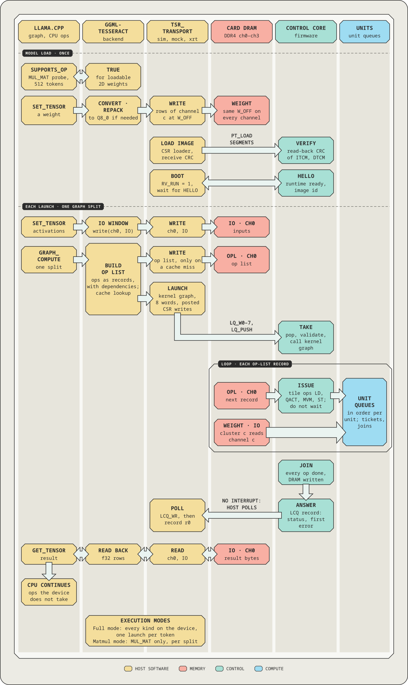

# Host transport and card bring-up (XRT)

This document describes the host side of the device interface: the transport `tsr_transport`
(`sw/transport`) with its layers and kinds, the protocol layer that every kind shares, the `xrt` kdev
that drives an Alveo card through XRT 2.18, the card selftest, the tests that need no hardware, and
the card bring-up. The kernel on the other side is described in [`platform-u200.md`](platform-u200.md);
the launch protocol itself is [EX](design/01-execution-model.md) §2-§4. `sw/transport/README.md` is the
developer summary of the same code.

> **Scope.** As-built documentation. Status words: the protocol layer and the `sim` and `mock` kdevs
> are *implemented and tested on the simulator*; the `xrt` kdev is *written and unit-tested against
> XRT's no-op shim only* (§6), with no run on a card or in hw_emu (no xclbin with the control core
> before Y5); the `vkernel` client is implemented, its two-clock server *planned* (P5.3). The card and
> hw_emu results (§8, §9, `platform-u200.md` §14) were taken before the control core was added, with
> the host issuing the ops. Normative: [EX](design/01-execution-model.md) §9-§10,
> [SW](design/06-software-verification.md) §9.1-§9.2, [DB](design/05-debug.md) §7, §9.

## 1. Layers

<p align="center"></p>

The figure shows one launch from the host's point of view; the layers below are the host column.

```
ggml-tesseract, tsr_rt, tools         tsr_transport.h: open, close, config, write, read, csr_read / csr_write,
                                      image open, boot, launch, wait, call, cancel, stop, soft reset, log
  └─ tsr_transport.c                  dispatcher: TSR_DEVICE = sim | mock | vkernel | xrt | <registered kind>
       └─ protocol layer  tsr_kdev.cpp        one implementation for every kind (§3)
            │   uses tsr_image.cpp (firmware images) and tsr_logdec.cpp (log and TRAP decoder)
            └─ kdev  (tsr_kdev.h)             raw register and memory access to one kernel
                 ├─ "sim"      tsr_kdev_sim.cpp      the simulator in-process behind the core CSR port, no adapter
                 ├─ "mock"     tsr_kdev_mock.cpp     the sim kdev inside the ap_ctrl_none adapter register model
                 ├─ "vkernel"  tsr_kdev_vkernel.cpp  client of the Verilated kernel server (server: P5.3)
                 ├─ "xrt"      tsr_transport_xrt.cpp xrt::ip + one device-only BO per channel (-DTSR_WITH_XRT=ON)
                 └─ others     tsr::register_kdev()
```

- **API** (`tsr_transport.h`): EX §10.1 verbatim plus the conveniences of SW §9.1. The host does not
  run programs: it binds the channel memory, loads a firmware image into the control core's TCMs,
  boots it and launches kernels (EX §2.1). DRAM transfers are byte-granular at any alignment.
- **kdev** (`tsr_kdev.h`): `reg_read` / `reg_write` on `s_axi_control` (32-bit, offsets below
  0x2000), `mem_write` / `mem_read` on a channel buffer, `num_ch`, `ch_bytes`, `ch_addr`, `describe`,
  and the time base: `now_ns()` and `idle()` (the poll loops call `idle()` between polls; it sleeps on
  `xrt`, advances the model on the simulated kinds), `simulated()`, `has_adapter()` and `sim()`.
- **`tsr::dma_engine`** turns byte-granular requests into transfers that obey a DMA path's rules
  (offset, size and host address multiples of `align`, at most `max_xfer` bytes each), with
  read-modify-write of unaligned edges through a bounce buffer. The `xrt` kdev and the `mock` kdev use
  it; the tests drive it with strict fake DMA rules (§6).
- **Plugging in a kind:** `tsr::register_kdev("<kind>", factory)` before `tsr_transport_open` makes
  `TSR_DEVICE=<kind>` work for the backend and every tool; `tsr::transport_open_kdev(std::unique_ptr<kdev>)`
  returns an ordinary `tsr_transport *` for a kdev built by hand. Built-in kinds cannot be re-registered.
  `tsr::transport_kdev(t)` returns the kdev behind a transport (tools use it for the adapter registers),
  `transport_adapter_log(t)`, `transport_boot_info(t)` and `transport_recovery_log(t)` return what the
  protocol layer saw.
- **Image loader** (`tsr_image.cpp`): parses the firmware ELF with the `tsr-elf` library
  (`sw/ctrl/tools/tsr-elf`), checks the segments, the kernel table and `.note.tsr` (EX §3.1) and that
  the stored image id equals the computed one (EX §3.2), and gives `mepc` → function and line from the
  symbols and the DWARF line table (DB §6.3). Images are reference counted: a transport keeps the
  image it booted alive after `tsr_image_close`. `tsr_image_open_default` opens `$TSR_IMAGE` or the
  build's `tsr-fw.elf`.
- **Log decoder** (`tsr_logdec.cpp`): decodes the device log words (DB §6.1 records on EX's log ring)
  and TRAP records, one line per record; the transport uses it for `TSR_LOG`, and `tsr-log` for saved
  dumps.

## 2. Kernel contract (software view)

The kernels `tsr_u200_k1` (NUM_CH 1, T_MAX 1) and `tsr_u200_k4` (NUM_CH 4, T_MAX 8) are `ap_ctrl_none`
RTL kernels with `ap_clk` / `ap_rst_n` and the control-core pair `ap_clk_2` / `ap_rst_n_2`,
`s_axi_control` (AXI4-Lite, 13-bit address space) and `m_axi_ch<c>` (AXI4, 512-bit) for c < NUM_CH. The full map is
[`platform-u200.md`](platform-u200.md) §2 and EX §9.2. What the software uses (byte offsets):

| Offset | Register | Software use |
| --- | --- | --- |
| 0x000-0x03C | reserved, read 0 | never accessed |
| 0x040 + 8c | `ch<c>_base` lo / hi | written at bind with the device address of the buffer of channel c (4 KiB aligned) while `MEM_EN` = 0 |
| 0x0E0 | `ADAPTER_CTRL` | bit0 `MEM_EN`, set after the bases; it must read back 1 |
| 0x0F0 | `ADAPTER_STATUS` | read and cleared (W1C) at open; read again on `PLAT_ERR`; sticky bits 0-5 and a saturating count in [31:16] |
| 0x0F4 | `ADAPTER_VERSION` | `{16'h0001, 8'h00, NUM_CH}`: major 1 and NUM_CH are checked at open |
| 0x1000 + off | core CSR window | every access of the launch protocol (EX §5), at any time |

The adapter RTL in the tree has no `ADAPTER_CTRL` yet (`platform-u200.md` §2); the adapter described
here arrives in Y5. The protocol layer implements this map, and the `mock` kdev models it,
including `MEM_EN`, `BASE_LOCKED`, `REQ_HELD` and `plat_err_i`. The `sim` kdev has no adapter at all (`has_adapter()` is false): the protocol skips `ADAPTER_STATUS` and the bind.

The `xrt` kdev finds the arguments by register offset, not by name, and refuses an xclbin whose
kernel:
- is missing: it takes `TSR_XRT_KERNEL`, else `tsr_u200_k4`, else `tsr_u200_k1`;
- has more than one compute unit, or declares an `s_axi_control` range below 0x2000 (XRT's register
  access checks `offset + 4 <= range`, `xrt_kernel.cpp` `get_cuidx_or_error`; the range comes from the
  kernel XML port, `xclbin_parser.cpp` `get_address_range`);
- is neither `ap_ctrl_none` nor, as EX §9.1's fallback, `ap_ctrl_hs` (never started);
- has an argument outside `ch<c>` at 0x40 + 8c (8 bytes, with a memory connection, contiguous from
  c = 0, at most `TSR_NUM_CH_MAX` = 16).

## 3. Protocol layer (tsr_kdev.cpp)

One implementation serves every kind (SW-18). It follows EX §2.1, §3, §4.8-§4.9, §8.4-§8.6 and
§10, as refined by SW §9.1 and DB §4.1, §6.1, §6.3, §7.3-§7.4, §9.2.

- **Open.** Reads `ADAPTER_VERSION` (major 1, NUM_CH equal to the number of channel buffers), then
  `ID` (0x54535231, "TSR1"), `VERSION` (Tesseract Core capability major 1), `CFG0`-`CFG3`, `CAPS`, `CTL_ID`, `RV_CFG`, `Q_DEPTH`, `RV_FREQ` (0 means "no `clk_rv`"), `LQ_CFG`, `PERF_INFO` and `DBG_ID`
  through the window, and clears `ADAPTER_STATUS`. The host counters (`LQ_SEQ`, `LCQ_RD`, `LOG_RD`) and
  the `LQ_W` shadow are read from the device: the rings keep counting across processes, and only a
  card reset zeroes them. Unless `TSR_ATTACH=1` it then writes `SOFT_RESET` and waits for
  `SR_BUSY` = 0 (`TSR_RESET_MS`), which stops a control core left running by an earlier process and
  discards the records and log words it left unread, and binds the channels (below). A debug
  configuration left armed (`SERIAL`, stop sources, tile breakpoints; DB keeps them across
  `SOFT_RESET`) is reported, and every wait then reads `DBG_STATUS` at its backoff polls, as with
  `TSR_TILE_SERIAL=1`.
- **Bind.** `MEM_EN` = 0, the `ch<c>_base` registers, `MEM_EN` = 1, checked: the open fails with
  "bind failed" if `MEM_EN` does not read back 1, `ADAPTER_STATUS` shows a misaligned or locked base,
  or a base reads back different from the buffer's address. The configuration (`tsr_config`) comes
  from the CSRs; `ch_bytes` is the smallest bound buffer (the core range-checks against its 16 GiB
  `CH_BYTES` regardless, `KERNEL_CH_BYTES`).
- **Boot** (`tsr_transport_boot`). Checks the image's `.note.tsr` requirements against the device,
  then VERIFY of every ITCM segment (CRC read back by the device), a cold load (`LOAD_ADDR`,
  `LOAD_DATA` words, receive CRC, VERIFY CRC) of each segment that does not match and of every DTCM
  segment, `RV_BOOT` = 0, `RV_RUN` = 1, and waits for HELLO (`TSR_BOOT_MS`) with the image id, the SDK
  ABI and the kernel count checked and no other record first. A boot with no ITCM segment written is
  a warm restart (EX §3.5). A booted device is soft-reset first.
- **Launch.** Host-side credit: at most `LQ_DEPTH` (8) launches are outstanding, with no device
  read; the `LQ_W` words that differ from the shadow copy are written, then `LQ_PUSH`
  (posted writes, EX §4.8). `tsr_transport_call` is launch plus wait.
- **Wait.** Consumes the completion ring (an OK DONE or PONG of the oldest launch: record word r0,
  plus r2 unless the kernel is `graph` or `replay`; every word otherwise), delivers events to the
  callback, writes `LCQ_RD`. Poll policy: busy-poll while the elapsed time is below the last service
  time of the same kernel (measured by the host from the push or the previous answer), then every
  max(10 µs, 1 % of the longer of that time and the time waited so far) with `idle()` and the
  transport mutex released (DB's in-process debug service needs it). The log is drained every poll
  with `TSR_LOG`, else every 10 ms.
- **Timeout and recovery.** `TSR_LAUNCH_TIMEOUT_MS` (default 60,000; 0 = none) counts only while
  `STATUS.RV_HALTED` = 0 and `DBG_STATUS.STOP_ACTIVE` = 0, and is off with `DBG_CFG.SERIAL` = 1. On a
  timeout the transport follows DB's recovery ladder (DB §7.3): a hang dump (`TSR_DUMP_DIR`);
  `UNIT_HUNG` ends in "card reset needed" (the device is FAILED); `LQ_CANCEL` covering every pushed
  launch, with `TSR_ABORT_MS` for the answers; then `SOFT_RESET` and a warm restart. The wait returns
  `TSR_TE_TIMEOUT` with the ABORTED record if the cancel produced one.
- **TRAP.** The log is drained and decoded, the trap is reported (cause, `mepc` → function and
  line, via the image's symbols), and the device is soft-reset and warm-restarted, unless
  `TSR_GDB_WAIT` leaves it trapped for the debugger. The wait returns 0 with the TRAP record.
- **PLAT_ERR.** One report per episode (`STATUS.PLAT_ERR` seen at a backoff poll, or a DONE with
  status `PLAT_ERR`). The episode covers the launches pushed before it was seen; `ADAPTER_STATUS` is
  cleared once all of them have answered, so they answer `PLAT_ERR` and later launches answer normally.
- **Cancel, stop, soft reset, log.** `tsr_transport_cancel` / `_stop` write the `LQ_CANCEL` / `LQ_STOP`
  watermarks (EX §4.9), moved up behind the answered launches every 2^30 launches so that they never
  wrap onto new ones; `tsr_transport_soft_reset` is `CTRL.SOFT_RESET` with the wait (outstanding
  launches return `TSR_TE_LOST`); `tsr_transport_log_drain` returns the raw words, up to 64 Ki kept.
- **Memory and CSR.** Range-checked against `ch_bytes`, then `kdev::mem_write` / `mem_read`.
  `tsr_transport_csr_read` goes to `0x1000 + off`; a failed read returns 0xFFFFFFFF.
  `tsr::transport_perf` reads a 64-bit PERF counter low half first (the core snapshots the high half
  on the low read).
- **Time base.** On `sim`, `mock` and `vkernel` every timeout and the poll policy count device time
  (core cycles at the nominal 276.3 MHz kernel clock; `vkernel` takes the server's time), so results
  and recoveries do not depend on host load; on `xrt` they count host time (`CLOCK_MONOTONIC`).
- **Threads.** One mutex per transport serialises every call. `tsr_transport_wait` releases it between
  polls. The event callback runs on the waiting thread with the mutex held and may call the transport.
- **Errors.** Calls return 0 or a negative `TSR_TE_*` code (`tsr_transport_strerror`): `INVAL` (-1),
  `IO` (-2), `TIMEOUT` (-3, the device was diagnosed and recovered), `LOST` (-4, flushed by a reset),
  `DEVICE` (-5), `IMAGE` (-6), `STATE` (-7). A message goes to stderr. A malformed environment value makes
  the open fail; it is never ignored silently.

## 4. The xrt kdev and device memory

`sw/transport/tsr_transport_xrt.cpp`, built only with `-DTSR_WITH_XRT=ON` (§7). The protocol on top
of it is §3.

### 4.1 Control

The kernel is `ap_ctrl_none`, so the `xrt` kdev opens its compute unit with `xrt::ip`, which XRT
opens with exclusive access (EX §2.4, §9.1): register access is `xrt::ip::read_register` /
`write_register`, a load or store to an mmap'ed BAR (`core/pcie/linux/shim.cpp:2341-2405` of the XRT
2.18.179 sources). No `xrt::kernel` and no `xrt::run` exist: XRT 2.18 refuses an `ap_ctrl_none`
compute unit there ("AP_CTRL_NONE is only supported by XRT native API xrt::ip",
`xrt_kernel.cpp:1560-1561`), and the driver touches no control or interrupt registers of such a unit
(`cu_hls.c:513-518`), so a halted control core cannot confuse XRT's scheduler. EX §9.1's fallback,
`ap_ctrl_hs` with `interrupt="false"` that is never started, opens the same way. A second process
cannot open the compute unit while the first holds it; whether XRT refuses it is a property of the
shim (the no-op shim accepts it, the test prints that, §6), to be confirmed on the card.

The xclbin is loaded with `device.load_xclbin` (the Alveo shim of 2.18 runs the legacy flow:
`register_xclbin` is a no-op there, `shim.cpp` `register_xclbin`, and `create_hw_context` returns
slot 0). Only under XRT's no-op shim (`XCL_EMULATION_MODE=noop`, the ctest, §6) it uses
`register_xclbin`, the only flow that shim implements. Kernel, compute unit and arguments are
discovered from the xclbin (§2). `idle()` sleeps, so the poll policy and the timeouts count host time.

### 4.2 Buffers: one device-only BO per channel

Each channel gets one `xrt::bo(device, size, xrt::bo::flags::device_only, group)`, where `group` is
the memory index of the bank that argument `ch<c>` is connected to
(`xrt::xclbin::arg::get_mems()`, EX §9.1; the card has to confirm that it equals what
`xrt::kernel::group_id` reports). Size: `TSR_XRT_CH_GIB` (1..16), default the bank size from the xclbin
memory topology (16 GiB on the U200 DDR4 banks), shrunk in 256 MiB steps if the allocation fails (down
to 1 GiB). Evidence from the XRT 2.18.179 sources (`build/xrt-driver/xrt-202420`, driver
`.../core/pcie/driver/linux/xocl`):
- A device-only BO has no host pages: `xocl_create_bo` (`userpf/xocl_bo.c`) reserves a
  `drm_mm` node in the bank (`xocl_drm.c`, PAGE_SIZE alignment, so bases are 4 KiB aligned) and
  allocates no pages for `XOCL_BO_DEV_ONLY`; the 4 GiB limit in that file applies only to
  host-memory BOs on kernels < 4.13. Host RAM therefore does not grow with the channel size.
- `xrt::bo::write` / `read` on such a BO (`common/api/xrt_bo.cpp`, class `buffer_dbuf`) call
  `unmgd_pwrite` / `unmgd_pread` at `bo.address() + offset` = `xclUnmgdPwrite` / `Pread`
  (`pcie/linux/shim.cpp`) = ioctls `DRM_IOCTL_XOCL_PWRITE_UNMGD` / `PREAD_UNMGD`. The driver
  (`xocl_migrate_unmgd`, `xocl_init_unmgd`) pins the caller's pages for the duration of the
  call (`get_user_pages_fast`), builds a one-time scatter list starting at the caller's byte
  offset and runs the XDMA engine on it: one transfer, no bounce copy, any offset (also beyond
  4 GiB: 64-bit `paddr` and `size`). The ioctls carry the same flags as `CREATE_BO`
  (`DRM_AUTH | DRM_UNLOCKED | DRM_RENDER_ALLOW`), so no root is needed.
- Limits: the XDMA fast path waits at most 10 s per descriptor batch (`libxdma.c`
  `xdma_xfer_fastpath`, `subdev/xdma.c` `xdma_migrate_bo`), a descriptor covers < 256 MiB.
  Transfers are therefore issued in chunks of `TSR_XRT_DMA_CHUNK_MIB` (default 64 MiB), which
  also bounds the pinned page list per call. The engine's alignment register is read by
  `libxdma.c` (`engine_alignments`) but never enforced in software: whether the shell's XDMA
  accepts unaligned host / card addresses is a property of the IP configuration, checked on the
  card by the selftest's unaligned ranges (§5).
- `xrt::bo::copy` (M2M / KDMA) would need a host-backed staging BO and a second device-side
  copy: it first queries the platform's M2M, then KDMA (`xrt.ini`), and otherwise copies through
  host buffers, which a device-only destination does not have (it throws). Whether the U200
  shell has M2M is a platform property (`xbutil examine -r platform`).

| `TSR_XRT_DMA` | Path | Host RAM | Status |
| --- | --- | --- | --- |
| `direct` (default) | device-only BO, `bo.write` / `bo.read` = unmanaged XDMA from the caller's memory, in chunks | the caller's buffer only | best: one PCIe transfer, no copy |
| `staged` | the same ioctls through an aligned bounce buffer (`TSR_XRT_DMA_CHUNK_MIB`), edges read-modify-written, `TSR_XRT_DMA_ALIGN` default 64 | one chunk | fallback for an XDMA that needs aligned addresses, or memory that cannot be pinned |
| `m2m` | host-backed staging BO per channel + `sync` + `bo.copy` into the device-only BO | one chunk per channel (host and device) | only for shells without unmanaged DMA; needs M2M or KDMA. The staging BO (device memory in the channel's bank) is allocated at open, before the channel BO, so that the default full-bank channel BO shrinks around it (allocated lazily after it, it found the bank full and every transfer failed: review finding) |

A failed `direct` transfer is retried once through `staged`; if that works the transport stays
on `staged` (one warning). The chunk / alignment / read-modify-write logic is
`tsr::dma_engine` (shared with the mock and tested there, §6).

### 4.3 Environment

Read at open; a malformed value makes the open fail. The variables of the protocol layer apply to
every kind; the others belong to one kind. A bare name is a number or a flag; defaults in the second
column.

| Variable | Default | Meaning |
| --- | --- | --- |
| `TSR_DEVICE` | `sim` | the kind: `sim`, `mock`, `vkernel`, `xrt`, or a registered kind (`none` is understood by the ggml backend only: it registers no device) |
| `TSR_IMAGE` | the build's `tsr-fw.elf` | firmware image (`tsr_image_open_default`) |
| `TSR_LAUNCH_TIMEOUT_MS` | 60000 (0 = none) | wait timeout per launch, debug-aware (§3) |
| `TSR_ABORT_MS` | 10000 | wait for the answers after `LQ_CANCEL` |
| `TSR_BOOT_MS`, `TSR_RESET_MS` | 2000, 15000 | wait for HELLO; wait for `SR_BUSY` = 0 after `SOFT_RESET` |
| `TSR_ATTACH` | 0 | 1: open without `SOFT_RESET` or bind, for diagnosis (boot an image before launching) |
| `TSR_LOG`, `TSR_LOG_LEVEL` | off, 3 | decode the device log to `stderr` or a file (appended); `LOG_CFG.LEVEL` 0 FATAL to 5 TRACE |
| `TSR_STATS` | 0 | 1: transport statistics on stderr at close |
| `TSR_DUMP_DIR` | none | directory for hang dumps (recovery ladder level 0) |
| `TSR_GDB` | none | `tcp:<port>` or `unix:<path>`: start the embedded GDB service in an executable linked with `tsr_dbg_embed` |
| `TSR_DEBUGGER` | none | `sock:<path>`: start the embedded monitor-command socket |
| `TSR_GDB_WAIT` | none | `boot` or `launch`: with the embedded service, halt at boot or kernel entry; retain a trapped device instead of restarting it |
| `TSR_TILE_SERIAL`, `TSR_TILE_HIST` | unset | 0 or 1: set `DBG_CFG` bits at open (serial tile mode, dispatch history) |
| `TSR_XCLBIN` | required (`xrt`) | xclbin to load; loading the one already on the card is cheap |
| `TSR_XRT_DEVICE` | `0` | device index or PCIe BDF |
| `TSR_XRT_KERNEL` | `tsr_u200_k4`, else `tsr_u200_k1` | kernel name |
| `TSR_XRT_CH_GIB` | bank size (16); 3 under `XCL_EMULATION_MODE=hw_emu` (§9) | channel buffer size in GiB |
| `TSR_XRT_DMA`, `TSR_XRT_DMA_CHUNK_MIB`, `TSR_XRT_DMA_ALIGN` | `direct`, 64, 1; `staged`, 64, 4096 under `XCL_EMULATION_MODE=hw_emu` (§9) | §4.2 |
| `TSR_SIM_TMAX`, `TSR_SIM_CH_GIB`, `TSR_SIM_THREADS`, `TSR_SIM_DRAM_DIR` | 1, 16, min(online CPUs, 8), none | `sim`: T_MAX (1-8), channel size in GiB (lazily mapped), MVM worker threads, directory for file-backed DRAM; the simulator itself also reads `TSR_SIM_SCHED`, `TSR_SIM_RV_RATIO`, `TSR_SIM_RV_CORE`, `TSR_SIM_RACE`, `TSR_SIM_LOG` and `TSR_TRACE` (`sw/sim/README.md`) |
| `TSR_MOCK_NUM_CH`, `TSR_MOCK_TMAX`, `TSR_MOCK_CH_GIB` | 4, 1, 16 | `mock` core configuration; `TSR_SIM_THREADS` applies too |
| `TSR_MOCK_DMA_ALIGN`, `TSR_MOCK_DMA_CHUNK_KIB`, `TSR_MOCK_DMA_BOUNCE` | 1, 65536, 0 | DMA rules the mock enforces |
| `TSR_MOCK_INJECT`, `TSR_MOCK_TCM_FAULT`, `TSR_MOCK_HANG` | none | tests: `N:V[,N:V...]` ORs V into `ADAPTER_STATUS` at the N-th `LQ_PUSH` (N = 0: left by an earlier process, before the open); `ADDR:XOR` corrupts one word-aligned TCM word after every `LOAD_DATA` write (VERIFY must catch it); n makes the MVM unit hang at the n-th `LQ_PUSH` |
| `TSR_VKERNEL_SERVER`, `TSR_VKERNEL_SOCKET` | none | `vkernel`: server command line (the client appends `--fd N`), or the path of a Unix socket a server listens on; the two-clock server is P5.3 (`platform-u200.md` §13) |

The embedded debug service is implemented and tested on sim; see `prof-dbg.md` §1 for its tests
and the remaining RTL/card limits. Without the embedded-service registration, the transport reports
that `TSR_GDB` / `TSR_DEBUGGER` are unavailable. Automatic transport profiling via `TSR_PROF`,
`TSR_PROF_TRW_MIB`, `TSR_PROF_EVERY` and `TSR_PROF_RV_SAMPLE_US` remains inactive; the standalone
`tsr-prof trw` / `stats` commands work. `trw` itself uses `TSR_PROF_TRW_MIB` for its default ring size.

With `TSR_XRT_CH_GIB` below 16 the core still range-checks against its `CH_BYTES` = 16 GiB: a faulty
launch could address memory past the buffer (other BOs, or a DECERR that shows up in
`ADAPTER_STATUS`). The backend never does (its heap ends at `ch_bytes`).

## 5. tsr-selftest

`tsr-selftest [--device KIND] [--image ELF] [--mem-mib N] [--no-mem] [--no-kernel] [--ids LIST]
[--no-shadow] [--rate-n N] [--traces DIR]... [--traces-serial DIR]... [--max-traces N] [--debug]
[--log-out FILE] [--seed N] [-v]` (`sw/tools/tsr_selftest.cpp`; SW §9.5, §7.6, SW-28). Default device
`$TSR_DEVICE`, else `xrt`; `mock` (the adapter register model, used by the ctests) and `sim` check the
tool and the protocol path. Exit code 0 = every check passed, 1 = a check failed, 2 = the transport
did not open or bad usage. Sections:

1. Identity: the kdev description, `ID`, `VERSION` (Tesseract Core capability 1.x), `CFG0`-`CFG3`, `CAPS`, `CTL_ID`,
   `RV_FREQ`, `RV_CFG`, `Q_DEPTH`, `LQ_CFG`, `PERF_INFO`, `LOG_CFG`, `STATUS`; the adapter
   (`ADAPTER_VERSION` major 1 and NUM_CH, `ADAPTER_STATUS` at open and now, `MEM_EN`, bases equal to the
   buffers' device addresses) or "no adapter".
2. Memory per channel: pattern write and read-back at aligned, unaligned, 4 KiB- and
   4 GiB-crossing and end-of-channel ranges with guard bytes; channel aliasing; write and read
   bandwidth of an `--mem-mib` transfer.
3. Boot: the image (id, base kernels `graph` / `selftest` / `replay` at 0 / 1 / 2); a boot with the
   receive CRC, VERIFY and HELLO; a second boot that must be a warm restart; the booted image's id.
4. PING: one round trip with the `ARG0` echo, then `--rate-n` sequential round trips (median and p99
   host wall time, the device's DURATION) and `--rate-n` pipelined launches (`LQ_DEPTH` outstanding):
   the rate. Measured values, not gated (EX §4.11's targets are estimates for the card).
5. The `selftest` kernel (SW §7.6): its ids and five misuses, each run on the device and on a shadow
   simulator with the same image, inputs and arguments; the answers, every output byte, the per-unit
   completion counts, the kernel events and the log records must be equal; plus the device-side
   checks and references computed in the tool.
6. `--traces DIR`: every trace below DIR replayed through the device (kind `ops` through the
   `replay` kernel, kind `launch` as full launches of their own image); `--traces-serial DIR` with the
   `replay` kernel's `SERIAL` flag (`traces/model-v1conv`). Answer, expect regions and device = shadow
   are compared; traces made for another configuration are skipped.
7. `--debug`: the DMI smoke (halt, read `dpc` / `dcsr`, single step, resume, PING after).
8. Log and status: every drained word decodes, no record dropped, no sticky error in `STATUS`, the
   transport's recovery counters 0, `ADAPTER_STATUS` clean at the end and no `PLAT_ERR` seen.

`--log-out FILE` keeps every drained log word, raw, for `tsr-log`.

## 6. Tests (no hardware)

Names are the ctest names; `ctest --test-dir build/dev -N` lists them.

| ctest | What | Result |
| --- | --- | --- |
| `transport_kdev` (`test-tsr-kdev`) | the protocol layer on the `mock` kdev: identity checks and adapter faults at open (ID, capability major, `CTL_ID` = 0, `ADAPTER_VERSION`, NUM_CH, `RV_FREQ` = 0, `ADAPTER_STATUS` left by an earlier process), bind (`MEM_EN`, misaligned base, `BASE_LOCKED`, held requests), timeouts (`SOFT_RESET` stuck, no HELLO), the stale core at open (a booted device with a launch running, left by a "dead process", with and without `TSR_ATTACH`), adapter errors during a launch (`PLAT_ERR`), a hung unit ("card reset needed"), the registry, `TSR_MOCK_*` parsing, `xrt_env_defaults`, and the chunked and aligned transfer engine (byte-granular transfers under DMA rules from align 1 to 4096, across 4 GiB, against a strict fake DMA) | passes in `build/dev` (run for this document) |
| `transport_protocol` (`test-tsr-protocol`) | one binary for every kind it can run (`sim`, `mock`; `vkernel` when a server is named): cold and warm boot, image-id mismatch, `.note.tsr` refusal, VERIFY with an injected TCM fault (mock), PING, 0-7 arguments, `BAD_DESC`, 8 outstanding launches and the credit rule, forced `LQ_OVERFLOW` and `RING_RD_BAD`, events while waiting, the log (FMT / TEXT / EVENT / BLOB decode, drop), cancel and stop, `SOFT_RESET` mid-launch, the debug-aware timeout with a hart halted through the DM model, the recovery ladder (levels 2 and 3), TRAP handling (decode with `mepc` → function and line against `addr2line`, warm restart), minimal record reads against full reads; records and DRAM identical across the kinds; the EX §4.11 numbers on `sim` (boot, empty-launch round trip, pipelined rate) | passes in `build/dev` (run for this document) |
| `transport_xrt_noop` (XRT builds only) | the `xrt` kdev on XRT's userspace with its no-op shim (`XCL_EMULATION_MODE=noop`, `libxrt_noop`; no card, no driver) and generated metadata-only xclbins of `tsr_u200_k4`: xclbin load, kernel pick, arguments by offset, the memory bank of each channel argument from the xclbin, bank-size default, device-only buffers, the compute unit opened through `xrt::ip` for `ap_ctrl_none` and for the `ap_ctrl_hs` fallback; refusals with a reason (range 0x1000, a foreign argument, no Tesseract kernel, `TSR_XRT_CH_GIB` above the bank); register access and unmanaged DMA fail cleanly (the shim implements neither: the open stops at the first register read); `TSR_XRT_DMA=m2m` allocates its staging buffers at open | 32 checks, 0 failed, in a scratch build with the unpacked 2.18.179 deb (§7; run for this document) |
| `transport_ggml_e2e_mock`, `..._tmax8` | `test-ggml-tesseract` (bit-exact backend checks) on the `mock` kdev, DMA align 64 / chunk 64 KiB; T_MAX 8 with 3 channels, align 4096 / chunk 12 KiB | defined in `sw/ggml-tesseract/CMakeLists.txt`; not re-run |
| `tools_selftest_mock`, `..._tmax8`, `..._1ch`, `..._faults`, `..._traces`, `..._traces_tmax8` | `tsr-selftest` on the `mock` kdev with the shadow, the DMI smoke and the log written for `tsr-log`: 4 channels T_MAX 1 with DMA rules that force the bounce path; T_MAX 8 (the k4 configuration); 1 channel (k1); the fault cases (an AXI error during a launch, `ADAPTER_STATUS` left by an earlier process, a TCM write fault, a hung unit: the selftest must fail with the reason named, and pass without them); replays of the trace sets that fit the device | defined in `sw/tools/CMakeLists.txt`; not re-run |
| `tools_log_selftest`, `tools_trace_replay_device` | `tsr-log` end to end; `tsr-trace-replay --device` through `sim` with the shadow and through `mock` | defined in `sw/tools/CMakeLists.txt`; not re-run |

The `xrt` kdev has no ctest on a card. The no-op test builds with
`cmake -S . -B <build> -DCMAKE_BUILD_TYPE=Release -DTSR_WITH_XRT=ON -DTSR_XRT_ROOT=build/xrt-local/opt/xilinx/xrt`
and `cmake --build <build> --target test-tsr-xrt-noop -j2`; `build/dev` itself is configured without
XRT, so it does not list `transport_xrt_noop`.

## 7. Building without an installed XRT

The 2.18.179 deb (sha256 `5e76278a…a688`, `sw/xrt-driver/README.md`) unpacks without
installing:

```
test -d build/xrt-local/opt/xilinx/xrt || dpkg-deb -x build/xrt-driver/deb-dl/xrt_202420.2.18.179_24.04-amd64-xrt.deb build/xrt-local
cmake -S . -B <build> -DTSR_WITH_XRT=ON -DTSR_XRT_ROOT=build/xrt-local/opt/xilinx/xrt
```

The XRT headers include `<uuid/uuid.h>` (package `uuid-dev`, an XRT dependency; installed on the dev
host). When CMake does not find it, `sw/transport/xrt-compat/uuid/uuid.h` declares the six libuuid
functions the headers call, and the system `libuuid.so.1` is linked by soname. With XRT installed at
`/opt/xilinx/xrt` (which pulls `uuid-dev`) the stand-in is not used. Binaries find `libxrt_coreutil`
through the build RPATH; XRT itself finds its driver shim through `XILINX_XRT` or `/opt/xilinx/xrt`,
so with only the unpacked deb a program that opens a device stops at "No such library
'/opt/xilinx/xrt/lib/libxrt_core.so.2'" (exit 2), and without
`TSR_XCLBIN` at "TSR_XCLBIN is not set". With `XILINX_XRT` pointing at the unpacked tree and
`XCL_EMULATION_MODE=hw_emu`, XRT loads its hw_emu shim from it instead (§9); `transport_xrt_noop`
loads `libxrt_noop` from the root it is given. `tsr_bw` (`docs/m0-bw.md` §6) is built by the same
configure.

## 8. Card bring-up procedure

Done on the card: steps, pass criteria and results are `platform-u200.md` §14. From 2026-10-25
the card ran XRT 2.18.179 with the patched DKMS driver (`sw/xrt-driver/README.md`), the U200 platform,
the shell flash with `xbmgmt`, `xbutil validate`, the M0 bandwidth run (`tsr_bw`, `docs/m0-bw.md`) and
the Qwen2.5-0.5B Q8_0 gates M3 and M4. Those runs used the xclbin load, 16 GiB device-only buffers
and unmanaged DMA in both the `direct` and the `staged` mode (`platform-u200.md` §14.3). They did not
cover `m2m` and the behaviour after `xbutil reset`.

Planned, W6 ([`docs/design/README.md`](design/README.md) §10; SW §11 P6.1-P6.6, §10.4 for the gates).
It starts when an xclbin with the control core exists (Y5, `platform-u200.md` §8.4) and uses the card, XRT and driver
steps that are already done. In order:
1. `TSR_XCLBIN=<k1 xclbin> tsr-selftest --device xrt`: identity (ADAPTER_VERSION, ID, VERSION,
   CTL_ID, RV_FREQ), bind, cold load with VERIFY, HELLO, PING round trip, the `selftest` kernel
   against the shadow, trace replays, the DMI smoke (§5). k1 first, then k4 with the sets that fit.
2. The backend tests (`test-ggml-tesseract`, `test-backend-ops -o MUL_MAT -b Tesseract0`) with
   `TSR_DEVICE=xrt`, then the M6 gate: Qwen2.5-0.5B Q8_0 logits bit-identical to the simulator and the
   Qwen2.5-32B Q4_K_M KL criterion (`docs/klcheck.md`), and a GDB smoke (halt, register read,
   breakpoint in a kernel, step, resume, the launch then completing).
3. If something fails: `TSR_LOG=stderr` and `tsr-log` for the device log, `TSR_DUMP_DIR` for the hang
   dump of the recovery ladder, `TSR_ATTACH=1` to open a device without resetting it,
   `TSR_XRT_DMA=staged` / `TSR_XRT_DMA_ALIGN=64` for DMA alignment, `TSR_LAUNCH_TIMEOUT_MS` for long
   launches, `TSR_GDB_WAIT=launch` to keep a trapped device.

**Untested for the `xrt` kdev** (everything that needs a card; the no-op test of §6 covers the
discovery logic only): every register access through `xrt::ip` and the exclusive-access refusal of a
second process; that the memory group from `xrt::xclbin::arg::get_mems()` equals what
`xrt::kernel::group_id` reports (EX §9.1, *confirm*); `load_xclbin` of an xclbin with the control core;
such an xclbin that `v++` accepts as `ap_ctrl_none` (`platform-u200.md` §12); the unmanaged DMA, `staged` fallback and `m2m` on
the 16 GiB device-only buffers with this kdev (the `dma_engine` and the DMA modes ran on the card, except
`m2m`, before the control core was added); the host-time poll policy and timeouts against a real core; behaviour
after `xbutil reset`; the `m2m` staging allocation with a full bank (the no-op shim does not enforce
bank capacity). Launch costs: `platform-u200.md` §14.5.

## 9. Hardware emulation (hw_emu) of `tsr_u200_k1` (2026-10-24)

The host binaries, built with `-DTSR_WITH_XRT=ON` against the unpacked XRT (§7), ran over `TSR_DEVICE=xrt` against the k1 kernel in Vitis hardware emulation: XRT's hw_emu shim
(`libxrt_hwemu.so`, in the unpacked deb), the extracted development platform, and xsim from Vivado
2024.2. This needed no root, no driver and no install. Everything below is simulation and came before the card runs (`platform-u200.md` §14). There is no
xclbin with the control core, so it has no hw_emu run yet; the two workaround defaults below stay in the `xrt` kdev.

**xclbin.** `TSR_VIVADO_LOCK=<lock> PLATFORM_REPO_PATHS=$PWD/build/platforms/root/opt/xilinx/platforms
hw/u200/build_xclbin.sh k1 hw_emu` (the `.xo` manifest matched, so no repackaging): `v++` rc 0 after
2 min 17 s wall (project, block design, output products, then `config_hw_emu` compile and
elaborate; nothing is synthesised for hw_emu). The largest process reached 2.98 GB RSS and the
whole `v++` process tree at most 4.8 GB (5 s samples). Output: `tsr_u200_k1.xclbin`, 23.6 MB,
"HW Emulation Binary". In its memory topology bank1 (DDR[1], 0x800000000, 16 GiB) is the only bank
used. Warnings: `[v++ 60-889]` (`kernel_frequency=300` equals the default), 84 × `IP-LOCK-01` (the
platform's 2021.1 IP in the 2024.2 catalogue) and `[v++ 60-1455]` (debuggable symbols).

**Runtime environment** (environment variables only; nothing under `/opt/xilinx` is used):

```
set +u; source /tool/Xilinx/Vitis/2024.2/settings64.sh          # xsim, emconfigutil
export XILINX_XRT=$PWD/build/xrt-local/opt/xilinx/xrt LD_LIBRARY_PATH=$XILINX_XRT/lib
PLATFORM_REPO_PATHS=$PWD/build/platforms/root/opt/xilinx/platforms \
  emconfigutil --platform xilinx_u200_gen3x16_xdma_2_202110_1 --od <dir>
export EMCONFIG_PATH=<dir> XCL_EMULATION_MODE=hw_emu XRT_INI_PATH=<dir>/xrt.ini  # [Emulation] debug_mode=batch
export TSR_DEVICE=xrt TSR_XCLBIN=<k1 hw_emu xclbin> TSR_LAUNCH_TIMEOUT_MS=0
```

`TSR_XRT_CH_GIB=3 TSR_XRT_DMA=staged TSR_XRT_DMA_ALIGN=4096`, the workarounds for the two simulator
defects below, are the xrt kdev's defaults under `XCL_EMULATION_MODE=hw_emu` (`xrt_env_defaults`,
tsr_kdev.cpp; ctest `transport_kdev`). Each one applies only when that variable is unset or empty,
so a value set in the environment wins. One line on stderr names the defaults that were applied:
`tsr_transport(xrt): XCL_EMULATION_MODE=hw_emu, defaults applied: TSR_XRT_CH_GIB=3 TSR_XRT_DMA=staged TSR_XRT_DMA_ALIGN=4096 (...)`.

The shim starts xsim in `.run/<pid>/` next to the executable. Run one emulation at a time under
`TSR_VIVADO_LOCK`.

**Two defects in the 2024.2 simulator models.** Both are in Xilinx code, both have an
environment-variable workaround (now the hw_emu defaults above), and neither is on the card's
path (XDMA, DDR4). The card, and every other emulation mode, keeps the defaults (`direct`, 16 GiB).
1. *A channel buffer of 4 GiB or more crashes the simulator.* The simulator backs a device-only
   BO with a file-mapped region (`.run/<pid>/hw_emu/device0/<n>/region_0x800000000_0x8bfffffff.mmap.dat`,
   created for its "ALLOC_BO p2p" call). The constructor of that storage,
   `xsc::mmapStorageEngine::mmapStorageEngine(unsigned int, std::string)` in
   `Vivado/2024.2/data/xsim/ip/xscl/libxscl.so`, takes the size as 32 bits: its disassembly does
   `mov %esi,%ebp`, then `mmap(NULL, size, ...)`. A 16 GiB BO therefore maps 0 bytes. The first
   DDR write then segfaults in `mmapStorageEngine::write`: `simulate.log` shows `FATAL_ERROR ...
   sim_qdma.cpp, line 106`, and `xsimcrash.log` has the stack. The host then spins forever in the
   shim's non-blocking socket read: the selftest hung in its first transfer (128 bytes at
   0x800000000) for 11 min until it was stopped, because no exec timeout applies to a transfer.
   3 GiB channels (and 1 GiB, in a probe) work. 4 GiB truncates to 0 bytes like 16 GiB.
2. *Host DMA through the simulator loses the tail of a transfer that starts off a 4 KiB boundary.*
   For [off, off + n), only ceil(n / 4096) pages counted from the first partial page arrive; the
   bytes in the last page are lost, for writes and reads alike. A probe with single-page transfers
   around it measured: 0xfbd + 0x1086 loses [0x2000, 0x2043), 0x800 + 0x1000 loses
   [0x1000, 0x1800); 0x10 + 0x2ff0, 0 + 0x2010 and 0x1000 + 0x1001 are intact. The host shim
   issues one call per range (HAL log), so the loss is in the simulator's host-DMA path (sim_qdma,
   then SmartConnect `transport_dbg`, then sim_ddr). With the default `direct` DMA the selftest
   fails exactly there: [0xffd, +4099) and [0x10011, +1048589) fail with "first difference at"
   0x2000 / 0x110000, and LD->ST with device 0x00 vs simulator 0xf1 at 0x4805000; the other 22
   checks pass. `TSR_XRT_DMA=staged TSR_XRT_DMA_ALIGN=4096` (§4.2) starts every raw transfer on a
   4 KiB boundary, and with it every range passes.

With the two defaults, the xclbin load, the 16 GiB device-only buffer, the memory ranges
of a 3 GiB channel and the DMA paths passed their checks in hw_emu.

Speed: one MVM run of 136,818 cycles added 45 s, i.e. about 3 K cycles/s with the upload. That is
roughly 100x slower than the Verilated kernel (`platform-u200.md` §13, 355 K cycles/s on k1). The
host-to-card figure that a transfer test prints (0.05 GB/s) is emulation time and says nothing about
the card.

Not run in hw_emu: the k4 kernel; 16 GiB channels and the ranges across 4 GiB and at 12 GiB
(defect 1); `direct` DMA beyond the failing ranges (defect 2); `m2m`; timeout and cancel.
