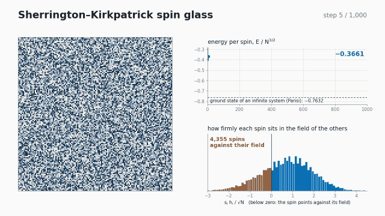

# Ising machine

A custom kernel example. It searches for the ground state of a Sherrington-Kirkpatrick spin glass (N spins, every
pair coupled by +1 or -1) with discrete simulated bifurcation. One step is a dense matrix-vector product over the
couplings (one MVM op, the coupling matrix streams from card DDR), a few vector-unit ops on the positions and momenta,
and an optional energy word. Up to `T_MAX` replicas run side by side in the same ops.

It is a project of its own that uses the Basis SDK (`sw/ctrl`), as a user's kernel project would. It is not part of the
SDK and has no version of its own.

[](../../docs/demo/spin-glass.mp4)

## What it shows of the SDK

- an argument block (`TSR_KFLAG_ARGBLK`) that carries the parameters, with checks against the device;
- tickets that order ops between the DMA, vector and MVM units, and between steps;
- several weight tensors when the couplings exceed the K limit of one tensor;
- a soft stop, polled once per step: the kernel stores the state and returns the number of steps done;
- a bit-exact host model of the kernel, and a field of the spins that is an exact integer (the kernel replaces the
  QACT block scales by the f32 nearest to 1/127, and the couplings are Q8_0 with scale 1.0).

## Files

| File | Content |
| --- | --- |
| `ising.cpp` | the kernel |
| `ising_abi.hpp` | the parameter block and the memory layout that kernel and host share |
| `ising_problem.*`, `ising_run.*` | the problem and its upload, the launches |
| `ising_ref.*` | the bit-exact model of the kernel |
| `ising_dump.*` | the trajectory file |
| `ising_host.cpp` | the tool `tsr-ising` |
| `sk_video.py` | the video of a dump |
| `tests/` | the test program and the tool test |
| `CMakeLists.txt` | the build of the image, the library, the tool and the tests |

## Build and run

`tsr-ising` runs on the simulator by default and on the card with `--device` or `$TSR_DEVICE`. It prints the energy per
spin e = E / N^1.5 of every replica. From the repository root:

```sh
cmake -S . -B build/dev && cmake --build build/dev -j8

# a small run, checked bit for bit against the model of the kernel
build/dev/examples/ising/tsr-ising --n 1024 --steps 200 --check

# a run with a dump, and the video of the dump (without --ffmpeg: the GIF and a PNG only)
build/dev/examples/ising/tsr-ising --n 16384 --t 4 --snap-every 5 --dump sk.dump
"$TSR_PYTHON" examples/ising/sk_video.py sk.dump --out sk --ffmpeg /path/to/ffmpeg
```

The video script needs numpy, matplotlib and Pillow. Ctrl-C stops a run softly between two steps. `--image` and
`$TSR_IMAGE` choose another firmware image.

## How the image is built

The firmware project `sw/ctrl` is a CMake project of its own. The main build runs it once for the SDK images. This
example runs it a second time as its own `ExternalProject`, in `<build>/examples/ising/fw`, with its own images file
that holds one line, `tsr_fw_image(example_ising SOURCES <path>/ising.cpp)`. The image is the production sources plus
`ising.cpp`. The host side gets its path as the definition `TSR_ISING_IMAGE`. A kernel project outside the SDK builds
its image this way.

## Tests

Both carry the label `example` (`ctest --test-dir build/dev -L example`).

- `example_ising` checks the kernel against its bit-exact model, under the fixed and random schedules, and the status
  codes, the soft stop, the quality of the answers and the constants against the design.
- `example_ising_tool` runs `tsr-ising` with `--check` and `--dump`, a Ctrl-C stop, bad command lines and the video
  script.
