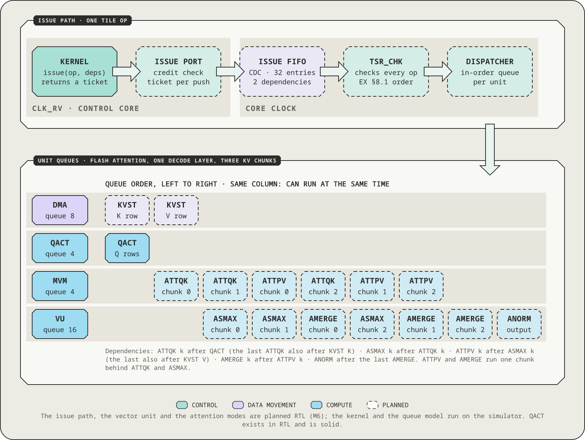

# Basis: the Tesseract kernel SDK (`sw/ctrl`)

Basis is the firmware SDK of Tesseract. `sw/ctrl` holds the software that runs on the control core: the runtime, a
header library for issuing tile ops, the graph executor and the kernels the host launches. It is freestanding C++20
for an RV32IMC core. The same kernel sources also build for the host and push the same tile-op stream there, so the
logic of a kernel is tested without a RISC-V interpreter. The RISC-V build stays the reference. Normative:
[SW](../../docs/design/06-software-verification.md) §6 (SDK) and §7 (kernels and executor),
[EX](../../docs/design/01-execution-model.md) §3 and §4 (image and launch protocol),
[DB](../../docs/design/05-debug.md) §6 (log and crash contract). Versions: [`docs/versioning.md`](../../docs/versioning.md).

| Path | Content |
| --- | --- |
| `include/tsr/` | the header library: `kernel.hpp` (issue path, tickets, joins, `group`, `spm_ring`) over `backend_dev.hpp` (control-core MMIO) or `backend_host.hpp` (simulator hooks), `rt.hpp` (kernel ABI, `TSR_KERNEL`), `log.hpp`, `exec.hpp` (kind handler interface), `opl.hpp` (op-list format), `plan*.hpp` (planners shared with the host backend), `version.h`. `mmio.hpp`, `vu.hpp` and `at.hpp` are generated from `sw/tables/tsr_tables.py`. |
| `rt/` | `crt0.S`, `runtime.cpp` (launch dispatcher), `trap.cpp`, `log.cpp`, `libc.cpp` (`memcpy`, `memset`, `memmove`, `memcmp`), `link.ld` |
| `kernels/` | the base kernels `graph.cpp`, `selftest.cpp` and `replay.cpp`, and the kind handlers of the graph executor (`k_*.cpp`, `gdn_kinds.cpp`, `k_fast.hpp`, `zz_kind_stubs.cpp`) |
| `host/`, `ref/` | the main project's side (`tsr-elf`, the `tsr_fw` external project, `tsr_fw_host`, the host backend and shim) and host references of the kernels |
| `tools/`, `tests/`, `examples/` | `tsr-elf` and `install-toolchain.sh`, ctest snippets and test kernels, the tested example `vadd.cpp` |

## Build

The RISC-V toolchain is required, and configure fails without it. `sw/ctrl/tools/install-toolchain.sh` installs the pins
of [`docs/design/toolchain.lock`](../../docs/design/toolchain.lock) in user space under `build/tools/riscv`
(`-DTSR_RISCV_TOOLS=<prefix>` or `-DTSR_RISCV_PREFIX=<dir>/bin/riscv-none-elf-` select another install). The main
project builds the firmware as the `ExternalProject` `tsr_fw`:

```sh
cmake -S . -B build/dev -DCMAKE_BUILD_TYPE=Release
cmake --build build/dev --target tsr_fw -j8            # build/dev/fw/tsr-fw.elf and the test images
```

`-DTSR_FW_BUILD_TYPE=Debug` builds without `NDEBUG` (runtime checks such as R10's idle test, `TSR_LOG` level DEBUG).
The flags are `-march=rv32imc_zicsr_zifencei -mabi=ilp32`, `-std=c++20 -ffreestanding -fno-exceptions -fno-rtti
-ffp-contract=off` (no libc, no libstdc++, no heap, no float, SW-8), `-Os` with `-O2` for `kernels/graph.cpp` and
`kernels/k_*.cpp` (SW-34), and warnings are errors. `rt/link.ld` places ITCM at `0x0000_0000` (128 KiB) and DTCM at
`0x0010_0000` (64 KiB). The production image `tsr-fw.elf` (the default image of the host libraries; `TSR_IMAGE`
overrides it) has an ITCM budget of 96 KiB and a DTCM budget of 56 KiB (SW §7.8). `tsr_fw_image(<name> SOURCES ...)`
builds a test image from the production sources plus extra ones.

## The image and `tsr-elf`

A firmware image is a static RV32 ELF (EX §3, SW §6.2): an ITCM segment (vectors at `RV_BOOT`, reset entry at +0x80)
and a loaded DTCM segment. `.tsr_kernels` lists the kernels in a fixed order (`graph` 0, `selftest` 1, `replay` 2,
then others by name), and the index is the kernel number in a launch descriptor. `.tsr_kinds` lists the op list kinds
the image provides with their numerics revisions. `.note.tsr` states the Basis ABI, the capability and memory sizes
the image needs and its Basis version, so the transport can refuse an image the device does not meet. `.tsr_id` is the
64-bit image id (a hash of the loaded segments), reported in HELLO. `build/dev/sw/ctrl/host/tsr-elf` has the commands
`stamp` (the last step of every image build: validates the layout, computes the id, writes the size report and the
log-format table for `tsr-log`), `check`, `id`, `size`, `kernels`, `kinds`, `note`, `logfmt`, `segments` and
`--version`.

## The runtime and the executor

`rt/runtime.cpp` implements the launch dispatcher of [EX](../../docs/design/01-execution-model.md) §4.7: R1 boot
(read the configuration, check the kernel table, clear the queues, post HELLO), R2 take a descriptor from the launch
queue, R3 and R4 validate it (`BAD_DESC`, `ABORTED`), R5 run the kernel between `TRACE_MARK` launch markers (staging
the argument block in the top 16 SPM lines when the kernel asks for one), R6 `FENCE` and join, R7 build the answer
from the first error record by the precedence of EX §4.4, R8 post it to the completion ring, R9 clear a unit left in
error state, R10 idle. Traps and `tsr::panic` write a crash record to DTCM and a `TRAP` log record, post a `TRAP`
answer and park the core. `TSR_LOG(level, "fmt", ...)` writes binary records to the log ring, which the host decodes
with the image's format table (`tsr-log`).

The kernels are `graph` (a0 op-list handle, a1 op-list bytes, a2 flags), `selftest` (a0 test id, a1 data area handle,
a2 area lines, a3 seed, a4 flags; driven by `tsr-selftest`, `ref/selftest_abi.hpp` has the layouts) and `replay` (a0
`push.bin` handle, a1 record count, a2 flags, a3 and a4 buffer placement; replays a trace's push stream,
[`traces/README.md`](../../traces/README.md)). `graph` walks an op list: a 64-byte header, a preload table and records
of one or more 64-byte slots (`include/tsr/opl.hpp`, SW §7.2; at most 4,096 records per list). For each record it
checks the dependencies on earlier records, calls the handler of the record's kind with the argument words and the
tickets of its predecessors, and keeps the returned ticket for the records that depend on it. It joins everything at
the end and returns 0, the failing record (index plus one) or a `RET_*` code. The executor keeps no state between
launches. The kinds and their revisions are listed in [`docs/versioning.md`](../../docs/versioning.md). The planners
in `plan*.hpp` are shared with the host backend, so `supports_op` rejects exactly what the firmware cannot plan
(SW-20). An image built without a handler's source still links: `zz_kind_stubs.cpp` defines every handler weakly as
"not in this image" (`BAD_RECORD`).

## Writing a kernel

<p align="center"></p>

A kernel is `extern "C" int32_t name(const tsr_args *)` plus one `TSR_KERNEL(name, nargs, flags, blk_lines)` line that
places its entry in the kernel table. It issues tile ops with `issue()` and orders them with tickets. Return 0 for
success. A negative value is `KERNEL_ERR`, and a positive value is the kernel's own status. The runtime joins all tile
ops after the kernel returns (R6). This example copies DRAM through the SPM:

```cpp
#include "tsr/kernel.hpp"
#include "tsr/rt.hpp"

using namespace tsr;

// a0 source handle, a1 destination handle, a2 lines, a3 first SPM line.
TSR_KERNEL(copy_lines, 4, 0, 0);
extern "C" int32_t copy_lines(const tsr_args * a) {
    const spm buf{a->a[3]};
    const ticket t = issue(LD(buf, from_handle(a->a[0]), a->a[2]));
    issue(ST(buf, from_handle(a->a[1]), a->a[2]), after(t));   // the ST waits for the LD's ticket
    return 0;
}
```

The header library provides `constexpr` op builders (`LD`, `ST`, `QACT`, `MVM`, `NOP`, `FENCE`, and the generated `VOP`,
`RED`, `ROPE`, `SOP`, `ATTQK` and other VU and AT builders; a field that does not fit is a compile error), `issue(op,
deps, flags)` (pushes one op after waiting for a credit of its unit and returns the ticket), `after(a, b)`, `deps` and
`group` (at most two hardware dependencies per op; `group` folds more with `SYNC` NOPs), completion tests and waits
(`done`, `join`, `join_irq`, `join_all`), error and queue control (`error`, `first_error`, `qclear`, `qhold`,
`qabort`), `spm_ring` (a scratch ring whose `alloc()` returns the dependencies that must precede a write to the block
and whose `release(block, ticket)` says when it is free again), `spm_ptr<T>()` and `spm_lb_ptr<T>()` (RISC-V access to
the SPM), `stop_requested()` (the soft-stop poll of EX §4.9), `event()`, `set_info()` and `TSR_LOG`.

Two rules decide whether a kernel is correct, and the tests enforce both. The timing rule (SW §4.7): nothing that
depends on timing may reach a pushed word, a dependency, an SPM store or the return value, so the same op stream
must come out under the fixed schedule and under every random schedule of the simulator, and on the host build.
Launch-stateless (SW §4.6, SW-4): a launch reads only SPM lines it wrote itself and keeps no state in DTCM that
changes what it pushes. The race detector reports a read of SPM that the launch did not write as `SPM_STALE`.
[`examples/vadd.cpp`](examples/vadd.cpp) is a complete, tested kernel (`y = a + b` over n floats): `ctest -R
fw_example_vadd` boots it on the simulator and compares the results bit-exactly, under the fixed schedule and under
`TSR_SIM_SCHED=random:1` with `TSR_SIM_RACE=fatal`.

A record kind is a handler `ticket handler(const volatile uint32_t * args, uint32_t n_args, uint32_t kflags, deps d,
kind_ctx & ctx)` (`include/tsr/exec.hpp`). It reads its argument words into locals before its first push, plans its
tiles with `tsr/plan*.hpp`, allocates scratch from `ctx.ring`, pushes its tile ops with `issue()` (every op depends on
`d`, directly or through the other ops, and carries `ctx.push_flags`), and returns one ticket whose completion implies
that all its tile ops are done. It never joins itself and keeps no state between launches. On arguments it cannot run
it returns `ctx.fail(opl::RET_BAD_RECORD)` or `ctx.fail(opl::RET_SCRATCH)`. The test kind `0x30` of
`tests/fw/exec_kinds.cpp` is the smallest example. A production kind is added in four places: the kind number,
argument indices and `kind_nargs()` in `opl.hpp`, a planner in `plan_*.hpp`, the handler declaration in `exec.hpp`
with its entry in the kind table of `kernels/graph.cpp`, and the handler in a new `kernels/k_<name>.cpp` (add a weak
stub to `zz_kind_stubs.cpp`). A short kind (a norm, RoPE, an activation) must cost at most 350 RISC-V cycles of work
per record at decode shapes (SW-35), so it has a leaf entry `kind_<name>_fast` that the executor calls first (the
pattern is `kernels/k_fast.hpp`, the reference short kind `tests/fw/exec_ref_unary.cpp`).

What a change to the kernels needs: a new kind adds `kind_rev()` and `kind_name()` entries in `opl.hpp` (the revision
starts at 1), `TSR_KIND(NAME);` in the source of the handler and a case in `tests/test_fw_kind_revs.cpp`, then
`test_fw_kind_revs tsr-fw.elf tests/kind_revs.txt --update` and a `CHANGELOG.md` line. A change that can alter any
output bit of a kind raises its `kind_rev()` in the same commit and updates `tests/kind_revs.txt` the same way (the
ctest `fw_kind_revs` fails with "bump the revision" when the bits moved and "revert the bump" when only the number
did). A change that leaves every output bit alone needs no revision. A change that breaks the layout of `tsr_args`,
`.note.tsr`, the launch protocol or the op list format raises `TSR_SDK_ABI` in the same commit.

## Test

All firmware tests carry the label `fw` and have the `fw_` prefix (`ctest --test-dir build/dev -N -L fw`). They cover
`tsr-elf` and the image budget, the header library against a line-level model and the checker (the RISC-V image under
the fixed and 7 random schedules with the race detector fatal, and a mutant without the ring's wait deps that must be
caught), the runtime (R1 to R10, every status of EX §4.4, traps, logging, cancel and stop, `SPM_STALE`), the executor
and planners, every kernel and kind bit-exact against its reference under 8 schedules, `selftest_sim`, `replay_sim*`,
the production image end to end, and `kind_revs`. `tsr_fw_host` (SW §6.8, SW-25) builds the kernels for the host
against the simulator's test hooks, so the same `issue()` and `spm_ring` code runs there under ASan and UBSan, and the
tests compare its push stream with the RISC-V build's. The long sweeps carry the label `slow`. The profile harness
`tests/fw_prof.h` attributes RISC-V cycles to PCs and access classes (`TSR_FW_PROF=1`, `TSR_FW_PROF_DUMP=<path>`,
`tests/fw_prof_lines.py`). Limits: at most 4,096 records per op list, a preload area of at most 256 lines, seven
argument words in a descriptor, kernel names of at most 23 characters, and no heap, exceptions or floating point.
