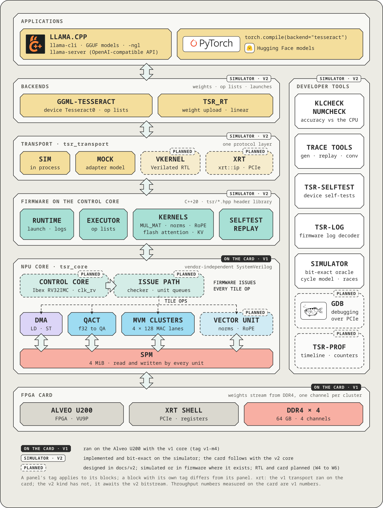

# Firmware SDK (`sw/ctrl`)

`sw/ctrl` holds the software that runs on the control core: the runtime, a header library for
issuing tile ops, the graph executor and the kernels the host launches. It is freestanding C++20
for an RV32IMC core. The same kernel sources also build for the host and push the same tile-op
stream there, so the logic of a kernel is tested without a RISC-V interpreter and the RISC-V build
stays the reference.

> **Scope.** Developer documentation of the firmware SDK as built in this tree. Status words: *on
> the simulator* means implemented here and tested against the simulator (`sw/sim`, RISC-V
> interpreter `tsr_rv`); there is no v2 RTL or bitstream yet, so nothing here has run on the card.
> Numbers are labelled with their provenance. Normative: [SW](../../docs/v2/06-software-verification.md)
> §6 (SDK) and §7 (kernels and executor), [EX](../../docs/v2/01-execution-model.md) §3 and §4 (image and
> launch protocol), [DB](../../docs/v2/05-debug.md) §6 (log and crash contract).

<p align="center"></p>

The figure shows where this directory sits: the layer between the transport (host) and the issue
path of the NPU core.

## Layout

| Path | Content |
| --- | --- |
| `CMakeLists.txt`, `cmake/` | the firmware project (its own CMake project, built with the pinned RISC-V compiler); `riscv32.cmake` toolchain file, `tsr_note.S` (the `.note.tsr` section) |
| `host/` | the main project's side: `tsr-elf` and `tsr_elf`, the `tsr_fw` external project, `tsr_fw_host` (host build of the kernels), the host backend and shim (`backend_host.cpp`, `shim_host.cpp`), `tsr_fw_image()` |
| `include/tsr/` | the header library: `kernel.hpp` (issue path, tickets, joins, `group`, `spm_ring`) over `backend_dev.hpp` (control-core MMIO) or `backend_host.hpp` (simulator hooks), `rt.hpp` (kernel ABI, `TSR_KERNEL`), `log.hpp`, `exec.hpp` (kind handler interface), `opl.hpp` (op-list format, reader, writer), `plan.hpp`, `plan_elem.hpp`, `plan_norm.hpp`, `plan_attn.hpp` (planners shared with the host backend), `traits.hpp`; `mmio.hpp`, `vu.hpp`, `at.hpp` are generated from `sw/tables/tsr_tables.py` |
| `rt/` | `crt0.S`, `runtime.cpp` (launch dispatcher), `trap.cpp`, `log.cpp`, `libc.cpp` (`memcpy`, `memset`, `memmove`, `memcmp`: the four functions GCC may call on its own), `link.ld` |
| `kernels/` | the three base kernels (`graph.cpp`, `selftest.cpp`, `replay.cpp`) and the kind handlers of the graph executor (`k_*.cpp`, `k_fast.hpp`, `zz_kind_stubs.cpp`) |
| `ref/` | host references of the kernels (`mulmat_ref`, `rmsnorm_ref`, `rope_ref`, `elem_ref`, `fattn_ref`, `kv_ref`), `selftest_abi.hpp`, `fw_sim_host.hpp` |
| `tools/` | `tsr-elf/` (image tool and library), `install-toolchain.sh` |
| `tests/` | ctest snippets (`*.cmake`), test kernels (`tests/fw/`), test drivers (`test_fw_*.cpp`), `fw_prof.h` and `fw_prof_lines.py` (RISC-V profile) |

## Toolchain and build

The RISC-V toolchain is required: configure fails without it. Install the pinned tools in user
space (no sudo) with

```sh
sw/ctrl/tools/install-toolchain.sh        # installs under build/tools/riscv
```

The pins (xPack `riscv-none-elf-gcc` 14.2.0-3, dtc, Spike, riscv-tests, riscv-arch-test) are data in
[`docs/v2/toolchain.lock`](../../docs/v2/toolchain.lock); the script verifies them and
`install-toolchain.sh --help` lists its steps. Another install root is `-DTSR_RISCV_TOOLS=<prefix>`,
another bare-metal GCC `-DTSR_RISCV_PREFIX=<dir>/bin/riscv-none-elf-`.

The main project builds the firmware as an `ExternalProject` named `tsr_fw`, after the host tool
`tsr-elf`:

```sh
cmake -S . -B build/dev -DCMAKE_BUILD_TYPE=Release
cmake --build build/dev --target tsr_fw -j2            # build/dev/fw/tsr-fw.elf and the test images
```

`-DTSR_FW_BUILD_TYPE=Debug` builds the firmware without `NDEBUG` (runtime checks such as R10's idle
test, `TSR_LOG` level DEBUG); the default is Release. Compiler warnings are errors in the firmware
project (the option `TSR_FW_WERROR` of `sw/ctrl/CMakeLists.txt` is on).

| Setting | Value |
| --- | --- |
| Architecture | `-march=rv32imc_zicsr_zifencei -mabi=ilp32`, libgcc of the `rv32imc/ilp32` multilib (integer helpers only) |
| Language | `-std=c++20 -ffreestanding -fno-exceptions -fno-rtti -fno-threadsafe-statics -fno-use-cxa-atexit -ffp-contract=off`; no libc, no libstdc++, no heap, no float (V2-SW-8) |
| Optimisation | `-Os` for the image; `-O2` for `kernels/graph.cpp` and `kernels/k_*.cpp` (V2-SW-34); the flags are recorded in `docs/v2/toolchain.lock` and the build warns when they drift |
| Link | `rt/link.ld`: ITCM at `0x0000_0000` (128 KiB), DTCM at `0x0010_0000` (64 KiB), kernel table, image id, debug flags and crash record in DTCM, log format strings at `0xF000_0000` (in the file, not loaded) |

Outputs in `build/dev/fw/`: `tsr-fw.elf` (the production image), `tsr-fw.map`, `tsr-fw.size.txt`,
`tsr-fw.logfmt.txt`, and one `<name>.elf` per test image (`tsr_fw_image(<name> SOURCES ...)`: the
production sources plus extra ones; `NO_KERNELS` keeps only `rt/`). `build/dev/fw/tsr-fw.elf` is
the default image of the host libraries; `TSR_IMAGE` overrides it.

The production image uses about 72 KB of the 128 KiB ITCM (budget 80 KiB, SW §7.8) and about 49 KB
of the 64 KiB DTCM (budget 56 KiB) with the three base kernels and every kind handler below. The
sizes change with every commit; `tsr-elf size build/dev/fw/tsr-fw.elf` prints the current ones.

## The image and `tsr-elf`

A firmware image is a static RV32 ELF with these properties (EX §3, SW §6.2): an ITCM segment (vectors
at `RV_BOOT`, reset entry at +0x80) and a loaded DTCM segment (kernel table, `.rodata`, `.data`,
image id, debug flags), the rest of DTCM zeroed by `crt0`. The table `.tsr_kernels` lists the kernels
in a fixed order (`graph` 0, `selftest` 1, `replay` 2, then others by name); the index is the
kernel number in a launch descriptor. `.note.tsr` states the SDK ABI, the control-core version and
memory sizes the image needs, so the transport can refuse an image the device does not meet.
`.tsr_id` holds the 64-bit image id (a hash of the loaded segments), which the runtime reports in
HELLO and which names the image in traces.

`build/dev/sw/ctrl/host/tsr-elf` is the tool for all of this (the CMake target is `tsr-elf`; the
same code is the library `tsr_elf` that `sw/transport` links):

```text
tsr-elf stamp IN.elf -o OUT.elf [--report F] [--logfmt F] [limits] [--strict-budget] [-q]
tsr-elf check IMAGE [limits] [--strict-budget] [--no-id] [--base]
tsr-elf id IMAGE [--stored]
tsr-elf size IMAGE [limits] [--strict-budget]
tsr-elf kernels|note|logfmt|segments IMAGE
limits: --itcm BYTES --dtcm BYTES --budget-itcm BYTES --budget-dtcm BYTES
```

`stamp` is the last step of every image build: it validates the layout, computes the id, writes it
into `.tsr_id` and produces the size report and the log-format table (`<name>.logfmt.txt`, address
and format string of every `TSR_LOG` call, for `tsr-log` and the transport's log decoder). `check`
repeats the validation rules (kernel table order, note fields, segment placement, size budget);
`id` prints the computed id (`--stored` the one in the file); `kernels`, `note`, `logfmt` and
`segments` dump the corresponding tables.

## The runtime (R1 to R10)

`rt/runtime.cpp` implements the launch dispatcher that [EX](../../docs/v2/01-execution-model.md) §4.7
defines as steps R1 to R10; `rt/trap.cpp` and `rt/log.cpp` implement the debug and log contract of
[DB](../../docs/v2/05-debug.md) §6. In short:

| Step | What the runtime does |
| --- | --- |
| R1 boot | reads the configuration, checks the kernel table, clears the queues (`QCLEAR` and a join), posts HELLO (image id, SDK ABI, kernel count) |
| R2 take | sleeps until a descriptor is in the launch queue (LQ), copies it to DTCM, pops it |
| R4, R3 validate | unknown type, reserved bits, bad kernel index or argument block: `BAD_DESC`; a launch the host cancelled or stopped before it started: `ABORTED` |
| R5 run | stages the argument block in the top 16 SPM lines when the kernel asks for one, records the launch's first push index and per-unit base sequences, calls the kernel between `TRACE_MARK` launch markers |
| R6 join | `FENCE` and join: every tile op of the launch is done |
| R7 answer | finds the first error record, picks the status by the precedence of EX §4.4, builds the answer |
| R8 post | waits for a free slot in the completion ring (LCQ), posts the answer |
| R9 recover | a unit left in error state is cleared with `QCLEAR` |
| R10 idle | back to R2 |

Traps (and `tsr::panic`) write a crash record to DTCM and a `TRAP` log record, post a `TRAP` answer
and park the core, so that the host or a debugger can read the state. `TSR_LOG(level, "fmt", ...)`
writes binary records to the log ring; the host decodes them with the format table of the image
(`tsr-log`, `TSR_LOG` in the transport).

## Kernels

A kernel is a function of the image that the host launches by index; the descriptor carries up to
seven 32-bit arguments (EX §4.3).

| Kernel | Arguments | Purpose |
| --- | --- | --- |
| `graph` | a0 op-list handle, a1 op-list bytes, a2 flags (bit 0 verify CRC) | executes an op list (OPL v1, below) |
| `selftest` | a0 test id 1 to 10, a1 data area handle, a2 area lines, a3 seed, a4 flags | card and simulator self-test programs: LD/ST on every channel, QACT, MVM, every VU and AT op, concurrency, error recovery, SPM windows, log, credits; `tsr-selftest` drives it (`sw/ctrl/ref/selftest_abi.hpp` has the data layouts and return codes) |
| `replay` | a0 `push.bin` handle, a1 record count, a2 flags (SERIAL, BUF), a3 and a4 buffer placement | replays a tile-only push stream of trace v2 through the issue port, for trace sets, SPM dumps and divergence search ([`traces/README.md`](../../traces/README.md)) |

### The graph executor and the record kinds

`graph` walks an op list: a 64-byte header, a preload table and records of one or more 64-byte slots
(layout and flags in `include/tsr/opl.hpp`, SW §7.2; at most 4,096 records per list). For each
record it checks the dependencies on earlier records, calls the handler of the record's kind with
the record's argument words and the tickets of its predecessors, and keeps the handler's returned
ticket for the records that depend on it. It joins everything at the end and returns 0 or the
failing record (index plus one) or one of the `RET_*` codes of `opl.hpp`. Lists above 4,096 SPM
lines stream through the OPL area in chunks. The executor keeps no state between launches.

| Kind | Name | Handler | Status |
| --- | --- | --- | --- |
| `0x00`, `0x01` | NOP, JOIN | built into `graph.cpp` | on the simulator |
| `0x10` | MUL_MAT | `k_mulmat.cpp` | on the simulator; emitted by the M6 backend |
| `0x11`, `0x12`, `0x13`, `0x1B` | ADD, MUL, SCALE, UNARY | `k_elem.cpp` | on the simulator, layer level; not emitted by the backend yet (W3b) |
| `0x14` | RMS_NORM | `k_norm.cpp` | as above |
| `0x15` | GLU (SWIGLU, GEGLU16, GEGLU) | `k_glu.cpp` | as above |
| `0x16` | ROPE | `k_rope.cpp` | as above |
| `0x17`, `0x1A` | GET_ROWS, CPY | `k_rows.cpp` | as above |
| `0x18` | SET_ROWS_KV | `k_kv.cpp` | as above |
| `0x19` | FLASH_ATTN | `k_fattn.cpp` | as above |

The kinds `0x20` to `0x3F` are reserved: `0x30` to `0x3F` for test kinds, the rest for M8. The M7
handlers are verified record by record against the composed references and as whole decoder layers
(`fw_m7_layer_*`, Qwen2.5-0.5B and a Gemma 4 12B shape), but the backend of this tree emits only
`MUL_MAT` lists (M6); the one-launch-per-token backend is work package W3b. An image built without
a handler's source still links: `zz_kind_stubs.cpp` defines every M7 handler weakly as "not in this
image" (`BAD_RECORD`).

The numerics of a kind are fixed by its tile-op sequence (SW §7.5), which `sw/ctrl/ref/*` and the
simulator's references implement. The planners in `plan*.hpp` are shared with the host backend, so
`supports_op` rejects exactly what the firmware cannot plan (V2-SW-20).

## Writing a kernel

<p align="center"></p>

The figure shows what `issue()` does with one tile op (the upper panel) and the queues of one
flash-attention decode layer (the lower panel).

A kernel is `extern "C" int32_t name(const tsr_args *)` plus one `TSR_KERNEL(name, nargs, flags,
blk_lines)` line that places its entry in the kernel table. It issues tile ops with `issue()` and
orders them with tickets. Return 0 for success; a negative value is `KERNEL_ERR`, a positive value
is the kernel's own status. The runtime joins all tile ops after the kernel returns (R6), so a kernel
does not have to wait for its last ops. This example copies DRAM through the SPM; it compiles with
the firmware flags of the build (checked with `riscv-none-elf-g++ ... -Wall -Wextra -Werror`) and
mirrors the test kernel `rt_copy` in `tests/fw/rt_kernels.cpp`:

```cpp
#include "tsr/kernel.hpp"
#include "tsr/rt.hpp"

using namespace tsr;

// a0 source handle, a1 destination handle, a2 lines, a3 first SPM line.
TSR_KERNEL(copy_lines, 4, 0, 0);
extern "C" int32_t copy_lines(const tsr_args * a) {
    const spm buf{a->a[3]};
    const ticket t = issue(LD(buf, from_handle(a->a[0]), a->a[2]));
    issue(ST(buf, from_handle(a->a[1]), a->a[2]), after(t));   // the ST waits for the LD's ticket
    return 0;
}
```

A scratch ring recycles SPM between tiles. `alloc()` returns the dependencies that must precede any
write to the block (the release tickets of the lines it reuses), and `release(block, ticket)` says
when the block is free again:

```cpp
namespace { spm_ring g_ring; }                  // DTCM state, rebuilt by init() in every launch

// a0 source, a1 destination, a2 tiles, a3 lines per tile, a4 ring lines.
TSR_KERNEL(copy_tiles, 5, 0, 0);
extern "C" int32_t copy_tiles(const tsr_args * a) {
    g_ring.init(0, a->a[4]);
    for (uint32_t i = 0; i < a->a[2]; ++i) {
        deps wait;
        const spm b = g_ring.alloc(a->a[3], 2, &wait);          // parity 2: any start line
        if (!valid(b)) return -1;
        const ticket t = issue(LD(b, from_handle(a->a[0]) + i * a->a[3], a->a[3]), wait);
        const ticket s = issue(ST(b, from_handle(a->a[1]) + i * a->a[3], a->a[3]), after(t));
        g_ring.release(b, s);
    }
    return 0;
}
```

What the header library provides (`tsr/kernel.hpp`; the op builders `VOP`, `RED`, `ROPE`, `SOP`,
`ATTQK` and the other VU and AT builders are generated into `vu.hpp` and `at.hpp`):

| Item | Use |
| --- | --- |
| `LD`, `ST`, `QACT`, `MVM`, `NOP`, `FENCE` and the generated builders | `constexpr` op builders; a field that does not fit is a compile error in a constant expression |
| `issue(op, deps, flags)` | pushes one op after waiting for a credit of its unit; returns the ticket the hardware assigned |
| `after(a, b)`, `deps`, `group` | at most two hardware dependencies per op; `group` keeps the latest ticket per unit and folds more than two with `SYNC` NOPs (`as_deps()`, `as_ticket()`) |
| `done(t)`, `join(t)`, `join_irq(t)`, `join2(a, b)`, `join_all()` | completion tests and waits (`join_irq` sleeps in `WFI`) |
| `error(t)`, `first_error()`, `qclear()`, `qhold()`, `qabort()` | error records and queue control |
| `spm_ring` | scratch ring with release tickets (`init`, `alloc`, `release`) |
| `spm_ptr<T>()`, `spm_lb_ptr<T>()` | RISC-V access to the SPM through the exact window or the line-buffered alias |
| `stop_requested()` | soft-stop poll (EX §4.9); a kernel that never polls runs to the end |
| `event()`, `set_info()`, `launch()` (`tsr/rt.hpp`) | kernel events (`0xC0` to `0xFF`), progress word, the running launch |
| `TSR_LOG`, `tsr::panic` | binary log records and fatal errors (`tsr/log.hpp`) |

Two rules decide whether a kernel is correct, and the tests enforce both:

- **The timing rule (SW §4.7).** Nothing that depends on timing may reach a pushed word, a
  dependency, an SPM store or the return value. `DONE_SEQ`, the credits, `QSTATUS` and `MTIME` only
  end waits. The same op stream must come out under the fixed schedule and under every random
  schedule of the simulator (`TSR_SIM_SCHED`), and on the host build.
- **Launch-stateless (SW §4.6, V2-SW-4).** A launch reads only SPM lines it wrote itself and keeps
  no state in DTCM that changes what it pushes (a ring is `init()`-ed per launch). The race detector
  reports a read of SPM that the launch did not write as `SPM_STALE`.

## Writing a record kind for `graph`

A record kind is a handler `ticket handler(const volatile uint32_t * args, uint32_t n_args,
uint32_t kflags, deps d, kind_ctx & ctx)` (`include/tsr/exec.hpp`). It reads its argument words into
locals before its first push (a push invalidates the line-buffered view of the record), plans its
tiles with `tsr/plan*.hpp`, allocates scratch from `ctx.ring`, pushes its tile ops with `issue()`
(every op depends on `d`, directly or through the other ops, and carries `ctx.push_flags`), and
returns one ticket whose completion implies that all its tile ops are done. It never joins itself
and keeps no state between launches. On arguments it cannot run it pushes nothing more and returns
`ctx.fail(opl::RET_BAD_RECORD)` or `ctx.fail(opl::RET_SCRATCH)`. This is the test kind `0x30` of
`tests/fw/exec_kinds.cpp`, registered in a test image through `tsr_exec_test_kind`:

```cpp
#include "tsr/exec.hpp"
#include "tsr/kernel.hpp"

using namespace tsr;

namespace {
ticket k_copy(const volatile uint32_t * a, uint32_t, uint32_t, deps d, kind_ctx & c) {
    const uint32_t src = a[0], dst = a[1], lines = a[2];     // all words read before the first push
    deps wait{};
    const spm blk = c.ring->alloc(lines, 2u, &wait);
    if (!valid(blk)) return c.fail(opl::RET_SCRATCH);
    group g;                                                 // fold d and wait to at most two dependencies
    g.add(d);
    g.add(wait);
    const ticket ld = issue(LD(blk, from_handle(src), lines), g.as_deps(), c.push_flags);
    const ticket st = issue(ST(blk, from_handle(dst), lines), deps{ld}, c.push_flags);
    c.ring->release(blk, st);
    return st;
}
}  // namespace

extern "C" bool tsr_exec_test_kind(uint32_t kind, kind_entry * out) {
    if (kind != 0x30u) return false;
    *out = kind_entry{&k_copy, 3u};                          // the exact argument count of this kind
    return true;
}
```

A production kind is added in four places: the kind number, argument indices and `kind_nargs()` in
`include/tsr/opl.hpp`; a planner in `include/tsr/plan_*.hpp` (so the host's `supports_op` uses the
same rules); the handler declaration in `include/tsr/exec.hpp` and the entry in the kind table of
`kernels/graph.cpp`; and the handler in a new `kernels/k_<name>.cpp` (the build picks it up by
glob; add a weak stub to `zz_kind_stubs.cpp` so images without it still link).

**Short kinds and the fast path (V2-SW-35).** The executor issues one record per decode step of a
layer, so the cost of a short record (a norm, RoPE, an activation) matters: the requirement is at
most 350 RISC-V cycles of work per record at decode shapes. A short kind has a leaf entry
`kind_<name>_fast` that the executor calls first. It follows the pattern of `kernels/k_fast.hpp`:
read the argument words in place into locals; decide with shifts and compares only (no divide) that
the record is a single-tile op with the kind's plan, otherwise return `KIND_NOT_FAST` having changed
nothing; take the executor's one-tile SPM block (`alloc_fast`, no ring record, no release); read
`ISSUE_CREDIT` once for all pushes of the record (`credits_for`); push with `issue_nc`; call nothing
on the common path. The general path (more tiles, odd shapes) is the out-of-line handler, which
starts with the same function so that both entries push the same ops. The reference short kind for
the form is `tests/fw/exec_ref_unary.cpp`.

## Host build of the kernels

`tsr_fw_host` (SW §6.8, V2-SW-25) compiles every `kernels/*.cpp` and the host shim with
`TSR_FW_HOST` defined. `tsr/backend_host.hpp` then maps the hardware access (`tsr::hw`) onto the
simulator's test hooks, so the same `issue()`, `join()` and `spm_ring` code runs against a
`tsr_sim` on the host, under ASan and UBSan in the sanitiser variants. A test binds a simulator with
`host_bind(sim)` and runs a kernel with `host_run()`, which does the runtime's R6 join and R7
first-error rule but none of the other steps. The host build and the RISC-V build push the same
words, dependencies and flags; the tests compare the two push streams. The reference stays the
RISC-V binary on `tsr_rv`.

## Tests and the performance harness

All firmware tests carry the label `fw`. List them with `ctest --test-dir build/dev -N -L fw` and
run a group with `-R`:

| Group | Tests (`fw_` prefix) | What they check |
| --- | --- | --- |
| Build and image | `elf`, `elf_asan`, `elf_link`, `elf_image`, `elf_hello`, `elf_test_image*` | `tsr-elf` and its validation rules, the linker script's checks, the production image's id, kernel table and budget, HELLO on the simulator |
| Header library | `hdr_host`, `hdr_rv`, `hdr_rv_mutant`, `hdr_constexpr` | builders against the checker, tickets, deps, `group`, `spm_ring` against a line-level model; the RISC-V image under the fixed and 7 random schedules with the race detector fatal; a mutant without the ring's wait deps must be caught; builder fields that do not fit must not compile |
| Runtime | `runtime`, `runtime_stale` | R1 to R10, every status of EX §4.4, traps, logging, cancel and stop, 0 to 7 arguments, argument blocks; a read beyond the staged argument lines is `SPM_STALE` |
| Executor and plans | `exec_rv`, `exec_host`, `exec_perf*`, `opl_m7`, `plan_cxx17` | every return code, streaming lists, preload, dependencies, error location; the planner header compiles as C++17 |
| M6 kernels | `kernels_rv*`, `kernels_host`, `selftest_sim`, `replay_sim*`, `m6_e2e`, `m6_perf` | MUL_MAT bit-exact against `ref/mulmat_ref.cpp` (shapes, addends, ACC_DST), v1 conversion identity, mutants, every selftest id, replay of the trace sets, the production image end to end |
| M7 kinds | `kernels_elem_*`, `kernels_normrope_*`, `kvfa_*`, `m7_layer_*` | element-wise, norm, RoPE, KV store and flash attention against their references under 8 schedules with the race detector fatal, against ggml-cpu for the layer outputs, and whole decoder layers |

The long sweeps (`fw_kernels_rv_v1conv_all`, `fw_kernels_rv_shapes`, `fw_replay_sim_all`, `fw_kernels_elem_rv_shapes`, `fw_kvfa_rv_slow`) carry the label `slow` too (`ctest -L slow`). The Spike and
conformance tests (`rv_*`) belong to the simulator; see [`sw/sim/README.md`](../sim/README.md).

`tests/fw_prof.h` is the profile harness. It reads the retire stream of `tsr_rv`, attributes the
RISC-V cycles of every instruction to its PC and to its access class (the control-window register it
touches, SPM, DTCM, ALU, branch), drops waits, and subtracts two list sizes so that the fixed cost of
a launch cancels. `TSR_FW_PROF=1` adds a per-function profile to `fw_exec_perf` and
`fw_kernels_normrope_perf`; `TSR_FW_PROF_DUMP=<path>` writes the per-PC histogram, and

```sh
python3 sw/ctrl/tests/fw_prof_lines.py build/dev/fw/fw_exec.elf <path>.case0 --top 40
```

maps it to source lines with `riscv-none-elf-addr2line`.

## Measured costs

Device time here is the simulator's cycle model (core cycles at the nominal 276.3 MHz kernel clock;
the control core at `clk_rv` 166.7 MHz, Ibex "maxperf" table); the card has not measured any of it.

| Quantity | Value | Provenance |
| --- | --- | --- |
| Launch: descriptor push to kernel entry, empty launch | 2.19 µs, 5.57 µs | simulator cycle model, `92f0b17` (the figures in the commit message) |
| The same two on the production image `tsr-fw.elf` (`ctest -R fw_m6_perf -V`; an empty launch is `selftest` with an unknown id) | 1.68 µs, 4.22 µs; 8 outstanding launches 4.33 µs each | simulator cycle model, tree of `a775222` |
| The same two on the test image `fw_rt.elf` (`ctest -R fw_runtime -V`; 19 kernels, an empty kernel) | 1.55 µs, 3.21 µs | simulator cycle model, tree of `a775222` |
| Executor, MUL_MAT record (Qwen2.5-0.5B decode shapes) | 1,976 to 387 RISC-V cycles | simulator cycle model, `41eb0da` (deep queues; 401 with the U200 queue depths) |
| Qwen2.5-0.5B decode layer, RISC-V time against MVM time | 110 µs to 39.5 µs, against 197 µs of MVM work; MVM issue-idle 8.1 % to 0 % | simulator cycle model, `41eb0da` |
| M7 short records at the 0.5B decode shapes (cycles of work per record, deep queues) | ADD 335, MUL 336, SCALE 305, GLU 330, UNARY 308, GET_ROWS 254, CPY 223, RMS_NORM 324, ROPE 325; every kind meets the requirement of 350 | simulator cycle model, tree of `a775222` (`ctest -R fw_exec_perf_m7 -V`) |
| M7 short records of other decode shapes | Gemma 4 per-head RMS_NORM 405 to 455, ROPE with a frequency-factor table or `freq_scale` other than 1 439 to 475: above 350 (open, SW §7.8) | simulator cycle model, tree of `a775222` (`ctest -R fw_kernels_normrope_perf -V`) |
| Qwen2.5-0.5B M7 decode layer (15 records and a join): issue loss against a near-ideal issuer | 5.1 % of the launch with the U200 queue depths, 2.1 % with deep queues, 2.5 % at a 250 MHz control core | simulator cycle model, tree of `a775222` (`ctest -R fw_m7_layer_perf -V`) |

The loss of a whole M7 decode layer comes from the 8-entry DMA queue and the planning time of
FLASH_ATTN, not from the short records ([README of docs/v2](../../docs/v2/README.md) risk 9,
SW §7.8).

## Limits

- At most 4,096 records per op list; a preload area of at most 256 lines; a launch descriptor has
  seven argument words; kernel names have at most 23 characters.
- No heap, no exceptions, no floating point in the firmware: every `f32` value that must be
  computed goes through a VU or QACT op, or is carried as bits.
- A launch reads only what it wrote (launch-stateless); the runtime stages the argument block in
  the top 16 SPM lines.
- Image sizes are bounded by the ITCM and DTCM of the control core and by the budget of SW §7.8
  (test images only by the ITCM).
- The firmware has run only on the simulator's RISC-V interpreter. The `tsr_rv` cycle model is
  informational; Ibex's own timing is a W5 check (RVFI lockstep against the RTL).
