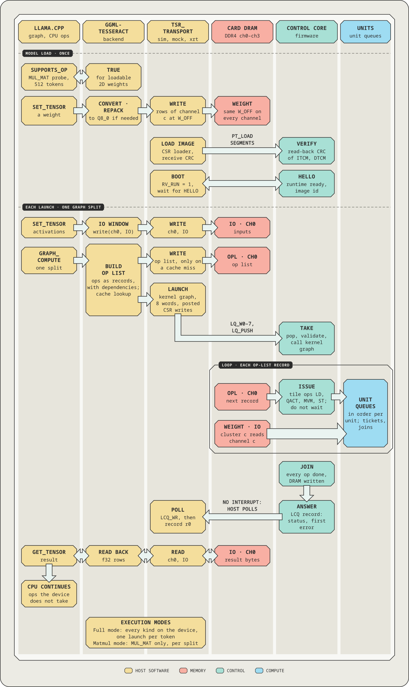

# Transport (`sw/transport`)

`tsr_transport` is the only target-dependent part of the host software. It connects a host process
to one Tesseract device: it binds the channel memory, loads a firmware image into the control core,
boots it, launches kernels and collects their answers. The ggml backend, `tsr_rt`, `klcheck`,
`numcheck`, `tsr-selftest` and the trace tools all use it, and every device kind (`sim`, `mock`,
`vkernel`, `xrt`) runs the same register protocol.

> **Scope.** Developer documentation of the transport as built in this tree. Status words: *on the
> simulator* means implemented and tested against the simulator. The `xrt` kind is written and
> unit-tested against XRT's no-op shim only; no firmware kernel has run on the card yet. Normative:
> [EX](../../docs/design/01-execution-model.md) §10 (the API), §2 to §4 (launch protocol), §8 (errors and
> recovery); [SW](../../docs/design/06-software-verification.md) §9.1 and §9.2;
> [DB](../../docs/design/05-debug.md) §7 (recovery ladder) and §9 (transport debug). The
> [`docs/xrt-host.md`](../../docs/xrt-host.md) document covers the card side.

<p align="center"></p>

## Layers

```text
tsr_transport.h   C API: open, close, config, write, read, csr, image, boot, launch, wait, cancel, ...
  tsr_transport.c    dispatcher: opens the kind named by TSR_DEVICE
  tsr_kdev.cpp       protocol layer, one implementation for every kind (open, bind, boot with VERIFY,
                     launch, wait, recovery ladder, TRAP handling, log)
  tsr_image.cpp      firmware images: segments, CRC, .note.tsr, symbols and DWARF lines
  tsr_logdec.cpp     decoder of the device log (binary records to text)
  tsr_mon.{h,cpp}    the live monitor record: the process that owns the device publishes counters in /dev/shm/tsr-mon-<pid> for
                     tsr-top (SW-87, docs/prof-dbg.md §7)
    kdev (tsr_kdev.h)   raw access to one kernel: registers, channel memory, a time base
      sim      tsr_kdev_sim.cpp        the simulator in-process behind the core CSR port, no adapter
      mock     tsr_kdev_mock.cpp       the sim kdev inside a model of the ap_ctrl_none adapter, with fault injection
      vkernel  tsr_kdev_vkernel.cpp    client of the Verilated kernel in a server process
      xrt      tsr_transport_xrt.cpp   the Alveo card through xrt::ip and one device-only buffer per channel
```

The protocol layer talks to a kdev through five operations: 32-bit register read and write (the
adapter registers and the core CSR window at `0x1000`), channel memory read and write, and a time
base. Everything else (what a launch is, how long to wait, what to do when the device does not
answer) is the protocol layer, so a behaviour tested on `sim` is the behaviour on the card.

## API

`tsr_transport.h` is EX §10.1 plus the conveniences of SW §9.1. Every call returns 0 or a negative
`TSR_TE_*` code and prints a message on stderr; `tsr_transport_strerror()` names a code.

| Call | Does |
| --- | --- |
| `tsr_transport_open(kind)` | opens `kind`, or `$TSR_DEVICE`, or `sim`; checks the identity (ID, Tesseract Core capability major 1, a control core (`CTL_ID` ≠ 0), configuration, capabilities, `RV_FREQ`), clears `ADAPTER_STATUS`, then `SOFT_RESET` and binds the channel buffers (`MEM_EN`), unless `TSR_ATTACH=1` |
| `tsr_transport_close`, `_name`, `_config` | close; kind name; the configuration as read from the CFG and CAPS registers |
| `tsr_transport_write`, `_read` | channel DRAM, byte offset and size of any alignment (the kdev's DMA rules are applied underneath) |
| `tsr_transport_csr_read`, `_csr_write` | raw core CSR access (offsets below `0x1000`) for PERF, debug and tools |
| `tsr_image_open`, `_close`, `_kernel`, `_id`, `tsr_image_open_default` | parse and check a firmware image (segments, kernel table, kind table, `.note.tsr` with this host's Basis ABI and a Basis version, stored id equals computed id); kernel index by name; the default image is `$TSR_IMAGE`, else the build's `tsr-fw.elf` |
| `tsr_transport_boot(t, img)` | refuses an image whose requirements the device does not meet; `VERIFY` of every ITCM segment and a cold load (receive CRC, `VERIFY` CRC) of those that differ; DTCM always reloaded and verified; releases the control core and waits for HELLO (image id, Basis ABI, kind table signature, kernel count, Tesseract Basis version). A matching image already in the ITCM is a warm start |
| `tsr_transport_launch(t, &launch, &seq)` | pushes a descriptor (kernel index, flags, seven arguments) into the launch queue and returns its sequence number; blocks only while the queue (depth 8) is full |
| `tsr_transport_wait(t, seq, timeout_ns, &rec)` | waits for the answer of one launch; reads only the words EX §4.8 requires for an OK answer; on a timeout runs the recovery ladder |
| `tsr_transport_call` | launch and wait |
| `tsr_transport_cancel`, `_stop` | the cancel (hard) and stop (soft) watermarks of EX §4.9 |
| `tsr_transport_set_event_cb` | callback for kernel events (`0xC0` to `0xFF`) and other unsolicited records |
| `tsr_transport_soft_reset` | `CTRL.SOFT_RESET`; the control core stays in reset, boot again (warm) |
| `tsr_transport_log_drain` | the raw log words (oldest first) that the transport drained earlier and kept, then the device ring |
| `tsr_record_decode`, `tsr_status_name` | decoded view of an answer record |
| `tsr_transport_get_stats` | launches, wall time, CSR accesses, DRAM bytes, log words |
| `tsr_transport_dmi_enable`, `_dmi_read`, `_dmi_write` | DB §9.2: the DMI window (`DBG_CFG.DMI_EN`, debug-module register r at `0xC00 + 4r`) for `libtsr_dbg` |
| `tsr_transport_now_ns`, `_idle` | the time base, and a pause in it (the simulated kinds advance the model) for a debugger polling a running hart |
| `tsr_transport_poll` | the non-blocking form of `_wait` (no timeout, no recovery ladder) |
| `tsr_transport_set_debugger` | a debugger is attached: debug-aware waits, a TRAP leaves the device trapped |
| `tsr_transport_set_debug_service` | registers the embedded debug service that `TSR_GDB` / `TSR_DEBUGGER` start at open (`libtsr_dbg`) |
| `tsr_transport_describe` | the device layer's description, one item per line (no device access) |
| `tsr_transport_perf_summary`, `tsr_perf_summary_str` | DB §8.6: PERF accumulated over the session (folded in before each `SOFT_RESET`) and its `TSR_STATS` text |

A minimal use (the same shape as `tsr_rt`, `tsr-selftest` and the tests):

```c
tsr_transport * t = tsr_transport_open(NULL);                    // $TSR_DEVICE or sim
tsr_image * img;  tsr_image_open_default(&img);
tsr_transport_boot(t, img);
tsr_launch l = { .type = TSR_DESC_TYPE_LAUNCH, .kernel = (uint16_t) tsr_image_kernel(img, "graph"),
                 .arg = { opl_handle, opl_bytes, 0 } };
tsr_record rec;
tsr_transport_call(t, &l, TSR_TIMEOUT_DEFAULT, &rec);
tsr_result r;  tsr_record_decode(&rec, &r);                      // r.status, r.ret, r.err_*
```

**The protocol in brief** (the register map and the rules are EX §3 to §5; the protocol layer is the
only code that follows them):

1. *Open.* Read the identity and configuration registers and check them, clear `ADAPTER_STATUS`
   (adapter kinds), `SOFT_RESET`, write the channel base addresses (`ch<c>_base`) and set `MEM_EN`
   (adapter kinds).
2. *Load.* `VERIFY` every ITCM segment against the image through `LOAD_ADDR`, `LOAD_COUNT`,
   `LOAD_CTRL` and `LOAD_CRC`; cold-load each one that does not match (`LOAD_DATA`, receive CRC, then
   a `VERIFY` CRC); reload and verify every DTCM segment. When no ITCM segment had to be written the
   start is warm.
3. *Boot.* Write `RV_BOOT`, raise `RV_RUN`, and read the completion ring until the HELLO record
   arrives (image id, Basis ABI, kind table signature, kernel count and Tesseract Basis version, all checked).
4. *Launch.* Write the eight descriptor words into the launch queue registers `LQ_W0` to `LQ_W7`
   (only the words that differ from the host's shadow of them) and write `LQ_PUSH`. The host keeps
   its own count of free queue slots, so a launch reads nothing from the device.
5. *Wait.* Poll `LCQ_WR` with a bounded backoff, read the record words of the oldest answer, advance
   `LCQ_RD`; kernel events and TRAP records are handled as they appear; drain the log ring
   (`LOG_WR`, `LOG_RD`) while waiting and on every error.
6. *Cancel and stop.* Write the `LQ_CANCEL` or `LQ_STOP` watermark; the firmware or the queues answer
   the covered launches `ABORTED` or `STOPPED`.
7. *Recover.* On a timeout or a trap: dump (if enabled), cancel, soft reset and warm restart.

**Time.** On `sim`, `mock` and `vkernel` every timeout and the poll policy count device time (core
cycles at the nominal 276.3 MHz kernel clock), so results and recoveries do not depend on the
load of the host. On `xrt` they count host time. A timeout does not count while the control core is
halted by a debugger or a tile stop is active.

**Threads.** One mutex per transport serialises the calls. `tsr_transport_wait` releases it between
polls, so another thread of the process (the debug service of DB) can use the device while a launch
waits. The event callback runs on the waiting thread with the mutex held and may call the
transport (the mutex is recursive).

**Errors.**

| Code | Meaning |
| --- | --- |
| `TSR_TE_INVAL` | bad argument or misuse (unknown or already waited sequence, no image) |
| `TSR_TE_IO` | a device access failed (kdev error, connection lost) |
| `TSR_TE_TIMEOUT` | the wait timed out; the device was diagnosed and recovered |
| `TSR_TE_LOST` | the launch was flushed by a `SOFT_RESET` or restart without an answer |
| `TSR_TE_DEVICE` | device failure: a unit hung ("card reset needed"), no `clk_rv`, reset stuck |
| `TSR_TE_IMAGE` | image refused: requirements, CRC or `VERIFY` mismatch, HELLO checks |
| `TSR_TE_STATE` | wrong device state for the call (not booted, trapped, failed) |

**Recovery.** A wait that times out runs the ladder of DB §7.3: a hang dump when `TSR_DUMP_DIR` is
set (level 0), `LQ_CANCEL` and a wait for the aborted answers (level 2), then `SOFT_RESET` and a
warm restart (level 3). A `TRAP` answer returns 0 with the trap record after the log was drained and
the trap decoded (program counter to function and source line with the image's DWARF); the
transport then restarts the device unless `TSR_GDB_WAIT` is set. Launches flushed by a reset
return `TSR_TE_LOST`.

## Kinds

| Kind | Status | Notes |
| --- | --- | --- |
| `sim` | on the simulator | the default; the simulator in-process behind the core CSR port, no adapter registers; the host triggers time (a read of the completion ring runs the model until something happens), so results are deterministic and independent of host timing |
| `mock` | on the simulator | `sim` inside a register model of the `ap_ctrl_none` adapter (`ch<c>_base`, `MEM_EN`, `ADAPTER_STATUS`, `ADAPTER_VERSION`), with configurable DMA rules (alignment, chunk size, bounce buffer) and fault injection; tests the protocol layer and the tools on the hardware register path |
| `vkernel` | planned (P5.3) | the client of the Verilated kernel server exists; the open fails with "not available until P5.3" because no two-clock server exists (`TSR_VKERNEL_SERVER` or `TSR_VKERNEL_SOCKET` name one) |
| `xrt` | written, not yet run with the control core | built with `-DTSR_WITH_XRT=ON`; opens the kernel through `xrt::ip` (exclusive access, no `xrt::kernel`, no `xrt::run`: the kernel is `ap_ctrl_none`), refuses an xclbin that breaks the kernel contract; unit-tested against XRT's no-op shim (`transport_xrt_noop`, when XRT is configured). The card runs of M0, M3 and M4 were made before the control core was added; the card path is work package W6 |
| registered | any | `tsr::register_kdev(kind, factory)` adds a kind at run time; the built-in names are refused |

## Environment

Read at open; a malformed value makes the open fail with a message and is never silently ignored.

| Variable | Default | Effect |
| --- | --- | --- |
| `TSR_DEVICE` | `sim` | the kind: `sim`, `mock`, `vkernel`, `xrt` or a registered one (also read by `tsr_rt`, `klcheck`, `tsr-numcheck`, `tsr-selftest` and the ggml backend) |
| `TSR_IMAGE` | the build's `fw/tsr-fw.elf` | firmware image of `tsr_image_open_default` (host libraries, `tsr-log`, `tsr-trace-replay --device`) |
| `TSR_LAUNCH_TIMEOUT_MS` | 60000 | default wait timeout; 0 disables it |
| `TSR_ABORT_MS` | 10000 | how long the ladder waits for the answers of cancelled launches |
| `TSR_BOOT_MS` | 2000 | wait for HELLO after boot |
| `TSR_RESET_MS` | 15000 | wait for `SOFT_RESET` to finish |
| `TSR_LOG` | off | `stderr` or a file: decode the device log there |
| `TSR_LOG_LEVEL` | 3 | `LOG_CFG.LEVEL`, 0 (fatal) to 5 (trace) |
| `TSR_ATTACH` | 0 | `1`: open without `SOFT_RESET` and bind, for diagnosis of a running device |
| `TSR_STATS` | 0 | `1`: transport statistics and the DB §8.6 PERF summary on stderr at close |
| `TSR_MON`, `TSR_MON_DIR`, `TSR_MON_PERF_MS`, `TSR_MON_KEEP`, `TSR_MON_MODEL` | on | the live monitor record (`tsr_mon.h`, SW-87): `0` turns it off; its directory (`/dev/shm`); the least ms between two PERF reads (100); keep the file at exit; the model name |
| `TSR_DUMP_DIR` | off | directory for hang dumps (`hang-<pid>-<n>/state.json` with every EX, Q, PERF and DBG register and the completion ring) |
| `TSR_GDB_WAIT` | off | `boot` or `launch`: after a trap leave the device in the trapped state instead of restarting it; with the embedded debug service also halt at boot or at the first launch for GDB |
| `TSR_TILE_SERIAL`, `TSR_TILE_HIST` | unset | `0` or `1`: set or clear serial mode and the dispatch history in `DBG_CFG` at open |
| `TSR_SIM_VU` | 1 | `sim` and `mock`: 0 = the core of `tsr_u200_k4` (no vector unit, no attention): CAPS 0 and no VU queue (`docs/platform-u200.md` §8.7) |
| `TSR_SIM_TMAX`, `TSR_SIM_CH_GIB`, `TSR_SIM_THREADS`, `TSR_SIM_DRAM_DIR` | 1, 16, `min(CPUs, 8)`, off | `sim` and `mock`: `T_MAX` of the simulated core, channel size in GiB, MVM worker threads, file-backed DRAM (see [`sw/sim/README.md`](../sim/README.md) for the simulator's own `TSR_SIM_*` and `TSR_TRACE`) |
| `TSR_MOCK_NUM_CH`, `TSR_MOCK_TMAX`, `TSR_MOCK_CH_GIB` | 4, 1, 16 | `mock`: channels, `T_MAX`, channel size |
| `TSR_MOCK_DMA_ALIGN`, `TSR_MOCK_DMA_CHUNK_KIB`, `TSR_MOCK_DMA_BOUNCE` | 1, 65536, 0 | `mock`: DMA alignment (power of two up to 4096), largest raw transfer in KiB, bounce every transfer |
| `TSR_MOCK_INJECT`, `TSR_MOCK_TCM_FAULT`, `TSR_MOCK_HANG` | off | `mock` fault injection: adapter errors at open or at the N-th launch push, a TCM word that does not hold what was written (caught by `VERIFY`), a unit that hangs at the N-th push |
| `TSR_VKERNEL_SERVER`, `TSR_VKERNEL_SOCKET` | unset | `vkernel`: command line of a server to spawn, or the path of a Unix socket one listens on |
| `TSR_XCLBIN` | required | `xrt`: the xclbin to load |
| `TSR_XRT_DEVICE`, `TSR_XRT_KERNEL` | 0, `tsr_u200_k4` or `tsr_u200_k1` | `xrt`: device index or PCIe address; kernel name |
| `TSR_XRT_CH_GIB`, `TSR_XRT_DMA`, `TSR_XRT_DMA_CHUNK_MIB`, `TSR_XRT_DMA_ALIGN` | bank size up to 16, `direct`, 64, 1 (64 for `staged` and `m2m`) | `xrt`: channel buffer size; DMA mode `direct`, `staged` (aligned bounce buffer) or `m2m`; largest DMA in MiB; DMA alignment. With `XCL_EMULATION_MODE=hw_emu` the defaults are 3, `staged` and 4096 (two Vitis 2024.2 emulation defects) |

`TSR_GDB` and `TSR_DEBUGGER` start the embedded debug service when the program links it
(`libtsr_dbg`'s `tsr_dbg_embed`, `sw/tools/dbg`; otherwise one note, ignored). `TSR_PROF`,
`TSR_PROF_TRW_MIB`, `TSR_PROF_EVERY`, `TSR_PROF_RV_SAMPLE_US` are not wired into the owning
processes yet (one note, ignored); `tsr-prof trw` runs its own launches. Boot waits (HELLO) count no
time while the hart is halted (halt-on-boot). The ggml backend adds its own variables (`TSR_STATS` for its host-time split, `TSR_STAGE_KIB`,
`TSR_LOAD_THREADS`, `TSR_OPL_CRC`, `TSR_FORCE_HOST`, `TSR_DEBUG`; see
[`sw/ggml-tesseract/README.md`](../ggml-tesseract/README.md)).

## Tests

| Test | What it checks |
| --- | --- |
| `transport_kdev` (`test-tsr-kdev`) | the protocol layer on the mock kdev: identity checks and adapter faults at open, bind (`MEM_EN`, misaligned base, locked base, held requests), timeouts, a stale core at open (with and without `TSR_ATTACH`), adapter errors during a launch, a hung unit, the kdev registry and `TSR_MOCK_*` parsing, and the chunked, aligned transfer engine under DMA rules from alignment 1 to 4096 |
| `transport_protocol` (`test-tsr-protocol`) | one binary for every kind it can run: cold and warm boot, image-id mismatch, `.note.tsr` refusal, `VERIFY` with an injected TCM fault, PING, zero to seven arguments, `BAD_DESC`, eight outstanding launches and the credit rule, queue overflow, events while waiting, the log (decode, drop), cancel and stop, `SOFT_RESET` mid-launch, the debug-aware timeout with a halted core, the recovery ladder, TRAP handling, minimal against full record reads; records and DRAM identical across the kinds; the EX §4.11 numbers on `sim`. Skipped (77) when the firmware images are missing |
| `transport_xrt_noop` (`test-tsr-xrt-noop`) | the xrt kdev against XRT's userspace with its no-op shim: xclbin load, discovery of kernel, arguments and memory banks, `xrt::ip` with exclusive access, device-only buffers, refusal of xclbins that break the contract. Defined only when `-DTSR_WITH_XRT=ON` and `libxrt_noop.so` exists |
| `sim_transport` | the simulator's CSR port as the transport uses it |
| `transport_ggml_e2e_mock`, `_mock_tmax8` | the ggml backend end to end on the mock kdev |
| `tools_selftest_mock*`, `tools_log_selftest`, `tools_trace_replay_device` | `tsr-selftest`, `tsr-log` and `tsr-trace-replay --device` on the mock kdev |

Run them with `ctest --test-dir build/dev -R 'transport_|tools_selftest|tools_log'`.

## Adding a kdev

Derive from `tsr::kdev` (`tsr_kdev.h`): implement `name()`, `num_ch()`, `ch_bytes()`, `ch_addr()`,
`reg_read()`, `reg_write()`, `mem_write()` and `mem_read()`; override `now_ns()` and `idle()` when
time is simulated (`simulated()` returns true then, and the protocol calls `idle()` with its mutex
held), `has_adapter()` when there are no adapter registers, and `sim()` when a simulator sits behind
the kind. Register a factory with `tsr::register_kdev("mykind", factory)` and select it with
`TSR_DEVICE=mykind`. The protocol layer needs nothing else; `test_kdev.cpp` shows registration and
the faults a kdev has to survive.

## Limits

- `vkernel` is not available until the two-clock server exists (P5.3), and `xrt` has not run a
  firmware kernel: only `sim` and `mock` carry the measured results of this tree.
- The launch queue and the completion ring have eight entries; `tsr_transport_launch` blocks when
  eight launches are outstanding.
- PCIe MMIO read latency, which sets the real cost of a wait poll, is not measured; the numbers of
  EX §4.11 are estimates until the card runs.
